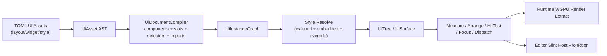

# Zircon UI 资产化 Widget Editor 与共享 Layout/Style/Event 详细方案

## Summary
- 目标是把现有 `zircon_runtime::ui` 模板链路升级为正式的 `UI 资产系统`，并把 `UI Asset Editor` 收束为 `zircon_editor/src/ui` 下的作者态活动窗口，用于编辑运行时 UI 和编辑器 UI。
- 已锁定的核心原则是：`editor/runtime 共用同一套 UI 资产描述、组件定义、slot 语义、样式规则、布局求解与事件路由`，差异只允许存在于最终宿主投影与渲染后端，运行时走 `wgpu`，编辑器走 `Slint host`。
- 现有基础会被保留并演进，而不是推倒重来：当前 [UiAssetDocument](/E:/Git/ZirconEngine/zircon_runtime/src/ui/template/asset/document.rs)、[EditorUiHostRuntime](/E:/Git/ZirconEngine/zircon_editor/src/ui/template_runtime/runtime/runtime_host.rs)、[UiAssetEditorSession](/E:/Git/ZirconEngine/zircon_editor/src/ui/asset_editor/session/ui_asset_editor_session.rs) 是迁移起点，不再停留在“手写模板 + 手写绑定注册”的阶段。
- 设计参考以 Unreal `WidgetBlueprint + WidgetTree + PanelSlot` 为主导，以 Godot `Control + Theme` 和 Fyrox `Widget + Style` 作为稳定化参考；Slint 只继续承担宿主显示层职责，不再承担布局和事件真源。

## Architecture
- `zircon_runtime::ui` 作为共享权威层，承载 UI 资产 AST、组件定义、slot 合约、样式表、selector 解析、样式求值、组件实例化、UI tree 编译与共享 preview/runtime surface。
- `zircon_runtime::asset` 负责把 UI 相关资源注册为正式资产类型，并支持 `layout/widget/style` 三类资源的加载、引用、热重载和依赖追踪。
- `zircon_editor/src/ui/asset_editor` 作为 editor-only 作者态域，承接 `UI Asset Editor` 的 route、window descriptor、reflection DTO、会话、预览、源码、undo、样式、树编辑、资源提升与工作区同步。
- `zircon_editor/src/ui/host` 和 `zircon_editor/src/ui/workbench` 作为宿主编排层，负责 ActivityWindow 注册、资产工作区入口、document tab/floating/exclusive page 宿主、Slint 投影与 editor binding dispatch。
- `zircon_editor/src/core` 只保留编辑状态机、intent/history、event runtime 与薄委托，不再直接拥有 UI host/layout/view/window/session 实现。
- 共享执行链路固定为：



- `ActivityWindow` 中的 `UI Asset Editor` 只是这条链路的编辑宿主，不是另一套私有 UI 系统。
- V1 的共享语义覆盖 `Container`、`Overlay`、`HorizontalBox`、`VerticalBox`、`FlowBox`、`GridBox`、`ScrollableBox`、`Space`、`Label`、`Image`、`Button`、`TextField`、`Canvas`；editor-only 界面通过这些共享基础控件和组件资产组合出来，不新增 editor-only 布局原语。

## Asset Model
- UI 资源统一使用 TOML 作为源码权威格式，文件后缀统一采用 `.ui.toml`，通过 `[asset.kind]` 区分 `layout`、`widget`、`style`。
- `layout` 代表可直接挂载为一棵 UI surface 的页面或面板资源。
- `widget` 代表可复用组合组件，支持参数、命名 slot、默认内容和局部样式。
- `style` 代表独立样式资源，供多个 `layout/widget` 共享引用。
- 资源头固定包含：`kind`、`id`、`version`、`display_name`，文档级固定包含 `imports`、`tokens`、`root`、`components`、`stylesheets`。
- 结构采用“递归树形 TOML + 显式稳定 `node_id`”作为唯一权威，不再以旧的 `节点注册表 + 根节点引用 + 子边表` 作为正式格式。
- 每条子边以 `[[children]]` 内嵌保存，边上的 `mount` 与 `slot` 跟随子节点一起序列化，避免父子结构与节点表分离后产生漂移。
- 每个节点固定有稳定 `node_id`，不使用运行时顺序号作为持久化主键。
- 节点定义固定区分三种实例来源：
  - `native`：共享基础 widget，例如 `Button`、`VerticalBox`。
  - `component`：当前文档内定义的本地组件实例。
  - `reference`：外部 `widget` 资产引用，可带参数和 slot 填充。
- 每个节点固定包含：
  - `type` 或 `component_ref`
  - `classes`
  - `props`
  - `layout`
  - `bindings`
  - `style_overrides`
  - `children`
- 每条父子边固定包含：
  - `node`
  - `mount`
  - `slot`
- `mount` 表示命名 slot 注入位置，服务于 React-like composition 和 Unreal named slot。
- `slot` 表示父级对该子项的放置语义，服务于 Unreal PanelSlot 能力；它不是子节点自己的私有属性。
- `layout` 表示节点自身的布局约束与容器配置，保留现有 shared layout contract 的语义，例如 `width/height constraints`、`container kind`、`scroll`、`clip`。
- `widget` 资产支持：
  - `params`：类型化参数，允许实例传值。
  - `slots`：命名 slot，支持 `required`、`multiple`、默认内容。
  - `root`：组件内部根节点。
  - `style_scope`：默认 `closed`，外部样式默认不能穿透外部组件引用边界。
- `reference` 节点只能修改外部 widget 的：
  - 参数
  - 填入的 slot 内容
  - 根实例 classes
  - 根实例 style_overrides
- `reference` 节点不能直接在父文档里改写被引用资源内部私有节点；要编辑内部结构只能双击打开源资源。
- 现有 `UiTemplateDocument component/template/slot` 语法保留为兼容子集，通过 `legacy adapter` 转换到新 AST，旧模板不会立刻失效。

### Canonical TOML 形态
```toml
[asset]
kind = "layout"
id = "editor.ui_asset_editor"
version = 2
display_name = "UI Asset Editor"

[imports]
widgets = ["asset://ui/common/editor_widgets.ui#ToolbarButton"]
styles = ["asset://ui/theme/editor_base.ui", "asset://ui/theme/docking.ui"]

[tokens]
panel_gap = 12
accent = "$color.blue.500"

[root]
node_id = "editor_root"
kind = "native"
type = "VerticalBox"
classes = ["editor-shell"]
layout = { width = { stretch = "Stretch" }, height = { stretch = "Stretch" }, container = { kind = "VerticalBox", gap = 0 } }

[[root.children]]
slot = { }

[root.children.node]
node_id = "toolbar"
kind = "reference"
component_ref = "asset://ui/common/editor_widgets.ui#TopToolbar"
classes = ["toolbar"]

[[root.children]]
slot = { }

[root.children.node]
node_id = "body"
kind = "native"
type = "HorizontalBox"
layout = { width = { stretch = "Stretch" }, height = { stretch = "Stretch" }, container = { kind = "HorizontalBox", gap = 0 } }

[[root.children.node.children]]
slot = { width = { preferred = 260, stretch = "Fixed" } }

[root.children.node.children.node]
node_id = "palette_panel"
kind = "native"
type = "VerticalBox"
classes = ["palette-panel"]

[[root.children.node.children]]
slot = { width = { stretch = "Stretch" } }

[root.children.node.children.node]
node_id = "designer_panel"
kind = "native"
type = "Canvas"
classes = ["designer-panel"]

[[stylesheets]]
id = "local_editor_rules"

[[stylesheets.rules]]
selector = ".toolbar > Button.primary:hover"
set = { self.background.color = "$accent", self.text.color = "$color.white" }

[[stylesheets.rules]]
selector = "#palette_panel"
set = { self.layout.width.preferred = 260, self.background.color = "$color.gray.900" }
```

## Style System
- 已锁定 V1 样式模型为 `选择器样式表`，并且同时支持 `独立 style 资产` 与 `单文件内嵌 stylesheets`。
- 样式求值顺序固定为：
  - widget 内建默认样式
  - imported 外部 style 资产，按 import 顺序
  - 当前文档内嵌 stylesheets，按声明顺序
  - 节点 `style_overrides`
  - 编辑器运行时临时预览 override，不落盘
- 同一层内部冲突规则固定为：`specificity > declaration order`。
- V1 selector grammar 固定支持：
  - 类型选择器：`Button`
  - class：`.primary`
  - id：`#save_button`
  - 状态伪类：`:hover`、`:focus`、`:pressed`、`:checked`、`:selected`、`:disabled`
  - 组合器：后代空格、直接子代 `>`
  - 作用域根：`:host`
- V1 不支持：
  - sibling selector
  - `nth-*`
  - 任意属性表达式查询
  - `calc()`
  - 浏览器式 media query
- 样式声明允许同时修改：
  - `self.*`：节点视觉、文本、图标、尺寸约束、container config、interaction flags
  - `slot.*`：父级对子项的放置参数，例如 padding、alignment、row/column/span、anchor/pivot/position/z
- 这保证“像 CSS 一样复用共同布局描述，同时允许局部 override”能覆盖布局层，而不是只覆盖颜色字体。
- 任何影响布局的样式字段变更必须触发布局脏标记；只影响视觉的样式字段只触发渲染脏标记。
- 样式 token 固定支持：
  - 文档内 `tokens`
  - 外部 `style` 资产内 tokens
  - 主题链合并
- token 解析只允许常量引用，不允许表达式语言。
- 外部 `widget` 资产默认形成样式边界；父文档样式默认只能命中被引用实例根节点，不能穿透其内部私有节点。
- 如果某个组件需要允许外部主题深度控制，只能显式把 `style_scope = "open"`，不能默认全局可穿透。

## Layout, Slot, Event, Component Semantics
- 主布局系统固定为 retained-tree auto layout，仍然沿用你现有文档中的 `measure desired_size -> arrange frame` 两段式求解。
- `AutoLayout` 是默认布局模式；所有节点先得到内在需求尺寸，再由父容器按约束和 slot 规则分配最终 frame。
- slot 语义固定按父容器类型决定：
  - `HorizontalBoxSlot` / `VerticalBoxSlot`：padding、alignment、fill/stretch、cross-axis 对齐。
  - `OverlaySlot`：anchor、pivot、position、z_index、alignment。
  - `GridSlot`：row、column、row_span、column_span、alignment。
  - `FlowSlot`：可选换行和对齐提示。
  - `ScrollableBoxSlot`：主要沿用通用 slot，滚动和虚拟化配置属于父容器。
- `min/max/preferred/priority/weight/stretch_mode` 继续作为共享核心约束类型存在。
- 组件复用语义固定为：
  - `widget` 资产像 React 组件一样声明参数和可组合内容。
  - `mount`/命名 slot 像 Unreal named slot 一样承接子树。
  - 子项在父里的布局仍然由 slot 决定，不把父布局规则反灌到组件内部。
- 组件实例可以在编辑器中执行这些操作：
  - 修改参数
  - 填入命名 slot 内容
  - 追加 class
  - 局部 style override
  - 跳转打开源 widget 资源
- 组件实例不能在父文档里直接展开并篡改内部私有树；如需局部定制，必须“转成本地副本”或“打开引用源”。
- 事件系统继续以共享 `UiEventKind` 为权威，节点上的 `bindings` 不再直接写宿主 callback 名字，而是写结构化 action target。
- `bindings` 的目标统一为共享 `UiActionRef` 风格语义；editor 侧会映射到 `EditorUiBindingPayload`，runtime 侧会映射到 UI 命令、脚本回调或游戏逻辑入口。
- 命中、冒泡、阻止、穿透、捕获、焦点、导航的规则保持此前共享 UI 架构计划不变；UI 资产编辑器本身也复用这套 dispatch。

## UI Asset Editor ActivityWindow
- 新增 `ActivityWindow` 固定命名为 `editor.ui_asset`，标题 `UI Asset Editor`，`multi_instance = true`，支持 `document tab`、`exclusive page`、`floating window`，默认宿主为 document center。
- 同一编辑器窗口可打开三类资源：
  - `layout`
  - `widget`
  - `style`
- `layout/widget` 默认打开 Design 模式；`style` 默认打开 Style 模式，但仍支持 preview。
- 界面结构固定为六区：
  - `Palette`：共享基础 widget、本地组件、外部 widget 资产、常用 layout pattern。
  - `Hierarchy`：树形节点和命名 slot 结构。
  - `Designer Canvas`：可交互预览画布，显示 frame、slot overlay、selection overlay、drop target。
  - `Inspector`：`Widget`、`Slot`、`Layout`、`Style`、`Bindings` 五类属性。
  - `Stylesheet Panel`：rule 列表、selector 编辑、matched rules 链、token inspector、pseudo-state preview。
  - `Source Panel`：TOML 文本源码，支持 Split 模式。
- 顶部模式切换固定为：
  - `Design`
  - `Split`
  - `Source`
  - `Preview`
- `Design` 是主要工作流；`Split` 模式必须与 Android Studio XML 编辑类似，左侧设计右侧 TOML，同步选中与跳转。
- `Source` 编辑规则固定为：
  - 打开文档时构建 AST 作为会话权威。
  - 手动修改源码后先 parse/validate。
  - 解析成功才刷新 preview 与 inspector。
  - 解析失败时保留最后一个有效预览快照，并在 source panel 显示结构化诊断。
  - 保存时统一使用 canonical serializer 输出，不承诺保留手写注释与表顺序。
- 画布交互固定为：
  - 单击选择节点。
  - 双击外部 widget 引用时打开引用源资源。
  - 从 Palette 拖入时插入新节点或新引用节点。
  - 在 Hierarchy 中拖拽时执行重排或重挂载，只有目标容器 slot 合约允许时才可落下。
  - 可执行 `Wrap In Container`、`Unwrap Container`、`Extract Component`、`Promote To External Widget Asset`、`Convert To Reference`。
- 选中逻辑固定为：
  - Hierarchy、Canvas、Inspector、Source 四处选中联动。
  - 选中子项时 Inspector 同时展示 `Widget props` 和 `Parent slot props`。
  - 多选只允许同一父节点下的兄弟节点，用于批量移动、抽组件、抽样式类。
- Inspector 规则固定为：
  - `Widget` 页显示组件类型、classes、props、bindings。
  - `Slot` 页按父容器动态切换字段，不显示不适用属性。
  - `Layout` 页显示节点自身的宽高约束、container config、scroll/clip/virtualization。
  - `Style` 页显示 class 列表、inline overrides、matched selector 链与 specificity。
  - `Bindings` 页显示事件与动作目标，不允许宿主私有 callback 字符串直接入资产。
- 样式编辑交互固定为：
  - 可以从选中节点一键 `Create Rule From Selection`。
  - 可以把 inline override `Extract To Rule`。
  - 可以新增或删除 `class`。
  - 可以切换伪状态预览 `hover/focus/pressed/disabled/selected`，即时观察 selector 命中结果。
- 资源复用交互固定为：
  - 允许把若干节点抽成本地 `component`。
  - 允许把本地 `component` 提升成独立 `widget` 资产。
  - 提升时自动生成参数和命名 slot 的候选清单，但用户必须确认暴露哪些参数和 slot。
- 预览能力固定为：
  - 根 surface 约束预设：`Editor Docked`、`Editor Floating`、`Game HUD`、`Dialog`。
  - 支持浅量 mock state，不引入完整数据绑定语言；V1 只需要能给文本、布尔、枚举、资源引用提供预览值。
- UI Asset Editor 的自身实现最终也应迁移到新 UI 资产体系，但不要求第一阶段立即完全自举；V1 允许窗口 chrome 仍有少量现有 editor host 壳逻辑。

## Editor Session And Authoring Flow
- `UiAssetEditorSession` 是单个 UI 资产编辑窗口的作者态权威，固定持有：
  - `route`：当前 view instance 与资产 URI/kind 的宿主路由。
  - `source_buffer`：用户正在编辑的 TOML 文本。
  - `last_valid_document`：最近一次 parse/validate 成功的 `UiAssetDocument`。
  - `last_valid_compiled`：最近一次 compile 成功的共享编译结果。
  - `preview_host`：基于共享 `UiSurface` 的 editor preview 投影，不拥有私有布局算法。
  - `undo_stack`：记录结构化 UI asset edit 与外部资源副作用。
  - `diagnostics`：源码、导入、slot、selector、binding、preview mock 的结构化错误。
  - `selection`、`style_inspector`、`preview_mock_state`、`compiler_imports`：Design/Split/Preview/Style 面板的派生视图状态。
- 会话权威规则固定为：
  - `source_buffer` 是用户当前编辑事实。
  - `last_valid_document` 是所有可视化面板和保存动作的结构化事实。
  - 当源码无诊断时，Design/Inspector/Stylesheet/Hierarchy 的命令会先修改 document，再经 canonical serializer 回写 source。
  - 当源码有诊断时，结构化编辑命令必须拒绝执行，只允许 source 继续编辑、诊断浏览、回滚到 last valid 或另存为草稿。
  - 保存永远写 canonical serializer 输出，不保存半解析状态。
- Source -> Design 同步固定为：
  - 每次 source text 变更先 parse TOML，再执行 tree authority validation、import resolution、component/slot validation、selector validation、binding target validation。
  - 全部通过后才替换 `last_valid_document`、刷新 compiled document、重建 preview、重建 hierarchy/inspector/style/source outline。
  - 任意失败都只更新 `diagnostics`，preview 和 inspector 继续展示最后有效快照，并在 Source Panel 中定位到错误范围。
- Design -> Source 同步固定为：
  - 所有 Palette、Hierarchy、Canvas、Inspector、Stylesheet、Bindings 操作都生成结构化 `UiAssetEditorCommand`。
  - command 在 `last_valid_document` 上执行成功后立即 revalidate + recompile。
  - 成功后 canonical serialize 到 `source_buffer`，并通过 `node_id + line_offset` 或源码 outline anchor remap cursor/selection。
  - 失败时 document/source/preview 均不变，只返回结构化错误给 status line 与 diagnostics panel。
- Undo/Redo 规则固定为：
  - undo 栈记录 document diff 或命令反向操作，不记录 Slint projection diff。
  - Palette drag hover、pseudo-state preview、selection、source cursor、panel scroll 属于 transient state，不进入 undo。
  - Promote To External Widget Asset、Extract Theme、Detach/Clone Theme Source 这类跨资产操作必须记录 `UiAssetEditorExternalEffect`，undo 时要么回滚外部资源，要么标记需要用户确认的不可自动回滚效果。
- Preview mock 规则固定为：
  - mock state 只覆盖 preview 时的参数、binding payload 示例值和资源占位，不写入 UI 资产主文档。
  - mock subject 来自当前 document 的 params、bindings、reference imports 与可见文本/资源 props。
  - Preview Preset 只改变根 surface constraints 与 host capability tag，不改变资产布局描述。

## Editor Command, Reflection, And Projection Contracts
- Slint host 到 editor session 的动作入口固定为字符串 route/action 适配层，但这只是宿主边界；进入 `UiAssetEditorSession` 后必须转换为类型化命令。
- 顶层 action namespace 固定分组：
  - `mode.*`：切换 `Design/Split/Source/Preview`。
  - `palette.*`：选择、拖拽、候选 drop target、确认插入。
  - `canvas.*`：移动、重挂载、wrap/unwrap、extract component、promote widget、convert reference。
  - `style.*` 与 `theme.*`：rule、token、class、pseudo-state、外部 style source 操作。
  - `binding.*`：事件、action kind、route suggestion、payload suggestion。
  - `source.*`：文本更新、cursor anchor、source outline selection。
  - `preview.*`：preset、mock subject、mock property、nested mock entry。
- Reflection DTO 固定是从 `last_valid_document + last_valid_compiled + selection + diagnostics + preview_host` 派生的只读快照，不允许 Slint 直接读写 session 内部状态。
- `UiDesignerSelectionModel` 固定用 `node_id`、父 `node_id`、child index、mount、slot summary、source anchor 表示选择，不用 Slint list index 作为长期身份。
- `UiStyleInspectorReflectionModel` 固定展示：
  - 选中节点 classes、inline overrides、matched selector chain、specificity、declaration source。
  - token 来源链：local tokens、imported style tokens、theme defaults、preview-only overrides。
  - 每条 rule 的 selector parse 状态和 layout/visual invalidation classification。
- Palette drop target 规则固定为：
  - hover 时通过 preview surface hit-test 得到候选节点。
  - 候选节点再走 parent container slot contract 过滤，产出 `InsertAsChild`、`InsertAfterSelection`、`FillNamedSlot`、`Reject`。
  - 多个候选重叠时显示 chooser，用户确认后才提交 command；hover 不改变 document。
- Inspector 字段规则固定为：
  - widget props、slot props、layout props、style declarations、binding payload 均以 semantic path 表示，例如 `layout.width.preferred`、`slot.layout.anchor.x`、`self.background.color`。
  - semantic path 由共享 schema 或当前父容器 slot contract 生成，禁止 UI 面板硬编码未知字段。
  - 数值、枚举、资源 URI、token reference 在写入 document 前必须完成类型检查，错误保留在 inspector 字段级诊断。
- Binding authoring 规则固定为：
  - editor 侧可以提供 route/action suggestion，但资产内只保存共享 `UiActionRef` 风格目标。
  - `EditorUiBindingPayload` 只属于 editor host 映射层，不进入 `zircon_runtime::ui` 的资产权威模型。
  - runtime 专用脚本回调、editor 专用 command route 都必须带 capability/host tag，preview 可显示不可用状态但不能静默丢弃绑定。
- Projection 规则固定为：
  - `zircon_runtime::ui` 输出 `UiSurface`、layout frame、clip、hit-test route、focus/navigation state 和 render extract。
  - `zircon_editor/src/ui/template_runtime` 只把共享 surface 投影为 Slint model、collection model、pointer target 和 callback payload。
  - Slint model 可以缓存 list row、text、icon、bounds 和 state class，但不能成为布局、style、event 的反向真源。
  - 任何 Slint pointer/detail/collection callback 都必须回到 editor session command，再由 session 产生新的 projection。

## Asset Workspace, Save, Reload, And Conflict Rules
- `UiAssetEditorSessionRegistry` 固定按 `ViewInstanceId` 管理打开中的 UI asset session；同一个 asset URI 可以在多个 view instance 中打开，但默认复用最近 active session，只有用户显式选择 `Open In New Tab` 时才多开。
- session registry 不拥有文件系统读写细节；资产加载、保存、热重载和依赖追踪统一走 `zircon_runtime::asset` 的项目资产管理接口。
- UI asset 工作区入口固定支持：
  - 从 Asset Browser 打开 `.ui.toml`。
  - 从 Palette 打开外部 widget reference 源资源。
  - 从 Stylesheet Panel 打开 imported style source。
  - 从 diagnostics 打开缺失/错误 import 的候选资源位置。
  - 从 Promote/Extract 流程创建新的 widget/style asset。
- 保存流程固定为：
  - session 必须无 source diagnostics。
  - canonical serializer 生成 `layout/widget/style` 源文本。
  - asset workspace 写入源文件，并同步或刷新对应 `.meta` 记录。
  - asset pipeline 标记 UI asset artifact dirty。
  - 打开的 editor preview、runtime preview 和依赖它的 layout/widget/style session 收到同一批 asset change event。
- 外部文件变更处理固定为：
  - 若 session 没有本地未保存修改，自动 parse/validate/recompile 并刷新 source、preview、inspector。
  - 若 session 有未保存修改且磁盘版本变更，进入 `ExternalConflict` 状态，不自动覆盖 source_buffer。
  - `ExternalConflict` 提供三种命令：`Reload From Disk`、`Keep Local And Save`、`Open Diff Snapshot`。
  - V1 的 diff snapshot 只需展示 canonical source diff 与节点级 changed/added/removed 列表，不要求可视化三方 merge。
- 依赖变更处理固定为：
  - imported widget/style 成功重载时，依赖它的 session 重新 compile 和 preview，但不重写当前 document source。
  - imported widget/style 解析失败时，依赖它的 session 保留最后有效 compiled snapshot，并在 diagnostics 中标记 stale import。
  - reference 源资产被删除或 asset id 改名时，父 session 不删除 reference 节点，只把该节点标记为 unresolved reference。
- 资源 URI 规则固定为：
  - editor 项目资源使用 `res://...` 或项目相对 asset URI。
  - engine 内建资源使用稳定 builtin URI。
  - 禁止把绝对文件系统路径写入 UI asset 正文；绝对路径只能存在于 editor session 的临时打开上下文。
- Promote To External Widget Asset 固定流程：
  - 从当前选中子树生成候选 widget document。
  - 自动生成 asset id、display name、root node id、params 候选、named slot 候选、local style/token 迁移候选。
  - 用户确认暴露的 params/slots/styles 后写入新 `.ui.toml`。
  - 原文档中被提升子树替换为 `reference` 节点，并保留原 parent slot。
  - external effect 记录新资源写入、原文档替换、asset registry refresh 三个步骤。
- Extract Theme / Promote Local Style 固定流程：
  - 从选中节点或当前 document 收集 inline overrides、local tokens、selected rules。
  - 生成 style asset 后把当前 document 的 local rule/token 替换为 import source 或保留 local override，具体由命令参数决定。
  - 默认不删除仍被本地 rule 引用的 token；`Prune Duplicates` 只删除语义等价且未被本地 rule 直接引用的重复项。

## Canvas Authoring, Overlays, And Tool Modes
- Designer Canvas 不是独立 UI runtime；它是共享 `UiSurface` 的 editor-only overlay 投影，负责显示 frame、clip、slot、selection、drop target、diagnostic marker 和 resize handles。
- Canvas overlay 固定分层：
  - `Surface Frame`：根 surface bounds、preset safe area、viewport scale。
  - `Layout Frame`：每个 visible node 的 arranged frame、clip rect、scroll viewport。
  - `Selection Overlay`：primary selection、sibling multi-selection、reference boundary。
  - `Slot Overlay`：当前节点在父容器中的 slot padding、anchor/pivot、grid cell、flow line。
  - `Drop Overlay`：palette drag candidate、invalid drop reason、named slot fill preview。
  - `Diagnostic Overlay`：unresolved reference、invalid binding、style selector miss、layout overflow。
- Canvas tool mode 固定为：
  - `Select`：单击选择、双击打开 reference/source、框选同父 siblings。
  - `MoveInParent`：通过 overlay handle 改变 sibling 顺序或 grid/flow 位置。
  - `ResizeSlot`：编辑父 slot 尺寸、anchor、pivot、grid span，而不是直接写子节点自身 layout。
  - `ResizeSelf`：编辑节点自身 width/height constraints。
  - `PanZoom`：只影响 canvas viewport，不进入 undo。
  - `PreviewInteract`：把 pointer/navigation 输入转发到 preview surface，用于验证 hover/focus/pressed/binding。
- canvas hit-test 固定先走共享 `UiSurface` hit-test，再走 editor overlay hit-test：
  - overlay handle 命中优先级高于内容节点。
  - preview interact mode 下内容节点命中优先级高于 editor selection overlay。
  - unresolved reference 和 parse-stale preview 的 hit-test 只允许选择节点，不允许执行 runtime action。
- 拖拽插入固定分三段：
  - `Hover`：计算候选 drop target、slot contract、named slot compatibility，不修改 document。
  - `Preview`：在 overlay 中显示临时 ghost node 和 slot result，不进入 compiled document。
  - `Commit`：生成 `UiAssetEditorCommand::InsertNode` 或 `InsertReference`，revalidate 后进入 undo。
- resize/anchor/grid 编辑固定使用 semantic path command：
  - linear container 修改 `slot.layout.width.weight`、`slot.layout.width.stretch`、`slot.layout.height.weight`、`slot.layout.height.stretch`。
  - overlay container 修改 `slot.layout.anchor.*`、`slot.layout.pivot.*`、`slot.layout.position.*`、`slot.layout.z_index`。
  - grid container 修改 `slot.row`、`slot.column`、`slot.row_span`、`slot.column_span`。
  - self constraint 修改 `layout.width.*`、`layout.height.*`。
- multi-selection V1 只允许同父 siblings，批量操作范围固定为：
  - move/reorder。
  - wrap in container。
  - extract local component。
  - add/remove class。
  - extract common inline style to rule。
  - 不允许跨父节点批量 reparent，也不允许跨 reference boundary 批量编辑内部私有节点。
- Canvas zoom 与 device scale 固定不影响 layout 求解；layout 求解只看 preview preset surface constraints，zoom 只是 editor viewport transform。

## Diagnostics, Validation, And Recovery
- UI asset diagnostics 固定有四级：
  - `Parse`：TOML 语法、serde decode、unknown enum。
  - `Validate`：空/重复 `node_id`、unknown component、invalid slot fill、invalid selector、invalid binding target。
  - `Compile`：import kind mismatch、unresolved reference、component param mismatch、style token cycle。
  - `Preview`：host capability mismatch、missing mock value、runtime-only action unavailable in editor preview。
- 每条 diagnostic 固定包含：
  - `severity`：error、warning、info。
  - `source`：source range、node_id、style rule index、binding index、import URI 中至少一种。
  - `message`：用户可读短文本。
  - `code`：稳定机器码，供测试和 quick fix 路由使用。
  - `quick_fix`：可选命令，例如 create missing slot、remove unknown class、open import source、replace asset URI。
- diagnostics 展示位置固定为：
  - Source Panel 行内标记 parse/validate 错误。
  - Hierarchy row 标记节点级错误。
  - Inspector 字段级标记 semantic path 错误。
  - Stylesheet Panel 标记 selector/rule/token 错误。
  - Canvas Diagnostic Overlay 标记 unresolved reference 与布局 overflow。
- 错误恢复规则固定为：
  - parse error：只更新 source diagnostics，保留 last valid preview。
  - validate error：允许 source 修改和 quick fix；结构化 Design 命令默认拒绝，除非 quick fix 明确作用于 last valid document。
  - compile error：保留 document，可继续 Inspector/Hierarchy 结构编辑，但 preview 使用 last valid compiled snapshot 并显示 stale 状态。
  - preview error：document 与 compiled 均有效，只禁用对应 preview interaction。
- Quick fix V1 只覆盖确定性修复：
  - 删除未知 class 或 binding。
  - 创建缺失 local component slot stub。
  - 替换 import URI 为用户选定资源。
  - 把 reference 转成本地副本。
  - 为缺失 preview mock value 填入默认值。
- 不做自动猜测式修复；任何会改变组件公共接口、删除子树、替换外部资产引用的修复都必须用户确认。

## Bootstrap And Self-Hosting Cutover
- UI Asset Editor 自身采用分阶段自举，不在第一阶段强制完全用自己编辑自己。
- 阶段 A：Slint host 保持窗口 chrome、menu、dock、document tab、native floating host；`UI Asset Editor` 主体内容开始由 `editor.ui_asset_editor` layout asset 投影。
- 阶段 B：Palette/Hierarchy/Inspector/Stylesheet/Source/Preview 六区的静态结构迁移为 UI asset，动态列表和编辑行为仍由 reflection DTO 驱动。
- 阶段 C：UI Asset Editor 的 toolbar、mode switch、preview preset、diagnostics list、property rows 全部来自共享 widget asset；Slint 只保留 generic host window 和 collection bridge。
- 阶段 D：UI Asset Editor 可以打开自身 layout asset 进行编辑，但保存后必须走 normal asset hot reload，不允许特殊内存替换路径。
- 自举保护规则固定为：
  - 编辑器正在编辑自身 UI asset 时，保存成功后先更新下一个 frame 的 projection，当前 command dispatch 必须完成后才替换 view model。
  - 自身 UI asset parse/compile 失败时，宿主回退到 last valid projection 或 builtin emergency shell。
  - emergency shell 只提供 Source、Diagnostics、Reload、Revert、Open Asset Browser，不包含完整 Designer。
  - emergency shell 不写入资产，也不作为设计系统目标。

## Schema Versioning, Migration, And Import Compatibility
- `UiAssetHeader.version` 是源码 schema 版本，不是 asset pipeline artifact 版本；artifact cache 仍由 importer version、source hash、dependency hash 共同决定。
- V1 固定支持读取当前 schema 版本和明确列出的旧 schema 版本；不允许静默接受未知未来版本。
- schema 版本处理固定为：
  - `version == current`：正常 parse/validate/compile。
  - `version < current`：先通过 `UiAssetSchemaMigrator` 迁移到 current，再进入 validate/compile；editor 打开时显示 migrated 状态。
  - `version > current`：拒绝结构化编辑，只允许 Source Panel 只读查看和另存副本。
- schema migration 只能做语义确定的结构变换：
  - 字段重命名。
  - 默认值补齐。
  - 旧 enum 值映射。
  - 旧 flat root/nodes 迁移到递归 tree。
  - 已知 binding action payload shape 升级。
- schema migration 不能猜测用户意图：
  - 不自动删除未知节点。
  - 不自动替换外部 asset URI。
  - 不自动把 unsupported layout 转换成看起来相近的 layout。
  - 不自动改写组件 public params/slots 的语义。
- editor 打开旧版本资产时固定流程：
  - 内存中构建 migrated document。
  - Source Panel 可切换 `Original Source` 与 `Migrated Preview Source`。
  - 保存时写 current schema canonical source。
  - 用户未保存前，磁盘文件保持原样。
- import compatibility 固定按 imported asset 的 schema version 独立处理；父文档 version 不要求和子 widget/style version 相同，但编译时所有 import 都必须迁移到 current in-memory document。
- migration diagnostics 固定输出：
  - migrated field 列表。
  - dropped unsupported metadata 列表。
  - manual action required 列表。
  - affected node_id/component/rule/import URI。
- asset pipeline 的 UI importer version 每次改变 compiled artifact shape、style resolver semantics、layout solver semantics 或 binding ABI 时递增；只改变 editor authoring projection 时不递增 runtime artifact importer version。
- `UiAssetSchemaMigrator` 属于 `zircon_runtime::ui::template::asset`，因为 runtime 也必须能加载旧项目资产；editor 只提供迁移预览、确认保存和 diagnostics 展示。

## Focus, Navigation, Accessibility, And Input Authoring
- 共享 UI 资产必须表达 focus/navigation 的作者态意图，但最终焦点状态仍由 `UiSurface` 的 `UiFocusState` 和 `UiNavigationState` 管理。
- 每个 interactive 节点固定支持以下 authoring 字段：
  - `focusable`：是否可进入焦点环。
  - `tab_index`：同级或局部 scope 内的焦点顺序提示。
  - `navigation`：up/down/left/right/next/previous 的显式目标或自动策略。
  - `accessibility`：role、label、description、state hint。
  - `input_policy`：pointer、keyboard、gamepad、text input 是否启用。
- 默认规则固定为：
  - Button、TextField 默认 focusable。
  - Label、Image、Space 默认不可 focus，除非显式启用 accessibility role。
  - Container 默认不可 focus，但可以定义 navigation scope。
  - Reference 节点继承外部 widget root 的 public focus contract，不允许父文档直接编辑 reference 内部私有节点的 focus order。
- UI Asset Editor 的 Focus Panel 归入 Inspector 的 `Bindings/Input` 区域，不单开第七大区；选中节点时展示 focusability、tab order、navigation edges、accessibility role、input policy。
- Canvas overlay 固定支持 focus preview：
  - 显示当前 focus ring。
  - 显示 tab order 编号。
  - 显示 explicit navigation arrows。
  - 显示 unreachable focusable node diagnostic。
- Preview Interact mode 固定把 keyboard/gamepad navigation 输入转发到共享 `UiSurface` navigation dispatch；Design mode 下快捷键先由 editor tool 处理，再按需要委托给 preview。
- 快捷键规则固定为：
  - editor command shortcuts 不写入 UI asset。
  - runtime/gameplay input bindings 不写入 editor command shortcut registry。
  - UI asset 里的 input authoring 只描述 widget event binding 和 navigation behavior，不描述宿主菜单快捷键。
- TextField 预览输入固定为 editor-local preview state；除非绑定显式写回 mock state，否则不修改 UI asset props。
- accessibility V1 不实现完整平台 accessibility bridge，但 asset schema 必须保留 role/label/description/state hint，以便后续 Slint host 和 runtime window host 都能导出平台辅助信息。
- diagnostics 固定覆盖：
  - focusable node 没有可达路径。
  - explicit navigation target 指向不存在 node。
  - interactive node 缺失 accessible label。
  - TextField 没有 text input policy。
  - modal/dialog surface 缺失 initial focus。

## Command Replay, Journaling, And Deterministic Tests
- `UiAssetEditorCommand` 是 editor authoring 的可回放协议，不只是 UI callback 的内部 enum。
- 每条 command 固定包含：
  - `command_id`：稳定字符串或 enum discriminant。
  - `target`：node_id、style rule id/index、binding index、import URI、semantic path 中的明确目标。
  - `payload`：结构化值，不保存 Slint row index 或临时 pointer 坐标，除非该命令本身就是 canvas hover preview。
  - `expected_revision`：可选 session document revision，用于冲突检测。
  - `label`：undo/redo 和 replay log 的用户可读名称。
- command replay 输入固定为：
  - initial source text。
  - compiler imports fixture。
  - optional asset workspace fixture。
  - command list。
  - optional expected external effects。
- command replay 输出固定为：
  - final canonical source text。
  - final selection snapshot。
  - diagnostics list。
  - external effects list。
  - preview projection digest。
- replay 必须保持 deterministic：
  - 新节点 id 由 command payload 或 deterministic id allocator 生成。
  - canonical serializer 稳定排序 imports、tokens、components、stylesheets 与 children。
  - 时间、随机数、文件系统绝对路径不得进入 replay 输出。
  - asset workspace fixture 用 virtual URI 和 in-memory file map。
- Undo/Redo replay 固定测试策略：
  - 每个 mutating command 都必须能在 replay 中 forward apply。
  - 可逆 command 必须能 inverse apply 回到 byte-equivalent canonical source。
  - 不可完全可逆的 external effect 必须显式声明并进入 manual confirmation path。
- Editor event journal 与 UI asset command replay 的边界固定为：
  - editor event journal 记录用户意图和宿主 route。
  - UI asset command replay 记录资产文档变化。
  - journal replay 到 UI asset session 时必须转换为同一批 `UiAssetEditorCommand`，不能绕过 session 直接改 document。
- Slint callback tests 只验证 route/action 到 command 的映射；真正资产行为测试放在 command replay 和 session tests。
- replay log 可以作为 bug report artifact：用户遇到编辑器问题时，导出 sanitized initial source + commands + diagnostics，不包含绝对路径和私有项目资源内容。

## Migration Rollout And Cutover Boundaries
- UI asset editor 的长期方向是替代手写 editor pane templates，但 rollout 必须按可验证边界推进，不允许一次性把所有 Slint 与 template runtime 混改到不可回退状态。
- cutover 单元固定为 `pane body` 或 `ActivityWindow body`，不是整个 workbench shell。
- 每个 cutover 单元必须声明：
  - source asset URI。
  - view descriptor / route namespace。
  - expected host payload kind。
  - required bindings。
  - fallback presentation。
  - parity snapshot test。
- 已迁移 pane body 的运行规则：
  - 结构、layout、style 来自 `.ui.toml`。
  - host payload 只注入数据 collection、selection、status、action availability。
  - pane descriptor 不再手写业务 widget tree。
  - Slint 只承载 generic host surface。
- 未迁移 pane body 可以继续使用 legacy template runtime，但必须通过 adapter 暴露为同一种 projection model，不能让 workbench 同时理解两套 pane body 语义。
- 每次迁移必须删除对应旧业务树入口，不能保留长期双入口；可保留测试 fixture 用于 migration parity。
- migration priority 固定为：
  - 低风险静态/半静态 pane body：Console、Hierarchy、Inspector 基础壳。
  - 资产浏览与项目面板：Asset Browser、Assets Activity。
  - 高交互编辑器：Animation、UI Asset Editor 自身。
  - runtime HUD/screen：Game HUD、Dialog、Pause Menu。
- 每个迁移阶段必须同时验证：
  - asset parse/compile。
  - Slint projection parity。
  - binding dispatch parity。
  - pointer/focus route parity。
  - hot reload refresh。
  - no old business tree source guard。

## Component Contract Evolution And Public API Rules
- `widget` 资产不只是可复用子树；它必须有可验证的 public contract，防止父文档依赖内部私有节点后形成难以迁移的隐式 API。
- 每个 external widget asset 固定导出：
  - `component_id`：稳定资产组件标识。
  - `api_version`：组件公共契约版本，独立于 UI asset schema version。
  - `params`：名称、类型、默认值、required、编辑器显示名、可选枚举域。
  - `slots`：名称、required、multiple、accepted child kind、fallback content。
  - `root_classes`：允许父文档追加或覆盖的公开 class。
  - `style_scope`：closed/open，以及 open 时允许穿透的 public style parts。
  - `focus_contract`：根节点 focusability、initial focus、public navigation targets。
  - `binding_contract`：组件公开 action route、event output 和 payload schema。
- component private tree 固定规则：
  - 没有声明为 public part 的 node_id 不能被外部 selector、binding、focus target、source outline deep link 依赖。
  - 父文档可以选择 reference root、填 slot、传 params、追加 root classes、设置 root style override。
  - 父文档不能直接引用 reference 内部私有 node_id；源码中出现此类路径必须报 validate error。
- public style parts 固定采用 `part` 名称而不是内部 node_id：
  - 例如 `part = "icon"`、`part = "label"`、`part = "body"`。
  - selector 可以写 `:host ::part(label)` 风格的受限语义，V1 可先以结构化 selector token 表示，不要求完整 CSS 语法。
  - part 必须由组件作者显式导出，默认无 part。
- component API version 兼容规则：
  - patch：只改默认值、样式或内部结构，不破坏 params/slots/parts/bindings。
  - minor：新增可选 param、optional slot、public part 或 binding output。
  - major：删除/重命名 param、slot、part、binding，或改变 required/default 语义。
- editor 打开 reference 时必须显示该 component contract；Promote To External Widget Asset 时必须让用户确认哪些 params、slots、parts、bindings 被公开。
- Extract Component 只生成 local component，默认 `style_scope = "closed"`，不生成 public parts；Promote External 时才进入 public contract 确认流。
- component contract diagnostics 固定覆盖：
  - required param 缺失。
  - unknown param。
  - required slot 未填。
  - slot child kind 不匹配。
  - selector/binding/focus target 访问 private node。
  - reference 要求的 major version 与实际 asset 不兼容。

## Theme, Token, And Style Governance
- style asset 不是任意规则合集；它必须明确 token namespace、theme layer、host capability 和允许覆盖范围。
- token namespace 固定分层：
  - `color.*`
  - `typography.*`
  - `spacing.*`
  - `radius.*`
  - `border.*`
  - `motion.*`
  - `z.*`
  - `component.*`
- token 值固定为常量或对同层/上层 token 的引用；不允许运行时表达式、脚本、条件语句。
- theme layer 固定为：
  - `engine_default`：引擎内建基础 token。
  - `editor_base`：编辑器通用主题。
  - `project_theme`：项目主题。
  - `asset_local`：当前 layout/widget/style 的局部规则。
  - `preview_override`：编辑器 preview-only 状态，不落盘。
- token merge 规则固定为：
  - layer order 决定默认优先级。
  - 同一 layer 内按 import order。
  - 同名 token 覆盖必须记录 source URI。
  - token cycle 是 compile error。
  - 未使用 token 是 warning，不阻塞 compile。
- Stylesheet Panel 固定支持 token governance 视图：
  - token source chain。
  - token consumers。
  - duplicate token detection。
  - extract selected tokens to style asset。
  - rename token with usage update。
- design token 与 style declaration 的边界固定为：
  - 颜色、字体、间距、圆角、边框、动效常量优先用 token。
  - 布局结构语义如 container kind、slot row/column、named slot 不抽成 token。
  - 尺寸常量可以 token 化，但必须标记用途，例如 `spacing.panel_gap`，不能只保留裸数字名称。
- host capability 规则固定为：
  - style rule 可以声明适用 `editor`、`runtime`、`both`。
  - runtime 不认识的 editor-only visual hint 必须在 compile 时降级为 warning 或被 editor projection 消费，不能进入 runtime render extract。
  - editor preview 必须能显示某条 rule 因 host capability 未启用而未命中的原因。
- theme hot reload 固定只触发依赖 surface 的 style resolve 和必要 layout invalidation，不强制重建整个 document AST。

## Incremental Compilation, Invalidation, And Large Document Performance
- UI asset compile V1 可以先全量实现，但设计边界必须支持增量；否则 UI Asset Editor 自举后会在大型 editor layout 上变慢。
- 编译产物固定拆分为：
  - parsed source AST。
  - validated document graph。
  - resolved imports。
  - expanded component instance graph。
  - selector match graph。
  - resolved style table。
  - layout tree。
  - render extract / Slint projection。
- invalidation 类别固定为：
  - `SourceParse`：source text 结构改变，需重新 parse。
  - `DocumentShape`：node tree、component、slot、reference 变化。
  - `ImportGraph`：imports 或 imported asset artifact 变化。
  - `SelectorMatch`：selector、class、id、state、style scope 变化。
  - `StyleValue`：token、style declaration、inline override 变化。
  - `Layout`：width/height/container/slot/scroll/virtualization 变化。
  - `Render`：颜色、文字、图标、border 等视觉变化。
  - `Interaction`：bindings、focus、navigation、input policy 变化。
  - `Projection`：editor-only selection、diagnostics、overlay、preview mock 变化。
- invalidation 传播规则固定为：
  - node props 改变只影响该节点和依赖该 prop 的 binding/style/layout。
  - class/id/state 改变触发 selector match 和 style resolve。
  - layout-affecting style value 改变触发 style + layout + render。
  - visual-only style value 改变触发 style + render。
  - binding/focus/navigation 改变不触发布局，除非对应 visual state 改变。
  - preview mock 改变只触发 preview projection 和受 mock 影响的 binding/value resolve。
- `UiInvalidationGraph` 属于 `zircon_runtime::ui`，editor overlay 只消费其结果；不能在 Slint projection 里私自决定重算范围。
- large document 性能目标：
  - 1000 node layout/widget 能在 source valid 后保持交互式 inspector 更新。
  - Palette hover 不触发 compile。
  - Selection/overlay 更新不触发 style/layout resolve。
  - Text source 连续输入时 debounce parse/validate，但保存前必须同步完成完整 validate。
- virtualization 规则固定为：
  - ScrollableBox 可声明 virtualization config。
  - virtualized child 的 authoring tree 仍然完整存在。
  - preview 可以只实例化 visible row projection，但 source/hierarchy/inspector 必须能访问完整 logical tree。
  - runtime render extract 只输出 visible/active render commands。
- performance diagnostics 固定覆盖：
  - selector 过宽导致 match scope 过大。
  - layout invalidation 频率异常。
  - non-virtualized scroll list 节点过多。
  - style token cycle 或 repeated unresolved token lookup。

## Extensibility, Custom Widget Descriptors, And Host Capabilities
- V1 共享基础 widget 固定有限，但系统必须允许后续扩展 widget，不要求每次新增控件都改 UI Asset Editor 面板硬编码。
- custom widget 进入 UI asset 系统必须提供 `UiWidgetDescriptor`，至少包含：
  - type name。
  - category。
  - props schema。
  - default layout constraints。
  - accepted children / slot contract。
  - focus/input/accessibility defaults。
  - render capability requirements。
  - editor palette metadata。
  - preview fallback behavior。
- descriptor 所属边界固定为：
  - 共享基础 widget descriptor 放在 `zircon_runtime::ui`。
  - editor-only authoring widget descriptor 放在 `zircon_editor/src/ui`，并必须带 `editor` host capability。
  - runtime-only widget descriptor 可以由 runtime module 注册，但必须暴露共享 schema，不允许 editor 直接持有 concrete runtime object。
- host capability 固定包含：
  - `editor`
  - `runtime`
  - `text_input`
  - `pointer_input`
  - `keyboard_navigation`
  - `gamepad_navigation`
  - `image_render`
  - `canvas_render`
  - `virtualized_layout`
- 当 asset 引用当前 host 不支持的 widget descriptor：
  - editor 可以显示 fallback preview card 和 diagnostics。
  - runtime 可以拒绝加载或使用 runtime fallback，具体由 asset-required capability 决定。
  - canonical source 不被自动改写。
- extension descriptor 不允许绕过 schema validation：
  - props 必须有类型。
  - slot 必须有 contract。
  - binding output 必须有 payload schema。
  - render capability 必须显式声明。
- VM extension 只能通过 stable host handles、capability negotiation 和 schema descriptor 注册 UI-facing capability；不允许把 Rust object 指针或 editor concrete type 写入 UI asset。
- Palette 固定从 descriptor registry 构建，不手写 widget 列表；descriptor 可以声明 icon、display name、category、default node template 和 quick insert variants。

## Localization, Text Resources, And Authoring Preview
- UI asset 中的用户可见文本必须支持从 literal 逐步迁移到 localizable text key，但 V1 不强制所有 editor prototype 文本立刻资源化。
- 文本值固定支持三种来源：
  - `literal`：直接保存在 UI asset 中，适合临时 editor-only 文案、debug 文案和未资源化原型。
  - `text_key`：引用本地化资源表，例如 `loc://editor.ui.save_button`。
  - `binding`：由 runtime/editor 数据源提供显示文本。
- canonical serializer 对文本 prop 的规则固定为：
  - 简短 editor-only 文案可以保持 literal。
  - runtime-facing layout/widget 的默认用户可见文本必须产生 localization warning，提示抽取 text_key。
  - binding 文本不自动抽取 text_key。
- `TextField` 的 placeholder、Button/Label 的 text、accessibility label/description、tooltip、diagnostic short label 都属于可本地化文本。
- localization asset 不放在 UI asset 内部；UI asset 只保存 text_key 和 fallback literal。
- text_key 解析固定由 `zircon_runtime::asset` 管理的 localization catalog 完成，editor preview 可以选择 locale 并显示 fallback 状态。
- UI Asset Editor 的 Text Panel 固定归入 Inspector：
  - 显示 literal/text_key/binding 来源。
  - 支持 Extract To Text Key。
  - 支持切换 preview locale。
  - 显示缺失翻译、fallback literal、格式化参数缺失。
- 文本格式化 V1 只支持命名参数占位，例如 `{count}`，不支持脚本表达式。
- text direction 规则固定为：
  - surface preview 可以切换 `ltr` / `rtl`。
  - layout solver 必须支持 direction-aware alignment token。
  - 绝对 overlay position 不自动镜像，除非 slot 显式声明 mirror behavior。
- localization diagnostics 固定覆盖：
  - runtime-facing literal 未抽取。
  - text_key 缺失。
  - locale 缺少翻译。
  - fallback literal 缺失。
  - binding/text_key 格式化参数不匹配。

## Media, Font, And Resource Reference Semantics
- UI asset 可以引用图片、图标、字体、材质或其他视觉资源，但引用必须通过 asset URI，不允许写绝对文件路径。
- resource reference 固定分层：
  - `image`：用于 Image widget、background image、icon。
  - `font`：用于 typography token 或 text style declaration。
  - `material`：用于 runtime-only advanced visual surface。
  - `sprite` / `atlas`：用于 runtime HUD 和高频图标。
  - `cursor`：用于 editor/runtime pointer affordance。
- 每个 resource reference 固定记录：
  - URI。
  - expected asset kind。
  - optional variant name。
  - host capability requirement。
  - fallback behavior。
- fallback behavior 固定支持：
  - `error`：缺失即 compile error。
  - `placeholder`：editor/runtime 可显示占位视觉并发 warning。
  - `hidden`：资源缺失时隐藏该视觉层。
  - `text_fallback`：图标缺失时显示短文本。
- editor preview 必须显示资源引用状态：
  - resolved。
  - missing。
  - wrong kind。
  - unsupported host capability。
  - stale artifact。
- resource dependency 进入 asset graph：
  - UI layout/widget/style 引用资源时，asset pipeline 记录依赖。
  - 被引用资源热重载时，只触发依赖 UI surface 的 render 或 typography invalidation，除非尺寸影响 layout。
  - 字体 metrics 变化必须触发 layout invalidation。
  - 图片像素变化但尺寸不变只触发 render invalidation。
- `Image` widget 的 layout 默认不从图片运行时像素尺寸反推，除非显式声明 `size_from_resource = true`；否则资源晚加载会导致布局跳变。
- icon usage 优先走 token/descriptor 提供的 icon name，再由主题解析到具体 resource URI；业务 layout 不应大量硬编码图标文件路径。
- packaging 时必须能从 UI asset dependency graph 收集所有 text catalog、style asset、widget asset、image/font/material/sprite 依赖。

## Packaging, Dependency Manifests, And Build Products
- UI asset 源码 `.ui.toml` 是 authoring truth；runtime/editor 可使用编译 artifact，但 artifact 不可成为用户手写编辑入口。
- 每个 compiled UI artifact 固定包含：
  - source asset id。
  - source schema version。
  - importer version。
  - source hash。
  - dependency hash。
  - host capability set。
  - compiled document graph。
  - style/token resolved table。
  - resource dependency manifest。
  - optional editor reflection index。
- dependency manifest 固定记录：
  - imported widget/style assets。
  - localization catalogs。
  - media/font/material resources。
  - descriptor types required。
  - host capabilities required。
  - runtime/editor compatibility flags。
- packaging 规则固定为：
  - runtime build 可以剥离 editor-only reflection index、diagnostic ranges、source outline。
  - editor build 保留 source map、node_id map、diagnostic mapping、reflection index。
  - shared runtime/editor artifact 必须使用同一 compiled semantic graph，不能各编一套不同结果。
- build product 分层：
  - `authoring source`：`.ui.toml`。
  - `compiled semantic artifact`：runtime/editor 共享语义。
  - `render backend artifact`：wgpu/Slint 等后端可选缓存。
  - `debug reflection artifact`：editor-only。
- artifact cache key 必须包含 importer version 和 dependency hash；只改 editor projection 不应强制 runtime artifact 全部失效。
- package validation 固定覆盖：
  - 缺失 dependency。
  - host capability mismatch。
  - runtime build 引入 editor-only widget。
  - editor build 缺 source map。
  - localization catalog 缺 required locale。
  - resource kind mismatch。
- UI Asset Editor 的 Package Preview 固定归入 Source/Diagnostics 周边工具，不作为 V1 主工作区：
  - 展示依赖树。
  - 展示 build inclusion reason。
  - 展示 artifact cache key components。
  - 展示 runtime/editor stripped fields。

## Collaboration Metadata, Stable Identity, And Diff Hygiene
- UI asset 必须对版本控制友好；canonical serializer 的目标是稳定 diff，而不是保留任意手写 TOML 样式。
- 稳定身份规则固定为：
  - `node_id` 永远是持久身份。
  - component name、slot name、param name、style rule id、token name 都是持久身份。
  - Slint row index、children position、source line number、pointer coordinate 都不能作为持久身份。
- style rule V1 应增加可选 `id` 字段；没有 id 的 legacy/local rule 可以由 selector + order 临时定位，但 editor 修改后应补稳定 id。
- canonical serializer 排序规则固定为：
  - asset header。
  - imports。
  - tokens。
  - root tree。
  - components。
  - stylesheets。
  - editor metadata。
- children 顺序保持用户排序，不按 node_id 排序。
- tokens、components、params、slots、style rules 中的 map-like 结构按 key/id 稳定排序。
- editor metadata 固定放在 `[editor]` 或 `[editor.*]`，只允许保存 authoring 辅助信息：
  - collapsed hierarchy nodes。
  - panel splitter ratios。
  - last selected mode。
  - source cursor hint。
  - migration acknowledgement。
- editor metadata 不得影响 runtime compile result；runtime artifact 必须忽略该段。
- diff conflict 最小化规则：
  - 插入新节点时只改父 children 局部。
  - 重命名 node_id 必须更新引用并生成 explicit rename command。
  - Extract Component/Promote Widget 必须记录 removed subtree 和 inserted reference 的 deterministic order。
  - 自动格式化不能重排 children。
- collaboration diagnostics 固定覆盖：
  - duplicate node_id。
  - style rule 缺 stable id 且被外部 command/replay 引用。
  - editor metadata 影响 runtime semantic hash。
  - command replay target 只靠 index 无法稳定定位。

## Data Binding, State Slots, And Preview Fixtures
- V1 不实现完整表达式语言，但必须为未来数据绑定留下结构化槽位，避免把绑定偷塞进字符串 callback。
- UI asset 中的数据绑定固定区分：
  - `prop_binding`：把 host state 映射到 widget prop。
  - `class_binding`：根据 host state 切换 class。
  - `visibility_binding`：控制 visibility/collapsed/hidden。
  - `enabled_binding`：控制 interaction enabled state。
  - `event_binding`：当前已有 `bindings`，把 UI event 映射到 action target。
- binding source 固定使用 schema path：
  - editor preview 使用 `preview_mock_state` 提供值。
  - editor host 使用 reflection DTO 或 editor event route 提供值。
  - runtime host 使用 gameplay/script/view-model facade 提供值。
- binding expression V1 只允许：
  - direct path。
  - boolean negate。
  - enum equals。
  - fallback literal。
  - simple format text with named arguments。
- V1 不允许任意脚本、算术表达式、函数调用、跨节点查询或副作用表达式。
- data schema 固定由 host 或 widget component contract 提供：
  - param schema。
  - binding input schema。
  - action payload schema。
  - preview mock schema。
- UI Asset Editor 的 Binding Panel 固定展示：
  - source path。
  - expected type。
  - current preview value。
  - fallback value。
  - action target。
  - payload mapping。
  - capability/host availability。
- preview fixture 固定可保存为 editor-only metadata 或独立 preview asset；默认不进入 runtime artifact。
- binding diagnostics 固定覆盖：
  - source path 不存在。
  - 类型不匹配。
  - enum value 不存在。
  - format argument 缺失。
  - runtime/editor host capability 不支持 action target。
  - binding 造成 layout-affecting prop 频繁变化且无 throttle hint。

## Animation, Transition, And Interaction State Authoring
- UI asset V1 不做完整时间线动画编辑器，但必须支持状态 transition 和简单 property animation，以覆盖 hover/focus/pressed/selected/open/closed 等基础 UI 体验。
- animation authoring 固定分层：
  - `state_transition`：从一个 pseudo-state 或 named state 到另一个 state 的过渡。
  - `property_tween`：对允许动画的 style/property 做 tween。
  - `visibility_transition`：enter/exit 动画和最终 visibility 语义。
  - `interaction_feedback`：pressed/hover/focus 的短反馈。
- 可动画字段 V1 限定为：
  - opacity。
  - color。
  - transform offset/scale。
  - border color/width。
  - background color。
  - text color。
- V1 不动画 layout solver 的核心结构字段：
  - container kind。
  - children order。
  - slot row/column。
  - required slot fill。
  - component reference。
- duration/easing 固定可来自 token，例如 `motion.fast`、`motion.standard_ease`。
- animation 不改变 canonical layout result；它只在 render/projection 阶段产生 transient visual state。
- editor preview 固定支持：
  - pseudo-state toggle。
  - named state selection。
  - play transition once。
  - scrub transition progress。
  - reduced motion preview。
- reduced motion 规则固定为：
  - asset 可声明 reduced motion fallback。
  - host 可强制 reduced motion。
  - runtime/editor 都必须尊重 host reduced motion capability。
- animation diagnostics 固定覆盖：
  - 动画字段不可动画。
  - easing token 缺失。
  - duration 非法。
  - transition 引用不存在 state。
  - visibility transition 没有最终 visibility。

## Layout Debugger, Explainability, And Constraint Inspection
- UI Asset Editor 必须能解释“为什么这个节点在这里、为什么是这个尺寸”，否则共享 layout 体系会变成黑盒。
- Layout Debugger 是 editor-only projection，不进入 runtime artifact。
- 选中节点的 layout explanation 固定包含：
  - parent container kind。
  - parent slot values。
  - self width/height constraints。
  - intrinsic desired size。
  - measured size。
  - arranged frame。
  - clip rect。
  - style rules that affected layout。
  - dirty/invalidation reason。
  - virtualization status。
- Canvas overlay 固定支持 debug mode：
  - show measure bounds。
  - show arrange frame。
  - show padding/margin/slot area。
  - show baseline/text metrics。
  - show clip and scroll viewport。
  - show invalidation heatmap。
- layout explanation 必须从 `zircon_runtime::ui` 的 layout pass debug packet 生成；editor 不重新推导布局公式。
- `UiLayoutDebugPacket` 只包含中性数据：
  - node_id。
  - constraints input。
  - desired size。
  - arranged frame。
  - dirty flags。
  - parent slot summary。
  - style/layout source references。
- Source Panel 与 Layout Debugger 联动：
  - 点击 debug row 跳到对应 semantic path。
  - 点击 source layout field 高亮 canvas frame。
  - 修改 layout field 后显示 invalidation reason。
- layout diagnostics 固定覆盖：
  - max < min。
  - fixed size 超出 parent clip。
  - stretch child 在 fixed parent 中无法分配。
  - overlay anchor/pivot 产生不可见 frame。
  - scrollable content 没有 viewport constraint。
  - virtualized list 缺 item extent。

## Action Safety, Capability Boundaries, And Host Policy
- UI asset 可以描述 action target，但不能绕过 host policy 直接执行任意 editor/runtime 操作。
- `UiActionRef` 固定解析为：
  - route namespace。
  - action id。
  - payload schema。
  - host capability requirement。
  - side-effect classification。
- side-effect classification 固定为：
  - `view_only`：改变 UI selection、mode、preview state。
  - `document_edit`：修改 UI asset document。
  - `asset_write`：写入或创建资产。
  - `project_write`：修改项目设置或项目资产索引。
  - `runtime_command`：影响运行时世界或 gameplay state。
  - `external_io`：访问文件系统、网络或外部工具。
- editor host policy 固定规则：
  - `view_only` 可直接执行。
  - `document_edit` 必须通过 undoable command。
  - `asset_write` 必须记录 external effect。
  - `project_write` 必须走 editor project command。
  - `runtime_command` 必须走 runtime facade/manager capability。
  - `external_io` 默认禁止，除非用户明确授权并且不写入 UI asset。
- runtime host policy 固定规则：
  - asset 中声明的 action target 必须由 runtime host 注册。
  - 未注册 action 是 compile warning 或 runtime load error，取决于 required capability。
  - runtime 不执行 editor-only action。
- VM/plugin action 固定只通过 stable host handles 和 capability negotiation；payload 必须可序列化，不允许传 Rust object。
- UI Asset Editor 的 Binding/Action inspector 必须显示：
  - action route。
  - side-effect classification。
  - required capability。
  - host availability。
  - undo/external effect behavior。
- action safety diagnostics 固定覆盖：
  - action route 未注册。
  - payload schema mismatch。
  - editor-only action 出现在 runtime-required asset。
  - external_io action 无授权。
  - side-effect classification 缺失。

## Runtime And Editor Consumption
- 所有 `layout/widget/style` 资源先由 `UiDocumentCompiler` 编译成统一 AST 和可实例化定义，不允许 editor 与 runtime 分别维护两套解释器。
- 运行时加载链路固定为：
  - 解析 TOML
  - 校验 imports / component refs / slot fills / selector grammar
  - 编译为可实例化文档
  - 实例化为 `UiSurface`
  - 执行样式解析、布局求解、事件分发与渲染抽取
- 编辑器加载链路与运行时完全一致，只在最后一步把 `UiSurface` 投影成 `SlintUiHostModel`。
- Slint 侧只消费投影后的节点模型、frame、clip、state、route id，不再定义另一套布局树或事件协议。
- Runtime WGPU 侧只消费共享 `UiRenderExtract`，不感知 `ActivityWindow`、dock、document tab 等 editor-only 语义。
- `layout/widget/style` 资产变更必须支持编辑器内热重载；打开的预览和宿主窗口在 parse 成功后刷新，失败则维持最后有效版本。
- `layout` 资源可以被 editor UI 和 runtime UI 共同使用；若某些节点只适用于 editor 或 runtime，必须通过显式 capability/host tags 校验，而不是运行时报错后再兜底。
- `editor-only` 活动窗口语义继续停留在 `zircon_editor/src/ui`；共享层只认识 UI 资产、widget、slot、style、event、render extract。

## Public Interfaces And Types
- `zircon_runtime::ui::template::asset` 新增或定型：
  - `UiAssetKind`
  - `UiAssetDocument`
  - `UiNodeDefinition`
  - `UiChildMount`
  - `UiComponentDefinition`
  - `UiComponentContract`
  - `UiComponentApiVersion`
  - `UiComponentPublicPart`
  - `UiBindingContract`
  - `UiComponentParamSchema`
  - `UiNamedSlotSchema`
  - `UiStyleSheet`
  - `UiStyleRule`
  - `UiSelector`
  - `UiSelectorToken`
  - `UiStyleResolver`
  - `UiThemeLayer`
  - `UiThemeTokenRegistry`
  - `UiTokenSourceChain`
  - `UiInvalidationGraph`
  - `UiInvalidationKind`
  - `UiCompileStageCache`
  - `UiWidgetDescriptor`
  - `UiWidgetDescriptorRegistry`
  - `UiHostCapability`
  - `UiLocalizedTextRef`
  - `UiTextDirection`
  - `UiResourceRef`
  - `UiResourceFallbackPolicy`
  - `UiDependencyManifest`
  - `UiCompiledArtifactHeader`
  - `UiPackageValidationReport`
  - `UiEditorMetadata`
  - `UiStableStyleRuleId`
  - `UiPropBinding`
  - `UiBindingExpression`
  - `UiBindingSchema`
  - `UiPreviewFixture`
  - `UiStateTransition`
  - `UiPropertyTween`
  - `UiAnimationToken`
  - `UiLayoutDebugPacket`
  - `UiActionPolicy`
  - `UiActionSideEffect`
  - `UiDocumentCompiler`
  - `UiCompiledDocument`
  - `UiLegacyTemplateAdapter`
  - `UiAssetSchemaMigrator`
  - `UiAssetMigrationReport`
  - `UiFocusAuthoring`
  - `UiNavigationAuthoring`
  - `UiAccessibilityAuthoring`
  - `UiInputPolicy`
  - `UiActionRef`
- `zircon_runtime::ui` 现有接口需要演进：
  - `UiTemplateDocument` 不再是最终权威格式，而是 legacy-compatible front-end。
  - `UiTemplateSurfaceBuilder` 演进为面向 `UiCompiledDocument` 的实例化器。
  - 现有 `style_tokens` 升级为真正的 `tokens + stylesheet + override` 体系。
- `zircon_editor::ui::asset_editor` 新增或定型：
  - `UiAssetEditorWindowDescriptor`
  - `UiAssetEditorRoute`
  - `UiAssetEditorReflectionModel`
  - `UiStyleInspectorReflectionModel`
  - `UiDesignerSelectionModel`
  - `UiAssetEditorDiagnostic`
  - `UiAssetEditorDiagnosticCode`
  - `UiAssetEditorQuickFix`
  - `UiAssetEditorExternalConflict`
  - `UiAssetEditorCanvasOverlayModel`
  - `UiAssetEditorCanvasToolMode`
  - `UiAssetEditorCanvasHitTarget`
  - `UiAssetEditorDropCandidate`
  - `UiAssetEditorCommandReplay`
  - `UiAssetEditorReplayFixture`
  - `UiAssetEditorReplayDigest`
  - `UiAssetEditorCommandJournalAdapter`
  - `UiAssetEditorMigrationPreview`
  - `UiAssetEditorFocusReflectionModel`
  - `UiAssetEditorThemeGovernanceModel`
  - `UiAssetEditorPerformanceDiagnostic`
  - `UiAssetEditorDescriptorPaletteModel`
  - `UiAssetEditorLocalizationModel`
  - `UiAssetEditorResourceReferenceModel`
  - `UiAssetEditorPackagePreviewModel`
  - `UiAssetEditorDiffIdentityModel`
  - `UiAssetEditorBindingInspectorModel`
  - `UiAssetEditorAnimationPreviewModel`
  - `UiAssetEditorLayoutDebuggerModel`
  - `UiAssetEditorActionSafetyModel`
  - `UiAssetEditorSession`
  - `UiAssetEditorCommand`
  - `UiAssetPreviewHost`
  - `UiAssetSourceBuffer`
  - `UiAssetEditorUndoStack`
  - `UiAssetDragDropPolicy`
- `zircon_editor::ui::host` 新增或定型：
  - `EditorUiHost`
  - `UiAssetEditorSessionRegistry`
  - `UiAssetEditorWorkspaceSync`
  - `UiAssetEditorExternalEffectRunner`
  - `UiAssetEditorHotReloadRouter`
  - `UiAssetEditorConflictPresenter`
  - `UiAssetEditorEmergencyShell`
  - `UiAssetEditorSlintProjection`
- `zircon_runtime::asset` 新增或定型：
  - `UiLayoutAsset`
  - `UiWidgetAsset`
  - `UiStyleAsset`
  - `UiLocalizationCatalogAsset`
  - `UiCompiledArtifact`
  - 依赖与 hot reload 注册
- `zircon_editor` 的当前 template runtime 与 builtin template registry 要迁移为对上述正式资产类型的消费，而不是继续硬编码内建模板常量。

## Milestones
- 里程碑 1：把当前 template 文档体系提升为正式 `UiAssetDocument`，定型 `layout/widget/style` 三类资产、递归树形 TOML、component/slot 语义和 legacy adapter。
- 里程碑 2：落地 selector 样式系统、独立样式资产、内嵌 stylesheets、token 合并、specificity 与 override 规则，并接入 shared layout dirty 传播。
- 里程碑 3：把 `UI Asset Editor` 全量收束到 `zircon_editor/src/ui/asset_editor` 与 `zircon_editor/src/ui/host`，完成 session registry、route、window descriptor、reflection DTO、Slint projection 与 editor core 薄委托。
- 里程碑 4：落地 `UI Asset Editor ActivityWindow` 的 Palette/Hierarchy/Canvas/Inspector/Source/Stylesheet 六区，以及类型化命令栈、source roundtrip、诊断回退、undo/redo、preview mock。
- 里程碑 5：落地 asset workspace 保存、热重载、外部冲突处理、依赖 stale import 诊断、Promote/Extract external effect replay。
- 里程碑 6：落地 Designer Canvas overlay、tool mode、slot resize、drop target chooser、diagnostic overlay 与 preview interact mode。
- 里程碑 7：落地 schema migration、migration preview、旧版本资产只读/迁移保存策略，以及 importer version 与 schema version 分离。
- 里程碑 8：落地 focus/navigation/accessibility/input authoring，打通 preview interact 的 keyboard/gamepad/text input 路径。
- 里程碑 9：落地 command replay、deterministic fixture、journal adapter、undo/redo inverse replay 和 bug report replay artifact。
- 里程碑 10：落地 component public contract、public part、api version compatibility、reference private boundary validation。
- 里程碑 11：落地 theme/token governance、theme layer merge、token source chain、token consumers、theme hot reload invalidation。
- 里程碑 12：落地 incremental compile/invalidation graph、large document performance diagnostics、virtualized authoring/runtime split。
- 里程碑 13：落地 widget descriptor registry、host capability validation、descriptor-driven palette 与 custom widget fallback。
- 里程碑 14：落地 localized text ref、locale preview、text extraction、text direction preview 与 localization diagnostics。
- 里程碑 15：落地 media/font/resource reference、fallback policy、resource dependency invalidation 与 packaging dependency collection。
- 里程碑 16：落地 compiled artifact header、dependency manifest、runtime/editor artifact stripping、package validation report。
- 里程碑 17：落地 stable identity/diff hygiene/editor metadata/stable style rule id/collaboration diagnostics。
- 里程碑 18：落地 prop/class/visibility/enabled/event binding schema、preview fixture、binding inspector 和受限表达式。
- 里程碑 19：落地 state transition、property tween、reduced motion、animation preview 和 animation diagnostics。
- 里程碑 20：落地 layout debug packet、canvas debug overlay、source/debugger 联动和 constraint diagnostics。
- 里程碑 21：落地 action side-effect classification、host policy、capability enforcement 和 action safety inspector。
- 里程碑 22：打通 runtime/editor 双宿主消费，保证同一 UI 资产能在 `UiRenderExtract` 和 `Slint host projection` 下产出一致的布局与事件语义。
- 里程碑 23：迁移一批代表性 editor `ActivityWindow` 与一批 runtime screen/widget 到新资产体系，并把现有 editor template runtime 从实验态转为正式链路。
- 里程碑 24：开始让 `UI Asset Editor` 自身逐步用新 UI 资产编写，实现部分自举与 emergency shell 回退。

## Test Plan
- 资产解析与 roundtrip：
  - `layout/widget/style` 三类 TOML parse/serialize 稳定。
  - canonical serializer 输出稳定，递归树形节点 id 与 children 顺序不漂移。
  - `validate_tree_authority` 能发现空 `node_id`、冲突重复 `node_id`、非法 component root、非法 slot fill。
  - 旧 `UiTemplateDocument` 能被 legacy adapter 正确转换。
- 组件与 slot：
  - 本地 component、外部 widget 引用、命名 slot、默认内容、参数传值正确。
  - 非法 slot fill、重复 slot、缺失 required slot、未知 component ref 报结构化错误。
  - 外部 widget 引用默认不能被父文档直接穿透改写内部私有节点。
  - component contract 能验证 params、slots、public parts、binding outputs、focus contract。
  - reference selector/binding/focus target 访问 private node 时产生 validate error。
  - component api version 的 patch/minor/major compatibility 行为可验证。
- 样式与 selector：
  - imported stylesheet、embedded stylesheet、inline override 的优先级正确。
  - `type/class/id/state/descendant/child/:host` 命中规则正确。
  - layout-affecting style change 只触发必要的 invalidation，不做整树无差别重算。
  - token layer merge、source chain、consumer lookup、duplicate detection、rename with usage update 行为正确。
  - token cycle 是 compile error，unused token 是 warning。
  - host capability 未启用的 style rule 能在 editor preview 中解释未命中原因。
- 布局与 slot：
  - `HorizontalBox/VerticalBox/Overlay/GridBox/FlowBox/ScrollableBox` 在新 slot 语义下求解正确。
  - `slot.*` 与 `self.*` 的职责边界正确。
  - 共享约束 `min/max/preferred/priority/weight/stretch` 和 overlay anchor/pivot/position 行为与既有 shared layout 计划一致。
- 编辑器交互：
  - Palette 拖入、Hierarchy 重排、Wrap/Unwrap、Extract Component、Promote External Asset、Open Reference、Undo/Redo 正确。
  - Inspector 根据父容器正确切换 slot 字段。
  - Split/Source 模式下选中同步、错误诊断、最后有效预览回退正确。
  - Source 有诊断时结构化 Design/Inspector/Palette 命令被拒绝，Source 编辑和诊断导航仍可继续。
  - Palette hover 只更新 transient drop target，不修改 document；确认 drop 后才进入 undo 栈。
  - Promote/Extract Theme 等跨资产操作能记录 external effect，并在 undo/replay 中给出可验证结果。
- 工作区与热重载：
  - 无本地修改的 session 能自动接收外部文件变更并刷新 source/preview/inspector。
  - 有本地修改的 session 遇到外部文件变更进入 `ExternalConflict`，不会覆盖 source_buffer。
  - `Reload From Disk`、`Keep Local And Save`、`Open Diff Snapshot` 三条冲突路径行为可验证。
  - imported widget/style 成功或失败热重载时，依赖 session 分别刷新 compiled snapshot 或标记 stale import。
  - Promote widget、Extract theme、Detach/Clone theme source 写入资源后能刷新 asset registry 并通知依赖 session。
- Canvas 与工具：
  - overlay hit-test 优先级正确区分 handle、selection、content node 与 preview interact。
  - linear/overlay/grid/flow/scrollable slot overlay 与 semantic path 写入一致。
  - drag hover 生成候选 drop target 与 invalid reason，commit 后才修改 document。
  - canvas zoom/pan 不影响 layout 求解与 undo。
  - self-hosted UI Asset Editor 失败时能回退到 last valid projection 或 emergency shell。
- 版本迁移：
  - `version < current` 的资产能生成 migrated in-memory document 和 migration report。
  - `version > current` 的资产拒绝结构化编辑，只允许 source 只读查看和另存副本。
  - 旧 flat root/nodes fixture 能迁移为递归 tree 并保持 node_id、children、slot、component 语义。
  - schema version 变化和 importer artifact version 变化分别有测试覆盖。
- 焦点、导航与输入：
  - Button/TextField/Container/Reference 的默认 focus authoring 符合规则。
  - explicit navigation target 指向不存在 node 时产生 diagnostic。
  - Preview Interact mode 能把 keyboard/gamepad navigation 输入转发到共享 `UiSurface`。
  - editor shortcut 不会写入 UI asset，runtime binding 不会进入 editor shortcut registry。
  - interactive node 缺失 accessible label 时产生 warning。
- 命令回放：
  - replay fixture 输入 initial source、imports、workspace map、command list 后产出稳定 final source、selection、diagnostics、external effects、projection digest。
  - 新节点 id 分配、canonical serialize、external effect ordering 都 deterministic。
  - mutating command 的 undo inverse replay 能回到 byte-equivalent canonical source。
  - editor event journal replay 会转换成 `UiAssetEditorCommand`，不能绕过 session 直接改 document。
- 性能与增量：
  - `UiInvalidationGraph` 对 source parse、document shape、import graph、selector match、style value、layout、render、interaction、projection 分类正确。
  - selection/overlay/palette hover 不触发 style/layout resolve。
  - visual-only style change 不触发布局。
  - layout-affecting style change 触发必要布局但不重建无关 document graph。
  - virtualized ScrollableBox 的 logical tree 可编辑，runtime extract 只输出 visible/active render commands。
  - large document performance diagnostics 能发现过宽 selector、非虚拟化大列表和异常 layout invalidation。
- 扩展与 descriptor：
  - Palette 从 `UiWidgetDescriptorRegistry` 构建，新增 descriptor 不需要修改 Palette 硬编码列表。
  - descriptor 缺 props schema、slot contract、binding payload schema 或 render capability 时注册失败。
  - editor/runtime host capability mismatch 产生 fallback preview 或加载错误。
  - VM extension 只能通过 stable handle/capability/schema descriptor 注册 UI-facing capability，不能把 concrete object 写入 asset。
- 本地化与文本：
  - literal、text_key、binding 三种文本来源都能 parse/serialize/reflect。
  - runtime-facing literal 产生 localization warning。
  - text_key 缺失、locale 缺翻译、fallback 缺失、格式参数不匹配都产生 diagnostics。
  - preview locale 和 ltr/rtl direction 切换不改写 source。
  - Extract To Text Key 能写入 localization catalog 并把 UI asset 文本替换为 key + fallback。
- 资源引用与打包：
  - image/font/material/sprite/cursor resource refs 按 URI、expected kind、variant、capability、fallback parse/validate。
  - 字体 metrics 变化触发布局 invalidation，图片像素变化但尺寸不变只触发 render invalidation。
  - `size_from_resource = true` 的 Image widget 在资源尺寸变化时触发布局更新。
  - dependency manifest 能收集 widget/style/localization/media/font/material/descriptor/capability 依赖。
  - runtime artifact stripping 不包含 editor-only source map/reflection index。
  - package validation 能发现缺失 dependency、capability mismatch、editor-only widget 进入 runtime build。
- 稳定身份与 diff：
  - canonical serializer 按固定段落输出，children 顺序保持用户顺序。
  - map-like 结构按 key/id 稳定排序。
  - editor metadata 不影响 runtime semantic hash。
  - style rule 缺 stable id 且被 command/replay 引用时产生 diagnostic。
  - node_id rename command 能更新引用并保持 replay target 稳定。
- 数据绑定与预览：
  - prop/class/visibility/enabled/event binding 都能 parse/serialize/reflect。
  - binding expression 只允许 direct path、boolean negate、enum equals、fallback literal、simple format text。
  - source path 不存在、类型不匹配、format 参数缺失、host capability 不支持 action target 都产生 diagnostics。
  - preview fixture 不进入 runtime artifact，且能稳定提供 preview mock values。
- 动画与状态：
  - state transition、property tween、visibility transition、interaction feedback 能 parse/serialize/reflect。
  - 不可动画字段产生 diagnostics。
  - reduced motion host policy 能禁用或替换 transition。
  - animation preview 的 play/scrub/pseudo-state toggle 不改写 source。
- Layout Debugger：
  - `UiLayoutDebugPacket` 从 runtime layout pass 生成，editor 不重新推导布局。
  - 选中节点能展示 parent container、slot、constraints、desired size、arranged frame、clip、style source、dirty reason。
  - source semantic path 和 canvas debug overlay 能双向定位。
  - max < min、fixed overflow、bad overlay anchor、missing scroll viewport、virtualized list 缺 item extent 都产生 diagnostics。
- Action 安全：
  - `UiActionRef` 能解析 route namespace、action id、payload schema、capability、side-effect classification。
  - document_edit 必须走 undoable command，asset_write 必须记录 external effect。
  - editor-only action 出现在 runtime-required asset 时产生 diagnostics。
  - external_io 默认禁止且不能写入 UI asset。
  - VM/plugin action payload 必须可序列化，不能传 concrete object。
- 迁移 cutover：
  - 每个已迁移 pane body 都声明 source asset URI、route namespace、payload kind、binding set、fallback presentation。
  - Slint projection parity、binding dispatch parity、pointer/focus route parity、hot reload refresh 都有 cutover 单元测试。
  - 旧业务树入口删除后有源码守卫，防止长期双入口复活。
- 诊断与恢复：
  - parse/validate/compile/preview 四级 diagnostic 都包含 severity、source、message、code、quick_fix。
  - source、hierarchy、inspector、stylesheet、canvas overlay 都能显示对应定位信息。
  - quick fix 只执行确定性修复，涉及删除子树或更改公共接口的操作必须用户确认。
- 反射与投影：
  - `UiDesignerSelectionModel` 使用 `node_id` 和 parent/child/mount/slot 信息稳定定位，不依赖 Slint list index。
  - `UiStyleInspectorReflectionModel` 能显示 selector 命中链、specificity、token 来源链和布局/视觉 invalidation 分类。
  - Slint detail/collection/pointer callback 只能触发 editor session command，不能直接修改 Slint model 作为真源。
- 宿主一致性：
  - 同一 UI 资产在 runtime WGPU 与 editor Slint 下 frame、clip、hit-test、focus、route id 语义一致。
  - Slint 不再私自决定布局与事件真源。
- 集成验收：
  - 至少 1 个 editor `ActivityWindow` 和 1 个 runtime UI screen 使用同一套正式 UI 资产体系跑通。
  - `UI Asset Editor` 能打开、编辑、保存、预览三类资源。
  - 现有 editor workbench 模板链路在迁移期可通过 legacy adapter 继续工作，不阻塞日常编辑器运行。

## Assumptions And Defaults
- 共享 UI 资产树和组件表达对 editor/runtime 完全一致，这是本方案的硬约束。
- `selector stylesheet` 已锁定为 V1 样式模型，同时支持外部 style 资产与文档内嵌 stylesheets。
- TOML 是源码权威；编译缓存可以存在，但不是用户编辑对象。
- V1 不做完整浏览器 CSS，也不做 React 式运行时代码执行；这里只借鉴组件化、slot、props 和样式组织方式。
- V1 默认不保留手写注释和 TOML 表顺序；保存时以 canonical serializer 为准。
- Slint 继续是 editor 宿主与组件显示层，不回退成布局或事件真源。
- world-space UI、动画时间线式 UI authoring、复杂数据绑定表达式系统不属于本方案首批闭环。
