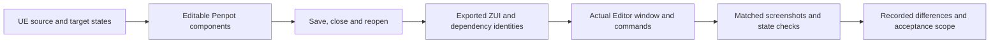

# UE windows through Penpot

Use this reference when reproducing Unreal Editor windows for ZirconEngine with Penpot and verifying their actual editor implementation. The user's reference is `dev/UnrealEngine`; inspect its local guidance and keep that reference tree read-only. This workflow also applies to a user-selected subset of those windows.

## Establish the actual target

Identify each applicable UE toolkit, layout/tab factory, Slate widget and style source. Record the source revision, paths and the corresponding Zircon feature or planned capability. Include related windows discovered from their tab registrations. Distinguish applicable, undecided and out-of-scope windows with a reason; a short list of familiar editors is not a complete inventory.

Describe the real regions, docking relationships, sizes, scrolling, selection, focus and commands before drawing. Preserve the UE target where Zircon supports it. A missing data model, renderer, command, font or UI primitive is a tracked reproduction gap. Keep the target design visible instead of silently simplifying it to fit current implementation.

## Reuse components and styles

Inspect the existing owners before adding a component:

- `zircon_editor/assets/ui/editor/components/catalog.toml`: component identities, document owners, bindings and slots.
- `zircon_editor/assets/ui/editor/theme/editor_tokens.zui`: shared palette, typography, density and chrome values.
- `zircon_editor/assets/ui/editor/unreal/starship.zui`: UE style imports, classes and interaction states.
- Existing workbench primitives, composites and real host bodies referenced by the catalog.
- `tools/penpot/apps/zircon-zui-plugin`: component ownership, instances, tokens, style projection and export behavior.

Map each repeated Penpot component to its engine component ID/document, slots, parameters, states and version. Use Penpot component instances and shared styles/tokens for repeated controls. Preserve those identities through save, reopen and ZUI export. Detached copies with matching appearances do not demonstrate reuse.

The bridge's ordinary imports create file-local leaf masters. For an authored canonical component, including a composite root with typed slots, use **Import component master** and retain its actual `canonical-record` library/component/main IDs. Publishing that file to the Penpot team makes it available to consumers; it still needs a connected-instance and style-propagation check before cross-window reuse can pass.

Keep common defaults in the shared owner. Window layouts supply content, composition and necessary variants. Record local overrides and how they inherit, reset and persist. Use the actual engine style precedence; propose missing customization support explicitly. Do not introduce a parallel token system or duplicate literal colors, fonts and control metrics in every window.

Component registration alone does not prove working behavior. A preview viewport, timeline strip or graph frame may lack the feature's renderer or editing commands. Verify its actual capability before counting it as a reusable functioning editor component.

For global customization acceptance, change a shared style/token and verify its propagation in Penpot and the Editor across at least two affected window families. Verify a local override and reset where supported. Record persistence and unsupported settings. A style file's existence does not establish a working global settings interface.

## Design and verify the same UI

Maintain editable Penpot documents, component instances and flow constraints. Include the window's distinctive data surfaces: real graph nodes and connections, tracks and timing, hierarchies, property editors and previews as applicable. A bitmap of the proposed window is a visual reference, not an editable design or an engine implementation.

Use logical layout constraints with measured text and content. Check label indentation, icon/text grouping, vertical alignment, minimum sizes, clipping and overflow. Apply DPI scaling once. Do not patch individual screenshots with arbitrary coordinate offsets. Use the existing flow, text and icon contracts for the actual controls involved.

The evidence chain is:

Record the Penpot file/page/board, component version, exported ZUI and component dependency hashes. Verify that the actual Editor loads those resources and shared styles. A root ZUI can remain unchanged when a referenced component changes; validate the relevant dependency closure rather than inferring application from the root filename alone.

Compare equivalent content, state, client size and actual DPI. Obtain official Penpot exports and actual Editor screenshots; show side-by-side and difference/annotated views where useful. Keep the original images and receipts. A cropped diagnostic is not a replacement for the full capture.

Choose states that expose the window's actual risks: focus, selection, scrolling, menus, resizing, long and Chinese text, empty/error states, graph/timeline interactions and relevant preview commands. Do not claim an untested DPI from a system-setting report; verify the new window's actual scale. When using the ordinary normal-frame evidence path, retain its nonce, generation, source and process identity checks. A stale case or invalidated hold requires a bounded fresh capture, not relaxed association checks.

### Preserve source identity while refreshing layout

Resolve localized captions through the same source table used by text projection before measuring icon/text groups. Preserve the translation reference and event bindings; a control that exports unchanged can still have an incorrect visual caption box.

Treat temporary scroll/capture metadata as temporary. Delete only keys that actually exist, using the host's real deletion contract; writing empty strings can create durable keys and invalidate exact save/reopen comparison.

Validate the existing source/export guard before automatic layout refresh. If measured text legitimately recenters a native glyph, admit only geometry derived from the same complete source owner, control identity, caption and actual font measurement. Keep unrelated geometry/style edits detectable and retain the original guard; do not re-sign arbitrary edits during refresh.

## Truthful completion and unresolved differences

Track Penpot design, editor implementation and actual validation separately. An editable design without the real Editor window is still awaiting implementation/validation. A rendered window without functioning commands is still incomplete for those interactions.

Do not count placeholder panels, canned preview images, decorative graph wires, no-op buttons, fake lists or unsupported backends as completed functionality. Representative fixtures may support design review and tests, but identify them as fixtures and retain the production capability gap. Never use a static mannequin or a captured viewport image as evidence of live animation or rendering.

For every unresolved difference, retain:

| Field | Required information |
| --- | --- |
| Identity | Window, component and exact state/DPI |
| Reference | UE source location and available reference image |
| Actual | Penpot and Editor images/artifacts, with absent evidence stated |
| Difference | Concrete geometry, style, content or behavior mismatch |
| Cause | Verified cause, or an explicitly unverified hypothesis |
| Dependency | Missing engine/UI capability or shared component owner |
| Decision | Proposed options or the design decision left for the user |
| Status | Open, awaiting user design, or verified fixed with evidence |

Keep unreproduced details visible and report them for the user's later design decisions. A similarity percentage or passing subset must not hide open differences or become a claim of complete reproduction. State the tested acceptance scope and remaining gaps directly.

## Independent session handoff

Use the session arrangement the user requested. Share window ownership, common component/style owners, Penpot document IDs and the difference ledger. Keep shared token/catalog changes with an explicit owner and integrate their affected consumers. Follow the repository's artifact and validation rules for each session; do not copy source trees or overwrite another session's work to make a visual pass.
