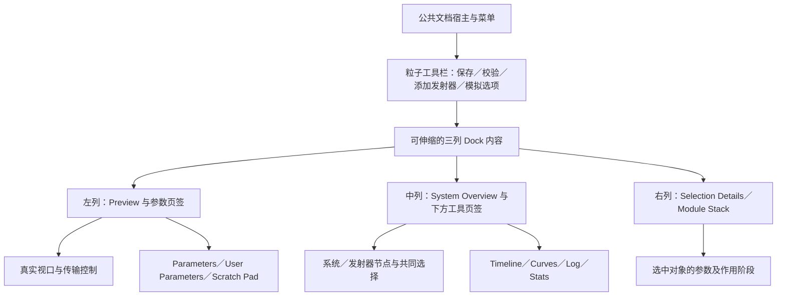

# 粒子窗口：区域、组件与真实行为设计

聊天 `01a16d52-a4a5-7271-90a2-336091337737`，Parent `01a16d4e-0491-7353-84fa-038bd7706546`。接续 [源码盘点](particles.md)、[共享消费合同](particles-shared-contracts.md)和 [验收要求](particles-cases.json)。原file `b4a1e3ce-9e6a-81fe-8008-d69d60c876ee`现已保存/fresh重开rev38/3页388对象；11个原Shared实例消费body/strong并保持中文/source refs，原生库Update已有实际syncedAt。640原叶能力说明已补；实际Graph/命中/输入和五类VFX仍待接。Shared rev2/34色/3文字样式存在，master有效style ref为0；实例本地样式覆盖不等于master继承或完整UE/产品通过。旧rev19/30、空样式和服务连接失败保留为各自时刻历史。

Parent统一服务、公共库和桌面输入/截图。UE和公共组件源码保持只读；本域已修改文档、生命周期metadata、已分配Penpot文件及`zircon_plugins/particles/editor`内的source codec/runtime转换。未修改公共源码或原3份ZUI，未操作共享桌面，不再单独询问用户服务信息。

按最新分工，共享timeline/curve/transport由动画聊天 `01a16d51-741b-73b3-a61a-2189cd38f81e`维护，graph surface由材质聊天 `01a16d50-6c7f-7370-853d-4581184b66a1`牵头，Parent负责跨域合同、公共主题/框架与集成。下文早先标为Parent的专用surface需求沿这些owner交接；粒子保留业务单位/codec/commands/runtime职责，未修改共享路径。

## 设计输入和边界

UE 的 `NiagaraSystemToolkitMode_Default.cpp` 提供默认 Dock 关系；`NiagaraSystemToolkitModeBase.cpp` 的 SpawnTab 将 Viewport、Curve、Sequencer 接到同一个 SystemViewModel；`NiagaraStackRoot.cpp` 定义系统、发射器、粒子各阶段，`NiagaraEditorWidgets/Private/SNiagaraStack.cpp` 与 `SNiagaraOverviewGraph.cpp` 定义选择、滚动、拖拽、上下文和事务关系。

Zircon 实际入口保持以下身份：

| 原资产/注册 | 必须保留的身份 | 设计职责 |
| --- | --- | --- |
| `zircon_plugins/particles/editor/authoring.zui` | asset/template/view `particles.authoring`，root `particles_authoring_root` / `ParticlesAuthoringRoot` | source document 的 Overview、stack、参数、curve、diagnostics body |
| `zircon_plugins/particles/editor/preview.zui` | asset/template/view `particles.preview`，root `particles_preview_root` / `ParticlesPreviewRoot` | 同文档的真实 preview scene、transport、runtime feedback |
| `zircon_plugins/particles/editor/particle_system.drawer.zui` | asset `particles.particle_system.drawer`，root `particles_component_drawer_root` / `ParticlesComponentDrawerRoot`，controller `particles.Component.ParticleSystem.drawer` | 实际场景组件的资产引用和实例覆盖；不把 source emitter 参数写成场景组件属性 |
| `editor/src/extension_ids.rs` | asset kind `particles.system`，drawer `particles.drawer`，template `particles.template.cpu_sprite` | 复用资产打开、创建、组件检查入口；不新注册另一套同功能工具 |

公共窗口宿主负责菜单、文档 tab、Dock、状态栏和窗口寿命；粒子域负责 body、source selection、参数语义和 preview session。不要在 authoring body 内再画一套全局菜单/状态栏。Preview 可以被 Dock 到同一工具窗口的左上区域，也可独立打开；两者绑定同一文档身份及 preview owner，不能各自启动模拟。

## 区域和流式关系

默认目标忠实保留 UE 三列关系，初始 splitter 权重来自 UE 的约 1:1:1；不把某一分辨率的截图坐标写入 ZUI。实际 body 由 Parent 的文档宿主提供可用宽高。

图中的 User Parameters、Scratch Pad、Stats 等是 UE 目标职责；尚无真实模型的 tab 在设计中注明能力缺口，产品入口按可用能力禁用并给出原因，不填假列表或数据。

| 区域 | 真实内容与文本规则 | Flow / scroll / input |
| --- | --- | --- |
| 工具栏 | 动作名来自 locale key；资产名/dirty 由文档投影；数值状态独立于动作 | 单行 HorizontalBox；动作组按语义排列；超宽进入公共横向滚动/overflow 合同，主保存和校验仍可键盘访问 |
| Preview | 实际 render surface、相机、网格与背景；粒子数/实际 backend 来自 runtime snapshot/readback | 占剩余空间，裁剪到本 view；禁止整张 Editor 截图或 mannequin 默认 SVG 充当预览；相机输入只在该 surface 获得焦点时消费 |
| 参数页 | 系统参数或当前 emitter 参数，名称开始对齐，参数值按类型编辑 | 页签头固定，内容一个垂直 scroll owner；切 tab 不复制 source 或重置选中、滚动 |
| Overview | system/emitter 选择身份；真实支持的 VFX node 类型及数据 | 图编辑为可 pan/zoom 的真实画布例外；坐标仅是 source/view node position；普通属性行不能用坐标摆放；没有 edge schema 时不能伪造可执行连线 |
| Module Stack | 阶段 header、参数组、验证状态、实际可编辑字段 | 一个垂直 scroll owner，组内普通流布局；列表超量用现有 virtualization；恢复每文档/每 emitter 的滚动状态 |
| Timeline / Curves | 实际 preview clock、lifetime keys、选中 key 值 | tab 只显示一个活动 body；画布可 pan/zoom；数值编辑走相同事务；不能把普通“Track”默认字样当真实 emitter track |
| Diagnostics | severity、source location、message、sequence/stale/drop | 接现有 DiagnosticRow 槽；消息自然换行/可展开；不能通过只保留固定一行裁掉中文错误；点击可定位 source 的真实条目 |
| Component inspector | asset、playing、backend、seed、time_scale 和诊断 | 独立实例属性与 source 设置分清；显式显示覆盖来源及 reset 目标；其生命周期归场景 mutation/undo owner |

### 三尺寸与 DPI

响应式策略是待 Parent 集成的具体提案，UE 默认布局仍是外观目标；窄屏重组差异单独记录，不能冒称 UE 已有同样的断点逻辑。

| 客户区 | 拟采用的行为 | 验收约束 |
| --- | --- | --- |
| 1280×800，100% / 150% | 默认三列，Preview/Parameters 左侧上下分区，Overview/下方工具中列，Details/stack 右侧；用户可拖 splitter | 两个 DPI 使用相同逻辑布局；150% 必须实际窗口 DPI144、1920×1200，不能将 PNG 插值放大充数 |
| 900×620，100% | 先缩可伸缩列，保留三列；下方 Timeline/Curves/Log 共用一个活动 tab；遵守区域最小宽度 | 若公共 Dock 的真实最小约束不能容纳，按同一 compact Dock 合同将 Parameters 合并到侧栏 tab；不靠文字缩放或把 Details value 裁掉解决 |
| 640×520，100% | 一个活动工作面，Overview/Preview/Stack/Parameters/Curves/Log 进入同一文档 Dock tab 组；关键 transport 留在 Preview body，Inspector 通过原 tab 可达 | 同一文档/选中身份，原 body 只能有一个活动实例；切 tab 和弹层返回恢复焦点及滚动；不能复制窄屏专用数据状态 |

`editor_tokens.zui` 当前已有 breakpoint 640/1260、compact side 1100/760、control height、panel header、spacing、splitter hit size 等命名值。尺寸通过现有语义 token 和 Parent 的 Dock 合同约束；粒子域不改全局断点，也不把现有 Workbench drawer 宽度误当成 Niagara 三等分规则。640 的合并 tab 策略以及 900 最小宽度处理，作为 PFX-LAYOUT-01 交 Parent 确认公共实现能力。

### 样式和排版

- 当前共享 token：Roboto、body 13.333333、caption 10.666667、line-height 1.2，dense/default control height 28/32，panel header 30。这里记录现值用于比对，不在粒子资产复制字面值；具体表达式沿组件已有的 `$editor.*` 名称。
- 复用 Starship/共享 palette 的背景、separator、selected/inactive-selected/focus ring；Niagara 各 stack 阶段色映射如尚无公共角色，提交语义 variant 提案，不在每个窗口硬编码颜色。
- 名称、说明与错误从开始对齐；独立工具按钮和 icon 在控件内居中；可比较的粒子数、时长、计数对齐末端。单位是独立有语义的后缀，不用空格拼接列。
- 产品标题、按钮、tooltip、空态和错误使用 `UiLocalizedTextRef` 与现有 `zircon_editor/assets/i18n/{en,zh-CN}.toml` 合同。`particles.editor.*` 只作为候选命名域，未创建或注册 key。用户资产名和参数值走 binding，不翻译用户内容。
- 长名使用现有 ellipsis + 完整 tooltip/可编辑字段；错误允许换行并可展开。共享 PropertyEditorRow 的 label 区固定宽度不能通过在本域复制组件来解决，需 Parent 的语义变体或行内现有 overflow 合同。

## 公共组件的实际合同

以下身份和 slots 已读取 catalog 与原组件源；它们不代表已经在 Penpot 建立对应 native instances。

| component ID | 已存在的合同 | 粒子使用方式 / 待 Parent 的具体补充 |
| --- | --- | --- |
| `DocumentHost` | `tabs` 接 `DocumentTabs`；`content` 必需且接 `PaneSurface` | 承接真实粒子 view，不能往 content 随意塞 WorkbenchButton；Dock/tab 身份由 Parent 提供 |
| `WorkbenchPanelHeader` | 必需 `title` 接 Caption/SectionTitle；`actions` 接 Button/Caption/Chip/Dropdown/IconButton/Toggle | 标题与动作各在自己的流槽；不增加本域同名 header |
| `WorkbenchTreeRow` | selected/focused/expanded/tree_depth、ellipsis、语义颜色和焦点环 | 绑定 stable source key 与 selection；没有 children 的项不显示虚假展开子树 |
| `WorkbenchPropertyEditorRow` | 必需 `value` 接七类现有输入；name column 现为 min60/preferred105/max105 | 绑定参数名与 typed value；Vector/Range 在已有输入组合内处理；reset 动作若现有 slot 无法表达，提 Parent 增加公共动作槽/语义变体 |
| `WorkbenchNumberField` | 原组件有 value/value_text/min/max/step/precision；默认 42、0–100、整数精度；catalog 只显式声明 value_text/placeholder | 粒子必须显式覆盖语义范围、单位、精度和真实 value；不能继承默认42/100。请 Parent 确认这些 props 的 native instance 暴露及 export/reconcile 路径 |
| `WorkbenchDropdown` | 默认 options 为 `["default"]`；value/value_text、popup_open/focus/selection 状态 | 选项来自真实枚举/capability，调用方提供值/显示名；关闭弹层后返回原 trigger |
| `WorkbenchDiagnosticRow` | `severity` 与 `message` 均必需，接 `WorkbenchStatusItem`；现有行高48、severity 槽宽80–92 | 复用原身份；多行中文/展开内容若被固定行高裁剪，交 Parent 扩展通用 auto-height variant，不能用截断后的单行冒充完整诊断 |
| `WorkbenchPreviewViewport` | 原 root 是 `Image`，默认 `animation_mannequin_viewport.svg`，全部 input flags false | 需要 Parent 明确真实 surface/image 资源绑定、交互/相机和 native media provenance 入口；粒子域提供 renderer consumer 和当前 generation。不能保持静态默认资源 |
| `WorkbenchTimelineStrip` | root `Canvas` + `timeline-strip`；duration/current_time/tick_interval/track_label/timeline_keys；input flags false | 当前是绘制投影；真实 seek/key 输入及 command payload 需公共合同。duration 是 preview view range，不能伪装成 system asset 中不存在的 duration |

现有 catalog 有 version1，组件文档均为 ZUI v2；没有逐组件版本字段或 Penpot library ID 时不编造版本。真实 Penpot 交接后记录库主组件、linked instance、允许覆盖的 props、slots、共享样式引用和依赖 SHA。

## 模块堆栈与真实数据映射

UE 的 System Spawn/System Update、Emitter Spawn/Emitter Update、Particle Spawn/Particle Update、Events、Simulation Stages、Renderers 是不同执行职责。Zircon 当前 runtime 是字段式 emitter 和固定模拟顺序；以这些组展示对应属性是可实现子集，**不能因此开放任意模块重排或声称拥有 Niagara script stack**。

| UE 职责 | 实际字段/入口 | 拟编辑行为及能力边界 |
| --- | --- | --- |
| System settings / initialization | system `id/backend/seed/looped/emitters` | source id 保持稳定；backend 显示请求与实际执行分别投影；seed 可编辑但 preview 安装另有 generation；looped 的真实消费缺口见下 |
| Emitter initialization | `max_particles`、coordinate_space、shape | Point/Sphere/Box/Cone 来自真实枚举；容量按 backend admission 显示，不以 UI 最大值100限制真实数据 |
| Emitter update / spawning | `spawn_rate_per_second`、bursts | rate 为每秒粒子数，burst time 为秒、count 为整数；source 稳定 key 与排序分开；当前无模块顺序重排语义 |
| Particle spawn | lifetime/initial_size/velocity/rotation/angular_velocity/start_color | Range min/max 和向量分量经 typed mutation；旋转当前使用弧度，不能无标注用 UE 度数直接写入 |
| Particle update | gravity/drag、size_over_lifetime、color_over_lifetime | 曲线输入是 normalized lifetime 0..1；线性插值；size key 是初始 size 的乘数，color key 乘 start_color |
| Events / Simulation stages | physics/animation interop 有限能力，非 Niagara event graph | 当前支持的 animation event 可按真实 capability 显示；通用事件图、GPU多 simulation stage 保持具体缺口 |
| Renderer | material/texture、现有 sprite extract / GPU transparent path | 资产选择必须 resolver 成功；VFX 当前仅 binding-free color Material shader graph；mesh/ribbon/light 等不可假装可选可运行 |

曲线编辑的 source 顺序、key 身份、输入单位、CPU/GPU能力分别展示。CPU `evaluate_*_curve` 对 normalized lifetime 做线性插值并依赖按 t 排序的 keys；builder `with_*_over_lifetime` 会排序，但字段本身可直接写。Editor mutation 必须维护顺序和 stable key；不能把数组索引当可持久选择身份。GPU compiler 对超过两 key 的曲线报告 first-to-last linear baseline；不得把 CPU 多 key 编辑效果宣称为 GPU 等价。

### 字段编辑约束

下表是待接入的 source validator/UI 合同；与当前 runtime 的归一或 clamp 差异须显式保留，不把设计规则写成已经通过的行为。普通 scalar 使用 NumberField 的真实 value/range/precision binding，draft 允许暂时未完成的负号或小数；commit 后才产生有限的 `Real`。

| 字段 | 值、单位与控件 | 目标 commit / 现有差异 |
| --- | --- | --- |
| system seed | 十进制 `u64`；复用 `WorkbenchField`（原root为InputField）严格解析，payload 保留十进制字符串 | 完整覆盖0～18446744073709551615；不能经过 JS Number、f32 或 NumberField 浮点 value 丢失高位。reset/readback/save/reopen 均核对原字符串和实际种子 |
| capacity / burst count | `u32` 整数，容量代表资源上限，count 为粒子数 | 不继承 NumberField 的100上限。零容量和零 count 可作为源值但须说明无产出；实际分配经资源准入。GPU aggregate 当前上限1048576，低层 compiler可 clamp并报告，VFX compiler对0或超限直接拒绝；两种路径不能混为一致成功 |
| rate / lifetime / burst time | rate 为粒子/秒，lifetime 和 burst time 为秒 | 设计拒绝非有限、负 rate、非正 lifetime、负 burst time；Range 保持 min≤max。当前 CPU 仅验 finite，lifetime 在采样时 clamp到 `Real::EPSILON`、burst time在执行时 clamp到0，这些属于待统一差异 |
| initial size / shape / drag | size、radius、height、half_extents 使用引擎世界单位，drag 显示模型语义 | size、shape维度、drag设计为非负；Box 明确是 half-extents。当前 CPU size/radius/height/drag可clamp、Box用abs；不把负值静默改写成另一个源值，不擅自标成 UE 的厘米 |
| velocity / gravity / rotation | Vec3 分量流式排列；rotation为rad，angular velocity为rad/s | 有限带符号值；允许负速度/重力/角度，不笼统把所有负参数判错。小数精度按字段显式设置，不沿默认 precision0 |
| curve key | normalized `t` 为0～1，size value为倍率，color为线性RGBA | 稳定key与排序分开；重复t/端点删除的策略须由source格式明确。当前runtime只验finite、没有重复t拒绝；不凭画布位置推导秒数或伪造Bezier切线 |
| instance playing / time_scale | 场景组件bool及非负有限倍率 | 不写source系统播放状态；当前 `with_time_scale` clamp负值，但runtime validator只验finite。字段draft/reject/undo须与场景mutation一致 |
| requested backend / material / texture | 枚举或真实资产选择，标明依赖解析状态 | backend请求不代表实际GPU执行；material/texture不能把进程内ResourceHandle raw值写入持久文档，须经现有AssetUri/resolver。VFX材质限制见源码盘点 |

组件当前实际只有 `entity/asset/transform/playing/time_scale`；`backend()`读取 `asset.backend`，`seed`同样在内嵌 `ParticleSystemAsset`。`particle_component_descriptors()`虽声明backend/seed可编辑，却没有独立override DTO、资产URI或自动同步层。Inspector设计先区分实际场景内嵌值和source文档；不能显示“继承/重置覆盖成功”而实际直接改了共享source，或把内嵌copy误称为已跟随源资产。独立覆盖与依赖更新的语义作为 PFX-RUNTIME-04 保留。

## 文档、选择、binding 与事件

以下是待实现的粒子领域投影合同，不是已安装 binding key；实际落 ZUI 前按导出/宿主支持核对。

| 原 control ID | 数据 owner | 事件与后置条件 |
| --- | --- | --- |
| `ParticlesAuthoringToolbar` | source session dirty/revision、command eligibility | 每个动作经实际 operation/command；pending/failed 不写成 saved/playing |
| `ParticlesEmitterList` | source emitter stable key/name、selection | select/extend/range/context/open；更新同文档 Overview/Details/Timeline 选择，保存 per-emitter scroll |
| `ParticlesModuleStack` | selected emitter 的真实字段组、capability、diagnostic | commit/reset/context；只修改所选 source path；不可拖动的固定执行组给出原因 |
| `ParticlesCurveEditor` | curve owner、stable key、normalized t/value、viewport | key select/move/create/delete/commit；拖拽一次作为一笔 undo；数值编辑与画布操作用同一个 mutation |
| `ParticlesDiagnosticsPanel` | source validation、runtime diagnostic sequence/stale/drop | activate 仅跳转可解析 source；stale/error 内容不假称 current compile success |
| `ParticlesPreviewViewport` | document revision、preview session、surface/frame generation、camera | 相机命令与真实渲染结果相关；旧代帧只能标为 last-good，不能作为当前修改通过 |
| `ParticlesPreviewTransport` | preview clock、playing/paused/stopped、job state | play/pause/stop/rewind/warmup 作用于相同 preview owner；不把 source dirty/undo 与播放时间混为一体 |
| `ParticlesPreviewStats` | snapshot/readback、实际 backend、active generation | 数值随 authoritative snapshot；没有 compiler stats 则说明能力缺席，不写固定数字 |
| `ParticlesComponentAssetRow` / `ParticlesComponentPlaybackRow` / `ParticlesComponentBackendRow` / `ParticlesComponentSeedRow` / `ParticlesComponentDiagnosticsRow` | 场景组件与其 source asset dependency | 场景 mutation/undo/save 由场景 owner 接收；source reset、instance override reset、simulation reset 必须是三种明确动作 |

选择身份建议为 source document identity + revision + emitter key + 可选 curve/node/key；每个工具页持有共同 selection owner。display name 与 source key 分离，重命名不改变稳定 key。Overview↔stack 双向更新采用现有 selection contract 的 guard/generation；选中变化不写入资产 dirty。需要共享 selection/Dock API 的部分交 Parent，粒子域不建立第二个全局 selection store。

### source mutation 和保存

字段编辑先保留输入 draft；commit 校验成功才生成带 expected source revision 的 typed patch；失败保留 draft 和诊断，source/last-good preview 不变。一次 slider/curve drag 的临时更新归入同一 transaction，结束后一次 undo；Undo/Redo/Reset 都经过同一路径重新验证和安装 preview，不只恢复显示文本。

Reset Property 恢复的是该 source 模板/继承层的真实默认值，不统一用 `ParticleEmitterAsset::default()`：当前 CPU Sprite template 的 rate32、capacity256、gravity/size 等与 Rust default 的 rate16、capacity128 不同。UI 必须显示实际 reset 来源。Reset Simulation 只清时间/粒子，不改变参数。Reset Component Override 恢复 source 继承值，由场景 mutation owner 处理。

Save 路径为 source revision → 现有资产存储的 durable write → 保存结果 receipt → clean revision；preview compile/install 可独立失败并保留 last-good，不能把“preview 已更新”当成 source 保存。实际是否先校验/保存不受支持的数据，由 source asset 格式合同决定；未实现的 operation 保持禁用，不发成功通知。关闭 dirty 文档通过公共 save/discard/cancel 流程，Cancel 必须回到原字段。

初始盘点时CPU Sprite TOML只是creation template的`default_document` URI，原editor tests只检查字符串，runtime类型没有serde，尚无source适配器。该历史缺口已在本域`src/source`补上DTO/codec与runtime转换；10项测试源尚待Jenkins执行，实际open/save/文档消费者仍缺，不能把编码成功当成持久化成功。

当前源格式为`format_version=1`：缺版本的旧模板兼容读取，emitter/burst/color/size项缺key时分配独立UUID并随源保存；已有键不重写，名称/排序/t变化不派生身份。`decode_toml`报告`assigned_keys`，旧模板新键尚待真实源写入，不能把未保存关闭再读视作同一套已持久化身份。重复/空白键、未知版本和字段拒绝。seed输出严格十进制u64字符串并兼容旧整数；material/texture保存URI，由既有owner提供ready handle后转换。源码校验不沿用capacity=0跳过的runtime漏洞，不悄悄clamp源参数；曲线仅接受有限、0～1、严格递增的t，size非负，color保留有限HDR值。该格式尚不含VFX node/edge schema，不宣称Niagara任意模块或节点已可编辑。`ParticleSystemSource::to_toml`只编码，DocumentHost/dirty/write receipt由现有宿主接续。详见[实际实现与检查](particles.md)。

### 复用现有命令和保存设施

以下源码提供可复用机制；粒子接线尚未实现。不得复制一套undo、dirty registry或job scheduler：

| 现有入口 | 拟接入职责与约束 |
| --- | --- |
| `zircon_editor/src/core/editor_extension.rs::register_operation_command` / `editing/operation/factory.rs::OperationCommandFactory` | 为原有particles operation安装真实factory并严格校验payload和目标source revision；descriptor本身不执行 |
| `editing/operation/registration.rs::OperationCommandFactoryRegistration` / `edit_target.rs::EditOperationTarget` | 对齐命令准入的文档目标；注册时target为具体enum，不能假设它自动从任意payload解析当前DocumentId。多文档路由需向Parent核对现有安装点 |
| `editing/operation/command.rs::OperationCommand` / `editing/engine/history.rs::HistoryContextId::Document` | source参数、增删、重命名、curve edit进入所属文档history；UI选择/滚动/transport不伪装成source undo |
| `editing/engine/command.rs::EditCommand` | 实现apply/revert以及既有 `RetainedOwnerV1`、retention plan和一次性materialization许可；不能只实现apply/revert绕过历史内存准入 |
| `editing/animation_document/{document,command}.rs` | 只读参考已有expected-revision/CAS source swap与单一可写owner的做法；这些类型是动画域私有，不跨域调用、不复制动画store到公共core |
| `asset/dirty/{registry,save_batch,save_job_adapter}.rs` | 使用 `SaveDirtyViewsJobAdapter` / `SaveDirtyViewExecutor`、dirty generation和 `mark_saved_if_unchanged`；保存旧revision成功不能清除期间新增编辑；关闭等待原有job终态 |

现有12个operation逐项接线边界如下，新的参数/重命名/删除命令还需粒子域descriptor和schema，本文不冒称已经注册：

| 原operation | 实际实现需求 |
| --- | --- |
| `particles.authoring.create_cpu_sprite_asset` / `open_asset` | 经项目AssetUri、真实codec、文档宿主和dirty lifecycle创建/打开同一个source，失败不留假tab |
| `particles.authoring.add_component` | 场景目标和所选source经场景mutation owner安装真实component；不可把只打开drawer当成组件已加入 |
| `particles.authoring.add_emitter` | 生成并持久化稳定子项身份，template/default来源明确，单笔文档transaction并验证preview |
| `particles.authoring.add_module` | 当前固定字段模型没有任意module插入语义，保持具体禁用原因；不能用添加装饰行或跳转参数组冒充添加模块 |
| `particles.authoring.edit_curve` | typed curve owner/key payload；拖拽和数值输入共用mutation/undo，CPU/GPU差异可见 |
| `particles.authoring.validate_asset` | 读取当前revision并发布source-located diagnostics，不改变dirty或播放时间；结果带revision防止旧校验覆盖新source |
| `particles.preview.play` / `pause` / `stop` / `rewind` / `warmup` | 同preview owner的实际运行命令，runtime/renderer结果决定状态；seek/warmup有界job。不能塞入source history，也不能将command入队等同于有效frame |

### 菜单、上下文和快捷键的作用域

以下是本地UE源码的实际路由及粒子目标行为，尚未做输入或窗口验证。`N` 指源码盘点中的NiagaraEditor目录，`W` 指相邻NiagaraEditorWidgets目录。菜单显示、禁用原因和键盘入口必须消费同一个command eligibility，不能出现按钮禁用而快捷键仍执行的第二条路径。

| 操作 / Windows快捷键 | UE真实依据 | Zircon目标与尚缺条件 |
| --- | --- | --- |
| Add Emitter / E | `N/Private/Toolkits/NiagaraSystemToolkit.cpp:564/604/624` 和 `W/Private/SNiagaraOverviewGraph.cpp:106/239`；SystemAsset模式才可见且可执行；打开真实modal asset browser | 保留系统编辑模式约束；确认才提交单笔add-emitter事务；取消不变更source/preview。当前只有system source，单Emitter资产模式尚无，不能虚构该模式已完成 |
| Reset Simulation / Space | `N/Private/NiagaraEditorCommands.cpp:25`，Toolkit:699调用明确的time/reset/reinitialize策略 | 作用于当前preview owner并回到确定性起点；编辑文本和弹层先处理自己的输入；不改参数、不当play/pause。UE可按设置重置依赖实例，Zircon尚无该依赖传播合同 |
| Collapse to Headers / Ctrl+O | NiagaraEditorCommands:54，`W/Private/SNiagaraStack.cpp`菜单与stack expansion | 仅改变本视图展开状态，选中/dirty/播放保持；不能同时触发全局Open Scene |
| Rename / F2 | `N/Private/ViewModels/NiagaraOverviewGraphViewModel.cpp:417`要求单个可重命名节点；`W/Private/NiagaraStackCommandContext.cpp:249`要求单个SupportsRename条目 | 对可编辑名称draft进行commit/cancel；Enter一次事务、Escape保留旧值；稳定key不变。当前runtime只有id字符串，独立显示名/稳定key需source DTO支持 |
| Delete / Delete、Backspace | OverviewGraphViewModel:187使用事务并筛选CanUserDeleteNode；StackCommandContext:104/211调用selection能力检测及具体失败说明 | 删除真实可删除emitter/key/node；处理混合选择和引用，Undo恢复源值/身份/preview；固定stage和system根不可假删；文本编辑先删除文本 |
| Cut/Copy/Paste/Duplicate / Ctrl+X/C/V/D | OverviewGraphViewModel:139起绑定；CanCopy/CanPaste明确拒绝EmitterAsset模式；Paste:321事务、重新生成Guid、实际clipboard导入校验。Stack按Supports*和TestCan* gate | 需要领域clipboard schema、版本/资源/身份重映射和真正undo。当前无codec，入口保留不支持原因，不把复制caption字符串当作复制可运行emitter |
| Select All / Ctrl+A | OverviewGraphViewModel:139绑定当前graph选择；通用键位来自Slate GenericCommands | 只选择当前活动工作面的真实条目；InputField内先全选文本；Overview/stack/Details共享selection owner |
| Zoom Selection / F；Zoom All / A | NiagaraEditorCommands:74/75；`W/Private/SNiagaraOverviewGraph.cpp:78/81`绑定实际graph viewport | 仅作用于有焦点且有几何数据的Overview/curve；保存实际pan/zoom；不误触发场景Frame Selection或在输入框中吞字 |
| Find / Ctrl+F | NiagaraEditorCommands:72定义contextual find；具体宿主须提供当前工具的搜索目标 | 搜索当前可用参数/stack或graph对象；无source项目不填假结果；Escape后焦点返回发起控件，过滤不改变源资产 |
| Isolate / S；Disable / D；Enable / Shift+D | NiagaraEditorCommands:56～58；SystemViewModel:2619/2681/2687消费选中emitter IDs，enable/disable进入事务并改变真正EmitterHandle状态 | 当前emitter无enabled/isolation字段，manager只有系统级play/pause；不得把行颜色、复选标记或playing整系统冒充发射器控制。作为PFX-RUNTIME-05保留 |
| Apply / Compile / Auto-play / Reset-on-change | Toolkit:489/499/509/519；Apply:1473仅在Emitter有未同步改动时可用；其余各有真实设置或编译owner | Save、preview install、compile不能画成同一个总是成功的按钮；VFX Compile必须走真实compiler，固定字段source validation不能声称Niagara脚本编译。自动播放/暂停改参重模拟需controller策略及真实设置存储 |
| Save / Ctrl+S；Save As / Ctrl+Alt+S | `Engine/Source/Editor/UnrealEd/Private/Toolkits/AssetEditorCommonCommands.cpp:14/15`；Niagara Toolkit:1341先NotifyPreSave、Emitter更新原对象、调用基类持久保存再NotifyPostSave | 粒子source走当前文档保存owner和revision receipt；场景component走场景保存；Save As需真实资源URI/依赖重定位，未实现保持缺口，不仅改变标题 |
| Undo / Ctrl+Z；Redo / Ctrl+Y及Ctrl+Shift+Z | `Engine/Source/Runtime/Slate/Private/Framework/Commands/GenericCommands.cpp:19/20`定义默认键；Overview新增/删除/粘贴/重命名有真实transaction | 复用公共文档history；当前Zircon只默认Ctrl+Shift+Z，额外Ctrl+Y为待Parent的UE兼容映射，不能在本域建立独立history |

**已有键位合同的具体冲突**：`zircon_editor/assets/ui/editor/keymap/default.keymap.toml` 的Ctrl+O为 `file.scene.open`，Ctrl+S为 `file.project.save`，E/F为scene rotate/frame；`commands/defaults/viewport.rs`已用 `FocusedDocumentKind(DocumentKind::scene())`约束场景操作，不能漏装粒子文档focus kind。`commands/keymap.rs::resolve_keyboard_input_when`遇到两个同时enabled候选会返回None，并不会自动优先选择粒子command。因此只添加粒子Ctrl+O或Ctrl+S不能完成作用域覆盖；需Parent统筹全局command predicates/当前文档保存route和host focus上下文。已有 `WhenClause::FocusedDocumentKind` / `Not` / `All` 可表达文档排他，但控件内文字编辑/弹层的输入优先级仍须按实际宿主核对。该依赖为PFX-SHARED-11，不改全局keymap来偷占键位。

弹层focus-return验收使用真实trigger身份：打开前记录document/view/control/source revision，确认/取消/Escape后核对原文档仍活动、原trigger恢复焦点、selection/scroll未重建、只有确认发生mutation；若trigger已随真实删除消失，则返回其所属有效pane。上下文菜单对未选中条目的作用对象须明确，不能把右键hit对象和之前selection混用。

Stack View Options中Show Only Modified、Advanced、Parameter Reads/Writes、Show Only Issues来自 `SNiagaraStack.cpp:584`；Show Only Issues额外检查选中都是stack root以避免隐藏当前module。Zircon可先提供真正有source default/diagnostic数据的过滤；尚无读写依赖模型时不提供假“Reads/Writes”结果。过滤后无结果是可恢复的空态，清除过滤不丢失原source选择。

### transport 与 preview 寿命

CPU 当前语义已读 `simulation/cpu.rs:65`：Play 只置 playing；Pause 保留 age/particles；Stop 置暂停并清 age/pool/RNG；`rewind_preview` 从零重模拟并恢复调用前 playing 状态。UE 的 Space 是 Reset，不是无条件切换 Play/Pause；输入框/弹层先消费键盘。Rewind/Reset 可复用 rewind 到0的语义；Warmup 只有 operation descriptor，不能当成已实现按钮。

最小可复用实现方向是在Parent的生产secondary-session owner内由粒子controller持有同一条 `ParticlesManager` / render consumer / clock 流，独立Preview tab消费同一owner；具体生产安装点先交接。参数修改时先验证候选source；当前manager没有replace-asset API，VFX configure又只能一次，因此需沿生产owner的候选安装/替换合同，在真实frame/install成功后切换generation，再取消/释放旧jobs/consumer/manager。UI保持明确的last-good/current标记；不在公共PreviewScene之外隐藏启动manager。

CPU RNG 使用 `asset.seed ^ handle.raw()`；在同一个 manager 中 remove/re-instantiate 会改变 handle。若以候选独立 manager 重建，需用相同的确定性初始 handle 流并验证种子重现；不能仅以 seed 文本不变证明 reset 后像素或粒子轨迹一致。GPU 与 CPU RNG 不要求跨 backend 像素等价，差异应单列。

当前通用 `ParticleRuntimeSnapshot` / `ParticleEmitterState`没有age字段；GPU专用 `ParticleGpuRuntimeInstance`有age_seconds，不能当作通用CPU/GPU快照。timeline必须绑定preview controller已成功执行的fixed-step clock/handle/revision并关联frame generation，不能用UI wall-clock冒充模拟时间。`rewind_preview`同步持manager锁循环，不带取消/步数上限；它按未缩放remaining调用tick，而tick再乘component.time_scale，所以请求seconds在倍率非1时不等于simulation age。具体时钟合同和PFX-RUNTIME-06见共享消费合同。长seek/warmup复用现有job owner有界调度，不阻塞UI或另造scheduler。

无 emitter 的 source 文档必须仍可打开/保存和编辑，但当前 runtime instantiate 会报 `must contain at least one emitter`；空态不实例化模拟，清楚显示没有可预览 emitter。能力诊断和源文档空态不能用假 emitter 修补。

## 新确认的具体差异与提案

| ID | 当前证据 | 必需处理 / owner |
| --- | --- | --- |
| PFX-LAYOUT-01 | UE 默认三列，Zircon 公共 Dock/compact 合同尚未交接 | Parent 确认900约束与640合并tab；粒子 body提供同一实例与稳定身份 |
| PFX-SHARED-07 | 共用 PreviewViewport 是静态 Image，TimelineStrip input false | Parent 给出真实 surface/media/input/seek/key payload 接口；现有组件演进，不新建粒子同名复制品 |
| PFX-SHARED-08 | catalog已补齐10个NumberField props；42/0..100/precision0仍为模板默认 | 源级透传声明已核实；typed Penpot主件、原生slot/export、精确整数与实际范围输入仍待产品证据 |
| PFX-SHARED-09 | PropertyEditorRow label 槽固定，DiagnosticRow 行高固定48 | Parent 提供 tooltip/自适应多行/动作槽合同，覆盖中文长文本、参数 reset和错误定位 |
| PFX-SHARED-10 | 现有operation factory/文档history/dirty save job可复用，但注册target不是自动多文档路由；seed不能无损经浮点输入 | Parent交接具体document/view/command安装点及typed payload保真合同；粒子域实现自身DTO/codec和factory，不另建全局文档/undo服务 |
| PFX-SHARED-11 | Ctrl+O/Ctrl+S已有全局Open Scene/Save Project；keymap不会为同时enabled的粒子绑定自动选优先级；E/F依赖正确focus kind | Parent统筹context predicates、当前文档Save route、Redo兼容映射和文字/弹层输入优先级；粒子提供明确mode/selection/capability eligibility |
| PFX-RUNTIME-01 | `ParticleSystemAsset.looped` 存在，但在当前 particles/vfx_graph Rust 搜索中未找到 simulation/GPU 消费 | 不把该 bool 当成已实现循环控制；交粒子 runtime owner 确认循环时长/边界语义，UI 暂不声称操作有效 |
| PFX-RUNTIME-02 | CPU validators大多只验 finite；负值/range可归一或clamp；capacity0会跳过该emitter的其它校验 | 设计目标是明确字段约束，不能宣称现有 runtime已经拒绝所有不合法输入；source validator与runtime policy需一致并有真实测试 |
| PFX-RUNTIME-03 | handle参与CPU RNG；manager无replace；公开snapshot无age；rewind无步数上限 | preview owner重建、确定性重播、clock/frame关联和有界job方案按上文实施并验证；公开DTO变化若需要，先交接精确范围 |
| PFX-RUNTIME-04 | 场景component内嵌完整asset；backend/seed没有独立override层，descriptor不是写入器 | 明确场景值、source依赖与覆盖/重置/保存的关系，再接真实场景mutation；不宣称当前已具备继承同步 |
| PFX-RUNTIME-05 | emitter无enabled/isolation字段；runtime没有所选emitter级pause/enable/isolate API | 不用整系统playing或UI行状态代替；需领域执行语义/持久化和preview mask能力后才能开放对应UE命令 |
| PFX-RUNTIME-06 | rewind_preview按未缩放seconds推进，tick再乘time_scale；倍率非1/0时目标seconds并非最终simulation age | controller明确预览rate/实例time_scale、请求/完成时间与frame反馈；不能只更新playhead文本。通用snapshot无age、GPU专用age不等于通用时钟 |
| PFX-DOCUMENT-01 | 已有TOML DTO/codec、持久UUID键、完整u64、URI-ready lowering及curve/typed参数候选；现23项测试未执行，文档/factory/history/save/preview消费仍缺 | 继续域内adapter接全局AssetUri/DocumentHost/history/dirty/job；编码不作为durable-write回执，沿原r2对账当前hash，保留旧Jenkins入口拒绝 |
| PFX-GRAPH-01 | VFX五类node列表可真实编译；无stable node/edge/pin，材质有明确限制 | 粒子域先定义可持久source node身份/真实属性编辑；完整Niagara连线/脚本语义继续保留差异，不用装饰wire替代 |

当前已完成下述局部native flow草案的保存/关闭/新context重开；完整共享组件/样式和各状态设计仍未完成。原始ZUI写回、Rust聚焦测试、正常EXE、样式改动传播和双端逐图比较均未运行。保留旧Jenkins恢复失败，不自行恢复服务或占用桌面。下一门槛是按专用owner交接接入真实library、控件实例和样式，再走正式插件导出；不另建同功能文件。

## 真实Penpot局部草案身份

本节记录revn5初始结构，后续状态设计为revn7；当前revn19及新增公共库验证页见末节。原画板和业务主件的身份始终保留。

已通过实际API保存到revn5/vern0，并在关闭首个认证浏览器context后，用新的认证context重开同一file/page。103个shape、49个flex容器、53个text和业务组件/实例身份与元数据摘要一致；重开前后SHA-256均为 `64b8afffd45467a7db4015b8e682409ec9bd5cdbdcf3d9ecaaa198434d09ad46`，无page error。API保存不使用skip-validate。

| 表面body提案 | 逻辑尺寸 | 实际board UUID |
| --- | --- | --- |
| Authoring | 1280×800 | `59d12ad4-91ab-80b6-8008-d6a494616358` |
| Authoring | 900×620 | `2d38887d-8b9f-40bf-9142-3c32387b077c` |
| Authoring | 640×520 | `c1ea88f6-0372-4a75-8f72-4a551689aca1` |
| Preview | 1280×800 | `78110a16-5bae-4d7c-9631-ffcb16d78d27` |
| Preview | 900×620 | `615cd47c-029a-41aa-895e-4b167fdd7c5f` |
| Preview | 640×520 | `0af719db-c439-49b0-81f1-154165adc185` |
| Component drawer | 1280×800 | `c76b68a9-3159-4613-a182-0794b4cc0f7d` |
| Component drawer | 900×620 | `9951fe59-f73c-4df0-87d9-b5372f627bfb` |
| Component drawer | 640×520 | `11e892f7-1f18-4469-99da-7449bc87b3c8` |

业务组件 `Particles / Domain / Emitter summary`：component `04aeb40d-d09f-41ca-8991-bd36d3348e57`，main instance `d0a46295-3d83-47be-8ae7-759cd432a8bd`；三个实例分别为 `65cfb6df-d05f-4826-89fe-65880b9f97e4`, `06d5ec2e-b9ca-49f3-93ff-e4d25c9b9b72`, `1e1c092a-a1e7-4786-b11b-fb7849c0a6b4`。它表示runtime ParticleEmitterAsset::default 的fixture，三个文本槽保留native shape-ref，并非通用TreeRow/Node/PropertyEditorRow的替代组件。System seed fixture使用实际默认0xC0FFEE（12648430）；创建模板capacity256/rate32与runtime默认capacity128/rate16是不同样本，不混称同一真实已加载资源。

画板和domain实例的草案合同存储在native plugin-data `shared/dev.zircon.particles` 的字符串draft-contract中，JSON API将namespace投影成devZirconParticles；它不是ZUI插件shared/dev.zircon.zui命名空间，也没有伪造exporter source/acceptance metadata。22处原control引用均已对原三资产实读核对，身份未改。

当前只形成结构草案。文本可编辑，普通布局采用native flex；公共控件/主题未接入的区域明确标作待消费slot。未添加平行token库、共享color/typography master或本地按钮/数值输入副本。尚未验证完整host客户区、900/640公共Dock可达、交互状态/字体/文本行框、官方ZUI导出或真实预览，不能以结构重开升级为完整设计通过。

实际浏览器预览为报告根的penpot-layout-draft-corrected.png；原penpot-layout-draft.png的反转失败保留。penpot-layout-draft.json保留初次HTTP500、受支持assign修正、metadata namespace校正、两次重开及两图复核。它们均不是原生EXE图或双端比较，±1逻辑像素目标尚未测量。

## 本轮新增状态设计与实际身份

本节为revn6→7的历史阶段；18个body板不是最新新增的公共控件验证板。

接收到Parent较早revn0交接后，再次认证API确认本域仍revn5/103对象；没有回退已有画板。实际在同一file/page添加163个原生对象、三个作者状态的三尺寸body草案，服务器校验通过且无skip-validate，API读回复核为revn6。原9画板、业务main及实例保留；随后原生重开修订为revn7，具体变化和fresh验证见下文。当前共18板、266 objects、131 flex frames、134 texts、1 master及7 instances。这只是局部可编辑状态设计，完整共享样式/实例及产品验收保持未完成。

| 状态 | 实际数据依据与领域内容 | 布局/焦点与未完成边界 |
| --- | --- | --- |
| Empty system | source codec允许emitters=[]；system仍有id/backend/seed，selection=None；没有虚构emitter、曲线、wire或粒子计数 | Overview为空，Stack无选择，Preview说明空系统；创建意图保留原particles.authoring.add_emitter operation；按钮由公共owner交付，设计不放无执行器按钮 |
| Selected CPU Sprite template | 读取现有templates/cpu_sprite_system.toml；capacity256/rate32、Sphere0.1、lifetime1～1.5、size0.2～0.4、gravity/drag与两条线性曲线值均按模板；中文长display_name是明确fixture | Overview复用本域Emitter summary原组件实例并覆盖文本，Stack显示真实字段分组；1280分三列、900保留Overview/Stack并折叠Preview、640为活动Stack；Dock切换/focus ring/公共property rows仍待Parent，不宣称可输入 |
| Invalid seed / unresolved texture | 已提交seed为u64::MAX十进制字串，未提交draft为MAX+1；真实AssetUri示例尚未ready，源revision和candidate/render状态分开 | 保留draft和长中文诊断，字段commit拒绝，不替换已有有效source；生产frame/last-good尚未接通，不编造frame/count；焦点返回到原ParticlesModuleStack的system.seed字段，Esc恢复已提交值的执行仍pending |

正常内容全部native flex，文本使用自动高度/换行；外层board位置只是设计画布编排，普通控件不依赖坐标。长字段区域由未来公共Stack滚动owner接管，当前设计不冒称真实滚动/弹层或文本输入。沿用已有中立原生文本及业务组件，公共主件/样式未交付前不复制TreeRow、PropertyEditorRow、Transport或另建theme。

信息架构继续映射[App Shell](https://pro.reactbits.dev/docs/app-ui/app-shell)，新增空数据/校验状态分别映射[Empty State](https://pro.reactbits.dev/docs/app-ui/empty-state)与[Forms](https://pro.reactbits.dev/docs/app-ui/forms)。本轮访问后两页仅取得公开目录壳，未取得可复用实现或iframe内容；没有导入Pro源码。具体布局、选择/Stack错误与运行语义仍以本地UE源码及已核实Zircon合同为准，未把目录壳当作视觉验收依据。

下列UUID均来自成功保存后的实际读回，file/page保持上述分配。它们没有冒充完整客户区或实际DPI。

| 状态 | body逻辑尺寸 | 实际board UUID |
| --- | --- | --- |
| empty-system | 1280×800 | `46dac66a-63ca-4b02-b2db-efef45674331` |
| empty-system | 900×620 | `9d0e5d0d-af46-4482-a3a3-aca9e3c9c746` |
| empty-system | 640×520 | `e6d178ce-1e65-485b-8456-9d31c2bad55c` |
| selected-cpu-template | 1280×800 | `7f0d509f-128a-4680-a2dc-297a782bca2a` |
| selected-cpu-template | 900×620 | `4097f2bf-5c4f-4095-8b2f-538d57877af1` |
| selected-cpu-template | 640×520 | `24e30f02-3e16-4926-bd5a-a8f0eacf1da7` |
| invalid-seed-unresolved-texture | 1280×800 | `6fc3e093-980f-4b36-ba98-d08169238cd7` |
| invalid-seed-unresolved-texture | 900×620 | `5432f2c1-d4aa-4509-940d-bc29ddc44bb9` |
| invalid-seed-unresolved-texture | 640×520 | `e797bcd3-81b5-4542-b06f-e9d16d1920be` |

新增原域main的实例为 `85f962fe-3c2b-41e3-9c50-9307554b9556`、`ec06c0ff-d080-451a-a6bf-1c3b6353c332`、`842f2084-53f6-4a45-b55f-98d607c34000`、`c728c593-6f3a-41a5-a70a-e850b27b217f`。模板文本用原生shapeRef和content-group/text-content-text override保存；没有detach或复制main。640板的活动Stack没有为隐藏Overview额外复制实例。fixture emitter key `emitter:175c2ef2-6697-5358-8212-f5a2add13bca`只用于跨设计板识别，不作为产品codec生成的UUID4资源身份。

本轮保存记录为报告根 `penpot-state-design.json`；初次revn6关闭/重开的内容合同摘要均为 `c052f0b3e18505e6fdc0f3c382f8e60fa7abefa818add8989544f74e79ee0972`。随后捕获中原生修订至revn7，旧三个实例图层名由“Emitter summary — emitter”同步为main名“PFX domain / Emitter summary”；未捕获该次update-file payload，名称同步机制属于与观察一致的解释。现有稳定投影摘要为 `fa948570c70c2909283eb61a8f25cf4841ff34346203995cb39b108a7a3d438b`，仅在内存还原三名便与旧revn5摘要 `64b8afff…` 完全匹配，故所核对的ID、层级、component/shapeRef及业务metadata一致。没有恢复文件、重命名实际实例或声称几何全字段不变。get-file-snapshots实际HTTP200但为空。

11:36的两个新认证context均读到revn7/266对象、无page error和无update-file响应，内容/合同摘要均为 `d7976ad4f75cd5da524f1b7145545ef339b177779ca79f78132b4c1e6c0d3f4b`。浏览器/context均关闭，原超时及其selector诊断保留在 `penpot-state-reopen.json`。初次错误由同名画布标题与Layers文本同时匹配造成；选择实际 `layer-name-<board UUID>` 后正常捕获。原“penpotFileMutated=false”记录已更正为“脚本无显式编辑，但观测到6→7修订”，不抹除首次记录。

| 实际图及逐图复核 | 参考与已见内容 | 差异、原因与接续 |
| --- | --- | --- |
| `penpot-state-selected-1280.png`，SHA-256 `bf4c14a0…` | Niagara System Overview/Stack职责；实际模板256/32/Sphere0.1、中文长display_name与复用域实例可见 | 仍为中立文本/flow body；没有UE工具栏、公共属性控件、真实选择/焦点或渲染。依赖Parent的host/library/theme及域handler/生产preview；open，不以静态fixture通过 |
| `penpot-state-invalid-640.png`，SHA-256 `03957e42…` | Stack字段诊断职责；20位溢出draft、已提交u64最大值、URI和中文诊断在窄body可读 | 是诊断状态设计；没有真正输入/提交拒绝、焦点返回、可滚动Stack或last-good帧。依赖typed field/diagnostic slot与实际文档/preview；open |
| `penpot-state-empty-900.png`，SHA-256 `1b7b8f88…` | System/Emitter可空数据职责；没有伪造emitter、曲线、计数或渲染图 | body有较多空白，公共创建/选择入口未交付；并非空系统在EXE中的运行证据。依赖同一公开operation/host安装；open |

四个实际中文SVG text的CDP平台字体均为系统 `Noto Sans SC`（非custom font）；这是隔离浏览器的字体观察，不是Zircon字体闭包或等宽行框证明。截图包含Penpot chrome和设计画布缩放，640/900画布的162%/119%缩放不能计作系统150% DPI。没有官方board导出、正常EXE图、并排/差异图或≤1逻辑像素测量；224项产品要求仍全pending。

## 曲线状态的真实源适配进度

粒子原包已有 `ParticleSourceCurveAdapter` 消费现成CurveModel，借用当前ParticleSystemSource并输出size multiplier/RGBA视图。轴t为normalized particle age；每个源color key只持有一个t/稳定key，四通道共用，value编辑限所选分量。Linear-only、无tangent；size非负、颜色有限HDR。新typed edit在写前验证旧值及目标，支持跨key后按t排序且保留key，返回精确inverse；不创建第二个source/history/clock。此源适配尚未被实际host/事件/retention/undo安装，现有Penpot曲线共享main也未发布可消费库，设计状态不能因有trait实现而变为产品可操作。

新增8项回归测试源中有一项比较同一曲线修改前、修改后及inverse后的真实CPU sprite输出，但尚未执行；该阶段原10项加此8项共18项，后续参数增量5项后共23项待托管验证。没有通过执行sprite DTO测试替代正常EXE/GPU画面要求。r2预检只绑定较早9路径/10项；Parent第二次接续要求保留原request/r2对账当前hash，早先另设operation的未执行计划已撤下，不覆盖原失败或将旧静态通过扩展为Rust通过。

Parent第二次接续后补了 `ParticleSourceParameterEdit` 的Seed、SpawnRate、Capacity及Lifetime领域修改和严格字符串seed入口。参数修改使用source同一范围校验、expected旧值和字段inverse，生命周期range两端一次提交；已有曲线测试文件本轮未改，由tests/source.rs接入原source_tests::筛选。新5项源测试含真实CPU发射数/容量变化和恢复，当前总23项执行0。UI草案中的NumberField/seed字段尚未消费这些API，公共控件/文档/focus-save/生产viewport仍由原owner接续，逆操作不是已安装的Undo/Reset。to_toml不清assigned_keys欠账，也不是durable回执；同一live document保留首次adoption源，实际保存重开后再记持久。640合并tab继续作为未批准提案，不以本轮域源码更改布局策略。

原r2对账阶段只改变当时的资格化记录，不改变当时这组Penpot板/组件身份、布局或产品能力。23项为静态定义，非Cargo发现/执行。当前cdd capsule的材质配方不能用于粒子，原9项hash亦不能背书当前模块；本地16模块及4个唯一include输入已另列报告根source-closure-candidate.json，完整传递闭包仍待原owner。合并AI/粒子的四边锁计划是受管生成候选，没有实际diff或receipt；本轮没有重投任务、改锁、源码、Penpot、原ZUI或占用桌面。详见[原身份对账](particles-shared-contracts.md#原r2只读对账与合并锁计划当前资格化状态)。

## Shared rev1原生消费者身份与逐图复核

2026-10-24T14:02:34Z认证API复读：粒子file `b4a1e3ce-9e6a-81fe-8008-d69d60c876ee`为revn19/vern0、2页301对象，local native masters仍1、copies共11（原业务7＋外部4）。原页266个对象逐项摘要及业务component字典摘要未变。Shared file `b4a1e3ce-9e6a-81fe-8008-d69d607aac12` / page `b4a1e3ce-9e6a-81fe-8008-d69d607aac13`仍revn1/vern0、isShared=true、41对象/4主件、colors0/typographies0，objects/components摘要均与试接前一致；消费者未写Shared。

新增page `92a91f8e-23b8-8096-8008-d6cd96ee165a`，名`PFX Shared Controls / consumer validation`；board `92a91f8e-23b8-8096-8008-d6cdb4e2219e`，名`PFX Shared Controls / 1280x800 / validation only`。[真实验证页](http://127.0.0.1:19001/#/workspace?team-id=822661f1-7ba3-81f7-8008-c6dcb4ae6a8f&file-id=b4a1e3ce-9e6a-81fe-8008-d69d60c876ee&page-id=92a91f8e-23b8-8096-8008-d6cd96ee165a)。新增35对象是page根、board和四棵实例子树共33形状，保持全部shapeRef。原18个body板和业务main另计；不能把component frame重复计为窗口画板。

| Shared主件 | component UUID | main / copy根shapeRef | 粒子copy根UUID | 最终文字覆盖 |
| --- | --- | --- | --- | --- |
| WorkbenchButton | `6ddc248b-bd35-80c5-8008-d6c8c01096f3` | `6ddc248b-bd35-80c5-8008-d6c8bd9b057f` | `92a91f8e-23b8-8096-8008-d6ce96926e7c` | 重置 |
| WorkbenchSearchInput | `6ddc248b-bd35-80c5-8008-d6c8c3ce892e` | `6ddc248b-bd35-80c5-8008-d6c8c0f9c196` | `92a91f8e-23b8-8096-8008-d6ceb4396eab` | 搜索模块或参数 |
| WorkbenchTreeRow | `6ddc248b-bd35-80c5-8008-d6c8c7a79944` | `6ddc248b-bd35-80c5-8008-d6c8c452bf0c` | `92a91f8e-23b8-8096-8008-d6ceb4cfb381` | 发射器／sprite_emitter |
| WorkbenchPropertyEditorRow | `6ddc248b-bd35-80c5-8008-d6c8cab1e7d0` | `6ddc248b-bd35-80c5-8008-d6c8c84d848f` | `92a91f8e-23b8-8096-8008-d6ceb54ed55d` | 发射率 |

各根componentFile均为Shared file、componentRoot=true、无mainInstance标志；没有新建本地共享master、detach或复制main。四个文字leaf依次为`92a91f8e-23b8-8096-8008-d6ce96926e7d`、`92a91f8e-23b8-8096-8008-d6ceb4396eb1`、`92a91f8e-23b8-8096-8008-d6ceb4cfe02f`、`92a91f8e-23b8-8096-8008-d6ceb54ed55e`；它们的shared shapeRef及content-group/text-content-text覆盖保存在报告，不更新main。

源metadata逐项实读，四源均为原ZUI v2，当前SHA及root props/slots完整列于`penpot-shared-components-consumption.json::sourcePathInspection`：Button为`zircon_editor/assets/ui/editor/components/workbench/primitives/inputs/button.zui`（sourceNodeId=root/controlId=WorkbenchButtonRoot），Search为`zircon_editor/assets/ui/editor/workbench/primitives/inputs/search_input.zui`（WorkbenchSearchInputRoot），Tree为`zircon_editor/assets/ui/editor/components/workbench/primitives/data/tree_row.zui`（WorkbenchTreeRowRoot），Property为`zircon_editor/assets/ui/editor/workbench/inputs/property_editor_row.zui`（WorkbenchPropertyEditorRowRoot）。这些字段保持原源映射；未据此宣称canonical owner或导出codec已验收。Property的value槽required=true/multiple=false/kind=linear，接受既有Field/NumberField等7种控件；仅4个主件已发布，故value槽保持空并明确未完，未发明输入组件UUID。

所有写入通过真实Penpot UI：Assets→Manage Libraries连接现有库、Add page、原生board/flex inspector、共享卡片拖入、图层文字编辑和层级重排。board为1280×800、native flex column、rowGap8/columnGap0、padding12；Button→Search→Tree→Property实测y依次为12、约52、92、128，宽240，高约32/32/28/32。8和12沿现有density数值做局部flow，未创建共享color/typography或平行token系统。

按钮中文覆盖保存为rev16；原生上下文菜单Reset overrides恢复Button、同一copy/leaf/shapeRef和touched=null，保存为rev17；随后重新应用四条文字及修正流式次序，最终rev19。实际update-file响应为HTTP200，时间、请求/响应SHA和各步骤保留在`liveUiTrial`，不以DryRun代回执。authoring context已关闭；两个fresh context于13:58:10Z/13:58:15Z读到同一rev19/35对象/4根及文字摘要`41b4f85e004d62d8d286aa943c9f6e21475456613efd267139fddba0c72f9c1a`。runner于bounded-total-timeout关闭最后context/browser并exit0，之后实际进程查询无自有匹配。此Penpot reset与粒子参数reset无关。

| 已逐图打开复核的原图 | 视图范围 | 观察与结论 |
| --- | --- | --- |
| `penpot-shared-components-validation.png`，SHA `882a5a2b346575970f2e4b0adca2af80455e4e35b99cdbf964bbd8f4d3a26b7a` | 1600×1100实际Penpot工作区，canvas60%，完整1280×800验证板可见 | 4个copy位置正确，Property value槽空；Tree标题两行，不能判视觉通过 |
| `penpot-shared-components-text-diagnostic-100.png`，SHA `955800f3740e4753ebcb1215f6c8eb2b001efc7acbb747e1a1836969603e50d0` | 同一fresh context，canvas100%补充文字诊断，画板右侧超出视口 | Button/Search/Property中文可见；Tree分为“发射器／”与“sprite_emitter”两条text run，PFX-SHARED-12保持open |

两图均在本域报告根，deviceScaleFactor=1；不是实际系统150% DPI、正式PNG exporter或正常Zircon EXE捕获。未裁剪拼接或覆盖原图。实际SVG中文用系统Noto Sans SC回退，源声明Roboto；平台字体诊断已记录，跨端等价与依赖闭包未证。两个16高Tree文字run与保存的128×16文字框、240×28根框及源text_overflow=ellipsis有明确冲突，原因待public owner核查；未放宽尺寸、缩短标题或改共享源码来隐藏。

实际失败也保留：Assets可访问名大小写定位超时、nowrap下禁用column gap输入、拖拽目标被viewport controls拦截，以及拖入后SVG重复ID/innerText诊断定位错误。每次先API复核有无实际copy再继续，没有盲重试制造重复对象。当前只验证4主件消费、覆盖/reset、局部flex与fresh重开；没有真实搜索、字段操作、source保存/撤销、模拟frame、官方导出、全局样式A/B或产品并排/差异图，所有原生验收项仍pending。

## Jenkins恢复通知后的接续边界

Parent原恢复r2已核实。14:39Z粒子沿原request/r2做一次正式QueryOnly，wrapper exit2/authorization pending；原冻结输入保持，执行0。当前实际installed已是9c684而非Parent较早20b3，11文件独立匹配；client/server/metadata仍未纳入粒子，受管四边锁生成也未实现。具体落点和原始输出见 [原身份接续](particles.md#jenkins恢复r2后的原身份接续) 及 `jenkins-r2-recovery-continuation.json`。该次恢复/查询没有修改以上Penpot文件、源codec、原3ZUI或产品能力；原NumberField/u64、12 operations、真实Preview/Transport代次及文档集成仍按既有合同，静态通过不能关闭产品验收。

## System Stack组合页的真实flow与外链实例

2026-10-24T15:35:57Z认证读回：file`b4a1e3ce-9e6a-81fe-8008-d69d60c876ee` revn30/vern0、3页388对象。新增page`f2894894-da30-8095-8008-d6e405e95ace`名`PFX System / Stack composition`，board`f2894894-da30-8095-8008-d6e431a06285`名`PFX Stack / selected CPU template / 1280x800`。[真实组合页](http://127.0.0.1:19001/#/workspace?team-id=822661f1-7ba3-81f7-8008-c6dcb4ae6a8f&file-id=b4a1e3ce-9e6a-81fe-8008-d69d60c876ee&page-id=f2894894-da30-8095-8008-d6e405e95ace)。新页87对象、22个native flex frames、27个普通文本，7棵外部copy子树共45形状；本地业务master仍1，没有新建通用组件/主题。旧业务页266对象摘要及Shared全data摘要未变，原18板、7业务实例和旧4外部实例保留。

| 用途／文字覆盖 | 本域copy根UUID | Shared component UUID |
| --- | --- | --- |
| Emitter SearchInput／搜索发射器 | `114b6636-4013-80fa-8008-d6e5abb8d6eb` | `6ddc248b-bd35-80c5-8008-d6c8c3ce892e` |
| Selected emitter TreeRow／sprite_emitter | `114b6636-4013-80fa-8008-d6e5ac73ca01` | `6ddc248b-bd35-80c5-8008-d6c8c7a79944` |
| System seed PropertyEditorRow／Seed | `114b6636-4013-80fa-8008-d6e5ad36aecc` | `6ddc248b-bd35-80c5-8008-d6c8cab1e7d0` |
| Capacity PropertyEditorRow／容量 | `114b6636-4013-80fa-8008-d6e5adedd383` | `6ddc248b-bd35-80c5-8008-d6c8cab1e7d0` |
| Spawn rate PropertyEditorRow／发射率 | `114b6636-4013-80fa-8008-d6e5aeb73c6c` | `6ddc248b-bd35-80c5-8008-d6c8cab1e7d0` |
| Lifetime PropertyEditorRow／生命周期 | `114b6636-4013-80fa-8008-d6e5af8042d8` | `6ddc248b-bd35-80c5-8008-d6c8cab1e7d0` |
| Reset simulation Button／重置模拟 | `114b6636-4013-80fa-8008-d6e5b040e53e` | `6ddc248b-bd35-80c5-8008-d6c8c01096f3` |

componentFile全部为Shared`b4a1e3ce-9e6a-81fe-8008-d69d607aac12`，direct library rev1、syncedAt`2026-10-24T13:41:24.959674Z`。每棵copy均核对正确main的完整source闭包、根shapeRef和子顺序：Search7、Tree20、4个Property各4、Button2，总45。7个文字leaf仅content-group/text-content-text覆盖，保留原leaf/shapeRef；没有detach、主件复制、Shared写入或覆盖别族。源资产路径、root/control ID、slot及原main UUID沿上节四组件映射。

布局依次为System caption、三列Stack body与status；左列256、中列640、右列368、间隔8。原生flow在实际加载时按文本测量收缩；外层board画布位置与字段语义分离。普通frame/text从`editor_tokens.zui`读取surface/text/Roboto/body-size/density，不声明共享styleRef已存在；样式发布及官方导出投影仍open。System/Emitter设置、Emitter Update、Particle Spawn/Update与两条曲线值直接来自实际CPU模板；右列为只读源参考，四个typed value槽仍为空。Tree短caption未复刻selected/focused状态，旧验证页完整长caption两行差异保留。板外说明列出typed input、生产viewport/transport/graph/Reset接线及样式/验收缺口。

作者context于15:31Z关闭，fresh context加载保存内容并取得真实工作区图；添加本板普通PNG 1x export setting后再次关闭，在15:34:57Z第二次fresh打开。最终page摘要`e83457685aa5ea3a76fcc7b3255f5b07639efe1b6bc29db7f5d46ab7e9ef8969`与关闭前相同，45 refs/七处覆盖仍一致；原业务页和Shared摘要亦一致。native库拖拽/文字编辑的update-file HTTP200及API结构写入的请求/响应hash保存在`penpot-stack-consumer-design.json`，不是DryRun。

| 原图／逐图复核 | 观察与缺口 |
| --- | --- |
| `penpot-stack-consumer-design-1280.png`，SHA `714060d847df3079912fa7f14a88f12970de047a02632695fb70261d64fc81b9` | 2100×1200完整Penpot工作区，canvas100%、deviceScaleFactor1；board实际bounds410/200/1280/800。7个共享控件、中文标签、分组与模板参考值可见，4个黑色value槽空。工作区有Penpot缓存board显示，文字柔化，不用于≤1逻辑像素判断；此板没有真实preview/graph或选中/焦点交互 |
| 原生PNG导出无文件 | fresh context中Add export→PNG 1x→Export 1 element实际POST`/api/export`，HTTP404；等待download 30000ms超时。请求SHA`8cbdf32cb7a471a8ab369e0e50023b57de0005dcddba5557fc2ebfa04c49b286d`。没有替代截图冒充native PNG、绕路、重试或启停服务 |

保留实际失败：默认新页名称为Page 2而非预期Page 3的定位超时、取消画板选择后内部SVG缺失的定位超时、collapsed tree没有aria-expanded时的首个leaf定位超时。每次先实际页面/API核对，没有重复创建页或实例；native编辑以真实子层展开修正。控制脚本的字符串解析错误未启动进程、未改产品，原失败不删。

该阶段只验证现有文件的原生flow/外链实例/文字覆盖与fresh重开；单板1280×800不代替其它尺寸、实际系统150%DPI、默认完整Toolkit Dock或正常EXE验收。原3ZUI、绑定、事件及公共source均未改；完整控件/样式消费、官方ZUI导出和产品操作继续pending，passed/accepted=false。

## d2873入口交付后的设计验收边界

> 以下保留该阶段历史观察；resolver实现和JM server准备已由本轮原owner交付。当前生成/资源状态见本文末尾新增记录，旧空值不作为当前未实现的结论。

原Jenkins owner已交付并部署粒子canonical单包`source_tests::`入口；本域独立核对d2873的11文件hash与指定result/summary原件。旧9c684的“无粒子配方”保留历史，本轮当前入口/metadata catalog已有粒子，Runtime native-host及Editor target-editor-host合同保持。管理#410/#411只验证管理代码和安装，不改变本域Penpot rev30/七新外部copy、原三ZUI或产品能力。

现有source/tests两个Rust增量及四文档变化已在原request/r2的`jenkins-r2-recovery-continuation.json::sourceLineageRevisions`透明登记；旧冻结输入及5b524bff候选不改写，本地审阅不当服务端source admission。当前25项定义仍未执行，合并四边锁的resolver/writer/source/resource/cache/pool、完整9-root capture仍缺；不以入口支持取代正式导出、字段操作、真实preview或正常EXE/DPI逐图。Penpot原生PNG的404、必需value槽空、Tree long-text/selected/focused及共享样式缺口保持open。

## 实际时钟最小边界与当前画面状态

Parent第四次复核确认原rev30设计、4+7 Shared消费及Stack已收件，仍有四typed value空槽、长caption两行和生产viewport/timeline/input缺口；本轮不修改Penpot或原始3 ZUI。时间轴和播放控件继续等待动画owner正式共享交付；材质私有main不作为通用节点库。

Runtime现在有源级最小 `preview_clock(handle)` / `step_preview(handle, dt)` 实现：clock来自当前实例实际age，step对指定handle一次既有tick并恢复原playing，倍率只在tick乘一次，GPU非fallback拒绝。10项 `particle_preview_` 候选回归独立于Editor 25项，尚未编译/执行；[完整source packet及静态证据](E:/cargo-targets/zircon-local/reports/ue-window-suite-20261024/particles/runtime-preview-clock-step.json)不等于画面或UI接通。设计时间显示仍须使用真实同文档/代次/实例关联，不能从滑块requested秒数合成age；backend/fallback必须显式保留。

旧f32 remaining rewind未改且禁作生产seek；需要既有jobs、显式total/slice预算、整数步计划、取消/新请求/关闭gate和actual进度后才能接seek。本增量没有新增scheduler、preview store或直接安装UI，也不证明GPU/media/frame-ready、实际EXE或任一尺寸/DPI画面通过。

## 原锁事务交付后的当前设计与运行边界

受管resolver及原JM server preparation已真实交付，旧“resolver未实现/无server准备”保留为历史；实际资源检查未准入，generation专用受信独立锁输出能力、当前输入、单锁writer及真实候选/CAS/恢复仍待完成。管理427 checks、157manifest/1075解析输入及cargo --version均不是产品Rust或frame-ready证明。

本轮没有改变原Penpot、三份ZUI或任何Rust。Runtime source packet `0b47e9c6…`保持；Editor 25项与Runtime 10项各执行0。typed value四空槽、Tree长caption、共享主题/专用组件发布、文档及输入/保存接线、生产viewport/timeline和正常EXE/150%DPI逐图验证继续open。既有设计身份/失败图和原r2/candidate不回写为成功；本地当前lineage记录只承载文档状态修订，不能当JM生成完成或粒子source/test准入。

## 当前共享样式和字段值的接入要求

Shared已实际发布rev2/34 colors/3 typographies，四个主件身份保持；body=`99eb86f9-12ff-5935-96ad-3d1a985e61f0`、caption=`c0224e78-f918-526f-8026-a76cd8f347af`、strong=`9ac86733-8214-5a04-820a-9074b5c68310`。主件样式需通过本文件原11个linked copies同步，保留原中文覆盖和业务7实例。18:10Z服务连接拒绝，本轮未执行同步；消费端当前继承引用/CJK行框不能由发布结果推断。完整UUID/源值引用Parent原记录，待真实保存/fresh复读后再登记当前consumer revision，不改写旧rev1快照。

| 当前Stack字段 | required value槽的候选消费 | 真实数据与提交边界 |
| --- | --- | --- |
| Seed | 既有WorkbenchField；待发布原生main | 严格十进制字符串0..18446744073709551615；expected/replacement经seed_from_decimal，禁止JS Number/f32/f64中转 |
| 容量 | 既有WorkbenchField或经验证的精确整数适配 | 源为u32完整0..4294967295，0合法；不得因NumberField浮点精度静默截小schema，资源预算另行准入 |
| 发射率 | 既有WorkbenchNumberField；待发布原生main | 绑定实际value/value_text及有限非负Real范围；不使用模板max100或precision0限制源；draft不修改source，commit经域预检 |
| 寿命 | 既有flow内两个WorkbenchNumberField | 两端有限、min≥Real::MIN_POSITIVE且min≤max，单位秒；一次Lifetime事务/undo；normalized lifetime曲线仍为独立0..1域 |

PropertyEditorRow现在公开value/description/source/reset四槽；value仍required，description/source可承载既有Caption/Label/StatusItem，reset复用既有Button/IconButton并等待真实command eligibility/结果。未发布的typed main不发明UUID，不用只读文本、假按钮或手绘输入补空槽。step/large_step/precision需由字段适配传入并验证，不能从公共模板推导域设计决策。完整源审计与保留的11个copy身份见 [rev2接续证据](E:/cargo-targets/zircon-local/reports/ue-window-suite-20261024/particles/penpot-shared-rev2-sync.json)。

## 无连接Overview：原640设计与实际源消费者

640仍使用已存在flow/板/叶，不将Stack自动合并页签提案当已批准响应式行为。原叶 `1848b40d-63ca-45f5-ba39-ae1500755dca` 现有非空原因，默认640图仍是中立模板值草案，没有真实Graph绑定；不能据文案宣称独立node命中或焦点返回。

源级 `ParticleSystemSource::project_overview(actual_measured_layout)` 现在返回共享GraphNodeView，System＋实际Emitter、inputs/outputs/edges均为空Vec。System节点ID只在原DocumentId内解释，Emitter key使用已存在assigned key；接口不创建DocId/revision、私有相机/clock或位置存储。无数据System保留实际System节点，未加载/解析失败不能通过Default构造伪装ready-empty；非法key/layout返回错误，数值编译诊断与source可视性分开。连接入口统一消费 `UnavailableNoSourcePortsOrEdges` / “此资源未定义端口或连线”，默认MissingPin只拒绝伪端点。现无UI routes；node mutation、retained permit、hit/paint及host绑定继续open。

| 实际VFX variant | 真源字段 | 当前消费边界 |
| --- | --- | --- |
| SpawnRate | particles_per_second: f32 | 直接typed源投影待专属leaf交接，非脚本pin |
| Lifetime | seconds: f32 | 秒单位，非0..1曲线时钟 |
| Velocity | value: [f32;3] | 真实三分量，不造连接边 |
| ColorOverLife | start/end: [f32;4] | 实际源两端色值，非本域RGBA曲线的持久key模型 |
| ShaderGraphMaterial | shader_graph: String | 真资源定位/合法性和lowering由VFX源负责，不借MaterialAsset做图模型 |

五类当前没有source key/pin/edge/layout/Serde。临时index locator绑定精确source/revision，重排失效；未来作者持久key/typed delta/retention另需源schema，不用Penpot shape ID。建议复用已有typed依赖的VFX editor leaf；精确路径/包scope尚待Parent交接，本轮没有复制类型或扩大锁依赖。

| 入口或状态 | 设计/消费者必须达到的行为 | 本轮证据限度 |
| --- | --- | --- |
| pointer/handles/菜单/toolbar/快捷键/程序入口 | 同一域eligibility及非空原因，无source pin/edge时无连接hit target | source enum和640可见文字已存在；生产入口未安装 |
| 键盘/弹层访问原因 | 原pane保留可读原因；菜单解释或宿主原因弹层按真实input owner访问，Esc按存活触发项返焦点 | 没有伪造keyboard/tooltip验证；Parent host route pending |
| source/revision/文档/模式/input owner切换 | 取消旧hover/candidate/wire，无delta/inverse/undo；按实际owner返焦点 | 只读source投影无gesture store；共享消费者生命周期待接 |
| 选择/Details/pan/zoom/frame | 同代际retained bounds、transform/clip、一次实际DPI；原node source key定位 | 函数接受实际测量bounds并拒绝非法几何，retained paint/hit/选中尚未证明 |

11个旧linked caption已通过原生Assets消费body/strong，再Update、保存、关闭fresh重开，sourceRef/中文保留。master那21处ref字段全null的实读与使用后才出现update banner的过程均记录；reset/未来master继承、颜色传播、两族全局A/B不计通过。四个required value仍空；两张fresh原图仅为Penpot workspace，不代替Graph/EXE/实际DPI或≤1逻辑像素。详见 [原生实证](E:/cargo-targets/zircon-local/reports/ue-window-suite-20261024/particles/graph-consumer-native-trial.json) 和 [source packet](E:/cargo-targets/zircon-local/reports/ue-window-suite-20261024/particles/source-overview-projection.json)。

## 动画 r03：同实例时间、曲线手势和动作状态

本节按 [r03 原提案](E:/cargo-targets/zircon-local/reports/ue-window-suite-20261024-animation/particle-consumer-r03-surface-proposal.json)落实消费设计边界；三专责 main 私有、正式输入/挂载未交付。保持本文件原 Penpot 身份及真实 rev38 读回，不添加另一套 Curve、clock/player 或未发布 UUID。本轮无页面编辑或新截图。

| 内容或触发 | 同一真实文档消费者的行为 | 当前实现及验收边界 |
| --- | --- | --- |
| System playhead / burst | 同一 manager/handle 的 actual age_seconds 为 simulation 秒；倍率仅由真实 tick 应用一次；burst 仍按秒 | Clock 候选已存在；没有 source/install/request/frame 关联，不据请求 dt 移动 playhead |
| Lifetime 曲线 | 横轴 0..1，size 为 multiplier；多 birth/lifetime 不显示伪造统一寿命 cursor | 现 adapter 有真源投影；Timeline 单 Canvas 不代表外部 Timeline 组合或已交付 scrub slot |
| RGBA 横向拖动 | 先按 emitter/source key 去重，再一次域 mutation/inverse 与原 history/retention，重投影四分量 | 不能把四条同 key 的旧 expected 连续 apply；单 key API 没有 multi-key atomic batch，未证明该手势宿主已接入 |
| RGBA 纵向拖动 | 仅提交选定分量；保持共享 key/t、Linear、无 tangent，有限 HDR 不夹 0..1 | 禁 Step/Hermite；size 值非负；实际 hit/transform/ESC/undo 仍待 canonical Curve surface |
| Stop / ResetSimulation | 由当前文档组合已声明 Button/允许动作类型，使用同 context 的 eligibility、handler、ACK、focus | Stop descriptor 未安装 handler，Reset 尚无 handler/正式 event；不借 Previous、改 icon 或旧 rewind；不将停止语义直接等同重置 |
| Step / seek | dt 是未缩放秒；成功读回实际 clock；生产 seek 另需 total/slice 预算、整数步、既有 jobs/资源准入、取消/新请求/关闭 gate | step 候选只 tick 指定实例一次并恢复 playing，不证明固定成本、完整 seek 或 GPU ready；无受控 seek 时入口不可用 |
| 预检失败 / Simulation 错误 | 前者保留修改前状态；后者提示失败，并仅在同 context 仍有效时重新读回实际 clock | 不将 tick Err 视为原子回滚，不沿用旧成功 clock/frame 伪造完成 |
| ACK / 弹层 / 关闭 | 文本/IME/弹层先处理，按仍存活的 opener 返回焦点；旧 request/source/install/capability revision 的 ACK 不夺焦点；Dock/Preview 同 clock 生命周期 | 外层 context/输入 owner 和最后消费者 teardown 仍由生产 owner 接线；clock 无这些字段 |

`authoring.zui#ParticlesCurveEditor` 与 `preview.zui#ParticlesPreviewTransport` 目前仍为 Space，后者固定高36；不是公开 slots。PanelHeader.actions 只接受 Button/Caption/Chip/Dropdown/IconButton/Toggle，不能塞整个 Transport。Transport 原六按钮＋Fill、外部历史 ClockStatus 边界和六条 route 保留；未交付 context slot 前不启 Record/Loop，也不把 Previous/Next 当粒子 step/seek。字段 value/reset 与动作组合仍沿已声明接受类型消费，不用只读模板值或无效果按钮关闭缺口。

当前 catalog 指纹已改变，但本轮只读核对的 10 props、4 slots 及动作接受类型保持源声明一致，详 [本域 r03 对账](E:/cargo-targets/zircon-local/reports/ue-window-suite-20261024/particles/animation-consumer-r03-reconciliation.json)。真实 canonical 发布/官方导出、同代际输入与 frame、Jenkins Rust、正常 EXE/多尺寸/150%DPI、逐图和 ≤1逻辑像素验收仍 pending；本节是消费约束，没有应用 UI/source 提案。

## 五类 VFX 当前只读源设计与宿主验收

前节 VFX 表中的“待 leaf 交接”是交接前记录；Parent 后续已授权并收到原 VFX editor 三文件。当前接口是 `project_vfx_overview(source, revision, &layout)`，直接借真实五类 payload，并将 actual source 的值交由 `resolve(locator)` 返回；没有生成第二份作者 DTO、持久 key、pin/wire、clock 或布局存储。源码及 5 项未运行回归见 [VFX source packet](E:/cargo-targets/zircon-local/reports/ue-window-suite-20261024/particles/vfx-source-overview-projection.json)，以下是实际宿主必须接续的状态，均没有画面/输入通过证据。

| 真实状态 | 已实现的源投影边界 | 实际窗口仍须证明 |
| --- | --- | --- |
| 五类 payload 与重复种类 | 原顺序、真实字段和重复节点保留，逐节点消费 host measured bounds | 同 source/revision 的节点、选择与 Details；实际 retained paint/hit/clip 和一次 DPI |
| 空 VfxGraphAsset | nodes/ports/edges 为真正空集合，不生成默认节点；区别于空 ParticleSystem 仍有真实 System 节点 | 明确区别空源、未加载、解析失败和 stale last-good，不将合法投影当资源或帧 ready |
| source/revision 变化或重排 | 旧 measured layout/locator 拒绝，index 不成为持久身份 | 原输入 owner 清候选/hover/拖线，无 delta/inverse/undo；选择与焦点按真实存活对象更新 |
| 缺失、额外或非法布局 | 显式 MissingLayout/UnexpectedLayoutNode/StaleSource/StaleRevision/InvalidBounds，不生成假位置 | 真实可读诊断；不能靠重用旧画面或静态文本隐藏错误 |
| 数值非法或 lowering 不支持 | 保留原 typed 值，编译诊断与只读可见性分开 | 实际 compiler/lowering 诊断及资源定位，不能由投影成功推导 GPU/生产 preview 成功 |
| 无源端口/连线 | 域 eligibility 有非空原因；空 Vec 保持原类型 | handles/菜单/toolbar/快捷键/程序入口一致禁用和可访问原因；合法 ports＋空 edges 的其它源仍可建第一条边，required-input 诊断保留 |

原 1280/900/640 板、640 文字原因与 Shared 实例身份保持，不新增或复制 Graph main。上表没有新 Penpot/API/浏览器读回，也没有为尚未挂载的窗口制造 board/control/frame 身份。三尺寸和 actual150%DPI 的选择、键盘、原因弹层/焦点返回及源切换，要在同一真实宿主中通过 LayoutReviewCase 与原生证据链复核；当前仍 pending。

这项只读消费不覆盖原 Niagara/VFX 作者编辑目标。`graph-edit` 继续要求真实支持的 typed edit、compile、undo 和效果变化；持久作者 key/schema、域 delta/retention 与后端安装仍未交付。Editor29、Runtime10、VFX5 各自执行0；不启用无效果按钮、不改六 animation route、不用只读选中或无连线文案关闭编辑缺口。

## Shared rev5 的当前设计消费与完整画板复核

最新真实保存为原file rev40，业务页仍266对象，其余验证35/Stack87；11个Shared copy和106个source refs/中文caption覆盖保持。Shared rev5的Button main新增1处真实editor.surface.1填色引用；原两个copy经原生库更新、保存关闭fresh重开继承该引用。文字main的typography引用仍0，已有body/strong仍是实例本地覆盖；不把这一色彩引用继承推为全部样式自动同步/reset、两族A/B或产品截图变化。

原Stack画板和画布外gap note几何不改，note改为准确的rev5消费说明；仍明确四个typed value空槽和生产输入/preview/timeline/graph/Reset缺口。当前[完整工作区图](E:/cargo-targets/zircon-local/reports/ue-window-suite-20261024/particles/penpot-stack-shared-rev5-fit.png)经Penpot原生“缩放以显示全部”显示80%，1280×800 board及note都在视口；[100%原图](E:/cargo-targets/zircon-local/reports/ue-window-suite-20261024/particles/penpot-stack-shared-rev5.png)因左边被视口裁切作为失败证据保留。未改变源布局去补截图，不能从80%图测1DIP或冒称实际150%DPI/正常EXE。

两图逐图复核完成，结论仅为本轮局部设计可见与引用持久。真实typed输入及效果参数commit/reset/play/save/undo、三尺寸焦点/滚动/弹层、正式导出和产品双端图仍pending。API、source refs、note身份、实际缩放及所有helper失败/终态见[本轮原生回执](E:/cargo-targets/zircon-local/reports/ue-window-suite-20261024/particles/penpot-shared-rev5-consumer.json)。

## Stack 业务容器的 Shared palette 引用

原Stack board及body的两处surface.0、十二个业务容器的surface.1已通过Penpot真实`update-file`的原生`assign`绑定现有Shared样式，保存为rev41；没有改Shared、组件main/copy或新增主题。源值仍为#151515/#242424、opacity1；变更只增加fillColorRefId/file。原Root Frame不在写集，初次预检误把它算入目标而拒绝、尚未POST的失败保留；随后精确14处修改通过正常服务端校验，没有skip-validate。

整份data排除这14处fills后的SHA前后相同，因此其它shape字段、布局、文字、组件和原106个source refs保持。实际关闭第一个隔离context后fresh重开，三个认证快照均rev41/388对象/106refs，14处引用逐项相同；浏览器观察到update-file写请求为0。绑定不是组件主件默认传播或全局A/B。

[完整原图](E:/cargo-targets/zircon-local/reports/ue-window-suite-20261024/particles/penpot-stack-shared-palette.png)已打开复核，原生fit-all为80%、deviceScale1，整板与说明可见。与前轮rev40同一board raster区域661004像素完全相同；这是同色值绑定的预期结果，不能用作Penpot样式改色→产品加载截图变化。四个typed value仍空，生产viewport/timeline/graph/input/Reset及正常EXE/DPI继续pending。[回执](E:/cargo-targets/zircon-local/reports/ue-window-suite-20261024/particles/penpot-shared-palette-consumption.json)保存精确身份、before/after、API ACK、fresh及逐图记录。

## 多选曲线手势与同一源 key 的落地边界

RGBA 四条展示曲线共享 emitter/source key 和 normalized lifetime t，System 的实际 simulation 秒仍独立。原可编辑设计及动画共享控件身份保持；本轮没有新建组件或修改 Penpot。现有粒子 `ParticleSourceCurveAdapter::apply_batch` 接一次手势的原 `ParticleSourceCurveEdit` 列表，先按同一源校验，再合并每个颜色 key 的分量/时间；同 key 的四条目标时间必须一致，未选择分量保留。

数值提交或拖动结束应由同一真实文档上下文收集一次 gesture 后调用此方法，并将返回的 inverse vector 整体放入已有 history；不能继续逐条调用单点 `apply` 来声称批量原子。换 source/revision、失焦/capture lost、cancel 和 close 必须沿共享 owner/宿主的原实际生命周期处理；本接口没有安装这些行为。拒绝不会先改部分源；空批次返回空 inverse，不据此制造 dirty/history/preview 变化。整批最终时间允许合法交换，仍拒绝与未选 key 冲突。

[本轮源及验证范围](E:/cargo-targets/zircon-local/reports/ue-window-suite-20261024/particles/source-curve-batch-mutation.json) 仅是本域数据能力。新增5项回归未执行；当前 Editor34、Runtime10、VFX5分开，真实公共 Curve mount/输入、一次撤销、保存和 preview/frame仍需产品证据。原三尺寸/实际150%DPI、18业务板与全部交互要求保留，不能用 domain inverse 替代宿主验收。

## Burst 源状态设计与原生排版复核

监督恢复后在原 Stack page `f2894894-da30-8095-8008-d6e405e95ace` 增加三板：1280×800 selected `69a39493-325c-4bdf-81ad-64e8b5f1d5b1`、900×620 empty `d39eec70-1eb7-4239-ad48-2bec32032d7f`、640×520 invalid draft `6be8baed-28fb-4529-af30-183766afe4ce`。保留原18板与三个页身份，没有安装640自动合并tab。新增3个原业务 Emitter summary native copy，仍引用 component `04aeb40d-d09f-41ca-8991-bd36d3348e57` / main `d0a46295-3d83-47be-8ae7-759cd432a8bd`，未新建主件或主题；新业务容器与文字使用真实 Shared surface/text/body/strong 引用。

900 板显示真实 cpu_sprite_system 模板的0 burst与连续32/s；另两板明确是源码测试显式创建的双 burst，展示 stable key、原始作者顺序、秒与整数数量，以及非法草稿保留原值。所有值是源状态说明，尚未挂载正式 typed input、应用按钮或生产效果 viewport。640 保留独立结构列与内容列，中文诊断和长标签必须通过实际排版复核，不能只从 API 文本存在推导字体或行框正确。

[原生设计回执](E:/cargo-targets/zircon-local/reports/ue-window-suite-20261024/particles/penpot-burst-states-r01.json) 保存 normal-validation API ACK、原对象指纹、库不变、失败原图和修正、关闭及 fresh 重开、逐图状态。API 中正确的 content/shapes 与旧 geometry/positionData 曾不一致；仅保存成功不足以过画面门，需经原生流式布局和文字编辑重新测量。最后截图须逐张检查并保留问题；Penpot 画布 fit 缩放或 deviceScale1 不替代正常 EXE、实际150%DPI、双端差异或≤1逻辑像素验收。

实际原生图层编辑已完成排版重测，关闭后 fresh 重开及最终独立 API 均为 rev49、479对象（266＋35＋178）、21 copy/118个有效source refs/1原业务main。原388对象除本页根的新增children外逐对象hash不变，Shared仍rev5且整份响应hash未变。三个原始工作区 PNG 均已逐张打开：[1280 selected](E:/cargo-targets/zircon-local/reports/ue-window-suite-20261024/particles/penpot-bursts-selected-1280.png)、[900 empty](E:/cargo-targets/zircon-local/reports/ue-window-suite-20261024/particles/penpot-bursts-empty-900.png)、[640 invalid draft](E:/cargo-targets/zircon-local/reports/ue-window-suite-20261024/particles/penpot-bursts-stale-640.png)。它们的实际画布 fit 为94%/131%/178%，deviceScale1；三板完整、中文/箭头/范围符号可读、640长summary已在原生copy中扩高至112且无裁切。`stale`只是该640板保留的初始标识，本图具体展示负时间草稿，不声称覆盖真实宿主的stale UX或错误返焦。

## CurveModel 的一次手势与一次 inverse

粒子原 adapter 的共享 trait delta 现为 `Vec<ParticleSourceCurveEdit>`，`apply` 一次把整数组送入既有批量验证/合并/写入；此前单点 trait 的说明保留为历史。Curve surface 在结束一次合法手势时提交同一个 emitter 的完整数组，不能按曲线、分量或选中 key 分开提交。返回数组整体作为 inverse，拖动过程中仍只持有原控件/宿主的有界预览，不另建粒子 history 或 clock。

颜色 key 的时间由所有 RGBA 投影共用，通道 value 独立；时间交换校验最终布局，不使用中间逐点状态。末项非法、冲突或 stale 时整批不写，输入草稿保留并由实际 input owner 返焦。空数组或全部 no-op 也须先通过当前 document/session/revision 与域前置条件，再决定不产生 history/dirty/preview；不能在检查前跳过 stale no-op。source/revision 切换、Esc/capture lost、modal/文本输入和焦点返回仍待共享宿主的真实消费，不从方法名推导完成。

13个曲线定义已改走 `CurveModel::apply`，总Editor39，正式Rust执行0。本轮未改Penpot、原三ZUI或共享控件，没有宣称真实用户gesture、撤销、保存、效果帧或DPI通过；接口与未满足的host authority/permit边界见[调用交接](E:/cargo-targets/zircon-local/reports/ue-window-suite-20261024/particles/source-curve-gesture-host-integration-r01.md)。

## 原 PropertyEditorRow 值槽的原生消费尝试

原1280 Stack板 `f2894894-da30-8095-8008-d6e431a06285` 有四个 linked PropertyEditorRow，当前 Shared component 为 `6ddc248b-bd35-80c5-8008-d6c8cab1e7d0`，slot源shape为 `6ddc248b-bd35-80c5-8008-d6c8c88eaacb`。本轮从真实模板读取期望显示的 `Seed=12648430`、容量256、发射率32 / s、寿命1–1.5 s；seed保留十进制字符串。它们尚未写入设计，四个slot仍无children；不能把预备值表计作字段挂载。

已在隔离headless原生编辑器选择原发射率slot、Shift+2适配实际边界、启用Text工具并点击内部；等待新文本编辑器超时。该失败[原图](E:/cargo-targets/zircon-local/reports/ue-window-suite-20261024/particles/penpot-source-values-attempt.png)已打开复核，实际画布609%，不是产品/DPI或完整板验收。后续只读检查证实slot并未锁定，故没有解锁或改组件。独立关闭/fresh重开后，原文件与Shared的完整响应hash仍与尝试前一致：PFX rev49/Shared rev5，没有新节点、detach、新master、API强写或保存变化。

本地Penpot实际绘制源码另明确：`drawing/box.cljs:107`通过`get-first-valid-parent`选父容器，`types/container.cljc:410`会跳过组件copy及variant container。因此普通Text绘制不是向linked copy内部追加slot内容的有效流程；这条源码约束与本次编辑器等待超时分别记录，不将其冒称超时的唯一原因。公共pipeline还需交付并验证原canonical Slot的实例内容/交换及export合同，本域不绕过普通校验、不改Shared main或在槽外造重叠文字。具体四组instance/slot身份、操作失败、源码hash和fresh结果见[消费尝试回执](E:/cargo-targets/zircon-local/reports/ue-window-suite-20261024/particles/penpot-source-values-r01.json)。这是新增缺口证据，本次没有新的设计保存或视觉通过；曲线域实现不因此停工。

## Burst 草稿与捕获值的 typed 调用合同

原同一手势现在可以先调用 `capture_burst_edit(emitter_key, burst_key)`，从真实源取得完整expected pair与稳定keys，再通过原DTO的 `set_replacement_from_text(time, count)` 更新proposal。setter不读取当前source；非法time/count不改变既有delta。原输入框保留raw草稿和IME状态，错误时不得忽略Result、提交旧proposal或回填新source来掩盖冲突。时间是simulation秒；count保持严格u32文本，不用NumberField的f32保证整数精度。

相同time仍按burst key选择；源变更后即使proposal恰好等于当前值，原expected也不刷新，域preflight继续拒绝。初始capture为no-op，但宿主仍须先验证原document/view/source revision及当前pair，再决定不创建history/dirty/preview。原field-level方法无法分辨另一document的相同值/keys，不能替代宿主CAS。取消、source切换和关闭沿真实owner退役原gesture，不重新capture当作继续提交。

新增五个候选使Editor filter静态为44，执行0；原三burst板的负时间draft仍只是设计状态，不能据此升级stale运行、输入返焦或撤销验证。本次未访问或改写Penpot，slot试接缺口保留；typed caller、整对inverse与宿主未完成项见[源packet](E:/cargo-targets/zircon-local/reports/ue-window-suite-20261024/particles/source-burst-typed-caller-r01.json)。
