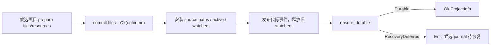

# ZirconEngine 架构审查与优化执行流

这份记录是现有性能计划的执行索引，不替代各模块 owner 计划，也不把历史静态审查提升为当前验收。当前工作区含有其他会话和用户的既有修改；每次实施前都必须按路径确认 owner，不能用整树清理或回退建立假干净基线。

## 1. 当前架构地图

```text
Product/CLI
  -> zircon_app::entry::EntryRunner / ProductComposition
  -> RuntimeSession (versioned C ABI, owned output/release, wake registration)
  -> zircon_runtime::CoreRuntime
       -> module/service lifecycle + TaskGraph + EventBus + frame clock
       -> World/ECS + scene generations + asset/project authority
       -> render extract -> render graph -> RHI/WGPU submission
  -> App frame host (Winit cadence, host requests, redraw, surface/present)

zircon_editor::retained_host
  -> EditorRuntimeGateway / SessionGateway
  -> the same RuntimeSession handle and viewport surface binding
  -> command/transaction/selection/save/reopen flows

Plugins
  -> catalog/discovery -> ABI/version admission -> runtime/editor registration
  -> lifecycle ticket -> callback/teardown barrier

Tooling
  -> managed Windows validation -> package/product evidence
  -> Tracy/WPR/RenderDoc/GPU timestamps only after a current product binary exists
```

### 1.1 关键调用链与权威 owner

| 业务路径 | 当前入口与核心链 | 权威状态 | 线程/失败边界 | 证据 |
|---|---|---|---|---|
| 启动 | `EntryRunner` -> `RuntimeSession::create_with_profile_and_project` -> versioned `create_session` -> module composition receipt -> Winit app | `RuntimeSession` 持有 ABI handle、动态库和输出释放器；Runtime 持有模块图与 World | 创建失败须保留可清理 session；宿主线程负责窗口和 surface | E1，需 M0.3 current-source compile |
| 帧循环 | `about_to_wait` -> `pump_frame_loop` -> `tick_frame` -> host-request drain -> `request_redraw` -> redraw -> `capture_frame`/present | Runtime 产生 frame demand 与 owned output；App 负责 cadence、窗口生命周期和退出 | tick/present 失败走终止路径；请求和输出必须有预算、generation 与 affinity | E1/E2，需 F0/F2 动态证据 |
| 场景/渲染 | World commit -> derived scene -> camera-neutral render extract -> render graph -> RHI/WGPU | World/scene generation 应是唯一生产真值，per-view 只消费 sealed extract | commit、extract、GPU resource lifetime 需明确屏障和设备丢失回滚 | E2/E3 静态，动态阻塞 |
| 编辑器 | retained host -> `SessionGateway` -> command/transaction/selection -> Runtime operation -> save/reopen | Runtime registry/project persistence 是真值；Editor 只持 authoring projection | callback 不得跨任意 World 锁；save/import/close 必须可取消和有 deadline | E2 静态，F4 未验收 |
| 插件 | catalog/discovery -> ABI admission -> registration -> lifecycle callback -> unload barrier | 单一 catalog/version/lifecycle generation | ABI 拒绝、回调异常、卸载等待必须原子且可诊断 | E2/E3，M3 未验收 |
| 停机 | close request -> stop admission -> release viewport surfaces -> destroy session -> unregister wake | App owns host teardown; Runtime owns module/task shutdown | 失败必须保留可重试状态，不得静默 Drop 或跨线程释放 | E1/E2，需 F0/F5 |

## 2. 统一问题队列

问题先归最低共享 owner；以下条目是当前可追踪的队列，不代表全部已经复现。

| 优先级 | 问题与根因假设 | owner | 当前证据 | 最小验收 |
|---|---|---|---|---|
| P0 | `00` current-source Runtime -> Editor -> App 编译门未在同一指纹上闭合；旧请求/历史 receipt 不能替代当前编译 | `docs/plans/mvp/00` + 最早报错的 Runtime owner | 23:32 UTC Runtime check及53叶/17,871输入稳定记录保留为历史；后续共享输入已变。当前六叶App/Input切片通过格式/静态guard，native intake与直接checkout执行门仍开放，见7.41–7.44；没有当前批次Cargo结果 | 原生受管实际checkout package编译与聚焦行为回归；完整输入/产物身份、合法路径授权和进程终态对应，错误按最低owner向上收敛 |
| P0 | Event/Message writer 可以同时持有同一 Store 的完整可变引用，异类型 writer 缺少 typed channel ownership | Runtime event/message owner | 17-path typed owner/grant 实现与 7 项行为回归已冻结，独立源码审查未发现剩余具体阻断；23:32 UTC 生产代码 check 通过，测试目标、行为与别名模型验证待执行 | typed grant；observer 顺序、空批次、Message 延迟创建、retention 与唯一释放回归 |
| P1 | App host-request 链存在多次 Vec drain、编码/解码和逐帧重复预算工作，且 tick 与 drain 顺序需要真实产品证据 | App entry / Runtime10 | `performance/pending.md` 的 App 行；静态调用链已读，尚无 current product trace | 同一 fixture 记录 queue count、bytes、alloc、wait；稳定空批次工作为零且语义不变 |
| P1（静态、待复现） | 项目文件提交的 `RecoveryDeferred` 成功 outcome 通过资源同步回调；当前 PAM 调用者在 publication 后才以 `ensure_durable` 转 Err。磁盘结果与 active/resource generation 的处置责任需要统一 | Runtime04：PAM 复合激活事务 + ProjectManager 持久化 owner | 7.39–7.40；Root 重新读取当前 resource publication，Luna 重新读取迁移后的 `assets/open_project.rs` imports 与生产方法，顺序风险仍存在；无故障执行或数据丢失证据 | A→B 与同 root 重开分别验证。发布前分类持久性；同 root 须隔离旧 active 对已变化磁盘的写入，恢复后重新对齐 generation。仅 Active journal 回滚，AllCommitted 恢复保留新目标；CleanupDeferred 仍为成功。真实故障 seam、资源、watcher、事件和重开均需验收 |
| P2（静态、待复现） | 创建失败后的 `cleanup_failed_transaction_staging` 调用 `remove_transaction_path`，忽略删除错误，无法向调用方报告本次 staging 的遗留路径与次级清理失败 | Editor01/Runtime04：ProjectAuthority 创建事务 | 7.39；Root 与 Luna 读取实际错误路径，保护原目录的 ownership guard 已确认；没有动态残留或原数据损坏证据 | 发布前失败并令本次 staging 删除失败；原目标不变，主错误保留，遗留路径与 cleanup error 可恢复；不能删除外来目录 |
| P1 | ECS/scene/render extract 仍存在多套 generation、World/DTO clone 与 per-view 重建路径 | Runtime03/07/08/10/11、Render04/07/12/17 | `2026-08-15-world-ecs-frame-extract-current-architecture-review.md`；静态 E2/E3 | 单一 commit/extract generation；稳定帧无 full clone/rebuild；F2/F4 像素和编辑行为不变 |
| P1 | Render graph 以全量 `previous -> pass` 串行链、裸 handle、锁内 compile 和逐帧 lint 扫描限制并行并制造重复工作 | Render01/02/17、Runtime11 | `2026-08-15-render-graph-current-architecture-review.md`；源模型未实测 | versioned handles、编译锁外发布、可并行 ready width、稳定帧 lint allocation 为零；RenderDoc current MVP capture |
| P1 | Editor jobs/gateway 与 Runtime TaskGraph 存在并行调度权威；callback/World lock、同步 wait 和终止 generation 不统一 | Editor01/12/14、Runtime06/10/11 | `performance/pending.md` editor jobs/gateway closures；静态 E2 | 一个 task authority、bounded lease/deadline、callback 锁外、F4 save/reopen 和 shutdown fault injection |
| P2 | catalog/插件入口、source-shape tests、重复 DTO/兼容路径增加维护分支和 false-green 风险 | Plugin/ABI、Tooling、各最低 owner | 现有 review/pending 条目；未完成动态 parity | 删除前覆盖 feature/registration/reflection/ABI；行为/复杂度测试替代源码字符串测试 |
| P1（静态、待复现） | 最后Graph owner消失后，accepted submission的弱pool失效；prelaunch与dispatcher runner spawn都可能在终态/retire补偿前unwind | Runtime11/Core：TaskPoolSubmission、CallbackDispatcher、JobScheduler与Scope的共同寿命契约 | [当前关闭阅读](2026-10-13-shutdown-ownership-current-audit.md)第8节；公开Graph Drop不等待，scope/node无强Graph或Drop补偿，保留handle的wait无graph失效出口。dispatcher callback catch不覆盖runner spawn。与CR-RUNTIME-TASKS-0001策略TODO分开待证，无动态复现 | 使用真实Graph/Scope、受控依赖与保留handle，验证observer delivery、dependent终态/queued retirement、实际join和timeout重试；确定两非取消policy契约后再选修复，不能只检查不崩溃 |


## 3. 阶段与进入条件

### M0 架构阅读与归属确认

- 固定 source fingerprint、toolchain、workspace 状态计数和现有 failure/receipt 索引。
- 逐入口读 descriptor、lifecycle、schedule、World、extract、Gateway、plugin ABI 和 teardown。
- 为每项问题登记唯一 owner、调用链、线程约束、失败/退出路径和证据等级 E0-E4。
- 退出条件：所有 MVP 相关入口达到 E1；P0/P1 具有明确最低 owner 和验证计划；未读域保持 pending。

### M1 恢复可运行基线

- 依 `00 -> F0` 顺序修复 current-source 最早共享编译/启动阻塞。
- Windows 原生受管 Cargo 输出只写 `D:\cargo-targets`、`E:\cargo-targets` 或 `F:\cargo-targets`；先确认当前 builder 和磁盘容量。
- 仅在当前产品二进制可重复运行后验证 Tracy、RenderDoc、GPU timestamp、WPR 能力。
- 退出条件：可归因 binary、启动/退出诊断和工具能力矩阵；否则保持 `blocked_by_00`，继续修最低 owner。

### M2 并行审查与复现

- 按不相交源码范围并行静态阅读；复现代理只验证问题是否成立，不直接扩大修复范围。
- 动态问题必须有触发条件、根因、影响、样本 fixture 和 acceptance counter；静态风险不能写成瓶颈。
- 退出条件：问题去重完成，每条待修项均有 E2/E3 或明确待测状态。

### M3 分批修复与精简

- 先修最低共享原因，再更新全部消费者、测试、ABI/版本、持久化迁移和文档。
- 删除重复实现前检查 feature/cfg、反射注册、插件入口和外部契约；旧 ABI/旧格式按显式迁移或拒绝处理。
- 共享契约、根清单和跨模块迁移串行集成；每个可写文件只有一个 owner。

### M4 验证与性能对比

- 受影响 package focused batch -> 依赖完整波次 -> F0-F5 产品门；失败从最低支持层修复。
- 相同 fixture、profile、硬件和显示设置，优化前后各至少 5 次，稳态预热后采 30 秒，记录 p50/p95/p99、CPU/GPU、RSS、分配、等待、上传。
- Tracy 负责 CPU/线程/任务/等待；RenderDoc 只捕获当前 MVP 产品帧；WPR 补 CPU sampling、上下文切换和 I/O。

### M5 归档与下一轮

- 只将已读源码、问题处置、回归和动态验收齐全的模块移入 accepted/review；待验收项留在 pending。
- 每个里程碑写一条带 source/artifact fingerprint 的 outcome；未完成问题保留 canonical failure 链接。

## 4. 当前并行任务包

当前目标要求 **至少 3 个 Luna/max 并行，总 subagents 最多 5 个**。计划安排 3 个 Luna 模块/独立复核槽位和最多 2 个 Sol 核心槽位；Root 不计入 subagents。只有具备实际工具访问并完成阅读的任务才计覆盖，当前工具限制及实际运行结果见 7.25。Luna 负责模块阅读、问题复现设计和独立复核；核心代码、跨模块契约及修复决策由 `gpt-6.1-sol`、`reasoning_effort="max"` 辅助完成。后续新任务使用 `fork_turns="none"`，任务包提供明文范围和源码指纹。主代理作为唯一 Main 写入者，串行集成共享接口并执行本地批量验证。

| 工作池 | 并发上限 | 职责 |
|---|---:|---|
| 模块与独立复核 | 3 | Luna/max 阅读、复现设计及消费者审查，按 MVP 门槛安排。 |
| 核心实现与决策 | 2 | Sol/max 辅助核心实现和独立决策，按窗口复用槽位。 |

2026-10-05 当前安排为 10 个 Luna 代理：Editor 生产修复、raw 字节组合、Controller 行为回归、Core/Scene 跨模块组合及独立复核；Shader 证据消费者迁移、真实 PS/Rust 桥接回归及独立复核；现有 M1 产品验收路径整理；性能工具只读能力核对。候选与元数据写入各自授权的 D 盘目录；主代理在完整变更复核后集成 Main。历史 Sol 候选和审查继续保留，其未完成项已有限交接。

每个返回必须包含：源码路径与行号、调用链、触发条件、根因、影响等级、owner、建议切片、回归测试、证据等级，以及是否与已有 pending/review 条目重复。主代理负责去重、串行迁移和最终验收；代理报告不直接解除任何 MVP gate。

## 5. 当前边界

- 旧本地协调器及其 lease/heartbeat/claim/replay 流程已退役；本记录不请求、不恢复也不推断任何外部服务端点。
- 保留其他会话的文件、索引、进程、历史 receipt 和未跟踪内容；不以 `git reset`、整树删除或手工清理制造基线。
- 当前 Query 切片保持原有精确应用记录；最新 Runtime package check 没有绑定其全部 46-path 指纹，focused 行为、性能和 MVP 验收仍开放。
- 当前阶段结论只表示架构流程和 owner 归属已经建立；M1/M2/M3/M4/M5 仍开放。

## 6. 本轮并行审查结果

以下结论均来自当前源码阅读；没有把静态风险写成运行时瓶颈，也没有解除任何 MVP 或性能 gate。

| 编号 | 结论 | 最低 owner | 进入修复前的证据门 |
|---|---|---|---|
| R1 | `CoreRuntime::shutdown_until` 的模块错误早返已改为完整模块/graph 聚合；相同绝对 deadline 继续 graph 关闭，保留模块主要错误和 graph 次要错误。 | `core/runtime/shutdown.rs`、模块 shutdown report 与 TaskGraph owner | 源码和消费者迁移已独立静态复核；Core 的 3 个失败/重试测试及 Dynamic close 的 2 个真实 scope/module/native-worker 顺序与聚合重试测试尚未执行。RetainedPacket 仍只在完整 Core 成功后标记完成，graph 成功回执不能绕过失败模块。 |
| R2 | 默认 App 的 `gamepad-gilrs`、Editor/Dev 的 DesktopApp/Reactive、Runtime Idle、帧许可内 polling 生产链已确认；没有 Gilrs 事件到 Winit proxy 的独立唤醒接线。 | App entry / gamepad polling | 动态复现 pending；最小方案是单一可取消/join 的 Gilrs owner、有限事件队列、空转非空合并 proxy wake，保留 ABI 和 rumble 结果。超时检查取消时不能请求帧；退出验收还依赖 R11。 |
| R3 | surface unbind 失败后 App 清零状态并释放 Window，Runtime ledger 却保持 Bound；ABI 只复制 HWND，RHI 要求 native owner 活到 surface session 销毁。 | App surface lifecycle + RuntimeSession binding ledger | 9-path 实现与受控 ABI provider 已独立静态复核：解绑失败保留宿主资源，销毁成功后才释放；销毁失败沿用既有 fatal 边界。10 项行为回归及独立 fatal child 尚未执行；真实 HWND/Destroyed/Suspend/rebind 验收仍开放。 |
| R4 | 动画 pose 的 mesh 存在性检查先构造完整 `SceneNode` 投影，只为读取 `mesh.is_some()`；这会放大 extract 分配。 | `scene/level_system_render_extract.rs`，必要时 World cheap presence API | profile pose 数量、投影分配和直接组件 presence 查询的对照；没有采样前保持 pending。 |
| R5 | shader PBR viewer 的 `build_viewport_render_packet` 无条件 clone World；静态或重复请求可能重复投影重建。 | `scene/world/render.rs` 与 viewer caller | 用稳定重复帧 profile 确认 clone/投影成本，再设计可复用 prepared snapshot，保持 mutable render systems 语义。 |
| R6 | render graph compile 的依赖推断与 resource state plan 分别扫描 access/history，可能重复工作；影响 graph compile/recompile，不等于每帧执行成本。 | render graph builder compile/inference | 加 visit counter 和代表性 graph compile 样本，确认重复访问后再合并中间表示。 |
| R9 | 多 primitive mesh 的 render extract 为每个 snapshot 重复 clone 同一 `morph_weights`，大权重向量会按 primitive 数量放大分配。 | `scene/world/render.rs` 的 mesh snapshot builder | 用多 primitive + 大 morph fixture 记录 snapshot 数、morph bytes 和分配；先确认 `RenderMeshSnapshot` 的 ownership/ABI，再考虑共享 backing。 |
| R7 | Event/Message writer 原先同时持有同一 Store 的完整可变引用；当前实现改为分别借用稳定的类型队列与受同步保护的活跃元数据。 | Runtime event/message owner | 唯一 owner 保存 `Box::into_raw` 的原始分配指针，类型查找只借 owner 元数据；错误的 shared payload 转可变草稿已保留并撤回。23:32 UTC 生产代码 check 通过；7 项真实回归、测试目标编译、别名模型及成本测量待验收，不推断整个 Scheduler 的安全性。 |
| R8 | Query/ECS 46-path 切片已精确应用，原 normal run 在 compiler 前阻塞；新的独立 Runtime check 不关闭该切片的行为、MVP 或性能门。 | Query/ECS owner + `00` baseline | 保留原 validation receipt，当前 toolchain 已可运行，后续绑定切片指纹执行最小 focused batch；不重放旧请求。 |
| R10 | 项目打开后替换已登记的资产根时，普通 World 保存和 Editor 事务的写入 guard 都重新解析登记根，将新目标作为授权基准；现有 ignored regression 只检查共享 URI 解析器。 | `PackageAssetRegistry` + 两个写入消费者 | 最低 owner 与实际保存调用链已独立静态确认；注册时保留身份、两个消费者共用基准。动态故障、真实保存、目录替换竞态及路径验收仍开放。 |
| R11 | 锁定 Gilrs 0.11.2 默认启用 FF；其 server 线程丢弃 JoinHandle，channel 断开后循环仍继续。WGI 已有 stop、回调注销与 join，FF 是本次剩余 owner 缺口。 | Gilrs FF lifecycle / App gamepad owner | 官方锁定源码与 cache 字节一致，调查时 master 的 FF server 也未修复。保留 rumble 的独立取消、设备清零与 join 候选仅存 OUT；尚未接入、编译或动态验证。App worker 的 join 不能替代依赖线程退出验收。 |

### 6.1 修复排序

1. 先恢复 `00 -> F0` 的可运行 current-source 基线，并解决 R1 的 shutdown 聚合语义；关闭路径不完整时不做运行时性能结论。
2. 在同一产品二进制上复现 R2/R3，再按最低 owner 修复输入唤醒和 surface rollback；每项先有失败测试或可重复 trace。
3. 以 profile counter 验证 R4/R5/R6 的实际成本，只合并能减少重复投影、clone 或 compile visit 且不改变 generation/ABI 契约的切片。
4. R7 的 typed writer ownership 与 R8 的 Query 迁移是正确性门，须在依赖它们的产品验收前完成；R10 在持久化门复现并修复。完成 focused、依赖波次和 F0-F5 后再接受 Tracy/RenderDoc 性能结论。

## 7. 当前独立编译恢复证据

2026-10-03 UTC，主代理使用 `python -B -m tools.dev.local_cargo` 执行 `check -p zircon_runtime --locked`，目标位于 `D:\cargo-targets\zircon-local\windows\m1-runtime-default-20261004`。命令终止于 exit 101，实际报 15 条源码错误、431 条警告。

- 原始诊断：[diagnostics.jsonl](E:/zircon-profiles/engine-audit-20260930-01a0f06a/m1-runtime-check-20261003-diagnostics.jsonl)，SHA256 `f9a83376766b55c153479907c60193e09ecc7a14a5cd4439c4b0cd6ebf0eeab6`。
- 本地结果：[receipt.json](E:/zircon-profiles/engine-audit-20260930-01a0f06a/m1-runtime-check-20261003-receipt.json)，SHA256 `89c3d4d0d89c01abbd78c9f141fdbba375249065aacc6a2213be59c303256ace`。记录读时指纹不等于整树编译 source seal。
- 三个独立审查包确认：生命周期 `Option<Result>` 与导出、错误属性归属、IME 两层可见性、缓存组件 import、typed root resolver、序列化 borrow/move 顺序、导航类型/关联函数、操作服务 checked snapshot reservation。
- 10-path before 字节已保留在 [before.json](E:/zircon-profiles/engine-audit-20260930-01a0f06a/m1-runtime-forward-20261003-r1/before.json)，原业务实现、外来修改与索引保持；局部前向修正已应用。操作服务超预算行为另需真实 focused regression。
- 修正后的 `check -p zircon_runtime --locked --message-format=short` 已终止于 exit 0；[本地回执](D:/cargo-targets/zircon-local/windows/m1-runtime-default-20261003-r1/runtime-check-receipt.json) 记录 10 个修正文件前后指纹一致，整树 source seal 和正式验收仍为 false。[编译日志](D:/cargo-targets/zircon-local/windows/m1-runtime-default-20261003-r1/runtime-check-short.log) SHA256 `b22aab757187ca1e557822692ff2f2dd8e4e1b8a8eb685dd30049d56b45ba8ee`；Runtime lib 仍报告 1656 条警告，其中 25 条重复。此结果只关闭本轮 15 条编译错误，不提供测试、Editor/App 或 F0-F5 验收。
- `git diff --check` exit 0。7 个无既有格式差异的文件通过 `rustfmt --check`；场景、导航和操作服务的原有格式差异保持。格式检查不提供行为或编译验收。
- RenderDoc MCP 的一次只读 `list_instances` 返回 0 个实例；MCP 方法可调用，但当前捕获/回放能力未验收，没有执行 capture。

### 7.1 后续源码与测试门

首个停机回归使用原有 `graph_report` 接口，但 `cargo test -p zircon_runtime --lib --locked module_failure_still_returns_graph_receipt` 在测试目标编译阶段失败：38 条源码诊断、1693 条警告，测试执行数为零。[原命令回执](D:/cargo-targets/zircon-local/windows/m1-runtime-default-20261003-r1/core-shutdown-baseline-red-receipt.json) 保留 exit 101 与 5 个选定文件前后指纹；[原日志](D:/cargo-targets/zircon-local/windows/m1-runtime-default-20261003-r1/core-shutdown-baseline-red.log) SHA256 `879012fb5e35519dc6f75878dde3513274c4e2c4f2a5bdf1303cb7f472fc0751`。这不是 R1 行为复现成功；其中 10 条诊断来自新增 snapshot 测试调用内域私有方法。

支持层已前向修正测试文件定位、descriptor/asset/snapshot 导入、工厂闭包借用类型、ProjectManager mutable fixture 及最小内部可见性；缺失的 World publication 子模块已补入 5 个真实 owner/generation/lifecycle 行为测试。[10-path before 与 delta](E:/zircon-profiles/engine-audit-20260930-01a0f06a/m1-runtime-test-support-20261003-r1/before.json) 保留原字节。这些修正的测试目标尚未完成编译，不能称 38 条错误已关闭。

R1 的 [4-path before 与 delta](E:/zircon-profiles/engine-audit-20260930-01a0f06a/m1-core-shutdown-aggregate-20261003-r1/before.json) 保留原模块/动态调用方/App 测试。完整聚合测试已替代临时单项测试；操作 snapshot 的 3 个测试也已挂载。7 个新/契约/测试文件通过 `rustfmt --check`，既有支持文件的无关格式差异保留；格式与静态审查不能替代编译和测试。

较早的 D/E/F 可用空间样本均低于 `tools.dev.local_cargo` 的 35 GiB 启动门。21:16 UTC 的一次只读样本显示 F 盘回到 35.915 GiB，但随后新的 Runtime `test --lib --no-run` 在实际启动预检时 exit 2：目标盘再次不足 35 GiB，Cargo 未启动，没有 compiler artifact 或测试执行。[该独立预检回执](F:/cargo-targets/zircon-local/windows/m1-runtime-tests-20261003-r2/runtime-test-compile-receipt.json) 保留 27 个选定文件前后指纹一致和 `formal_acceptance: false`，没有重放历史请求。

后续顺序保持 Runtime affected check/tests → Editor → App → F0-F5；容量门实际通过后再执行新的独立本地命令并保留原回执。当前新代码的编译、行为、MVP 与性能验收继续开放。

旧协调器已退役。独立 Jenkins 的只读 status 因托盘源码与激活版本不一致而失败；此观察不提供当前 MAIN 端点、恢复结论或历史 transport 故障根因，也不授权重启或重放既有请求。Runtime -> Editor -> App 与 F0-F5 继续开放。

### 7.2 当前源码切片与验证配置

R3 的 [9-path 当前后像与完整 delta](E:/zircon-profiles/engine-audit-20260930-01a0f06a/m1-app-surface-lifetime-20261003-r2/after-r2-sha256.json) 及 [独立源码报告](E:/zircon-profiles/engine-audit-20260930-01a0f06a/m1-app-surface-lifetime-20261003-r2-independent-review.json) 保留原文件字节。fatal child 的返回与 panic 路径直接退出，避免 Drop 补发 abort 造成误通过；父进程有 10 秒退出观察和 1 秒终止观察期限，只有确认退出后收集输出。受控 provider 使用真实 App/RuntimeSession/绑定账本与 ABI，但没有创建物理 Window，不能关闭 native window 门。

App 默认 `check -p zircon_app --locked` 保留 Gilrs。R3 行为批次另使用 `test -p zircon_app --lib --locked --no-default-features --features shipping-runtime,dynamic-api entry::runtime_entry_app::surface_present::lifecycle::tests -- --test-threads=1`；默认 App libtest 不会包含这组受 `!gamepad-gilrs` 保护的回归。两种配置分别验收。

R7 的 [17-path manifest](E:/zircon-profiles/engine-audit-20260930-01a0f06a/m1-event-message-owner-20261003-r1/manifest.json) 与 [独立源码报告](E:/zircon-profiles/engine-audit-20260930-01a0f06a/m1-event-message-owner-20261003-r1/typed-channel-owner-independent-review-r1.json) 绑定当前 typed owner、读写 grant、消费者与文档。State 不缓存跨轮 payload 指针；同类型读写冲突仍由原准入规则拒绝，observer 顺序与 Message 延迟发布保持。回归覆盖异类型交替写入、reader 共存、准确的元组错误、空批次、frame/ID/retention、scoped thread 及 clear/World drop 唯一释放。结构回放、源码审查和生产代码 check 不提供测试目标、行为或 Miri 验收；新增分配、Atomic 和 Mutex 的成本尚未量测。

R11 的 [依赖调查与候选](E:/zircon-profiles/r2-r11-gilrs-shutdown-support-20261003/shutdown-support-report.md) 基于官方提交 `07e286e24b046cf39e5c367daa2770b805a64692`，包含 FF owner 和真实 MsgServer 测试候选。依赖来源、许可与受维护 package 的接入方式尚待确定；Main、Cargo cache 和默认 FF 配置保持。真实线程退出、设备停振及 native 调用期限仍须验证。

当前 [00 基线流程](../mvp/00-current-source-baseline-recovery.md) 已与协调器退役规则对齐。23:09 UTC 的一次整合样本显示 D/F 盘分别有 37.857/37.040 GiB；M8 的 `soleEntryEnforcementApplied` 仍为 false，独立本地入口继续适用，实际命令仍须通过 35 GiB 启动检查。新的 Runtime check/test → Editor check → App check/聚焦回归按当前后像验证，源文件变化则保留原结果并重新归因。

本次 [有限协调结果](E:/zircon-profiles/engine-audit-20260930-01a0f06a/m1-coordination-boundary-20261003-r3.json) 记录 Jenkins status exit 1 的激活版本不一致阻断，当前 MAIN 端点与实际服务负责 chat 未得到验证。该记录不改变历史请求或任何 MVP gate。

### 7.3 当前生产代码 check 与新的测试编译边界

23:25–23:32 UTC，新独立命令 `check -p zircon_runtime --locked --message-format=short` 已终止于 exit 0。[本地回执](D:/cargo-targets/zircon-local/windows/m1-current-validation-20261003-r3/runtime-check-r1-receipt.json) SHA256 `5a6c23b1a8bf43e0c6ff71073e5ab2bd8adb9a4c8ac8b86923f176fda8094fa6`，绑定 R1/R3/R7 与测试支持等 53 个选定文件，并记录 17,871 个 workspace Rust/Cargo 输入前后无变化。它是该次共享源码观察上的独立编译证据，整树 source seal、测试执行与正式验收仍为 false。

后续 Runtime libtest 的 D 盘尝试在 35 GiB 预检 exit 2，Cargo 未启动；新的 F 盘尝试通过容量门，但依赖索引请求继承的 `127.0.0.1:7897` 代理不可连接，entry exit 101。原回执分别保存在 [D 盘预检](D:/cargo-targets/zircon-local/windows/m1-current-validation-20261003-r3/runtime-test-compile-r1-receipt.json) 和 [F 盘代理失败](D:/cargo-targets/zircon-local/windows/m1-current-validation-20261003-r3/runtime-test-compile-r2-f-receipt.json)，没有重放旧协调器请求。

沿用用户此前选定的直连方式，仅为新验证子进程设置代理覆盖；全局配置保持。00:02–00:05 UTC 的 [直连尝试](D:/cargo-targets/zircon-local/windows/m1-current-validation-20261003-r3/runtime-test-compile-r3-f-direct-receipt.json) SHA256 `7fdee73055a4f3d82bf6402ba001c029cfc7b5877af10ed91294f38079c61380` 已取得依赖并实际编译，但在 `zircon_runtime_interface/build.rs` 终止于 3 条编译错误、entry exit 101，测试执行数为零。该次 53 个选定文件与 17,871 个观察输入前后稳定；与 23:32 check 之间有 13 个共享输入变化，因此前一结果不能替代后一次编译。

最低层错误是把字符串拼接表达式放进 `format!` 的首参数。主代理保留 [当前共享原像、精确 delta 与后像](E:/zircon-profiles/engine-audit-20260930-01a0f06a/m1-interface-render-support-20261004-r1/postimage.json)，只改为含 `{literal}` 的格式字符串；既有 BuildSet 验证、生成契约、所有其他外来字节和 HEAD/index 保持。build.rs 后像 SHA256 `86858edc3a7fb92d3f3adf66c0fa9361d6a544f5775b5f2fc261ce8e56571f8b`，[独立源码复核](E:/zircon-profiles/engine-audit-20260930-01a0f06a/m1-interface-render-support-20261004-r1/renderer-independent-review-r1.json) 未发现剩余源码阻断。新的 54 文件独立验证已开始，日志已记录新 build-script 可执行产物；完整测试目标编译和行为结果仍待返回。

真实隐藏 Window 的 [OUT 测试候选](E:/zircon-profiles/engine-audit-20260930-01a0f06a/m1-app-surface-lifetime-20261003-r1/out/physical-window-candidate-sol/README.md) 及 [独立源码报告](E:/zircon-profiles/engine-audit-20260930-01a0f06a/m1-app-surface-lifetime-20261003-r1/out/physical-window-candidate-sol/independent-review.json) 尚不提供合入、编译或运行证据。Winit 的 Window Drop 只投递销毁消息，因此候选同时检查无额外强引用的 Weak owner 计数、HWND 和创建线程，并等待真实 OS Destroyed；仅 `IsWindow` 不能证明 App 仍持有 owner。该 Destroyed 仅覆盖 App 外层回调不重入 ABI，内部 `handle_window_destroyed` 分支未被执行；实际 RHI/GPU/DLL worker quiescence 继续开放。

后续 [聚焦验证清单](E:/zircon-profiles/engine-audit-20260930-01a0f06a/m1-current-validation-batch-20261004-r1.json) 合并停机、typed writer/observer、snapshot、World publication 和动态会话重试，随后验证生成契约与 Editor/App。清单是准备记录，运行中的原命令须先终止并核对实际结果，清单本身不提供通过证据。

R10 的 [有限支持层审查](E:/zircon-profiles/engine-audit-20260930-01a0f06a/m1-r10-root-identity-support-20261004-r1/root-identity-independent-support-review-r1.json) SHA256 `c2ab1f3b24fa0faf6430907709acb7869d3398cfcc93247c86baab0669c0c769` 确认已有 canonical 路径在两个写入入口被重新解析；重复校验仍会刷新同一授权基准。修复候选须在现有 registry 成功注册时捕获 resolved identity，保留路径顺序、别名预登记、失败原子性与既有 owner/clone 边界。13 个审查文件前后指纹一致，但没有运行目录替换或保存；resolved path 身份也不等于持有文件对象句柄，最终检查之后的竞态仍是独立开放门。


### 7.4 当前受限写入与验证边界（2026-10-04 UTC）

当前 chat 的 15 项真实文件操作探针已终止并全部通过：[当前命令探针回执](E:/cargo-targets/zircon-local/codex-permissions/chat-probe-504f92c3f96948858545508ae4c15c70/receipt.json)。结论限于该次命令及继承子进程；其他 chat 与宿主后台进程没有由此获得权限证明。以后新证据、临时文件与编译缓存均写明确授权的 `D/E/F:/cargo-targets/zircon-local`；历史 `E:/zircon-profiles` 仅作只读引用。

本轮实际路径查询发现部分历史 E/D 回执与候选文件当前不存在，原记录保留为历史记录；没有删除、迁移或重建旧证据，也没有获得缺失原因或负责者证明。R7 当前 17 路指纹的 [独立续核](D:/cargo-targets/zircon-local/evidence/engine-audit-20260930-01a0f06a/m1-r7-typed-channel-owner-current-boundary-review-20261004-r1.json) 未发现新源码阻断，完整 alias/Miri、测试执行与成本门仍开放。R3 当前 9 路实现保持，受控 provider 不含真实 Window/ HWND；物理窗口候选尚未应用。

R1 的 [真实 Dynamic close 测试与精确 delta](D:/cargo-targets/zircon-local/evidence/engine-audit-20260930-01a0f06a/m1-dynamic-shutdown-behavior-20261003-r1/postimage-r2.json) 覆盖 scope 先排空、module 后清理、graph 最后实际 join，以及完整错误来源和原 runtime 重试。旧 session lifecycle 的字符串顺序断言已迁到行为测试，mirror/core/process-log 顺序守卫保留。格式检查通过，行为尚未执行。

本次有限 [服务与准备边界记录](D:/cargo-targets/zircon-local/evidence/engine-audit-20260930-01a0f06a/m1-current-validation-20261004-r4/coordination-boundary.json) 保存正常 Jenkins status 的 exit 1：`Jenkins 协调器尚未正式启用`。当前 MAIN 端点和负责 chat 未经验证，进程详情查询被权限拒绝，zr_vm 全组 census 与 capture readiness 未得到证明。没有 START、hold、服务恢复或旧请求重放。

当前 M8 `sole_entry_enforced` 实际为 false，D 盘新样本有约 168 GiB 可用空间。本轮 [20,396 个所选 Rust/Cargo 输入观察](D:/cargo-targets/zircon-local/evidence/engine-audit-20260930-01a0f06a/m1-current-validation-20261004-r4/source-before.json) 只是读时指纹。新的 Runtime `test --lib --no-run` 准备在 [MSVC 启动环境预检](D:/cargo-targets/zircon-local/evidence/engine-audit-20260930-01a0f06a/m1-current-validation-20261004-r4/runtime-test-compile-r1-launcher-failure.json) exit 1，Cargo 未启动、测试为零；环境修复使用新独立命令身份。当前源码编译、行为、Jenkins、MVP 和性能验收继续开放。


### 7.5 当前目录迁移、依赖与实际编译边界

本轮实际查询确认独立本地验证入口已经迁到 `tools.dev.local_cargo`，Cargo 工具 crate 的实际目录为 `tools/cargo`、package 名仍为 `cargo-zircon`。主代理只前向修正根 workspace 中该成员路径，保留所有其他共享清单和源码字节：[精确原像与 delta](D:/cargo-targets/zircon-local/evidence/engine-audit-20260930-01a0f06a/m1-tool-workspace-owner-path-20261004-r1/postimage.json)。自有验证 runner 同步新入口，生产验证工具未由主代理修改。

正常直连 Cargo 下载在 Schannel `SEC_E_NO_CREDENTIALS` 失败；Python 默认 HTTPS 证书及主机名校验能取得完全匹配 `Cargo.lock` 的归档。只在授权 D Cargo cache 补齐三项实际缺失输入：`brotli 8.0.4`、`brotli-decompressor 5.0.3`、`ttf2woff2 0.13.1`，逐项校验锁定 SHA256 与读回值，保留原失败回执。没有全局代理、TLS 校验关闭或 C cache 修改；见 [两项 Brotli 归档](D:/cargo-targets/zircon-local/evidence/engine-audit-20260930-01a0f06a/m1-current-validation-20261004-r4/runtime-locked-brotli-archives-r1.json) 与 [ttf2woff2 归档](D:/cargo-targets/zircon-local/evidence/engine-audit-20260930-01a0f06a/m1-current-validation-20261004-r4/runtime-locked-ttf2woff2-archive-r1.json)。这些准备不等于网络路径、编译或测试验收。

[Runtime libtest 编译 r5](D:/cargo-targets/zircon-local/evidence/engine-audit-20260930-01a0f06a/m1-current-validation-20261004-r4/runtime-test-compile-r5-dev-entry-offline-receipt.json) 已实际终止于 exit 101：328 条 compiler artifact、6 条 Interface 编译错误、测试为零。20,400 个所选输入前后未变，不封存新路径或外部 sibling。最早错误是生产生成器被迁到 `zircon_runtime_interface/tests/unit/build.rs` 后 Cargo 没有构建入口，两个 `OUT_DIR` 缺失导致后续生成符号缺失。

主代理准备了生产 `build.rs`、独立六项 unit tests 与真实生成器测试引用的三路径修复候选，但应用前观察到共享源码已经完成相同生产入口修正。主代理没有覆盖或认领该源码；[当前重叠观察](D:/cargo-targets/zircon-local/evidence/engine-audit-20260930-01a0f06a/m1-interface-build-owner-20261004-r2/current-observation-before-root-apply.json) 记录实际三个后像、未知外来 owner 和仅 JSON fixture 缩进的候选差异。[r6 原命令](D:/cargo-targets/zircon-local/evidence/engine-audit-20260930-01a0f06a/m1-current-validation-20261004-r4/runtime-test-compile-r6-current-layout-offline-receipt.json) 已终止于 exit 101：401 条 compiler artifact、38 条 Runtime 错误、测试为零；Interface custom-build 与 lib 已产生实际产物。23,680 个所选输入中 187 项在运行期间变化，结果不能作为当前整包或整树验收。

[新输入清单](D:/cargo-targets/zircon-local/evidence/engine-audit-20260930-01a0f06a/m1-current-validation-20261004-r4/source-before-r3.json) 用当前可见 Rust/Cargo/JSON 路径与独立验证入口重新选取 23,680 项输入，r6 已逐项重读；它仍不提供 index、ignored output、submodule 或 zr_vm 整树 seal。App 的真正 tests owner 已迁到 `lifecycle/tests/cases.rs`；按新挂载准备的 sol-r2 物理窗口补丁已独立复核并应用，执行门见 7.6。

R1 Dynamic/Core 的 [原聚合语义源码复核](D:/cargo-targets/zircon-local/evidence/engine-audit-20260930-01a0f06a/m1-dynamic-core-shutdown-behavior-source-review-20261004-r1.json) 没有该范围 blocker，仍不提供实际 join 或行为通过。后续 Core 调用准入迁移暴露新消费者与 cleanup/失败回滚契约缺口，当前整体 R1 继续开放。Gilrs 第三版候选已覆盖 `Message::Open` 的设备 owner，仍未接入；自线程 join、原生驱动期限及依赖写入边界未关闭。SystemState 和 QueryState 的设计复用现有唯一 World token，显式传入旧/新 World 完成转移；当前尚未实现。


### 7.6 当前源码修复与清理契约

主代理已在十个 Runtime 路径完成 UI 与测试支持修正：mesh profiling 引用使用真实目录深度、Commands 测试传入单元素 Bundle；BlockBox 在递归前复制槽位 padding；滚轮翻译在移动 context 前读取坐标。Atlas 采用独立构建错误，完整 cell 的尺寸、padding 溢出和容量均先验证，不截断矩形或 UV；保留首个 ID 请求和固定排序。空裁剪持续保留 `Some` 零面积帧，未启用自身裁剪的节点透传祖先裁剪。

[实际源码、格式与 diff 回执](D:/cargo-targets/zircon-local/evidence/engine-audit-20260930-01a0f06a/m1-runtime-ui-lower-contract-repairs-20261004-r1/final-source-receipt.json) 记录八项新增回归及格式/diff exit 0；[独立 UI 复核](D:/cargo-targets/zircon-local/evidence/engine-audit-20260930-01a0f06a/m1-runtime-ui-lower-contract-repairs-20261004-r1/independent-ui-lower-contract-review-sol-r1.json) 绑定十个后像和十四个消费者，八个 UI 文件获源码批准，其他两路径仅核对哈希。Editor 的既有唯一 pointer owner 已在真实滚轮 handler 补齐坐标，未增加第二份状态。全部新测试与既有真实 arranged/paint/scissor 回归尚未执行。

R3 的四路径 sol-r2 [独立源码复核](D:/cargo-targets/zircon-local/evidence/engine-audit-20260930-01a0f06a/r3-physical-window-candidate-20261004-sol-r2/physical-window-independent-review-core-r1.json) 通过后，主代理按当前十八个上下文指纹应用。应用后的字节差异经逐文件核对为 Git 的 LF/CRLF 转换；[实际最终源码回执](D:/cargo-targets/zircon-local/evidence/engine-audit-20260930-01a0f06a/r3-physical-window-candidate-20261004-sol-r2/root-canonical-final-source-r1.json) 记录格式与 diff exit 0。测试使用真实隐藏 Window、无强引用的 Weak 观察及明确的提前释放对照，包含实际 OS Destroyed 外层路由与内部防御分支。编译和原生窗口执行仍为零，不提供 RHI/GPU/DLL worker 退出验收。

Core 的普通 resolve 已返回 `ServiceCallGuard`，旧 Arc 消费者须完成迁移；长期持有使用 durable handle，每次调用取得准入。现有 cleanup 在外部准入关闭后仍走普通 resolve；部分 build 失败回滚还涉及关闭、排空及 generation 复位顺序。现有三个 sol 子代理继续分工完成完整消费者/清理契约、独立复核与 SystemState/QueryState 身份迁移；不能用五个 facade 类型修正替代完整生命周期验收。

本次有限协调核对只确认当前 Jenkins `active.json` 不存在，现用 MAIN 端点和实际服务负责 chat 未经验证；历史请求、队列和封存保持。按当前增量交接规则，新增产物只包含 scoped patch、源码指纹与元数据，不再创建源码副本或 bundle。当前编译、行为、Jenkins、MVP 和性能门全部保持开放。

### 7.7 World 身份、清理 owner 与消费者迁移

当前源码完成了以下批次，均保留共享修改和索引归属。实际编译与行为执行仍待后续完整消费者批次。

| 范围 | 当前实现与源码复核 | 待执行回归 |
|---|---|---|
| World / SystemState / QueryState / Animation | 复用现有唯一 World token；移动保留身份，克隆和反序列化取得新身份。活动 SystemState 在错误 World 上拒绝 run、retire 和普通 rebind；显式 `rebind_to(old, new)` 先构造替代状态，再在旧 World 退休原状态。Query 重绑重建 D/F access 与全部计划，动画五组缓存和 revision map 一起重置。 | 6 项真实 reader lease、初始化失败、World 移动/克隆/恢复、不同组件注册顺序及动画暂停实例回归。 |
| Core 清理 owner | `ModuleCleanupContext` 仅在外部准入关闭、调用与初始化排空后借用该模块的现有实例；不初始化 Lazy 服务。build 的 Err/panic 仍进入关闭与补偿清理；失败保留原代次与 Stopping。迟到工厂对象释放完成后才解除初始化占用。Platform/Text/UI 改用该清理入口；Text 的 Draining 不再返回成功。 | 9 项真实 Core 注册表、旧代次、部分 build、迟到工厂析构、投影 guard 释放顺序和外部文本 family 重试回归。 |
| Dynamic Session 与重载队列 | 每次访问取得短 guard；Session 先释放视口，成功后释放 UI 文本 family，再关闭 Core。视口失败保留原 bridge 与 UI 供重试。队列仅持有原 Core/token；源失效后保存原错误、取消任务并等待物理结算，正常帧保留完整报告后返回 CoreStep。 | 2 项真实 Session 关闭回归和 3 项已注册队列源失效/重激活/任务结算回归；Session 与队列结算联动另待补齐。 |

World 批次的 [14 路最终源码](D:/cargo-targets/zircon-local/evidence/engine-audit-20260930-01a0f06a/m1-system-state-world-owner-binding-canonical-final-20261004-r2.json) 与 [主代理独立复核](D:/cargo-targets/zircon-local/evidence/engine-audit-20260930-01a0f06a/m1-system-state-world-owner-binding-root-independent-review-20261004-r1.json) 保持原 r2 记录；主代理随后把身份检查改为借用 token，仅新建状态时克隆一次，[四路径后续回执](D:/cargo-targets/zircon-local/evidence/engine-audit-20260930-01a0f06a/dynamic-service-call-and-shutdown-20261004-r1/root-followup-canonical-r1.json) 同时记录队列错误接线，格式/diff 均 exit 0。可变 Query 的入口仅读取 tick，现有缓存检查在投影前拒绝错误 owner；未添加重复检查。已迁到 `docs/crates/zircon_runtime/scene/ecs.md` 的文档超出当前写授权，保持只读。

Core 的 [23 路最终源码](D:/cargo-targets/zircon-local/evidence/engine-audit-20260930-01a0f06a/core-cleanup-owner-20261004-sol-r1/core-owner-final-source-receipt-r1.json) 与 [清理 owner 独立复核](D:/cargo-targets/zircon-local/evidence/engine-audit-20260930-01a0f06a/core-cleanup-owner-20261004-sol-r1/core-owner-root-independent-review-r1.json) 记录局部格式/diff exit 0，9 项测试尚未执行。当前新增的两种外来 alias helper 只在构造时共享对象，源身份与后续双准入仍待统一修复；这些 helper 的字节保持，未作为已验收实现。Platform manager 的持久 driver、PreparedLevel/补偿释放、VM 回调与 Editor job 等消费者仍须按原 44 类矩阵完成迁移。

Dynamic Session 的 [八路径实际源码](D:/cargo-targets/zircon-local/evidence/engine-audit-20260930-01a0f06a/dynamic-service-call-and-shutdown-20261004-r1/root-canonical-source-receipt-r1.json) 与 [两项关闭回归](D:/cargo-targets/zircon-local/evidence/engine-audit-20260930-01a0f06a/dynamic-service-call-and-shutdown-20261004-r1/session-shutdown-regressions-canonical-r1.json) 保留外来短 Text guard 修改和实际 before/after。新增视口测试使用真实 Core Lazy 槽与正常 Bridge 调用，受控 provider 只验证顺序与重试；直接 Drop、DLL/RHI/GPU worker 退出继续开放。

输入、资产访问与重载队列的 [13 路消费者批次](D:/cargo-targets/zircon-local/evidence/engine-audit-20260930-01a0f06a/core-consumer-immediate-guard-20261004-r1/evidence.json) 已完成局部格式/diff；新增 fixture 的 [独占目录修正](D:/cargo-targets/zircon-local/evidence/engine-audit-20260930-01a0f06a/core-consumer-immediate-guard-20261004-r1/fixture-ownership-r2/evidence.json) 保留预先存在的路径，并在递归清理前核对真实目标归属。源码审查、格式及差异检查均不替代新的 Runtime 编译、产品回归或 Tracy/RenderDoc 前后测量。M1 与整体 MVP/性能验收保持开放。

### 7.8 新编译边界与剩余迁移

[r7 独立原生命令](D:/cargo-targets/zircon-local/evidence/engine-audit-20260930-01a0f06a/m1-current-validation-20261004-r4/runtime-test-compile-r7-fresh-inputs-offline-receipt.json) 已 terminal 101：Runtime lib test 的 `--no-run` 编译报告 40 个错误，测试执行 0。重新发现的 24,994 项选定输入前后无漂移，HEAD 和 index 哈希一致；这不是整个工作树或外部 zr_vm capture seal。原 r6、旧协调器请求和失败回执均保留，不重放。

[实际诊断分工](D:/cargo-targets/zircon-local/evidence/engine-audit-20260930-01a0f06a/r7-current-compiler-repairs-20261004-r1/r7-root-routing-and-format-reconciliation-r1.json) 覆盖 guard 导出、同步材质访问、alias 工厂、PreparedLevel 发布和清理测试迁移。主代理已补齐 Core 的 `ServiceCallGuard` 导出，并把材质 readiness 的四个 Arc 克隆及重复闭包改为同一次准入内的共享借用；[两路径源码回执](D:/cargo-targets/zircon-local/evidence/engine-audit-20260930-01a0f06a/r7-current-compiler-repairs-20261004-r1/source-final-r1.json) 仅提供格式/diff exit 0。其余类型推断诊断须在新编译中确认，不能按预计消失计为通过。

统一 alias 修复采用原物理实例、精确代际、借用投影与双准入；Owned 和 alias 的 idle token 均移除私有服务 Arc，只保留弱 Core 和身份。活动 guard 在调用结束前持有服务与真实准入。该实现正在进行，尚无编译、行为或 native code pin 验收。UI 重激活测试允许地址复用，以注册代际、旧 token 拒绝和新配置为实际 oracle。

PreparedLevel 的下一切片将让发布、编辑器安装与失败回滚共享一次 lexical admission；未提交 seed 不持有活动 guard，Drop 不重新解析关闭入口。既有 gateway replacement mutex 无可中断期限，本批不声称新增 hard deadline。VM 回调及 Editor 持久 job 的后续范围见 [实际消费者计划](D:/cargo-targets/zircon-local/evidence/engine-audit-20260930-01a0f06a/core-cleanup-owner-20261004-sol-r1/core-persistent-consumer-readonly-plan-r1.json)。

Session 与重载队列的联动回归将放在本组新建的私有测试叶，使用真实注册资源事件、Compute 工作项和原结果结算；不写 owner 未知的现有 prepared-project 测试叶。模块零时长 probe 与已过期绝对 deadline 是不同入口，源确实卸载和原 token 的真实拒绝必须作为前置 oracle。后续执行仍需 Runtime 编译、集中行为测试、产品 F0–F5 以及实际性能采集。

### 7.9 PreparedLevel 事务与真实 Session 结算回归

PreparedLevel 的七路径切片已完成串行合入，[最终交接](D:/cargo-targets/zircon-local/evidence/engine-audit-20260930-01a0f06a/m1-prepared-level-transaction-20261004-sol-r1/s1-prepared-level-final-handoff-r1.json) 和 [主代理源码复核](D:/cargo-targets/zircon-local/evidence/engine-audit-20260930-01a0f06a/m1-prepared-level-transaction-20261004-sol-r1/s1-root-independent-source-review-r1.json) 绑定当前后像。seed 只存精确 idle token，World/resource 字段先于 token 释放；准备阶段取得短 guard，发布、真实消费者安装和私有借用回滚共享一次准入。安装期间不持有 registry mutex；Err/panic 先移除 registry 项并释放暂存资源，再释放 guard。旧公共 publication 对象已移除，Editor 保留原安装错误和失败前的 gateway/作者状态。

四项 Runtime 行为回归覆盖成功与失败发布、原 panic、关闭和重激活后的旧代次拒绝，以及关闭期间资源先释放再重试清理。Editor 新回归从实际 Registered replacement 把 gateway 推进到最大代次，再通过实际 Prepared replacement 触发原 `GenerationExhausted`，核对 registry 回滚和旧作者仍可访问。五项回归均未执行；源码复核与格式检查不提供编译或行为验收。registry/gateway mutex 仍无可中断期限，外部保留的 LevelSystem clone 仍属于消费者资源 lease。

Session 新私有测试叶已实际加入：[源码回执](D:/cargo-targets/zircon-local/evidence/engine-audit-20260930-01a0f06a/session-reload-source-settlement-canonical-20261004-r1/evidence.json) 和 [主代理独立复核](D:/cargo-targets/zircon-local/evidence/engine-audit-20260930-01a0f06a/session-reload-source-settlement-canonical-20261004-r1/root-independent-review-r1.json)。它通过真实资源事件、原 Compute 任务、零时长模块 probe、原 token 拒绝与原任务的物理 Cancelled 结算，检查重复帧不丢错误、不重复取消且终态才退休原任务。实际运行仍待 Runtime 测试目标可编译。

Core alias 写入时发生的新正文已写入、后续截断失败的部分修改已经按当前字节修复；[失败补充记录](D:/cargo-targets/zircon-local/evidence/engine-audit-20260930-01a0f06a/m1-core-alias-canonical-first-hunks-20261004-r1-failure-addendum.json) 明确原 `written=[]` 不等于没有修改。原记录保留，后续采用正常 scoped Git patch；完整 alias 工厂和持久消费者迁移尚未封存。下一编译使用新独立命令身份，原 r7 和历史协调器请求保持。

### 7.10 同实例 alias 封存与 r8 编译边界

Core alias 的 [29 路最终源码记录](D:/cargo-targets/zircon-local/evidence/engine-audit-20260930-01a0f06a/m1-core-same-instance-alias-canonical-20261004-r2-final-source.json) 已封存；[独立终审](D:/cargo-targets/zircon-local/evidence/engine-audit-20260930-01a0f06a/m1-core-same-instance-alias-independent-source-review-20261004-sol-r1.json) 确认全部后像匹配，未发现具体 alias 算法阻断。两个注册入口共用同一 binder，逐项校验原 Core、槽位、代次、模块依赖和工厂准入；闲置 token 只持弱引用，实际调用同时准入原对象和别名，并在释放准入前释放投影。Asset、VM、Scene、Navigation、Platform 及所选插件使用原对象的借用投影。八项新回归尚未执行；注入 factory 的既有 Arc、VM 原 Option 错误粗化、native code pin、self-clone、worker 停稳和性能仍属开放边界。

[r8 独立编译原回执](D:/cargo-targets/zircon-local/evidence/engine-audit-20260930-01a0f06a/m1-current-validation-20261004-r4/runtime-test-compile-r8-unified-alias-offline-receipt.json) 已 terminal 101，593.17 秒，401 个依赖产物、2 个编译错误，测试执行数为零。24,998 个所选输入、HEAD 和 index 前后稳定；错误从 r7 的 40 个降至 2 个，不表示测试或产品验收通过。剩余错误是 PreparedLevel 的 ServiceHandle 导入和 alias fixture 的 HRTB 对象寿命签名。前者在编译结束后的当前源码已更正，归属尚未证明，Root 与 App 原 owner 均未写入此次更正；当前外来字节保持。[本次终态路由记录](D:/cargo-targets/zircon-local/evidence/engine-audit-20260930-01a0f06a/m1-current-validation-20261004-r4/r8-root-terminal-routing-r1.json) 保留原诊断与来源边界。后续采用新的独立命令身份编译当前源码，再执行已注册的真实行为测试；历史请求不重放。

### 7.11 Runtime r9 编译与真实限定回归

alias fixture 的对象寿命签名已按 [精确补充记录](D:/cargo-targets/zircon-local/evidence/engine-audit-20260930-01a0f06a/m1-core-alias-r8-fixture-lifetime-forward-r1-addendum.json) 前向更正，生产 binder 保持。[r9 原编译回执](D:/cargo-targets/zircon-local/evidence/engine-audit-20260930-01a0f06a/m1-current-validation-20261004-r4/runtime-test-compile-r9-fixture-signature-offline-receipt.json) SHA256 `08967ddb17925fcc4ac61f26d38c6aabd8019be8c6ff1b3c19f4b13e8f09ac45` 为 terminal 0，402 个编译产物、零编译错误；命令是默认 features 的 Runtime libtest `--no-run`，该命令没有执行测试。25,002 个所选输入中有 18 项在编译期间变化，涉及外来 zr_vm、Editor、GPU Scene 和 UI 源码；这些变化保持原归属。本轮产物编译成功不提供当前整树源码封存或产品验收。

随后对该原始测试二进制实际执行了 57 项精确回归：[实际行为回执](D:/cargo-targets/zircon-local/evidence/engine-audit-20260930-01a0f06a/m1-current-validation-20261004-r4/runtime-r9-artifact-focused-57-r1-receipt.json) SHA256 `bd43df52f2607a1d64a0e05a7c4bfa4e675335b87a71145af6c1eabe0be3ec7b`，exit 0，57 passed、0 failed、0 ignored，7.53 秒。覆盖 Core alias 8 项、Core cleanup 9 项、World system binding 5 项、typed Event/Message ownership 7 项、Session lifecycle/source settlement 3 项、PreparedLevel transaction 4 项、UI 边界 21 项。所选测试源码未变化，原二进制前后 SHA256 均为 `18d281149c22b6c505c0187d349838e7c35a2ea5bb55bb9dd4e186121d0adf22`。这是该 r9 产物的真实限定行为证据；Editor、其余受影响回归、当前源码编译、原生窗口/GPU/DLL、Jenkins、MVP 与性能门继续开放。

### 7.12 普通资产导入的提交后取消边界

已合入三叶 [普通导入修复候选](D:/cargo-targets/zircon-local/evidence/engine-audit-20260930-01a0f06a/editor-import-postcommit-candidate-20261004-r2/candidate.patch) 及 [Root 合入记录](D:/cargo-targets/zircon-local/evidence/engine-audit-20260930-01a0f06a/editor-import-postcommit-candidate-20261004-r2/root-canonical-integration-r1.json)，后者 SHA256 `53de9afac2bb25d462b6e97442971b1cd6a96a7a4433c0ed3e9d63d4d70709af`。普通 job 保留调用前的取消检查；Runtime 后端返回已提交的 `Ok(Some(status))` 后，晚到的取消继续返回原成功结果。`None`、原错误、panic、共享任务、缓存与 index lease 路径保持。真实回归通过注册 Core/Asset/Tasks 模块执行实际导入，核对 artifact/meta/registry、资源与目录代次、共享 ticket/cache、原任务终态及诊断；该 Editor 回归尚未编译执行。

首次 scoped Git apply 返回 0，但 Git 的 `core.autocrlf=true` 将三叶转成 CRLF，后像断言失败。Root 核实三叶的 LF-normalized SHA 与候选逐项一致，再以精确实际字节针前向恢复原 LF；未重放原补丁、未改 Git 配置或 index。最终三个后像、rustfmt 和 diff 检查均通过。此处只完成源码合入，原 token、活动项目身份、EditorManager 持久消费者和产品/性能验证仍按各自门继续推进。

### 7.13 Runtime r10 与性能工具的限定回归

[r10 编译回执](D:/cargo-targets/zircon-local/evidence/engine-audit-20260930-01a0f06a/m1-current-validation-20261004-r4/runtime-test-compile-r10-query-reload-pose-offline-receipt.json)：exit 0，743.13 秒，402 个产物、零编译错误，默认 features 的 no-run。25,010 个所选输入中七项变化（外来 VM header 一项、Shader 六项），HEAD/index 稳定；不提供整树或外部 capture seal。

[r10 实际限定行为](D:/cargo-targets/zircon-local/evidence/engine-audit-20260930-01a0f06a/m1-current-validation-20261004-r4/runtime-r10-artifact-affected-query-reload-pose-r2-receipt.json)：52 passed、0 failed、0 ignored，24.01 秒。覆盖 Query 41、注册重载源 3、R4 存在/pose/帧 guard 4、队列顺序/报告 3、Session 结算 1。3,851 个相关源码指纹稳定，二进制前后 SHA256 为 80c468611e9a1fa46cd2b8caa9c6108c1da7c715e2892e37eef5192c31536b9a。[原 r9 的 42 passed / 5 failed](D:/cargo-targets/zircon-local/evidence/engine-audit-20260930-01a0f06a/m1-current-validation-20261004-r4/runtime-r9-artifact-query-and-settlement-47-r1-receipt.json) 保留，原五项失败在新产物的受影响组通过。四项旧测试契约已修正，生产 Query 保持；队列稳定裁剪已结算任务的 FIFO 占位并释放计费，未结束工作保持。R4 四叶改用借用的 mesh-node 存在检查，保留代次、空帧、顺序和 pose Arc 所有者。首个执行器误预计 Query 42，在实际列表后、测试启动前停止；[原预检失败](D:/cargo-targets/zircon-local/evidence/engine-audit-20260930-01a0f06a/m1-current-validation-20261004-r4/runtime-r10-artifact-affected-query-reload-pose-r1-receipt.json) 保留，新 r2 按实际 41 执行。

性能工具九叶路径修复和两叶测试修复已合入。原 Pester 26 passed / 4 failed 保留，实际原因是三项无消息异常断言及 Describe 范围 provider mock 污染硬链接测试。完整非法路径矩阵、硬链接数据检查和 native Times0 保留。[新四叶 Pester 回执](D:/cargo-targets/zircon-local/evidence/engine-audit-20260930-01a0f06a/m1-current-validation-20261004-r4/profiling-output-pester-four-r2-receipt.json)：30 passed、0 failed/skipped/pending，十项输入稳定。采用 own JSON；测试 PE/ETL/recorder mock 只提供工具行为证据，真实 Tracy/RenderDoc/WPR 和性能仍未采集。

Editor 原 token、保存回执与项目切换 fence 继续完成必要消费者和真实回归；随后推进 App、物理窗口/DLL、F0–F5 与优化构建性能测量。R4 成对成本诊断仍为 D-only ignored 测试候选。独立 shader viewer/publication 输出祖先边界另有实际待修问题。最新有限协调核对只确认独立 Jenkins active.json 不存在，当前 MAIN 端点和实际服务 owner 地址未知；历史请求/队列/封存保持，zr_vm 无 START/hold。整体 M1/Jenkins/MVP/性能接受继续开放。


### 7.14 2026-10-05：Shader 实际工具回归与 Editor 修复闭包

- Shader r3 七叶已由 Root 全文复核并按当前 raw pins 接入；normal apply / scoped diff check 均为 0，所有后像精确匹配，观察到的共享 index 658da596… 在本次写入前后保持，未操作索引或旧协调器。
- 新的独立两叶 Pester 原始运行实际执行 59 项：39 passed / 20 failed / 0 skipped / 0 pending；21 个工具与测试输入前后稳定。完整失败记录保留，不以结构检查代替运行结果。全部 14 项 publication 检查已通过，覆盖实际 exclusive lock/heartbeat、stale recovery/quarantine、atomic/immutable receipt、ordinal/full-artifact hash 和四项真实 junction/hardlink 写前拒绝及原数据保留。
- 20 项失败仍开放：19 项由 contract 默认 RepoRoot 少一层导致定位到 tools/zircon_app；1 项由 realtime_ibl_profile_test_support.rs 已迁入 environment/tests 而固定路径未迁移。额外源码审查发现 mandatory dot-sourced source-closure helper 未进入原 17-tool fingerprint 列表。现有 owner 正形成 coherent forward delta，同步精确 producer / Python strict consumer / PS 与 Python fixture 列表；不移除关键输入，不重放旧请求。
- Editor ordinary import 的原 active ProjectManager packet activation identity 设计已冻结并由 Root 全文审阅：19 叶闭合正常更新、未发布准备、排队 A→B、same-root reopen、旧 lease 条件清除和真实 manager unchanged-delta producer。实现仍为 D-only，编译与行为验收开放。Scene 两叶伴随切片独立 source review 无必改项；须与完整原 service admission 迁移组合，尚未采用独立编译或项目一致性验收。
- 保存九叶 r4 独立复核为 CHANGES_REQUIRED_SOURCE_ONLY：缺少实际 serialized-source receipt 的 completion error 必须返回原 typed source。真实 zero-byte / overflow 的 receipt-before-count 与 baseline-before-error 修正保留；后续 r5 正形成私有真实 Host regression child。panic-after-write、batch actual report/typed error 保留、投影失败与 ClosePrompt dirty-empty 自动关闭、完整消费者迁移仍开放。
- 同一份有限协调观察保持：独立 Jenkins activation descriptor absent，当前 MAIN endpoint / recovery / actual service-owner address 未核实；旧 coordinator retired，原请求和历史记录保留。没有 zr_vm START/hold、恢复旧服务、重放、外部通知或推送。Runtime52 与输出工具30已有通过证据保持各自范围；本节无新增 Cargo、产品捕获、MVP/Jenkins 或性能收益接受。

本节证据：
- [Shader r3 Root adoption](D:/cargo-targets/zircon-local/evidence/engine-audit-20260930-01a0f06a/m1-shader-profile-output-candidate-20261004-r1/revisions/review-r3/root-canonical-adoption-r1.json)
- [Shader59 native receipt](D:/cargo-targets/zircon-local/evidence/engine-audit-20260930-01a0f06a/m1-current-validation-20261004-r4/shader-profile-pester-two-r1-receipt.json)
- [Project activation design](D:/cargo-targets/zircon-local/evidence/engine-audit-20260930-01a0f06a/m1-editor-import-project-activation-fence-design-20261005-sol-r1/design.json)
- [Scene2 independent review](D:/cargo-targets/zircon-local/evidence/engine-audit-20260930-01a0f06a/m1-editor-scene-original-admission-candidate-20261004-r1/candidate-independent-review-r1.json)
- [Save r4 independent review](D:/cargo-targets/zircon-local/evidence/engine-audit-20260930-01a0f06a/m1-editor-manager-original-generation-forward-20261004-sol-r1/document-save-receipt-subcandidate-r4-independent-review-sol-r1.json)

### 7.15 2026-10-05：Shader 受影响回归通过与当前并行边界

Shader 四叶前向修复已完成审查并接入：默认 contract Root 按实际目录向上四层，固定源码路径跟随真实 `environment/tests` 挂载；mandatory source-closure helper 同时纳入 producer、Python strict consumer、PS 与 Python fixture 的精确 18-tool 集合。原 17 项及顺序保留，未削弱关键输入校验。normal apply / scoped diff 均 exit 0，四个 raw 后像精确匹配；共享 HEAD/index 的本次观察前后保持，Root 未操作索引。

新的独立 Viewer Pester r3 实际执行 45 项，全部 passed，零 failed/skipped/pending；21 项工具/测试/解释器输入前后稳定。采用同一 PS 7.6.5、Pester 3.4.0 与 own JSON，保留原 59 项中的 20 个失败及独立 r2 执行器换行预检失败（测试与新执行器写入均未开始）。publication source/test/shared guard/support 未变，复用原 14 项实际通过，不重复执行。当前工具范围证据为新的 45 项及原 14 项各自的准确输入，不能提升为真实 Shader viewer/GPU、Tracy/RenderDoc/WPR、Jenkins、MVP 或性能收益验收。

Python 四项受影响消费者验证已准备并正常发出独立执行；转入新轮次后原工具 session 85664 报 missing，当前没有终态 JSON，原日志尚空。现存 Python 进程归属尚未核实，原执行保留且未重复启动；该门继续开放。R4 pose 成对成本候选的独立完整源码复核无必改项，原 452 行精确保持；仍为 D-only ignored 诊断，优化编译、实际样本和产品性能全部未执行。

Editor 项目切换 fence 在 fresh before guard 检出四叶并行变化；完整候选未封存，也未按旧 D5 重放。保存 r6 物理 fixture 准备同样因 EventRuntimeHarness 支持源码变化而停止，后续仅前向合并当前 original handle body 与必要 test-only owned fixture。Root 的 project_access companion 也在写前拒绝：当前 foreign 修改已经完成三个 private guard 转发，内存 inverse 比较精确还原旧指纹；Root 未写入、恢复、认领或编译接受该叶。项目 activation、原始 EditorManager 句柄、panic-after-write、batch 实际回执/typed error 与 ClosePrompt 完整消费者验收继续开放。

当前工作采用替代版 AGENTS 的 `docs/tooling` 与 `tools/dev/local-cargo.ps1` 路径。独立 Jenkins activation descriptor 的有限只读样本仍为 absent，实际 MAIN endpoint / loaded source / recovery / service owner 地址未核实。历史379e、7a89、db667、Editor09/ECB及原回执保持，没有旧服务恢复、重放、zr_vm START/hold、新监控或外部通知。

本节证据：

- [Shader 四叶 Root adoption](D:/cargo-targets/zircon-local/evidence/engine-audit-20260930-01a0f06a/m1-shader-profile-output-candidate-20261004-r1/revisions/review-r4/root-canonical-adoption-r1.json)，SHA256 `8ba519bd99b7bdb334b9690531c3b724f2543298797000c9ebfa02ca26e8ecc9`。
- [Viewer45 实际回执](D:/cargo-targets/zircon-local/evidence/engine-audit-20260930-01a0f06a/m1-current-validation-20261004-r4/shader-profile-viewer-r3-receipt.json)，SHA256 `8335a552f45f0edef705aa6f1ee16204626361600f59a5769bade352dfebf3de`。
- [Project-access 当前并行观察](D:/cargo-targets/zircon-local/evidence/engine-audit-20260930-01a0f06a/m1-current-validation-20261004-r4/project-access-foreign-forward-observation-r1.json)。
- [R4 诊断独立源码复核](D:/cargo-targets/zircon-local/evidence/engine-audit-20260930-01a0f06a/m1-r4-pose-presence-paired-cost-candidate-20261004-r1/independent-review-sol-r1.json)，SHA256 `02d30e39e6e86149d8c29c4cf3c642a6180b911cecdff53bb4b8638c77395bc8`。

### 7.16 2026-10-05：R4 优化验证启动与当前采集／保存边界

R4 pose 成对成本诊断已完成独立源码复核并按 exact before 接入 Main。原 452 行保持，新增单一 ignored test；normal apply / scoped diff 均为 0，预期后像为 `8b67bcae…1d27`，七项支持源码及共享 HEAD/index 在写入前后保持。Root 首次预检因 HEAD 字符串多了后缀而停止，未改源码；该失败独立保留。诊断同时核对旧 find_node 深复制表达式与 borrowed predicate 的 entity 顺序、skeleton、pose 值／Arc 身份及 World generation/change ticks，不设置人为速度阈值。

原独立 profiling 编译已实际进入 Cargo：native session 85878、Root runner PID 16376、local wrapper PID 23664，使用 `test -p zircon_runtime --lib --locked --offline --no-run --profile profiling --jobs 2 --message-format=json`。25,229 项选定输入仅保存 hash 元数据；target/build/cache/compiler TEMP 位于允许的 D drive-root cargo-targets/zircon-local。当前启动证据不是终态编译通过，本节测试执行和成本样本仍为 0。优化产物、局部诊断、真实 Tracy/RenderDoc/WPR、整帧五次独立 30 秒样本与 F0–F5/MVP 各自继续开放。

Shader 退休迁移的 12 叶设计已冻结：实际 writer/Viewer 仍调用退休的 zircon-session 入口，独立 local Cargo 当前实际仅返回 subprocess 退出码，缺少真实 source-to-Viewer-artifact 终态证明。两叶 foreign local wrapper/test 变化已单独记录并保留，不恢复旧 pin、不制造 ticket 或 Jenkins 接受。真实 RuntimeProfile SessionId 与源码、工具、binary、HDRI、Ready/PNG/GPU/replay/publication 约束必须保持。

唯一 PS identity policy 修复已按 exact before 正常接入 `v15 → v18`，后像 `4a5737b0…31f1`，AST syntax errors=0；Rust/Python v18 消费者无需放宽。真实 PS producer → Rust loader 桥接未执行，完整 provenance 迁移及采集 readiness 未接受。原 Viewer45 与 publication14 回执按原输入保留；这一工具变化后，不能将原 21-pin 集合继续表述为当前完整匹配。

Editor 保存候选 r6-r2 已在 fresh foreign ServiceHandle support 上前向封存：12 叶虚拟格式／idempotence 与 apply-check 为 0，增加显式 owned physical fixture/config 路径，保留原 r5 八个生产 raw blocks。r7 另封存真实 SaveCtx owner 的六叶增量：无 actual source receipt 时 resume 原 panic Box；有真实 receipt 时沿原 HookFailedAfterWrite 保留实际 report 和 typed panic payload。七项实际写入／completion／panic 行为回归尚未编译或执行，fixture 独立复核正在进行。105 叶未封内存图已实际丢失，不再作为完整候选证据；原句柄、batch/ClosePrompt 和当前消费者闭包从持久化补丁／设计及真实源码继续恢复。项目 activation19 草稿已持久化，正式格式与完整复核仍开放。

原 Python consumer r1 工具句柄缺失、终态回执未取得；现有 Core/App 代理没有可将 PID 39260 归为自有进程的事实，Root 未重复运行或终止该进程。有限协调结论保持：Jenkins active descriptor absent，当前 MAIN endpoint／loaded source／recovery／实际服务 owner 地址未核实；旧 coordinator retired。原379e、04e8、7a89、db667、Editor09/ECB及所有历史回执保持，无重放、旧服务恢复、zr_vm START/hold、新监控、WeCom 或 push。

本节证据：

- [R4 Root adoption](D:/cargo-targets/zircon-local/evidence/engine-audit-20260930-01a0f06a/m1-r4-pose-presence-paired-cost-candidate-20261004-r1/root-canonical-adoption-r1.json)，SHA256 `cb789b9611305a527296ac5a570f36bf6356f9778b332c4823089729a67ace88`。
- [原 profiling started](D:/cargo-targets/zircon-local/evidence/engine-audit-20260930-01a0f06a/m1-current-validation-20261004-r4/r4-pose-cost-profiling-compile-r1-started.json)。
- [Shader frozen design](D:/cargo-targets/zircon-local/evidence/engine-audit-20260930-01a0f06a/m1-shader-provenance-retirement-design-20261005-sol-r1/design.md) 与 [Root policy adoption](D:/cargo-targets/zircon-local/evidence/engine-audit-20260930-01a0f06a/m1-shader-provenance-retirement-design-20261005-sol-r1/root-policy-line-adoption-r1.json)。
- [保存 r6-r2](D:/cargo-targets/zircon-local/evidence/engine-audit-20260930-01a0f06a/m1-editor-manager-original-generation-forward-20261004-sol-r1/document-save-receipt-subcandidate-r6-r2.json) 与 [SaveCtx panic owner r7](D:/cargo-targets/zircon-local/evidence/engine-audit-20260930-01a0f06a/m1-editor-manager-original-generation-forward-20261004-sol-r1/document-save-receipt-subcandidate-r7-panic-owner.json)。


### 7.17 当前有界协调结果与 Editor 源码复核（2026-10-05）

- 本轮只执行一次正常只读 Jenkins `status`：入口 exit 1，返回“Jenkins 协调器尚未正式启用”；当前 `active.json` 在读取前后均不存在，入口和退役文档字节未变。MAIN endpoint、loaded source、recovery 和实际服务 owner chat 均未核验；缺少启用描述符不能证明进程死亡或故障原因。唯一 sanitized receipt：`root-failure-roll-coordination-status-20261005-r1.json`，SHA256 `95f69ed16754e1b40eada63d7a237bea3de3e9bd71e1e81ce0d07f9c63064286`。原379e/04e8/7a89/db667/Editor09/diagnostic请求保留；本轮没有恢复旧服务、重放、状态修改、zr_vm START/capture/hold、监视、通知或推送。
- Core 项目 activation fence 正式19叶 patch `aefef8860679d16e971e55dacc4dad3054a1c51d7997d4ea8bf1c96a5ed6a3e6` 已由 Root 全文读取。独立 fresh 16-before+3-absent、63 hunks 内存回放、全部 virtual after hashes、normal apply-check 和 HEAD/index 守卫通过。Root review `dfffa7d0b6eb986880e5ea254423966f09b3b6dc4c3375c96a958601156bb38d` 只接受这一源码 slice；App 原 handle foreground caller/full-token 与 Root Scene companions 仍是整批接入依赖。两处 source-sync 均在同一次 index lock 读取 activation/catalog；六条真实回归未编译、未运行，19叶没有 Main/index 写入。
- Save receipt/panic-owner r7 的原15叶独立 review `738a1296d7b1a787714421c52472988509986f5433fadd7065c2e4ec59362acf` 发现 support 文件前进：当前 before `94b3d55ebe95249779939da5df0c457ccdb1e53b6790d778bc78e52c61bac991`，仅99–124行新增未归因 `register_test_editor_manager`。新 support-forward patch `94ef326aa86eb934f9146c2e7eff518fe9fa75f3c2024c95585dc97539ec914b` 保留该原始字节。Root 独立15叶 replay 验证其余14 after 精确旧r7，support在内存移除该外来范围后也精确旧after；review `9dae9aa8c5558da22b84d1b08a9d2ae45a8ed4f8209f60fa38efe4727c819a0f`。旧候选、失败的 formatter 尝试及 review 全保留，七条真实回归仍未编译、未执行。
- 同一 SaveAll/ClosePrompt producer/DTO/projection 的8叶 partial 已D持久化（patch `7e92b8dbe2884beee14487d1d4c2655139bace87bb01e1e68086518c68567546`），Root 已读全文，独立 Core review 延续。unknown/duplicate 保留原 request 和整批 owned completions；Saved/Failed/Stale 分别保留真实 report，typed JobError 不改为字符串替身；postprojection Err 拥有完整实际 batch result。另发现真实连续操作缺口：一次失败使用 allow_close=false，但 finish_save(empty,None) 没有保存失败决定，再次 Save 可经 NoDirtyDocuments→true 关闭窗口。实际 UI Save button/dispatcher 可达；App 正在原 PendingClosePrompt 内修复并准备真实连续 Save 回归，不新增 registry。该8叶仍不可独立接入或标记验收。
- 原优化编译仍由正常 native session85878 执行；当前日志观察415个编译产物、0个 observed compiler errors，但没有 build-finished、Runtime libtest executable 或终止回执，不是编译通过。单一 R4 配对 diagnostic runner 已D持久化并实际 Python AST compile=0：runner SHA256 `89ec16ef55fc6c3b592bd61d72553ffb530d9708714a98f0001433b82fc0fa56`，prepared metadata `0cef3a01f7b2927a142b31cf8fd4279aec891f52d183203da6d3370eeb9e0f8e`；该控制脚本一次 apply_patch 写失败后原字节核验未变，正常同路径精确修正已封存。没有调用该 runner；必须等待原编译真实 terminal0/opt3 artifact 后才运行 exact ignored selector。测试、配对耗时、Tracy/RenderDoc、5×30秒、F0–F5、整MVP性能结论仍开放。
- Shader 真实来源证明继续原独立工作组：现有固定包 input planner 不能充当 Viewer closure；新增 local evidence 路径使用实际 retained Windows Job/creation time/accounting/EOF 和 Cargo artifact 字节，明确 selected-input 前后观察不是 immutable compiler seal。低层 buffered pipe close 可在 active reader 时无界阻塞的真实 owner 问题已进入同一必要依赖；候选未接 CLI、未编译、未执行，不借用假 task/lease/ticket，也不挪用85878的 pending 作为 Viewer proof。原四项 Python consumer 尝试终态未知，继续保留，不重复提交。


### 7.18 原优化产物的实际成对诊断（2026-10-05）

原profiling native session85878已正常terminal0：416个编译产物、零compiler errors、build-finished=true；命令仅编译Runtime libtest。耗时12643.77秒，25229项选定输入中观察到115项变化，HEAD/index稳定。[原终态回执](D:/cargo-targets/zircon-local/evidence/engine-audit-20260930-01a0f06a/m1-current-validation-20261004-r4/r4-pose-cost-profiling-compile-r1-receipt.json)，SHA256 `7e5d82638943802c5956eeb60cd1cc3619aef00fdaf262f0d7946570307de644`。该成功不提供当前整树或外部zr_vm封存。

同一4461项相关源码范围内，Root逐项实读7个Runtime Interface diff，确认仅新增注释和空行；每项编译前hash与当前HEAD字节一致，after固定。原控制准备曾误拒绝插入空行，在所有输出写入前停止；修正仅接受这7组精确before/after，不新增通用语义归一化。[精确核对](D:/cargo-targets/zircon-local/evidence/engine-audit-20260930-01a0f06a/m1-current-validation-20261004-r4/r4-paired-cost-comment-reconciliation-r1.json)，SHA256 `7a18c2381cd1c71bcfcf748d5cc1cebcc00d506995560d319000e7dd1200a766`。

原unused diagnostic identity随后实际运行一次exact ignored selector：native PID32292，exit0、1 passed/0 failed/0 ignored，30组交替顺序样本完成；4461项相关当前输入和二进制前后稳定。[实际诊断回执](D:/cargo-targets/zircon-local/evidence/engine-audit-20260930-01a0f06a/m1-current-validation-20261004-r4/r4-pose-cost-profiling-diagnostic-r1-receipt.json)，SHA256 `3cee2fe3832445753787654e83d0ea87d22d52989fdcaa61645603d9b501c8e7`；二进制SHA256 `c7555a193879d095ee3cdf0062db8ffe4bffb0770a8630ad8c112de5a0b5486e`。

| 重型内存夹具，每样本8次pose筛选 | 旧find_node深复制 | borrowed mesh predicate |
|---|---:|---:|
| 30组样本的标准中位耗时 | 1.14925 ms | 0.15065 ms |

成对比值中位数为7.5646。真实prepare/extract对照同时核对entity顺序、skeleton、pose值/Arc身份及World代次/change/component ticks；独立复制见证在计时外。计时包含共有Vec/Arc工作，排除World锁获取、帧准备、GPU及产品整帧；编译器消除和机器噪声仍是限制，无速度阈值。此证据只接受该小段诊断，整帧五次独立30秒、Tracy/RenderDoc/WPR、F0–F5及MVP继续开放。

Editor另发现共同native-close入口可绕过原失败决定：dirty-empty直接关闭、dirty-nonempty重建Prompt均受影响。十叶r3在共同入口先展示并保留原pending，NoDirty重复Save保留失败，显式Cancel/Discard沿原逻辑。[Root十叶复核](D:/cargo-targets/zircon-local/evidence/engine-audit-20260930-01a0f06a/m1-current-validation-20261004-r4/root-ten-leaf-close-entry-source-review-r1.json)，SHA256 `9e7cced89259bc65522298c6027444b7d1df3bc4540fa87dc43c54aa027cb050`；55 hunks内存重建与normal apply-check0。

[独立29叶保存/关闭回归复核](D:/cargo-targets/zircon-local/evidence/engine-audit-20260930-01a0f06a/m1-editor-manager-original-generation-forward-20261004-sol-r1/original-token-real-save-regressions-forward-r2-independent-review.json)，SHA256 `59f112d0b8c32c689c47ab1040bb361287a5a880f094f469250fd37230ef0380`已实读，未见新增源码阻断。四条注册batch候选在代码中调用实际零字节source publication及原typed error/panic/Core代次；两条Main/Floating候选代码经实际test-backend on_close建立Prompt，lower实际投影失败清空dirty后重复close/Save/Cancel。测试尚未编译执行，也不证明物理HWND退出。后续34→47→60叶D-only候选补齐blocking保存、既有调用者和Controller/Shell锁外准入；完整typed extension、execution、sourceguards及Core19/RootScene2仍须一次闭合。Editor Main集成、当前编译与产品接受未完成。

Shader工具四叶候选的精确target/build sibling、retained Job/EOF/timeout CLI及真实errno修复正在Root接入前核对。5项新回归执行0，原四项Python consumer UNKNOWN仍保持，不重放。固定包input planner未形成真实Shader build/registry/驱动/provider闭包，selected-input端点观察不能充当immutable seal，compilerInputClosureVerified/captureAdmission仍false。唯一前轮协调结果保持，本节无新status/replay/restart/zr_vm START/hold/捕获/通知。


### 7.19 独立本地命令工具的实际原生回归（2026-10-05）

四叶local command evidence工具已由Root接入当前Main：`tools/dev/local_cargo.py`、`tools/dev/local-cargo.ps1`、`tools/jenkins/pilot/native/windows_job_process.py`、`tools/tests/test_local_cargo.py`。[接入回执](D:/cargo-targets/zircon-local/evidence/engine-audit-20260930-01a0f06a/m1-shader-provenance-producer-candidate-20261005-sol-r1/root-producer-r4-integration-r1.json)，SHA256 `fdadc48ee2f8332a1970172bf1f1aeacf28bafb325a26ab7d70ffe3ab6e28998`。原3叶生产body复用精确r1审查，新增artifact sibling、errno及完整测试body已实读；4项before/after原字节、AST、PowerShell ParseInput、正常apply-check和scoped diff均通过，HEAD/index稳定。两次控制预检在输出/源码写入前停止，分别为helper缺少__file__和LF补丁对CRLF context不匹配；修正逐行复制原context字节，addition沿原当前行EOL，不整叶改写换行，不推定foreign归属。

实际新原生/组件组：[5项回执](D:/cargo-targets/zircon-local/evidence/engine-audit-20260930-01a0f06a/m1-shader-provenance-producer-candidate-20261005-sol-r1/root-producer-r4-native-five-r1-receipt.json)，SHA256 `1fdf04f6e3b08bc53f660f76a16334e094d32f0cdc0b766310f347d3d99b6bff`，native PID3136，5 passed/0 failed/0 skipped，12.178秒。两项真实Windows回归分别证明原父进程退出后仍等待真实descendant/Job/管道EOF，以及超时失败的CLI正常退出、原blocker OS对象终止；其余三项覆盖物理namespace、实际源字节观察及精确target/build解析。fixture为独占D UUID目录，native身份未获或终态未定时保留，不清foreign输入。20项相关输入及HEAD/index前后稳定；Cargo、服务与旧请求重放均为0。

由于CLI parser/PS参数转发也改变，另运行既有默认组：[10项回执](D:/cargo-targets/zircon-local/evidence/engine-audit-20260930-01a0f06a/m1-shader-provenance-producer-candidate-20261005-sol-r1/root-producer-r4-default-ten-r1-receipt.json)，SHA256 `b477aadc571d2b4617420a9654c566e73412f9fbe93288aac87a1eff850cc91e`，native PID11836，10 passed/0 failed/0 skipped，14.441秒；没有重跑上述5项。覆盖default dry-run不写输出、不联系coordinator、真实PS package/filter/binary argv转发、物理根/alias/低磁盘前检、Runtime cdylib参数和退休convention消费者。相关输入及HEAD/index稳定；这组也没有Cargo或服务启动。工具范围所需本轮行为验证完成。

以上15项只接受local工具行为。compilerInputClosureVerified、immutableInputSeal、Shader captureAdmission、真实PS→Rust/private loader、Jenkins、MVP及产品性能接受仍false/open。schema3消费者迁移继续同一现有代理完成；原schema2历史审查、Viewer45/publication14、原四项Python UNKNOWN及Failure rolling各原请求均保持。

Editor 60/73/78叶后续partial另被独立复核发现同类CRLF/LF artifact问题：真实before针未漂移，但LF-normalized context不能称raw replay通过。App正在最末composer保每项真实equal行字节/EOL并重新绑定after与严格回放；这些历史partial保持D-only，先前相同生产body审查仍可复用。完整Core19/RootScene2/typed extension与原代次/owned-stop行为候选一起闭合后再整批接入及当前Editor编译，不把任何partial或源码guard计为产品验收。

### 7.20 Luna 接续与当前 Editor 修复边界

最新目标将后续子代理统一为 Luna/max、上限 30。本次 6 个任务继续已有修复和验收准备；旧 Sol 已封存候选、实际阅读范围、准确缺口和原工具终态。

Editor 最新 78 叶候选仍未集成 Main：`MenuAction::CreateNode` 缺少局部 `shell`，另两处 detach helper 将局部 `MutexGuard` 裸传给要求 `&mut WorkbenchShellStateData` 的真实接口，均需修正。三叶的 CRLF/LF 重建仍缺精确 raw 字节组合；真实 Controller 旧代次拒绝和关闭后 owned-stop 回归、Core 19 叶与 Scene 2 叶的完整消费者组合尚未闭合。Luna 实现与独立复核负责这些具体缺口，当前没有 Editor 编译或行为通过证据。

已经执行的 Runtime 30 对优化诊断和独立工具 15 项测试保留原回执，无重复运行。旧协调器失败请求、票据、归属与历史服务记录继续保留；本轮未重放请求、恢复旧服务、开始 zr_vm hold 或捕获，也没有新增服务可用性结论。


### 7.21 当前 Editor 原始字节候选合并（2026-10-06）

Root 已将 78 文件原始字节候选与三处菜单修复合成 r3：`CreateNode` 使用局部 Shell guard，两处 detach 调用传递 `&mut shell`。78 文件、330 hunks 的逐项 fresh before 指纹、严格原始字节重放和 `git apply --check` 均通过。原始 CRLF/LF 保留；准备脚本的一次错误块数假设在输出写入前失败，修正和原始失败均记录。

在此基础上，项目 activation 的 19 文件与 r3 范围互不重叠，已合成 [当前 97 文件候选](D:/cargo-targets/zircon-local/evidence/engine-audit-20260930-01a0f06a/m1-editor-core19-raw78-menu-union-20261006-root-r4/editor-core19-raw78-menu-current-r4.json)。393 hunks 的 fresh before、严格 after 重放及正常 apply-check 全部通过；patch SHA256 `310de9e664f04aec92de21c0f580de3f7f8e0d212376d6abb7ff6a1c934da3df`，manifest SHA256 `6fc7a4c1ab77ce65a811524618b162919a6e9910e7f12c520f1b302c5c5e284c`。该组合包含 Core 保存入口的原始 handle 参数及资产消费者的配套迁移。

97 文件首轮写前守卫发现 `ui/retained_host/app/tests/mod.rs` 前进，未输出候选。Root 实读整个当前模块和固定 HEAD：唯一变化为 `mod hierarchy_search_actions;`；内存中移除这一行精确还原原 before。新候选保留该外来注册行的字节，未推定作者、恢复源码或操作共享索引。其余 96 项 before 和全部 Core 19 项 after 精确匹配；本次 HEAD/index 前后保持。

Editor owner 另定位到场景适配器三处 Shell 内 service admission，正在保持同一原始 handle/guard 的前提下移到 Shell 锁前。场景适配器、其余 Scene helper、两个真实 Controller 旧代次/关闭准入回归分别按文件范围归属；整包消费者与返回类型继续独立复核。复核中关于 ExitPlay 重入死锁的静态假设已在实读 `request_stop` 和原 ServiceCallGuard 生命周期后撤回。

上述补丁仍为 D-only 源码候选，Main 代码写入、Cargo、行为测试、产品进程与捕获均为 0，`EditorClosureReady=false`。尚须合入场景/行为回归，完成整包复核、当前受影响 package 编译及聚焦回归；F0–F5、Jenkins 和五次独立 30 秒性能验收继续开放。原有工具 15 项及 Runtime 成对诊断证据保持准确范围。旧协调器请求与历史回执保留，没有服务恢复、请求重放、zr_vm START/hold、监控或外部通知。

### 7.22 当前 Editor/Core 101 文件已集成（2026-10-06）

Root 已完成原始字节组合及 Main 写入：[101 文件集成回执](D:/cargo-targets/zircon-local/evidence/engine-audit-20260930-01a0f06a/root-editor101-main-integration-20261006-r1.json)，SHA256 `14676e9ed8b28793f2e71cc44b559776aa10a953e66e792f755fc24c048f3f9f`。最终 patch `dcae839a65ec57883f215fe882a4fc0b2c583b59f2de21f343ae11ad86c9db71` 经 409 hunks 严格重放和 apply-check；101 项 postimage 逐文件回读匹配，scoped diff-check 为 0。HEAD、共享 index 和原 index.lock 保留；外来 hierarchy_search_actions 注册行保持原字节。

组合补齐 Scene 的单次 ProjectManager 快照路由、原始 AssetManager 准入、Shell 加锁前的三处场景准入与两个产品清理消费者，并加入真实 Controller 旧代次拒绝、关闭准入后 owned-stop 行为回归。App 部分的错误 hunk 数和 EOF framing、两项行为测试的错误上下文已按固定原始字节重新构造；409 个最终 hunks 为实际验证值，原 component deltaHunks 仅保留作历史准备信息。未使用模糊重放或覆盖外来源码。

这完成源码集成，尚未形成编译、行为测试或产品接受。受影响 package 检查已准备精确 116 项输入；首个工具动作在创建进程前遭 runner spawn_ready 拒绝，其后原生会话 69709 在 MSVC cl/link 前检失败退出 1，均未启动 Cargo，也未创建原 target/evidence 输出目录。磁盘上的 x64 MSVC 和 SDK 已实读存在，导入后 PATH 未含编译器目录；后续本地命令采用本次进程 PATH 补入已核实目录，实际结果另记原命令回执。私有 Shader Rust 两叶的未接受大实现保持原归属，正在准备完整精简候选，不计入 Editor 接受。

[一次当前协调入口结果](D:/cargo-targets/zircon-local/evidence/engine-audit-20260930-01a0f06a/root-current-independent-validation-route-20261006-r3.json) 实读旧服务已退役，Jenkins active/deployment-acceptance 描述符缺失；实际 MAIN endpoint 和服务 owner 尚未核实，未作健康、恢复或责任归因。Tooling379e、Runtime7a89、Resourcedb667、Editor09、diagnosticac4c 及其历史回执保留；没有重放旧请求、恢复旧队列、启动 zr_vm hold/capture 或外部通知。F0–F5、Jenkins、实际工具捕获与优化前后各五次至少 30 秒稳态测量继续开放。


### 7.23 当前编译失败收敛与核心审查（2026-10-08）

原三包 test-build r4 的真实 Cargo 终态为 exit 101，仍为失败批次。其原始进程终态、stdout/stderr、request 和 receipt 保持；97 项可执行产物消息中的 7 个合法双硬链接不能把失败批次提升为编译通过。原 124 项输入声明不含当前 Runtime Core 和新增 integration test，后续编译必须使用新的完整受影响输入范围。

Root 已修复四个真实编译消费者：ManagerServiceGuard 使用借用对象身份比较；Project scope 的 typed service name 使用实际字符串视图；重复字段断言保留真实 ExtensionRegistry/AssetTypeRegistry 包装；键盘测试在 Shell 锁前准入实际 EditorManager 并释放原 guard 后刷新 UI。Rustfmt 与 scoped diff 已通过，受影响 package 编译和行为执行仍待完整 UI/Core 变更闭合。

编译产物审计器已按 Sol 核心审查完成三个文件的严格原始字节集成。调用方的真实 target 叶目录与 build sibling 保持精确归属，拒绝重叠根；合法硬链接经完整原生名称枚举、所有别名的文件身份校验和 pinned physical path 的 GLOBALROOT 枚举后计算哈希。普通源码、状态及 receipt 仍拒绝硬链接。原 8 个 driver 指纹保留并加入实际依赖的 paths/windows_storage/compiled_products，产物审计后再次核对 driver 和物理映射。

实际 Windows 验证证明标准及自定义 target/build 的双硬链接通过，越界别名拒绝且原字节/链接保留。r2 控制脚本在这四项通过后因 Root 的注入位置错误终止，原失败回执不改写。r3 仅补执行剩余检查：映射变化拒绝、7 个原编译产物的原始哈希一致、3 项当前永久回归全部通过（failed/error/skipped 均 0）。没有启动 Cargo、产品或捕获；共享索引、外来锁及历史回执保持。这接受工具切片的实际行为，不能代替当前三包编译、F0–F5、Jenkins 或性能验收。

当前 10 个 Luna/max 并行审查；Sol/max 负责 ECS、UI、Shader provenance、产品/性能控制和项目身份时序。ECS 已确认在途注册跳过图验证、整帧快照期间注销后续 worker，以及保留/替换 Schedule 的恢复问题；候选正在统一现有 registry/plan owner，等待完整生产回调回归和独立复核。UI 当前 Unreal owner 与已删除 Shell 资产的消费者失配，修复必须覆盖实际模块导航、Run、组件示例及全部编译/治理消费者，未集成中间候选。

旧性能控制器没有实际启动 Tracy/RenderDoc/WPR/GPU 采集，不能用于性能接受。新的控制器保持同一 F0–F5 工作负载、优化前后各五次独立运行、预热后至少 30 秒，并绑定真实工具输出与原产品 PID/creation time。工具存在、源码补丁和日志指标均不能替代真实捕获；原生指标接线、完整当前产物、旧项目迁移和全部产品门继续开放。

历史协调器与 Failure roll 请求保持退役及原状态。已有一次入口结果的 endpoint/service owner 仍为未核实；本节没有重放、恢复服务、zr_vm START/hold、监控、外部通知或推送。旧文档转发控制的工具观察句柄缺失且终态回执未获，保留为未核实；本次使用新的当前文档指纹守卫，不重放旧控制。

本节证据：

- [工具三叶原始字节集成](D:/cargo-targets/zircon-local/evidence/engine-audit-20260930-01a0f06a/root-artifact-exact-roots-correction-20261009-r2.json)，SHA256 `b08df315cce43aeafe506f5f9210edc70dad33b51c15f77da6e32d683d9373bd`。
- [原生四项通过及控制失败原回执](D:/cargo-targets/zircon-local/evidence/engine-audit-20260930-01a0f06a/root-native-artifact-verification-20261009-r2/receipt.json)，SHA256 `bb08d25a2b91bddd0c6d938b3f4af4deb1ea3d2008696bff212acd40b8276f90`。
- [剩余原生验证与三项真实回归](D:/cargo-targets/zircon-local/evidence/engine-audit-20260930-01a0f06a/root-native-artifact-verification-20261009-r3/receipt.json)，SHA256 `3a2ccd5924aef924ab072d79994435b79bacdc5eac913080500b1f88adf15948`。
- [已返回的一次协调入口结果](D:/cargo-targets/zircon-local/evidence/engine-audit-20260930-01a0f06a/root-current-independent-validation-route-20261007-r4.json)，SHA256 `a05c874f49aabfde0e1dca7795a2d41794d01806e9eb9514b61e2366b8322aad`。

### 7.24 当前并发配置调整（2026-10-09 UTC）

用户已将目标调整为最多 5 个 subagents、至少 3 个 Luna/max 并行；核心代码和决策继续由 Sol/max 辅助。当前工具包含 Root 的总上限也是 5，因此当前安排为 3 个 Luna 复核（项目激活、UI 消费者、当前编译输入）和 1 个 Sol 核心调度修复。Root 继续作为唯一 Main 写入者，负责批量验证与采样控制。此前标明日期的并发记录保留为历史。

全引擎 M0–M5、功能保留、完整消费者及一次性数据迁移、F0–F5 和同条件五次优化前／五次优化后、预热后至少 30 秒的实测要求保持开放。当前项目激活补丁已产出，仍在完整源码与行为回归复核；没有把源码候选当作编译或产品接受。


### 7.25 当前调度生命周期与 UI owner 复核（2026-10-09 UTC）

本轮继续最低未完成的 MVP 00，不将源码候选、静态复核或历史产物登记为模块接受。原项目激活九文件切片已在 Main：七个生产/注册文件与原候选一致，两个测试与格式整理后的集成回执一致；原九项行为回归仍等待当前原生执行，没有重复套用补丁。

三个 Luna/max 已同时委派，但该模型的当前子代理上下文未提供可用文件工具，并把明文任务消息显示为不可解释的载荷。更换为明文任务文件后，三份返回仍明确不能读取文件。它们不计为已完成审查。本轮实际核心工作由两个 Sol/max 分别负责 ECS 候选和独立 owner/消费者判断；最多五个 subagents 的用户限制保持，Root 是唯一 Main 集成者。

ECS 原 44 文件候选完成有限语义复核，Root 修正三项候选编译类型错误：固定步结果遮蔽整帧执行 guard、成功清理分支的错误包装、ActiveChangeTickGuard 参数遮蔽。原补丁把混合 CRLF/LF 当作规范化文本；新的候选严格固定物理 before/after，保留未改变行的字节及行尾。一次准备脚本失败、一次新增文件头遗漏及其原补丁均保留，没有把这些失败记录改成通过。

生产调用链 World::spawn -> bundle transaction finish -> lifecycle replay 没有覆盖整个回放的调度执行 guard：第一个 Add 观察者注册有效系统后，单 callback bucket 的 guard 结束，后续事件可因旧 plan 身份检查被跳过。候选改为整次 spawn/despawn 回放持有原 Schedule/World guard，真实双组件回归检查全部事件、回放后发布及新系统执行。另发现 Schedule 替换取消路径丢失同窗口已记录命令错误；队列局部移动诊断并保留顺序，替换 World 的诊断袋不得被读取。首个诊断候选仍遗漏“checked reparent 后，下一 structural callback 替换 World”的路径，已经拒绝作为最终候选，继续补齐真实回归。以上都是源码成立的正确性路径，不是已执行 Rust 回归或性能收益。

UI 的旧 12 文件候选继续 stale/pending。[有限独立复核](../../../.codex/sessions/performance-audit/reviews/ui-core/core-owner-decision-20261009-r1.json) 严格内存重放 11/12 项；旧 toolbar before 不可获得，不恢复推测字节。18 个 foreign 已采用 postimage 均保留。十份 workspace 文档当前与 HEAD 的真实事件生产者同为 139；旧 toolbar 另有 17 个 chrome 义务，历史总遍历实际 156，而非旧断言 189。将十文档断言修正为 139 仍须分别覆盖 17 个 chrome 义务，不得削弱全部控件、typed binding、payload、preview 或 96 项强可达治理。

当前 UI open issues 归现有 owner：仍打开已删除 workbench_shell 的运行时测试；模式/吸附下拉框只更改节点属性、未更新随后派发的 typed binding；候选样例 open/close 的 host preview/menu dispatch 未完整接通；foreign lazy mount 三项复核缺陷。Details V3 已由其 owner 集成，替代旧 handoff 的 pending 实施说明；实际原生行为仍 pending。未启动第二个竞争 UI 实现。

当前聊天没有跨聊天发送工具，Jenkins chat 01a0f6e1-e9a8-7b92-aed8-5220c71a9c43 的通知不能宣称送达。当前 verified active 描述符未见；没有恢复旧协调器、扩展权限或通过其他服务写入未获准目录。D/E 空闲空间不足本地入口 35 GiB 门槛，F 获准命名空间有足够空间，准备在完整补丁复核后运行独立 Windows Runtime 检查。独立结果、Jenkins 接受、MVP 00/F0–F5 和原始 E:\zircon-profiles 捕获继续分别开放。


### 7.26 ECS 44 文件当前源码已精确集成（2026-10-09 UTC）

[独立核心复核](../../../.codex/sessions/performance-audit/reviews/ecs-final/independent-core-r11-review-20261009.json) 的结论为 approve_bounded_source_repair_slice，SHA256 77b6eab6004f57b2772e0526648c57a6d994fc05412ccb0c4c0ac2e9fd4ba208。r11完整保留31项回归声明；r10补齐checked error随后被structural observer替换World的诊断丢失，r11仅澄清applied_count包含已消费的拒绝/取消barrier及World或Schedule失效的取消语义。回归API假设、队列局部诊断移动、原owner panic处理和两处bundle lifecycle lease已静态复核，Rust回归尚未执行。

Root先执行Git apply，实际exit0，但自动CRLF转换使36个文件的物理postimage不符；[原失败回执](../../../.codex/sessions/performance-audit/ecs-integration-r1.json) 保留，不升级为通过。Root逐项核对当时实际SHA，证明每项只去除新增CR即精确还原审查postimage，再直接恢复该范围的规范字节。[r2集成回执](../../../.codex/sessions/performance-audit/ecs-integration-r2.json) SHA256 7cab665c159750bdd3520bfcaa706605626c8986af621df294a96e219c8f0a3c：44项after全部匹配最终候选；scoped diff-check0；HEAD、共享index和原index.lock保持。随后[59项当前source context](../../../.codex/sessions/performance-audit/ecs-current-source-context-r1.json) 全部匹配限定审查的当前输入。这里是精确源码集成证据，没有compiler input closure、immutable seal、Jenkins或里程碑接受。

独立审查将两个preexisting公开路径继续留在Runtime owner：World::remove_entity在lifecycle callback后使用原IDs；DynamicScene::spawn_into批量publication没有整回放lease/fence，可能把原事件发给替换World并返回原EntityRemap。下一有限只读任务另外发现remove_entity orphan-child helper也有callback边界，必须一起纳入根因设计。Editor direct remove_entity的已找到消费者是CreateNode失败清理和create undo；普通DeleteNode走PreparedEntitySubtrees，不将两条路径混作同一复现。这些问题阻止广域模块/产品接受。

已准备1800秒有界Windows Runtime独立检查控制，实际命令check -p zircon_runtime --locked。本次最新空间观察D约30.3GiB、E约19.4GiB，低于35GiB门槛；F约95.8GiB但盘根F:\cargo-targets不存在，当前声明写入授权只到zircon-local子目录。Root请求用户先准备父目录，尚未收到完成确认；命令未运行，没有Cargo、测试或产品通过结论。基础gate00与F0–F5继续开放。

用户指定Jenkins聊天的[具体交接正文](../../../.codex/outbox/engine-audit-20261009-01a12097/jenkins-runtime-baseline-handoff.md) 已写入授权outbox，SHA256 16e179573935cb134aa2d85b8b419dc06068f9f07aec4367a78a0621b8d8819d；[发送状态](../../../.codex/outbox/engine-audit-20261009-01a12097/delivery-state.json) 明确threadDelivery=false、requestSubmitted=false。当前无跨聊天工具，没有通知送达、Jenkins回执或active核验结论；full-access声明不替代该聊天实际接受门或扩张当前文件边界。原协调器数据、外来进程和历史请求保持。

### 7.27 公开生命周期与 App V8 有限阅读（2026-10-09 UTC）

[当前 owner 与调用链图](../../../.codex/sessions/performance-audit/m0-owner-boundaries-r1.md) 汇总三份有准确范围的源码阅读。[公开生命周期回执](../../../.codex/sessions/performance-audit/reviews/public-lifecycle/core-ecs-read-only-review-r1.json) 完成 50 项详细输入与 111 项搜索输入的区分，165 个去重原始 pin 前后复核；不把搜索文件算作完整阅读。三项 preexisting P1 是 remove_entity、remove<T> 和 compact scene publication；orphan helper 也必须受同一操作 guard 保护。已选择直接 SceneError 取消分类、已有 DynamicSceneError 取消传播和反射全文映射，未实施或执行原生回归。同 World 的重入变更等剩余风险保持开放。

[App/Runtime V8 有限回执](../../../.codex/sessions/performance-audit/reviews/app-abi/independent-core-app-abi-review-20261009-r1.json) 完整读取 15 个生产文件、15 个聚焦测试文件，58 个上下文 pin 全部复核。CR-APP-ENTRY-0003 的五项 Gateway 测试仍引用已移除 linked API；它们在 target-editor-host 下接通，App 默认 feature 实际是 target-client，纠正先前默认启用的口头判断。生产构造填零身份与原非零身份回归失配。现有 GatewaySessionIdentity 明确 App 创建基础身份，Play 资源 scope 也消费它；Root 选择保留非零实例、epoch 1 和 project namespace，使用已有 new_with_identity 及动态 V8 provider。核心助手只在 RAM 编写有限候选，Main 基线保持，真实插件事件回归不降为静态断言。

[原生插件边界阅读](../../../.codex/sessions/performance-audit/m0-native-plugin-boundary-r1.json) 包括六项完整、一项部分输入；44 个 ECS 路径没有改变所读 C 记录。该切片不要求这些 C ABI 升级；Rust 消费者、完整插件卸载与产品行为未接受。CR-PLUGIN-NATIVE-0105／0602 仍为原静态问题。新两个候选没有集成、Cargo 或行为通过，MVP 00、F0–F5、Jenkins 及五次三十秒性能门继续开放。


### 7.28 App 身份源码集成与取消消费者窗口（2026-10-09 UTC）

[App r2 独立复核](../../../.codex/sessions/performance-audit/reviews/app-gateway-independent/app-gateway-independent-review-r2.json) SHA256 `580a2862c16630976ffbf7e0945da19c9e397b82dba1078630a6f65a9c33376b` 已批准五文件源码切片；[Main 精确集成](../../../.codex/sessions/performance-audit/app-gateway-integration-r2.json) SHA256 `ee7fd2d54febb7b1f537c6132fa61ac110821ee7a0808133e0e63d7efc8fbf30` 为 5/5 after 匹配、scoped diff-check 0、26 个 review context 与 59 个 Runtime ECS 输入保持，HEAD/index/原空 lock 保持。LoadedRuntime 创建永久非零实例，RuntimeSession 保留原 handle、epoch 1 和非空 UTF-8 project 表示，Gateway 使用原 new_with_identity；未改变所读 C ABI。原 r1 的 report.remove(0) 编译消费者改用已有 owned IntoIterator，保留两项单注册断言和真实 0/1/0 导航行为。r1 request-changes 历史、已读 warning 风险保留；当前 App 编译与行为仍未执行。

[公开生命周期独立复核](../../../.codex/sessions/performance-audit/reviews/public-lifecycle-independent/independent-review-r1.json) SHA256 `32d9ac9f46e37b7ffa589affdcf61dfa705d2d5262b959c1f99cd984e20a7556` 仅有界批准精确 8 生产／5 测试后像；实际完整阅读 13 项／6,419 行，40 个实读 context、66 项 support pin、111 个既有 SceneError consumer 原始 pin 保持，18 个新增测试声明执行 0。13 文件仍未集成。Schedule-only 更换也取消 lease；回调前已发布的行不承诺自动回滚。CreateNode 的字符串 ExternalEffect/Unchanged 分类、records bare replay、detached remove/restore 的 payload 与统计尾部，以及 Physics 公共 cleanup 的取消丢失需要完整消费者窗口。不能把取消简单改为 Applied，既有 Engine 的补偿路径可能继续作用于替换 World；核心助手正独立核对中断、faulted/history/replay 与 owned payload 保留。prepare entry flush 的原假设已沿实际 generation/cache/binding mark 链排除，不提升为缺陷。

[当前 owner／数据流追加图](../../../.codex/sessions/performance-audit/m0-owner-boundaries-r2.md) 与 [dynamic bootstrap 原始阅读](../../../.codex/sessions/performance-audit/m0-runtime-plugin-bootstrap-r1.json) 继续绑定准确范围。CoreOnly 忽略 prepared project manifest；真正 NavigationRuntimePlugin 的 tick/mirror 没进入该 World。已读 native live host 有 signed activation 路径，但 loader 成功不能替代 registry/World 安装成功；CR-PLUGIN-NATIVE-0302 是既有 replay 原子性债务。当前 Navigation native dist/capability 投影仍无真实 systems/events，不能以 metadata/module descriptor 替代真实 producer。最低 bootstrap/admission 与所需版本化输入由另一核心助手只读设计，尚未修改 C 契约或宣称 CR-APP-ENTRY-0003 关闭。

[D 检查准备](../../../.codex/sessions/performance-audit/runtime-check-d-prepared-r1.json) 保留当前 44 ECS／59 support 输入；[实际启动前状态](../../../.codex/sessions/performance-audit/runtime-check-d-launch-preflight-r1.json) SHA256 `b9fb8bb10d3af8680af77a57a36bb8353ed91ea7bc927474fcefd3692ec3a523` 明确 driver/Cargo 未启动。Root 原 any-Cargo 全局排他前检过宽；政策允许不同稳定 lane-owned target 的 package family 并行，性能采样另须独占。最新归档 D 空闲 34,733,633,536 bytes 低于 35 GiB，F 父目录仍未准备，不清理外来池或扩权绕过。新的 [Jenkins 具体交接 r2](../../../.codex/outbox/engine-audit-20261009-01a12097/jenkins-runtime-baseline-handoff-r2.md) 仍未发送；当前无跨 chat 工具。Luna 的三项明文重试仍收到 opaque payload，未执行审查，不计覆盖。当前原生检查、产品捕获、五次前后性能、MVP 00/F0–F5、Jenkins/模块接受均开放，review.md 不变。


### 7.29 当前原生基线修复与完整取消消费者（2026-10-10 UTC）

原 D 盘生产检查实际执行 `cargo check -p zircon_runtime --locked`，Cargo exit 0；[独立命令回执](D:/cargo-targets/zircon-local/engine-audit-20261009-01a12097/runtime-check-d-r1/receipt.json) SHA256 `9ba81b12c567a55a3dc04780822424b5b100bcee518fbf36bafad9fddd680c1a`。外层控制因 24,532 项选定输入中的十项外来 Editor UI 漂移退出 1。该批次没有 immutable input seal，不提升为当前源码、Jenkins 或产品接受；后来的五个测试修复另有新指纹。

随后真实 Runtime libtest 编译 `test -p zircon_runtime --lib --no-run --locked --message-format=json` 以 exit 101 结束，耗时 1,064.8307 秒；[终态回执](D:/cargo-targets/zircon-local/engine-audit-20261009-01a12097/runtime-focus-tests-r2/receipt.json) SHA256 `7433c3d13d84d1dd6a51966335506f97b3b59fc076ffe477234f797dc17d1cfd`。12,273 项选定输入前后保持，原 Job/process birth、退出和管道 EOF 证据已闭合；列表及测试执行均为 0。[失败归属](../../../.codex/sessions/performance-audit/runtime-focus-validation/runtime-focus-native-failure-r2.json) 记录五条诊断的四个原因：transaction 子模块路径、EventTypeId 与注册返回值失配、PanicOnReplace 的插入 API、secure-text 测试的旧参数。子模块启用后另发现 retained_schedule 的同类注册误用，这是新静态消费者发现，不增报原编译诊断数。

[五文件候选](../../../.codex/sessions/performance-audit/runtime-native-baseline-fix/candidate-r2.json) 经[独立复核](../../../.codex/sessions/performance-audit/reviews/runtime-baseline-fix-r2.json) 后已精确写入 Main。仅修复上述测试消费者，保留 33 条既有声明及真实断言；secure-text 的生产前缀保持。首次 truncate-open 写入实际失败且 sourceWrites 为 0，[原失败](../../../.codex/sessions/performance-audit/runtime-native-baseline-fix/integration-r1.json) 保留。已有文件的非截断写句柄已实际探测成功，r+b 内核对原字节后 write/flush/truncate/fsync；[实际 r2 集成](../../../.codex/sessions/performance-audit/runtime-native-baseline-fix/integration-r2.json) SHA256 `8e16cf5b703d9e7901a40be2919dd77f31dbb9b91fcf9f45be4d6584fa509d7a` 为 5/5 after 匹配，HEAD/index/原空 lock/Cargo.lock 保持。新的 [source context r2](../../../.codex/sessions/performance-audit/ecs-current-source-context-r2.json) 只覆盖旧 59 项中的四个测试 pin，并显式加入 UI 测试；context r1 保持历史状态，不能用旧测试 after 要求当前 Main 回退。当前修复后的编译和行为尚未执行。

完整取消迁移仍在 RAM。当前[准确范围 r3](../../../.codex/sessions/performance-audit/lifecycle-cancellation-source-scopes-r3.json) 为 59 个唯一文件：待集成 Shared/Reflection 10、Core 22、Engine 6、Editor consumers 6、Asset/session 9、Physics 4，共 57；另两项仅为已集成基线测试。每个源码路径唯一 owner，Root 最终串行集成；不重放旧十三文件候选。Core22 已封存[实际基线候选](../../../.codex/sessions/performance-audit/lifecycle-core-extension/candidate-r1.json)，相对 Main 128→153 条声明，25 新声明及一个另计旧测试重命名，执行 0，独立复核进行中。纯 Interface cause DTO、typed Scene/Reflect/DynamicScene 错误、move-only detached 归属、Interrupted/history/faulted 与消费者必须在同一窗口闭合。Same-World 任意结构重入、析构 panic、公开低层保存入口和所有产品路径仍不是该有界切片的接受结论。

[Engine6/Editor6 有界源码复核](../../../.codex/sessions/performance-audit/reviews/lifecycle-unified-review/phase1-bounded-r1.json) 未发现新增阻断，不能替代 native。Shared 旧八叶遗漏两处静态契约消费者；[Shared r2 十叶](../../../.codex/sessions/performance-audit/lifecycle-shared-reflection/candidate-r2.json) 只迁移那两项旧错误 token，保留其余字节、clone 和预算断言，独立再审正在封存。[Physics4 复核](../../../.codex/sessions/performance-audit/reviews/lifecycle-physics-independent/physics-review-r3.json) 有界通过，实际 Core/shared API 组合与 native 仍开放。所有候选测试均为声明，不能登记测试通过或性能收益。

[Asset r2 独立复核](../../../.codex/sessions/performance-audit/reviews/lifecycle-unified-review/asset-r2-bounded-r2.json) 为 request-changes：取消后的帧循环冻结未覆盖 `ffi::handle_event -> with_session_owned -> session.handle_event`；Schedule-only 取消仍可经合法 editor transform write 和非零 wheel 修改同一 Level。准确新增 `dynamic_api/session/events.rs` 第九叶，由原 Asset owner 在 RAM 修复真实事件入口并补 owned transport 回归；viewport resize 沿既有 camera/cache 路径，未证明 World 写入。已排队 worker 的物理停止/在途 fence 与 payload 释放仍需独立说明，不能从 queue marker 推导。另[既有 Context 诊断缺口](../../../.codex/sessions/performance-audit/lifecycle-editor-engine/context-diagnostic-limit-r1.json) 保留下一窗口：重复 callback 与 dispatch Err 同时发生时原 Context 返回 protocol error 丢失另一诊断；当前 Engine 只保存 Context 实际返回的错误，不改写该源码或宣称三重故障全量诊断保留。

F 父目录现在经新观察实际存在，不推定创建者或使用时间代替许可。[实际 F 写入与物理前检](../../../.codex/sessions/performance-audit/native-f-preflight/preflight-r2.json) SHA256 `000469bbfc8f4c1610bdfcfad3e97afe2abbf7440b3ae1c61333d876c0693cee` 与[终态 receipt](../../../.codex/sessions/performance-audit/native-f-preflight/receipt-r1.json) 已闭合：F: 为真实 HarddiskVolume8，无 reparse/盘符别名，授权 zircon-local 唯一子目录内 94 字节 exclusive create/write/fsync/read 精确通过，probe 保留。前后空闲 102,910,431,232 bytes，高于 35 GiB；D 观察 35,899,031,552 bytes，低于门槛。仅接受该正向存储前检，不宣称全权限 profile、编译或产品验证。新的 F Runtime 原生控制仍在准备，启动后本轮源码保持冻结直到批次终态；不降低门槛或清理外来产物。

当前仍无跨 chat 发送工具，Jenkins 交接未送达；独立本地证据与 Jenkins 接受分别开放。E:\zircon-profiles 不在当前写入 grant，未采集原始产品样本；Tracy/RenderDoc/WPR/GPU timestamps 的当前产品捕获、同条件各五次至少三十秒性能、MVP 00/F0–F5、模块与里程碑仍待验收，review.md 不变。历史旧协调器数据、失败回执、外来进程及共享索引保持。


### 7.30 取消候选独立复核与当前输入漂移（2026-10-10 UTC）

F-r3 在获准启动后被完整 sourceObservation 等值检查拒绝，Cargo、rustc、list 和测试均为 0，原生输出命名空间未创建。[有界失败报告](../../../.codex/sessions/performance-audit/runtime-focus-validation/runtime-focus-failure-r3.json) SHA256 `15c416787e9b566c7272bbb41eb0a38f677090c470039969bebb36dac7a64833`：原 12,278 个观察名字保持，三个 Picking 叶只新增注释/空行，直接 module/cfg/include_str 消费链已独立阅读；65 个必要 pin、tool、metadata、HEAD/index/原空 lock 与旧原生记录保持。注释同样属于真实编译/测试输入，不跳过或回退外来变化。

[F-r4 具体准备包](../../../.codex/sessions/performance-audit/runtime-focus-validation/runtime-focus-preparation-packet-r4.json) 使用原默认 features、31 个真实回归声明、1800/60/60 秒预算、物理 F/35 GiB/owned Job/进程 birth/终态与 EOF 门。packet-only 控制误把 superseded paths 读作测试名单，[原失败](../../../.codex/sessions/performance-audit/runtime-focus-validation/runtime-focus-packet-failure-r4.json) 保留。修正仅在新归档控制：原 driver/PowerShell/generator/prepared 不改；真实 source-focused closeout 再核 12,278 输入与 65 个 pin，复用明确的历史检查，不重造失败前未落盘的完整 fresh receipt。其 toolChunk 合成标签的澄清另有记录，真实 session17433 terminal1/cell165 保持。Root [启动审查](../../../.codex/sessions/performance-audit/runtime-focus-validation/root-launch-review-r4.json) 有界通过后授权唯一一次 launch；该 launch 再因 sourceObservation 漂移在前检以 exit 1 终止，[r4 实际失败](../../../.codex/sessions/performance-audit/runtime-focus-validation/preflight-failure-r4.json) SHA256 `240ea968ae242c532bf3e3a177ffc9bf7364a20be3a10d8dbb85c10142d647ef`。F-r4 request、compile/Job 与产物均未创建；Cargo/list/tests 仍 0，具体新漂移正在有界归属，不称为 Rust 编译失败，也不重提 sealed r4。当前修复后 native 基线继续开放。

[Shared r2 独立复核](../../../.codex/sessions/performance-audit/reviews/lifecycle-unified-review/shared-r2-bounded-r1.json) 静态关闭遗漏的两项消费者，十叶有界批准，类型/行为仍 pending。[Asset9 r4](../../../.codex/sessions/performance-audit/lifecycle-asset-reload/candidate-r4.json) 与[最终作者证据](../../../.codex/sessions/performance-audit/lifecycle-asset-reload/final-author-receipt-r4.json) 修正公开 owned event 入口、三个实际测试 API 错误和 state 行数预算；共享 admission helper 只有一份，搬至 events impl，cause accessor 的最小 sibling visibility 保持。state 796 行满足两项既有 `<800` 谓词。20 种事件中 17 种在终态拒绝，resize/lifecycle/window cleanup 保留；真实 FFI destroy 仍沿独立 owner shutdown。新增两项真实 transform/wheel 夹具含合法控制，十条声明执行 0。[独立九叶复核](../../../.codex/sessions/performance-audit/reviews/lifecycle-unified-review/asset-r4-bounded-r1.json) SHA256 `9df7afe3d3398306e7969f7ebdfc636fa279970c8572265d85340a83c4321990` 绑定九叶及 41 个支持文件，P2-02/03/04 仅静态关闭。worker 实际停止、payload disposal、通用 custom services 与产品行为继续开放；旧 r2/r3 修改请求和失败记录不改。

Root 的[统一 RAM 准备](../../../.codex/sessions/performance-audit/lifecycle-unified-integration/preparation-r1.json) 对 Shared10/Core22/Engine6/Editor6/Asset9/Physics4 共 57 叶逐项检查 ownership、before/after 原始字节、双补丁坐标、并集及 Git apply-check，统一 delta SHA256 `948f0b701890b80e143e317d76dc6d5bad198c4c94269f66065202e247e28bf8`，Source/index/Cargo/test 为 0。此包是实现准备，不是接受；之后新增两个 Core1 静态阻断，阻止它直接集成。typed_api 从 781 增至 801 行，触发实际 nonignored `runtime_15_no_oversized_production_files` 的 `>=800` 判定；预算叶 SHA256 `45b111e54c8b3b8227a092ddf11ecc0d5d23acddeee29c75afd24cc7daffb8de`。独立审查又确认第三 World restore 夹具只注册 ComponentId，未真实建立 preflight 要求的 archetype/sparse storage，不能兑现原 ticks/兼容性断言。Root 授权原 Core owner 在同 22 叶范围内用 ScheduleExecution 的 crate-private cause helper 合并三处重复转换，并修正真实第三 World seed/cleanup；允许变化仅两生产叶加一既有测试叶，剩 19 后像精确复用，禁止减弱预算、删 padding 或修改生产 restore preflight。Core1 和统一 r1 均保留，Core2 与独立复核仍 pending，Main 尚未采用这 57 叶。

[Bootstrap 独立设计复核](../../../.codex/sessions/performance-audit/reviews/runtime-bootstrap-independent/runtime-bootstrap-independent-review-r1.json) 完成 37 生产/config 全读、18 部分读、3 MVP 文档全读，25 项 search-only 单列；83 个实际 raw pin 保持。原 r1 是 56 叶分阶段提案，并非 56 叶均属 W1，也未批准新的 native descriptor/behavior 布局。实际 V8/V3/V4 与 optional standalone symbol 有先例，W1 companion 配置仍未冻结；public Interface reexport 另有遗漏。最低 owner 是 registry publication 前的 Runtime construction。当前 failed-startup cleanup 无法确认终止时的 abort 契约保留；before-first-effect 所有权、失败清理/保留与 retry、有效 receipt 和真实产品调用链必须先闭合。真实 Navigation protocol/kernel parity 留在被选择 provider 的行为门，不能无证据前移为 F0/F2 全部高级能力。没有新 ABI/layout/implementation 或 CR-APP-ENTRY-0003 接受。

本轮每份原始失败与继承/自读覆盖明确分开。五个 Sol/max 核心辅助仍在执行受限任务；Luna 不可用的历史任务不计覆盖。Context 同时 callback protocol/dispatch Err 的诊断遗失另作只读契约设计，不扩本次 57 叶写入窗口。不同 lane 编译与性能独占仍分开；当前没有产品采样。Jenkins 发送工具仍缺失，交接未送达；E:\zircon-profiles 当前不获写入，MVP 00/F0–F5、模块/里程碑、产品/Jenkins 和五次前后至少三十秒性能门保持开放，已验收账本与 review.md 不改。


### 7.31 取消迁移已写入 Main，原生验收仍开放（2026-10-10 UTC）

[Core2 独立复核](../../../.codex/sessions/performance-audit/lifecycle-core-extension-review/independent-review-core2-r1.json) 有界通过：三叶修正后，typed_api 为 786 行，其余十九叶后像保持；第三 World restore 测试真实建立兼容 storage。旧 Core1 和统一 r1 的修改请求不改。Root 的[实际统一集成 r2c](../../../.codex/sessions/performance-audit/lifecycle-unified-integration/integration-r2c.json) SHA256 `2c5635e7077ed7ef65bbe8ab6debb7ae8c44d2007d8ceefd0ac031d8ffca075e` 已写入 Shared10/Core22/Engine6/Editor6/Asset9/Physics4 共 57 文件，包含一项新 Interface DTO。57 个最终字节及范围内 diff-check 通过，HEAD、main ref、index、原空 lock 和 Cargo.lock 保持。旧集成控制中的优化模式写入隐患与 Git 可选锁设置已在执行前修正；旧控制保留且未执行。此次有序写入不宣称跨文件原子性或其他任务不能写入。

[当前源码 context r3](../../../.codex/sessions/performance-audit/ecs-current-source-context-r3.json) SHA256 `e9b2e7bede0de351a2a3115fa588fb05656d0893e83ebd634731077e9a798e28` 合并旧 ECS、App、最小原生修复和统一迁移，记录 110 个唯一当前 pin 及十二项明确 supersession；不要求 Main 回退到旧 after，也不把该清单当作完整 compiler-input seal。typed World/Schedule 取消沿 Scene/Reflect/DynamicScene、move-only detached custody、Engine Interrupted/faulted/history 和 Asset/Editor/Physics 消费者贯通。已发布状态不承诺补偿；Same-World 任意重入、析构 panic、通用原生外部效果和完整退出仍开放。

[有限验证清单](../../../.codex/sessions/performance-audit/reviews/lifecycle-validation-closure-r1/package-validation-plan-r1.json) 将原始 31 项与本轮 68 项新增声明映射到真实模块；Asset 是 6 项新增、10 项总声明。完整计划为四个 package、三次编译阶段、248 个普通测试及八项 guard。先恢复 Runtime 原始 31 项，再验证 Interface、其余 Runtime、Editor 和 Physics；各阶段按实际 features 分开。声明和结构阅读均不是执行通过。event_processing 的既有预算风险 805→808 继续开放，不能因 typed_api 修正就声称全局预算通过。

F-r4 实际输入漂移已归属单项 publish 叶，仍保留原失败。新的 r5 控制独立复核要求修正最终观察图在 free-space gate 前的持久化，并补齐真实 helper、package initializer 与 sole-entry config 的硬 pin/absence；r5b 作者修正和独立复核正在进行，尚未 prepare/launch。拟用一次明确的 launch 源码观察作为本批基线，记录 prepare→launch 的完整变化；之后任何相关源码漂移或观察不完整都使验收失败。物理 F、35 GiB、原 31 项、6 个 helper、进程 birth、Job 终态与 EOF、1800/60/60 秒预算保持。此规则不追认 r3/r4 失败或虚构失败当时未落盘的图。

[Context5 作者候选 r2](../../../.codex/sessions/performance-audit/lifecycle-context-diagnostics/final-author-receipt-r2.json) 已绑定实际 Main 的五个 before，只在 RAM 保留 callback 协议诊断 P 和 dispatch 诊断 D 的顺序；四个新增声明、十个场景未执行。独立复核进行中，未写入 Source，也不混入原始 Runtime31 基线。[Bootstrap 独立设计](../../../.codex/sessions/performance-audit/reviews/runtime-bootstrap-independent/runtime-bootstrap-independent-review-r1.md) 的方向仍是 Runtime construction、既有 registry 和所选 World；before-first-effect 所有权、真实调用方与新 companion 契约未闭合，当前 failed-startup abort 保持，没有新 ABI 布局实施。

本记录是源码交付进度。当前编译、测试、产品启动/输入/渲染/保存重开、工具捕获和五次前后性能测量未验收；模块、里程碑、MVP 00/F0–F5 与 Jenkins 接受均开放，已验收账本不改。当前无跨 chat 发送工具，Jenkins 交接未送达；E:\zircon-profiles 无写入授权，不另存替代采样来宣称性能通过。


### 7.32 原生终态、共享修改核对与产物目录约束（2026-10-11 UTC）

F-r5c 已实际运行一次 Runtime libtest no-run；Cargo 在依赖获取阶段以 exit 101 结束，耗时 61.2802352 秒。最低失败是 crates.io config.json 的 Schannel `SEC_E_NO_CREDENTIALS`，没有当前 Rust 源码编译诊断、测试列表或测试执行。[终态归档](../../../.codex/sessions/performance-audit/runtime-focus-validation/native-failure-closeout-r5c-r1.json)，SHA256 `da2066928154802488701bfa26cda6411427c3aed6d4866090a8f648fb25ec72`，记录实际 Cargo 进程、Job 归零、waiter/readers 结束及 EOF。存储计数 cargoCommandsStarted=0 是 JSON 消息计数，不能抹去实际一次依赖获取。旧 r5c 不重试、不升级为接受。

[当前 context r4](../../../.codex/sessions/performance-audit/ecs-current-source-context-r4.json)，SHA256 `fefce7d988d063000ac7c43df516410ecfce0fedc9ee659ae7300552932a5a79`，重新核对 110 项：109 项保持，一项外来 reload_source_settlement 测试改用同等 disabled-wake 插入包装器。四块原始差异和测试断言经[独立语义核对](../../../.codex/sessions/performance-audit/reviews/lifecycle-source-drift-r1/source-drift-review-r1.json)保留；这是静态修正可见性证据，未运行测试。外部提交已到 `fc3eb93e2675f699ca661104e3cc6827105f43c5`；main ref/index 及 index.lock 存在与身份的历史变化原样记录，不归因、不恢复旧 Git 字节。当前七项保护输入在本次 checkpoint 内一致，不能宣称跨整个历史持续保持。

[离线锁文件供应核对](../../../.codex/sessions/performance-audit/runtime-focus-validation/cache-supply-diagnostic-r1/cache-lock-closure-r2b.json)已实际核验 921 个 registry archive 的锁文件 checksum 和 807 个 sparse index 文件中的精确版本：将 config 合计为 1,729 个供应文件、208,979,433 字节。它没有执行 Cargo、解包全源码或形成编译通过。旧 F 盘 staging 草案因新产物规则保持未执行；E 盘后继仍待独立复核及一次实际复制。

用户新的 artifact-lifecycle 约定已应用。实际 `.codex/config.toml` SHA256 `b31490a9954ca9cc2c89d006ef98e8b019b2ea1c64114f03500db9c09af031d9` 指定新构建、缓存与临时目录使用 E 盘。`artifact-lifecycle` 技能要求稳定任务清单；实际登记 `E:/cargo-targets/zircon-local/reports/engine-audit-20261009-01a12097/artifacts.json`，SHA256 `5fd8c11624ecc5136b7102e957afde07bd7c32e84d136298344ca7423024f890`，状态 active。构建树按配置复用，不生成 checkout/module 源码副本。D 共享供应缓存、旧 F 失败证据及未知候选原位保留；实际删除和释放均为 0，未完成全量归属盘点。

2026-10-11 13:35:29 UTC 的 E 空闲为 22,161,416,192 字节，低于本地 35 GiB 门槛 15,419,547,648 字节；配置的 E codex-default/build 约 15.8 GB 为共享、混合配置目录，未证明清理归属。不能靠删除它或降低门槛恢复编译。七文件 Context 诊断保留与 event task 拆分仍待集成：r2 准备检查在固定证据读取时因访问时间比较误报退出，Source/Cargo/测试均为 0；19 项读取重现只有 atime 变化，内容与稳定身份保持。r3 正修正校验比较，原失败保留。

下一根工作区批次的静态计划为 Runtime＋Interface 与 Editor 两阶段、241 普通选择及八项 guard，共 249 项；Physics 独立工作区另有 11 项、72 个版本尚待供应核对。清单仍是计划，执行与实际列表匹配均未完成。MVP 00/F0–F5、模块/里程碑、产品、Tracy/RenderDoc/WPR/GPU 与五次前后性能、Jenkins 送达/接受均开放；已验收账本不增加。


### 7.33 七文件实际集成、离线供给与空间恢复（2026-10-11 UTC）

Root 已完成 Context5 与 event2 共七文件的实际集成。`source-integration-r4/integration-r4.json` SHA256 `481977eea8c07a77c6792420172f8c385575e76e8b4a48cdc831c9b6d23e6256` 和实际命令回执记录 child PID 4524、exit 0、wait 完成及 EOF 关闭；34 项 journal 对应六个已持有文件、新叶创建及七次写入、截断、读回。`source-integration-independent/independent-result-delta-r4-r1.json` SHA256 `0e68711c990daa1a2717c45f8212eeb78d2656767c0c5b550efa0779846d5256` 独立核对通过，接受范围仅为实际源码操作。Context 保留原始 typed primary 与有序 protocol/dispatch 诊断；event_processing 的三个方法与三个 helper 移至 task_admission，当前生产行数分别 658、165，原行为的静态等价与 scoped 格式检查已有证据，Rust 类型、行为及全局 guard 仍待执行。

[父 context r4](../../../.codex/sessions/performance-audit/ecs-current-source-context-r4.json) 的 110 项保持准确继承；`source-integration-r4/source-context-r5-delta.json` SHA256 `995dfe8d48d0cc48f19987591484c7b3c5547fa0660ee471020cec91ca89ebbb` 显式替换三项、加入四项，合并为 114 项，不重造完整源码清单。Root 在实际 batch 前后重新观察七个保护输入，期间等值；外来提交已到 `be024246003fe3309e33302c39641c2d408b5507`，旧 Git 状态仍作为历史保留。此次观察不证明跨历史持续一致或 checkout 独占。

E 离线供给已实际完成一次：1,729 个文件、208,979,433 payload 字节，645 个子目录及 journal/receipt 两个辅助文件。不可变供应根为 `E:/cargo-targets/zircon-local/cache/engine-audit-20261009-01a12097/root-lock-supply`；原始 `stage-receipt.json` SHA256 `e35dd63f1e42edb3a17e0a1cc2e892bac2216e6703d352f4140a13498913b3a2` 记录完整读回、目录清单及 D 供应输入保持。实际 child PID 23452、exit 0、wait 和 EOF 已核对。独立结果 `offline-supply-independent/independent-stage-result-reconciliation-e-r1.json` 有界通过；其 JavaScript 报告序列化曾将 20 个整数显示字段舍入，修正 delta `stage-result-numeric-precision-correction-e-r1.json` SHA256 `3b40bca5fdd934d6c151f9c632eb82129bef0959ea09ff4e5d7c1f8375b12fb5` 保留原报告并明确未来 guard 使用 Python 原始准确整数回执。该问题未改变原始 stage 审计结果。尚未解包或执行 Cargo，供给操作通过不构成编译接受。

稳定任务 manifest 已推进 revision 2：`E:/cargo-targets/zircon-local/reports/engine-audit-20261009-01a12097/artifacts.json` SHA256 `c7841e7e35e1c0645a0844104d375b083ff954e6c50c6b228803eca07a7634e5`，17,374 字节，登记实际供给、源码交付、已退出自有进程与独立报告。初始 5fd8 清单原始字节归档为 `artifacts-registration-r1.json`。用户释放空间后 Root 实际观察 E 盘剩余 220,072,534,016 字节，约 205 GiB；35 GiB 容量门已恢复，启动时仍需再查。Root 实际删除及释放均为 0，任务 active；共享缓存、旧 F 失败证据和未知产物保留，未宣称清理关闭。

当前 E 原生执行器及独立审查正在完成，两阶段计划准确为 Runtime 191 个功能选择及三项 guard、Interface 两个功能选择、Editor 48 个功能选择及五项 guard；共 241 功能加八 guard，所有功能先于 guard，全局预算最后。Physics 11 项另行等待其 72 个锁定版本的供应核对。三个 Luna/max 正在实际只读审查资产准入、编辑诊断、启动清理；静态发现按根因合并，未登记完整模块接受。当前修复后编译、测试与产品验收仍未完成。

本节相对证据路径均位于上述稳定任务的 E reports 根。MVP 00/F0–F5、模块与里程碑、产品启动/输入/渲染/编辑/保存重开、工具捕获及前后各五次至少三十秒性能均开放。当前跨 chat 发送工具不可用，Jenkins 告知未送达；`E:/zircon-profiles` 不在当前写入 grant，原始性能采样未执行。已验收账本和 review.md 不增加条目。


### 7.34 当前准备通过、存储拒绝根因与有限审查（2026-10-12 UTC）

实际当前输入准备已通过：`native-offline/prepared-inputs-r6-e-r2.json` SHA256 `ebde7787a5991dfe5b565466f36a16075730b8c88f7adf7576f3692964e904fd`，14,362,219 字节，完整观察 20,119 个源码/相关输入、1,729 个供应文件及保护、工具、控制和环境；sourceFingerprint 为 `d4aef03e19f1417578693653c66fea9d5ca0d5f23b282d3b01686380f06e68e5`。实际准备诊断进程 PID 35384 已退出，准备结果不授权原生启动或产品接受。Root 首项临时 Codex PATH 代理变化已限定移除并保持其余路径和十四个环境字段；实际子进程探针证明环境显式传递前后不同，因此 Root 新入口使用 `env=dict(os.environ)` 和隐藏启动标志，未改变源码、工具或功能配置。

随后一次原生启动控制失败：`native-offline/root-launch-command-r6-e-r2.json` SHA256 `0a069f4a145f9063b75dd8076c985827af847297f4cf55afed477bd6c00b8720`，Root parent 20624、runner child 27312、exit 2、wait 和 EOF 完成，完整启动准入已写入原回执。当前执行目录为空，CONFIG、任务 build 父目录与 compiler TEMP 尚不存在；没有编译产物或测试结果，不从 outer failure 的缺失记录推定全局进程计数为零。

`native-offline/root-storage-boundary-diagnostic-r6-e-r4.json` SHA256 `d3b1e458c6d1d27896ed9d484ac58a29bb3bb46c8a6522d71be4900d4842b509` 的有界动态诊断禁止一切 FILE_CREATE。report/execution 固定打开成功；`WindowsStorage(CONFIG, create=True)` 首个 `cargo-targets` 组件以 mutable access 返回 Errno 5。最低原因是构造模式对只读祖先请求写入，不是 Source 或 Rust 编译错误。恢复方案仅从已授权的 `E:/cargo-targets/zircon-local` 用 create=False 锚定，再相对创建同一固定配置，不改共享 WS、权限或输出配置。现有空 execution 的完整身份、物理路径、清单和失败 terminal 回执已绑定至 `root-storage-recovery-token-r6-e-r5.json` SHA256 `04d9dd349e3dc220c851446663e1f95cb0ce5873071aedf6024db249d51fb8cf`；一次 claim、首写前复检及逐层创建证据仍待实际执行。R5 控制已生成，独立实际差异复核进行中；新 Root recovery launch 全 guard 保留原 prepared 的 Source/protected/tools/environment/supply 等值，原 R4 metadata 全数组现核对，新控制/review/recovery pins 另行精确核对，不重复 prepare，不覆盖旧证据。

三份 Luna 有限模块审查已实际完成（均静态、tests=0）：`module-reviews/asset-admission-luna-r2/review.json` SHA256 `82c7b1547889660b278e6df21596f1fa1e66fcdf0865d2d337c346f81208040d`，资产容量/调度拒绝后的 revision retry 语义及 carried_event generation 缺口等待最小复现；`editor-diagnostics-luna-r2.json` SHA256 `41585851b23d25134eb55b27bb451ef6ab3b0c796beebf848e480151ca4ee2c4`，普通 command `.next()` 和 scene_write_failure 的附加诊断丢弃归并到既有诊断消费者问题；`bootstrap-luna-r2.json` SHA256 `c7f2abc2a3d4e8484b5de5b76af3d4321add7ca1709aa7e41959282017d3fe26`，effectful load/create 失败 custody 为条件风险，Gateway Arc 的真实 session/library 保留为已读正向路径，真实 DLL unload/quiescence 仍未验收。CoreOnly/provider 及 before-first-effect owner 继续归现有启动 owner，未新增重复问题或实施 ABI/layout 迁移。

新增三个 Luna 并行只读核对恢复准入、产品入口与工具能力。Hub project intent 到 App parser、默认 runtime preflight/session/editor gateway、retained UiHostWindow/run 和退出 cleanup 的可见路径已有有限阅读，首帧、World 安装、持久化及退出仍需动态证据；已有 `retained_host/app.rs` 外来 M 保留。RenderDoc `D:/Tools/renderdoc/{renderdoccmd,qrenderdoc}.exe` 当前 v1.44，MCP enabled=false；WPR/WPRUI/WPA 可见，未执行采样。Tracy 源码/可选 profiling-tracy feature 与 gated runtime caller 已读，程序当前仅在有限路径中未解析，历史已找到程序的准确路径仍待核对。GPU timer 要求两种 timestamp feature，设备和产品启用尚未测；PBR evidence 文件仅部分阅读，样例计数不能替代任务规定的独立五次、稳态三十秒。当前产品二进制前置未完成，所有工具动态能力均未验收。

R5 仅控制变更；七文件源码集成与 114 context 保持，当前 Root env/protected/HEAD 有界探针仍匹配原准入。任务 active，实际释放 0，供给、失败回执和稳定构建配置保留；artifact manifest 执行期间保持原 pin。MVP 00/F0–F5、源码编译/测试、产品、性能、模块/里程碑和 Jenkins 接受全部开放，review.md 与已验收计数不改。跨 chat 工具仍不可用，指定 Jenkins 告知未送达；E:/zircon-profiles 无当前写 grant，未另存替代原始采样宣称通过。

### 7.35 恢复启动终态与显式源码 epoch 更新（2026-10-12 UTC）

R5-r2 对现有 E build 父目录增加了完整 128-bit FileId、设备和创建时间绑定，按单个组件创建 task/config 并立即记录、重开和持有。Root 已读实际 patch、token、入口及所有变更函数；Sol 独立回执 SHA256 a10ec981191f9f242be7a3145971c872135127e7e3fb43fd503f9369becc46be，34637 字节。未 join 的既有 Native helper 异常路径只能保留 Job 到 CLI exit，不能静态保证目录句柄持有到实际 Native 终态；该 caveat 保持开放。Root 的 bounded launch 决定仅接受实际 active-zero、join 和 EOF 证据，该异常若触发则停止后续并保留 namespace，不清理或提升接受。

第一次入口因 review 路径的 slash/Windows 字符串投影不一致，在 approval/Popen 前退出；原失败证据保留。规范路径启动后实际 parent PID 3192、child PID 2344，从 04:57:28 到 05:08:52 UTC，684.105 秒，child exit 2，wait 和 EOF 完成；Root exec 同样终态 exit 1。命令回执 root-recovery-launch-command-r6-e-r5-r2.json SHA256 9eb0fba510c01d660d3fa4ca6eb03670b0040ce5b89b513938b933464ebe1d2d，4183 字节。失败在恢复完整准入后的 original prepared snapshot 整对象比较，CONFIG/task/TEMP 和 execution request/receipt 仍不存在，未创建 Cargo 或测试进程；不是原有磁盘门槛失败或 Rust 编译错误。

当前完整准入 recovery-launch-admission-r6-e-r5-r2.json SHA256 b0c0f9b84a3c24ffc4a693410d39337ad49c35c28c40368e55be9c2dcfed3cb9，14363094 字节，通过完整观察但 Source fingerprint 为 50f2ac678f882b82a86edff74d13fbfbeb458a57290a319a9cce23e9b37e49b3，与原 prepared 的 d4aef03e19f1417578693653c66fea9d5ca0d5f23b282d3b01686380f06e68e5 不同。16 个非本轮 Root 写入的叶在共享 checkout 已变化：4 个 Editor bottom-pane/recompute 文件与 12 个 Runtime input framework/runtime/tests 文件。其余 20103 个整 file_fact、snapshot 其余字段以及 protected/tools/environment/supply/supplyIdentity 五组相同。Root 没有恢复或覆盖这些修改。

Root source-epoch-drift-r6-e-r5-r2.json SHA256 4b710fa4445eb02a0012aff1899ffb2ba5c46237a0554a5f3b0bcceaa154a302，18614 字节，以精确整数保留 16 叶完整 before/after，重新验证现 16 叶内容及稳定身份均与本次 admission 相同。该报告仅为观察，sourceEpochSupersessionApproved=false；r2 claim 已消费。后继需新的显式 Root token、claim、控制和独立复核，把准确 delta 投影为新的严格 baseline；保持旧 prepared、旧 metadata、供给、114 critical context、选择和 Native tail。后续 guard 仍严格比较新 baseline，没有永久忽略旧叶或自动重试。三路 Luna 正只读审查这 16 个输入/编辑叶，Sol 辅助控制更新，未写生产源码。

补充阅读已覆盖 App runtime 入口 753 行、RuntimeEntryApp 四叶 449 行及 Editor ownership 89 行；App 的 typed create failure 在错误分支先转换诊断，未在该窗口调用本 owner 的 cleanup retry，这是静态恢复责任风险。Sol 建议保留 typed owner 并仅在创建线程、确有本次 pending owner 时重试一次，成功清理仍返回原 startup failure；TLS/Drop 和 callee 边界尚需继续核对。退出日志和 owner 移交不证明 worker/callback quiescence，未展开 callee 作为覆盖缺口保留，不计已复现泄漏。

Tracy 在 App defaults 之外按 profiling-tracy feature 启用，初始化结果被调用方忽略。进程日志 sink 的有限 395 唯一行使用独立 controller/sink，没有证据表明该路径安装全局 tracing subscriber；其他路径先安装 subscriber 仍只是条件风险。该 reader 后置 pin 命令未启动，完整模块覆盖和当前可采集状态未接受。实际 Tracy 程序路径、RenderDoc MCP 捕获、GPU timestamp/WPR、E 原始 profile grant、五次前后采样继续开放。

本轮实际释放 0 字节，自有启动及观察进程均已终态；任务与失败/供给证据保留，未关闭全任务清理。当前源码编译/行为、App 与产品、MVP 00/F0–F5、性能、Physics11/额外供应、Jenkins 送达/接受及模块/里程碑仍待验收；review.md 和已验收计数不增。

### 7.36 精确 epoch 复核通过，启动在新工具入口前拒绝（2026-10-12 UTC）

R5-r3 的 Root 和 Sol 复核均完成。独立报告 native-offline-independent/independent-source-epoch-review-r6-e-r5-r3.json SHA256 6ef3249d8a87ac3a6dc4111f3c858e26708e603fe3c42eb71f266258168b07fb，53328 字节，1480 行；精确重建 16 项完整 file_fact 与 20103 项保留事实，五组非 Source 输入及旧 22 项 metadata 整数组相同。新 runner 仅增加显式 epoch 投影及 lineage 校验，source_snapshot 定义和 Native tail 字节保持。有限只读目录身份观察为物理 E；当时剩余 216768995328 字节，正式启动仍有独立 35 GiB 门槛。未 join 的既有 helper 异常仍须停止、保留 namespace 并核对真实 Job/PID/EOF，不能由 CLI exit 推定 Native 终态。

Root 只替换两个 review refs，得到 final contract SHA256 75c653b5d62ea4c6d6ec9c098880fc57dc60b0674fd9f82cd2daa8d6747d888a，25904 字节；Root bounded decision SHA256 912740a29738796bf709ec19c2d3e282e2386d3a5756d0707183f198b15c8469，4416 字节。规范 Windows 路径启动实际 parent 16764、child 19932，06:31:09.277196 至 06:31:09.811330 UTC，0.534 秒；exit 2，wait 和 EOF 完成，stderr 0。命令回执 native-offline/root-recovery-launch-command-r6-e-r5-r3.json SHA256 f2ccc854c815d0b57ca9bc0da81a6956423d7c1412f553ec00c54728d0616b18，4091 字节；approval SHA256 337fcc35bce3259f317ac8b0508e46f150b4352181df149a65387b4e9b4dc9f5，2185 字节。失败在 before-admission 的 helper pin 校验：tools/dev/local_cargo.py 由 5d1f2bb01c3ba8349dcab3342a381fcbdc3dbeba1f26ea811049251fe806637e/33151 变为 e9259f185e8af0c9b344fa329288dc124b1ac52c99c9d0cbb3065ec9befb5083/29471。r3 claim、full admission、build task/config、compiler TEMP、execution request/receipt 均不存在；原生编译和测试执行仍为 0，不重发旧 approval。

当前工具 main 已转普通 Jenkins，新增 locked 参数控制；其余 retained runner helper 的等价性及入口能力正在按实际源码核对。当前 Jenkins/dev 技能要求编译、生成及产物生命周期交接 Jenkins，并允许明确任务例外；保留用户实际 checkout、main、无源码副本和文件写入边界。三路 Luna 分别核查 selected driver/增量能力、身份与提交消费者、工具函数差异，Sol 核对固定输入；在新入口能力和实际权限确定前，不修改新配置、不恢复退役协调器、不借另一个会话的 Full Access 绕过当前边界。有界核对已完成：114 Source 内容及历史身份全同，18 helper 唯一实存内容差异为 local_cargo.py，45 build 与 related2 实存内容全同，六项 null pin 严格缺失全部相符。未重新观察完整 Source，不将上一次 50f2ac… 准入称为当前完整基线。

16 个 epoch 叶的 Luna 全文阅读已完成，当前 pins 首尾稳定，共 6379 行：Input framework6 1666 行、runtime4 983 行、tests2 1362 行、Editor4 2368 行。Git HEAD/index 差异不冒充 prepared→current 差异。Input 的同帧手柄断连重连轴变化顺序、设备/触点代际和混合滚轮单位均为待复现风险；Editor hide 的部分失败是否保留可用旧 token、recompute 的 .ok() 是否吞掉应报告错误，仍需消费者和定向故障验收。没有运行这些测试或取得性能证据。

CR-INPUT-FRAME-0001 已核实为源码守卫缺陷：frame_state.rs:243–264 的 frame_input_clears_after_level_tick_not_before 查找不存在的 fn drain_host_requests，运行时会在顺序检查前 panic。精确引用的 dynamic_api/session/state.rs 全文 796 行已读，实际 tick 在清理之前，host 请求由 collect_host_requests 汇集；不能把守卫失败解释为产品帧顺序故障。该函数及此测试叶的其他函数均不在本次 249 选集中，完整 Input 回归仍须处置。button_input_state.rs 全文 124 行的 take/remove 守卫与实现相符；recording.rs 全文 224 行仅证明工具回放链，不证明产品帧快照频率，不完整录制的回放推进作为条件风险保留。

App typed create failure 的补读累计 1054 行，最低建议是在创建线程、确有本次 cleanup_pending owner 时仅 retry_cleanup 一次，再报告原 startup failure。RetainedPacket 先检查创建线程；销毁失败恢复原 Session/handle/LoadedRuntime，成功注销并置 invalid，后续 Drop 不再 native destroy。registry 实际是进程全局、按 ThreadId 分桶、强持有 Arc，不是 TLS；持续失败后原线程退出不会自动释放 owner，恢复责任缺口保持。现有 failure 测试只有无 owner 协议错误，未证明原 handle、原线程、失败保留或 DLL 卸载。五秒 deadline 不证明同步 DLL 调用硬超时。尚未实施此建议。

Root 已重新核对此前日志 sink 和 Tracy 叶的原 pins，有限 sink 阅读仍为 395 唯一行，不能扩大成完整模块或 subscriber 冲突证据。Tracy 程序、当前产品捕获和实际安装结果、RenderDoc MCP、GPU timestamp/WPR、E 原始 profile grant、前后五次及三十秒采样继续开放。Root 本轮生产源码/Git/共享 helper 写入为 0，释放 0；控制、供给、失败证据及其他任务修改保留，清理未关闭。MVP、当前编译/行为、产品、性能、Physics 供应、Jenkins 送达/接受与模块/里程碑未接受；review.md 和已验收计数不变。

### 7.37 App 原 owner 清理与 Input 守卫迁移已写入，原生交接待身份（2026-10-12 UTC）

Root 已在实际 main 写入六文件切片，准确 before/after、字节数与验证参数见[更新后的既有 Jenkins 交接正文](../../../.codex/outbox/engine-audit-20261009-01a12097/jenkins-runtime-baseline-handoff-r2.md)。本次观察 HEAD 为 `be024246003fe3309e33302c39641c2d408b5507`，不是完整 compiler-input seal。保留先前集成与其他任务修改；Input 的整体 Git diff 不能归为本切片。没有 Git、共享 helper、ABI 或权限配置修改，也未创建源码副本。

App 的启动创建错误原先直接投影诊断，虽持有 typed retained failure，却没有尝试其本 owner 的清理。私有恢复函数现在在创建线程、仅当 `cleanup_pending()` 为真时调用一次 `retry_cleanup()`；清理成功仍返回原 startup failure，清理失败按 primary→cleanup secondary 顺序记录并保留 recovery context。新增三例走真实 RuntimeSession 创建及 retained owner API，覆盖成功、持续失败与 ownerless 错误隔离。Sol 对实际差异及保留内容的独立静态复核通过，Luna 分别复核真实调用链、测试注册与可见性。fixture 固定当前进程模块，不证明外部 DLL 卸载；原线程退出后的恢复权和同步 DLL 调用硬超时仍开放，CR-APP-ENTRY-0003 不整体关闭。

CR-INPUT-FRAME-0001 的失效测试已删除：它在查找不存在的 `drain_host_requests` 标记时失败，其后 manager 情景与保留的按下/保持/释放行为覆盖重复。真正帧调度 owner 仍由 `session_profiles.rs` 的 `tick_frame_drives_loaded_level_before_clearing_frame_input` 静态 guard 检查；contracts 显式引用该 owner，behavior inventory 保留二十个实际锚点。数量预算纳入已挂载的 event_buffer，四子模块为 5/12/2/4，共二十三例；旧失焦名称迁至实际用例，两条不存在的文档读取迁至 docs/crates。仅删除 frame_state 的十二段相同泛化 return/panic 说明，保留具体断言、生命周期、BUG 与墙钟限制；该叶 868→759 行，五个父子文件都维持严格 <800 的原门槛。真实 Level observer 的动态契约仍需验收。

Luna 对实际消费者、全部 include/read 路径和锚点做独立静态复核通过；六叶 scoped diff-check 通过。Root 对三消费者的 RAM inverse 精确恢复各修改前哈希，对 frame_state 的本轮说明精简精确恢复中间态哈希，Sol 对 App 两叶恢复原哈希/原字节前缀。第一次消费者回放检查使用过宽缩进子串，在纯 RAM 中退出；改为整行锚点后通过，没有写回旧源码。以上均不替代 Rust 格式、类型和行为执行。App 专项完整条件为 Windows、`--no-default-features --features dynamic-api,platform-winit`；默认 App 与仅 dynamic-api 都不会编入三例。合法原生批次须确认实际测试名和三例执行，另保留默认生产配置、Runtime/Interface client 与 Editor host 分阶段验证，不能将过滤后零例成功记为通过。

E 空闲实际观察为 `216464470016` 字节，35 GiB 门槛已满足，正式 launch 重查。普通 Jenkins 入口要求本任务合法 identity；ENV 未设置，只读当前 coordination.sqlite3 时，本 Root session 的原始 authorizations/requests 为空。跨 chat 工具再次发现为零，指定 Jenkins 消息仍未送达，更新 outbox 不算提交。待合法身份或交接方式，不借其他 actor，不重发 R5-r3，不以私有旧 runner 替代当前入口；物理产物仍限定 E:/cargo-targets/zircon-local，E:/zircon-profiles 尚无写入 grant。

本切片当前原生编译/测试为零，当前全树观察未建立。MVP 00、F0–F5、当前产品/工具捕获、五次前后性能、Physics 供应、Jenkins 送达/接受与模块/里程碑仍开放；review.md 和已验收账本不增加。实际释放零字节，未创建新的构建或采样产物；已有供给、控制、失败证据及未知/共享产物保留，任务与清理状态仍 active。

### 7.38 用户指定的 records 任务消息已写入，等待接收回执（2026-10-12 UTC）

用户明确指定通过 `E:/Git/ZirconEngine/.jenkins/records` 留存消息，Root 已写入并读回核验[本任务原消息（现存归档）](../../../.jenkins/state/records-queue/archive/8cb75329f06f6fe219e1641ac3a7b0fb53135fd40b7f7a463d5deff9eb4452a6/engine-audit-20261009-01a12097-to-jenkins-01a0f6e1.md)：SHA256 `ccfeb8c1fe2e04209f8e4e878494ff54d437b136db065b8d9c1e9d8d539cf142`，5965 字节。接收方为 `codex://threads/01a0f6e1-e9a8-7b92-aed8-5220c71a9c43`，消息 ID 为 `engine-audit-20261009-01a12097-m1-handoff-20261012`。写入前再次核对六个当时源码叶及既有 outbox 正文的准确哈希；消息包含受管验证参数、实际执行三例的要求、配置 family 和物理 E 输出约束。该文件建立新的本地传递状态，取代 7.37 的“仅有未发送 outbox”状态。其后授权与外部归档状态见 7.41，不更改原消息字节。

任务 artifacts.json 在创建消息前登记其 owner、路径、依赖、哈希和保留条件，当前登记为 revision 3，SHA256 `2620cc09b47cd2dad8086fea672f979dce7f6c885c507524b09c5f4030bc5313`，20140 字节。旧 revision 2 的精确 17374 字节另存于同 reports 目录的 `artifacts-registration-r2.json`，保留原 SHA256 `c7841e7e35e1c0645a0844104d375b083ff954e6c50c6b228803eca07a7634e5`；旧失败控制仍绑定该历史内容，不更改旧 approval/contract。本轮保存的是任务元数据与消息，没有源码副本、构建或采样产物。

[delivery-state.json](../../../.codex/outbox/engine-audit-20261009-01a12097/delivery-state.json) 已记录 `fileMessagePosted=true`、准确路径和哈希；接收 ACK、合法 identity、request/attempt 和最终 Native receipt 尚未获得。文件写入不等于接收聊天已读取或作业已提交，`threadDelivery`、`requestSubmitted` 和各项 acceptance 保持 false。没有借用其他 actor、扩大 Root 权限或重发旧 runner。Native=0，MVP、产品、性能及整模块验收继续开放；本轮释放 0 字节，供给、历史控制、失败证据和其他会话文件保留，任务与清理仍 active。

### 7.39 产品调用链与 F1 事务边界有界复核（2026-10-12 UTC）

三路 Luna 与两路 Sol 的只读任务已收束，最多五个助手并行，无新增子代理或 F1 实现。以下只更新架构事实、证据等级和统一队列，不晋级 `00/F0/F1`。Root 在性能计划和已有 `lifecycle-unified-review` 的 Markdown/JSON 中检索本次精确事务符号，未找到重复记录；该范围不代表全仓库历史去重。新增两条静态事务项留在本页统一队列，不另造并行 failure 账本。

实际 Editor existing 路径是 Authority preflight→session admission→`revalidate_preflight`→用 receipt 的物理根 materialize/open→activation effects→UI finish。旧项目持有 guard 时，新 admission 会拒绝。Create 路径先发布新项目，随后 activation 失败明确保留产物供重开。由此撤回“receipt 与实际打开未绑定”的候选风险；已有 manifest replacement 和顺序结构测试只作为未执行的契约证据。

UI finish 的 recents snapshot 失败会进入 `rollback_failed_project_activation`，清理文档/plugin 状态并请求 host rollback；runtime/plugin/ledger 全部终态才释放 guard，其他路径隔离并保留恢复权。撤回“UI 错误直接返回且完全没有补偿”的候选判断。Welcome 恢复与 runtime owner 关闭仍归尚未读到的 `host.roll_back_project_activation`，需实际故障观察，不能声明完全回滚。

`ProjectPaths::resolve_path` 对逐组件 metadata 的 NotFound 分支再调用 symlink_metadata；链接对象本身存在时拒绝，不把 dangling link/junction 当成可创建尾段。解析器和 broken-link 测试均已读，由此撤回本次 Editor `.exists()` 断链绕过疑虑。Windows junction 测试未运行。PAM 的 readiness 是 `RwLock<()>` 发布门可读性检查，poison 分支不承诺 registry 内容健康，本次 poison 疑虑亦撤回。

当前资产事务链如下。`RecoveryDeferred` 是 commit-point 持久性未确认；`CleanupDeferred` 仍属 Durable，两者不能合并。泛型 `commit_project_resource_sync<T>` 对任意 Ok(outcome) 安装 source paths 并调用 publication，没有发布前 durability 分类；PAM 在新 active/watchers 和事件发布后才将 outcome 转 Err。Sol 与 Root 排除了此前未读 callee 可能拦截的假设。最低修复归 PAM 复合激活 owner，配合磁盘事务 owner；首选保留现有 Err 合同并在发布边界前判定持久性，候选 journal 保留显式恢复责任。实现等待最低基线，A→B 与同 root 重开均须验证，不能据静态顺序宣称磁盘数据丢失或已实测错误。



现有 ProjectManager 测试辅助可显式 FnOnce 注入 `FailCommitPointSync`，但不经过 PAM 打开链；PAM 现有替换失败测试只覆盖发布前的重复 root 等情况。后续需要把一次性 fault 送入同一真实 prepared commit 路径，观察旧 identity、catalog generation、resources、watchers、事件及重开恢复；不能用 manager helper 的结果替代 PAM 行为。ProjectAuthority 清理项仅确认错误被忽略，尚无动态 staging 残留，保护原目录的 ownership 条件保持。

Runtime preview/shipping main 的创建失败发生在 RuntimeEntryApp 构造前，随后返回产品进程 ExitCode。将“仅 creator 线程退出、产品进程继续”的疑虑从 Runtime F0 直接阻断中撤下，保留为长寿命 library host 条件风险；失败终态日志仍不证明 destroy_session 或 quiescence。Editor 产品配置确实注入 EmbeddedPlayBackend。Play factory 仍把 typed retained failure 转 String；backend 的 scene snapshot cleanup 与 native owner recovery 不同，成功 lease 的 retire 失败会保留同 Session。此边界并入既有 CR-APP-ENTRY-0003，未另计一次 native 泄漏，也未扩 ABI/registry。Controller 同步调用链已读，GUI 最终 handler、实际线程与失败后 GUI 存活尚未闭合。

下表为本次重点叶的实际阅读范围；全文与部分读严格分列，既有全读证据可复用。Root 重新读取当前文件哈希，不将哈希核对冒充 Root 全文阅读。Source 内容没有随审查改变：

| Source 叶（checkout 相对路径） | 正文阅读范围 | 当前 SHA256 |
|---|---|---|
| `zircon_runtime/src/asset/project/paths.rs` | Luna 全文 1–451 | `83f2036194c4194756f40ba1c2d8101e9d169c1120bc2b3ed7758810c2145129` |
| `zircon_runtime/src/asset/project/paths/tests/cases.rs` | Luna 146–185、631–767 | `cd38c2b3932594729589dc2f95645113f25065a80484744b8bb70fabd71f2577` |
| `zircon_editor/src/ui/host/editor_manager_startup.rs` | Luna 全文 1–190 | `87382a5b18fafc54f6be59fd0019ae285fa9acacd29fdf14f7830d8930b6bb8a` |
| `zircon_editor/src/ui/host/editor_manager_project_session.rs` | Luna 1–205、281–727 | `cd84b526aac64642b7670d6a5125728c24362408520406572c7ec07b680bdc3f` |
| `zircon_editor/src/ui/host/editor_manager_project_activation_effects.rs` | Luna 全文 1–346 | `a72231ee537cabf8b74bb0f89663f76c4a44e27e1269278bab1264ddf94ebfd3` |
| `zircon_runtime/src/asset/project/manager/scan_and_import/full_generation.rs` | Luna 1–462、730–760 | `b08848ab1be8b72211250c21ee6893f556fc64d7463214deb7e549fb0502bce2` |
| `zircon_runtime/src/asset/project/manager/durable_transaction.rs` | Sol 1–94、165–178；Luna/Root 复用子窗口 | `fc89339fd4110523381e4d29f21fd87376c75cb19876e1f7c2f5c6a849e18f23` |
| `zircon_runtime/src/asset/project/manager/open.rs` | Luna 全文 1–77；Sol 1–67 | `b4083a6c2b2c283f703f7527817987b0675d74d207337efbb9fdbc73e35f8667` |
| `zircon_runtime/src/asset/pipeline/manager/project_asset_manager/resource_publication.rs` | 复用 Luna 全文 1–505；Sol/Root 209–226 | `22a469bc1398c83255a6dc3f4ce18b87c7c5ce8451b6b4552409772469748e90` |
| `zircon_app/src/entry/entry_runner/editor/play_session_factory.rs` | Sol 全文 1–108 | `ee2e15c80c54e4c58b6971da2ae19a0454fbb12f106b3958eb27738f2f36556b` |
| `zircon_editor/src/core/play/embedded_backend/mod.rs` | Sol 全文 1–311 | `01f3dbde3a187f721a58a8931b1efe8114cd442ac4e9782df9e5d4ddef60c541` |
| `zircon_editor/src/core/play/controller.rs` | Sol 135–321、419–508、582–665、683–705、727–788 | `ab16e41f9ae783afd0204887883a5f28271736ce5576dc9a27ee6d3f22913bd1` |
| `zircon_editor/src/ui/retained_host/app/callback_wiring.rs` | Sol 全文 1–26；只委派 host_shell/pane_surface | `e073eb0612312d3418810d8e8bf3405f7c97421afbe647f286180b49afb1501c` |

本组 reader 已真实终态；有界未读项为 host rollback、Play 的 host_shell/pane_surface handler、runtime_shutdown、Factory 测试以及底层提交点故障映射。没有运行 unit/fault/product，也没有当前 DLL unload、性能或模块接受。本任务 records 目录仍只有发送消息，没有接收 ACK；六叶 M1 切片与其 Native 批次继续待验收，其他任务/历史证据保持，释放0字节，清理active。

### 7.40 恢复责任、产品错误处理及当前路径复核（2026-10-13 UTC）

本节归档上一组有界阅读，并区分随后共享 checkout 的变化。Root 当前观察 HEAD 为 `5a547d4e2727d27ddf99578f548efb7e6d19d915`；此前入口审查并不证明该提交或全树通过验证。部分 UI、资产和测试文件已迁移，Root 未执行这些迁移，也未回退其他会话内容。下表中的“复用”仅表示重新查找当前路径并确认字节哈希与实际阅读时一致；不同哈希另列本次真实阅读范围，不将文件哈希核对记作正文阅读。

Play 的成功 lease、失败创建的 retained native owner、主 Editor Session 和 scene snapshot 有不同的关闭责任。已读 Factory 返回 `Result<lease, String>`，将 typed 创建错误的诊断投影为字符串；其十行测试只约束源码字符串，不能证明 native 恢复成功或调用不阻塞。已读失败 Enter 分支恢复 Shell Edit 后返回错误，没有把该创建失败 owner 转交 backend；Controller 的非 Playing poll 不变化，event pump 也没有仅因失败创建 pending 而重试的路径。该根因继续并入 CR-APP-ENTRY-0003，未新增重复 native 泄漏结论。

Root 保留的后续契约方案是由 typed 创建失败携带 opaque recovery owner，交给 backend 持有并显式 retire；scene cleanup 和该 native owner 都达到终态后才能解除 pending，并允许下一次创建。恢复必须保留原创建线程和库生命周期，持续失败不得丢 owner。若仍保持 String 接口，必须有每次调用独立的 handoff 身份；共享 factory pending slot 不能在并发调用下配对错误。该方案尚未实施；Factory、App adapter、Embedded backend、Controller/report、菜单/停机消费者及两处产品 composition 需同一窗口迁移，真实 DLL、exact-once、线程和 quiescence 仍需动态验证。

已读 pane callback 经 dispatcher 返回 effects/error；错误被投影到 status line，并按规则生成有限期 toast、提交 pending UI projection，不在该 handler 中关闭 host。当前复核确认这一 error 分支仍存在。Rc/RefCell callback 链没有显示任意线程转发，但框架的实际 callback 线程仍未验证；dispatcher 的最终命令映射与失败后恢复按钮是否可达也未闭合。UI toast 或 scene cleanup 都不能替代 native owner 的终态证据。

Host activation rollback 已读链先关闭 runtime owner、清空资产投影并重启 watcher；全部 terminal 后才释放 admission guard，失败保留 RecoveryRequired 隔离。Welcome 正常关闭路径可以进入 workbench，但本次 rollback 叶没有显示 Welcome 恢复，上层错误处理仍未读。资产 deactivation 的 projection 来自 runtime generation，清空 projection 和发布空 catalog 不构成另一份项目权威，也不等于 worker quiescence。

磁盘恢复的精确分支修正了后续验收设计：`RestoreOriginal` 只对 Active journal 回滚；AllCommitted、Cleanup 等阶段走清理并保留新目标。任一 rollback 错误必须保留证据；`recover_project_generation` 的 Ok 只说明恢复调用成功，不能据此宣布旧 generation 被还原。同 root 的候选提交若改变当前 active 对应磁盘，即使把 durability 判定移到 publication 前，旧 active 仍可能过期；最低 owner 必须隔离该 root 的新写入，恢复后重新对齐内存和磁盘。物理独立的 A→B 切换另验旧 A 未被扰动。

`FailCommitPointSync` 的已读 test cfg seam 在真实 `record_commit_point` 返回后改写局部 outcome 为 PublishedWithoutSync；它没有把故障送入实际磁盘同步，也未在该位置修改 journal phase。现有测试的 deferred outcome、新目标与保留 journal 断言不能证明 Windows 同步失败或重启回滚。真实 PAM 一次性 prepared commit 故障和 journal phase 检查仍待执行，不以 manager-only helper 或现有 source guard 代替。

当前 Root 已重新读取迁移后的 `resource_publication` 两个 commit 方法：`commit_files()?` 之后安装 source paths 并调用 project-state callback，再提交 resource reservation，没有 publication 前的 durability 分类。Luna 对当前 `assets/open_project.rs` 的 imports 和唯一生产方法 19–92 已读到终态：58–69 提交文件并安装项目与 watcher，随后发布 generation 和处理 watcher，90 行才执行 `ensure_durable`。该方法在错误返回前没有补偿上述 publication；根因顺序仍有当前静态依据，同 root 实际触发仍属待复现条件。当前 full-generation test helper 仍先安装 candidate 再 `ensure_durable`；恢复入口新增的 owner-lock 注释不改变 Active/AllCommitted 的分支。F1 保持只读。

| 当前 checkout 叶 | 实际正文覆盖或复用范围 | SHA256 |
|---|---|---|
| `zircon_app/src/entry/entry_runner/editor/tests/play_session_factory.rs` | Sol 全文 1–10，当前同字节 | `c3783807dbb7dd4b7cbf61027929801b75ae794fe7d0a7e5523177872838170e` |
| `zircon_editor/src/ui/retained/app/runtime_shutdown.rs` | Sol 全文 1–22，当前同字节 | `a14ae097ea2d8505fae70845e56c31d7b677ce7c370cf742980ac5075af7b481` |
| `zircon_editor/src/ui/host/editor_host_event_controller/runtime_shutdown.rs` | Sol 全文 1–470，当前同字节 | `5535de63de8d1dba54a217e4a2cf0f6b9d5b4e70f2ba80ba8b2cc851ae99f758` |
| `zircon_editor/src/core/play/embedded_backend/session_contract.rs` | Sol 全文 1–51，当前同字节 | `f12564bf867da40f06a18eb5eceeafd7bd51a439b36cd5ea6201123ba4058667` |
| `zircon_editor/src/core/play/backend/report.rs` | Sol 全文 1–109，当前同字节 | `3c48a9c37d7cc6379acfead26b53a829e2f6d615c96a096416672bce67900cf4` |
| `zircon_editor/src/core/play/controller/runtime_ownership.rs` | Sol 全文 1–230，当前同字节 | `2acf9f193a9c4e1cc195a95022a7a3c708c604f1ad1b7d26f901fb90334f4e5d` |
| `zircon_editor/src/ui/host/editor_event_execution/menu_action.rs` | Sol 1–28、272–591、752–797，当前同字节 | `a61e0c3b93c0154c384f0f29a7502eff07fe8192a37c782f2c4c74798435bf68` |
| `zircon_editor/src/ui/retained/app/callback_wiring/host_shell/runtime.rs` | Luna 全文 1–96，当前同字节 | `abe94b9ec52def1e76456a09c3a3bb1ba51c355c5a4eaef274d91201a8601a88` |
| `zircon_editor/src/ui/retained/app/callback_wiring/pane_surface/pane_controls.rs` | Luna 全文 1–69，当前同字节 | `b43a2e3159a1f856acc74111586511fd232615a6dc399db6bc6c65dc4847f25a` |
| `zircon_editor/src/ui/retained/app/pane_surface_actions/click.rs` | Luna 全文 1–146，当前同字节 | `65192c9851ce62c7175409c680faf5e5f3cc114023b057f0919465b996291ab3` |
| `zircon_editor/src/ui/retained/app/pane_surface_actions/surface/control.rs` | Luna 全文 1–73，当前同字节 | `89eca410b575f123774fe6c9fb9e0b19ce90f1b78e8104fe3cdc8b1ef01e2764` |
| `zircon_editor/src/ui/retained/app/host_lifecycle/recompute/viewport_surfaces.rs` | Luna 全文 1–47，当前同字节 | `538f599dc2df83d06a7510be3f507dc0c1d196dc5377b7cf47b6a385345cafee` |
| `zircon_editor/src/ui/host/project_access.rs` | Luna 21–75、121–159、483–626，当前同字节 | `38def9cd56fd366d94f63754d43b279e7d048d9a5976388f6b793e44af0705eb` |
| `zircon_editor/src/ui/host/startup/welcome_page.rs` | Luna 全文 1–49，当前同字节 | `9709ce402bc351b7005bfec1dda37ac664235819884808965be9f49f879c4b0e` |
| `zircon_editor/src/ui/host/assets/manager/assets/project_deactivation.rs` | Luna 全文 1–71，当前同字节 | `15b6674b4c513751fe776b8a0e94a413cdb3e269fd3a502903f1953e366ec2a7` |
| `zircon_runtime/crates/zr_resource/src/io/transaction/recovery/policy.rs` | Luna 全文 1–35，当前同字节 | `d18c059c3bb7e880619e2ae5b55d54e5280c1ee0fdbee829e561ffd8eb516cc9` |
| `zircon_runtime/crates/zr_resource/src/io/transaction/recovery/replay.rs` | Luna 全文 1–120，当前同字节 | `02bae8bb548e595db8b90d6118780182bfc135a7f01a49ec02b7b93a05399673` |
| `zircon_runtime/crates/zr_resource/src/io/transaction/schema.rs` | Sol 全文 1–380，当前同字节 | `27be80a3a195335e391119a1deefa3f352ab6d5ea26e1255fd0442c677d55eb8` |
| `zircon_runtime/crates/zr_resource/src/io/transaction/commit.rs` | Sol 1–60、63–157、159–185、219–255、257–308，当前同字节 | `1b8bf9eaee25b9ff258e0cccac90a33670dc9b96b3391505372d4367bf2df6c8` |
| `zircon_runtime/crates/zr_resource/src/io/transaction/engine.rs` | Sol 1–284，当前同字节 | `66e449587bc86a0e50c8e39f2fd1182689accd02f7b34ede2ac6ebb9fe5739c3` |
| `zircon_runtime/src/asset/pipeline/manager/assets/resource_publication.rs` | Root 当前 200–230、450–505；历史全读不提升当前全读 | `2dcc849548979429c4ae6b7b01474fab17c8c9fe5d6e617e025b6198e4ac2967` |
| `zircon_runtime/src/asset/pipeline/manager/assets/open_project.rs` | Luna 当前 1–93，imports 与唯一方法 19–92 | `36a53891b3023454bebaea32f4f6f3b827c341091128daba01e3862ca83b8c89` |
| `zircon_runtime/src/asset/project/manager/durable_transaction.rs` | Root 当前 65–94、171–180、265–303、310–335 | `01804a739e64a93d6a9df48d068e72b56c5803921719083d60393279cca29f3f` |
| `zircon_runtime/src/asset/project/manager/scan_and_import/full_generation.rs` | Root 当前 78–112、402–468、548–565、676–756 | `a1ed02e88c6015f72cd1da34e3fc3f14e99cac068618723841cacb73461c0222` |
| `zircon_runtime/crates/zr_resource/src/io/transaction/recovery/mod.rs` | Root 当前全文 1–84 | `c6a87c9eccee8db1624fa34933bb46729203d727f97a95cdebcfe82678be1d70` |
| `zircon_editor/src/ui/retained/app/callback_wiring/host_shell.rs` | Root 当前全文 1–26 | `129db901f78b77a036d372622ee9896f3b29f370af005a0898f0c5c81d28e418` |
| `zircon_editor/src/ui/retained/app/callback_wiring/pane_surface.rs` | Root 当前全文 1–40 | `73c88964ba45e0bb8de0f44488f8eb6eb38d084ea6c13fa0d8e1ae707af82f76` |
| `zircon_editor/src/ui/retained/app/host_lifecycle/dispatch_effects.rs` | Root 当前 25–95 | `bf184dbef0186afec3c1c62da0c54f3eba24f37ba7fa090fcc61a6dfb36c2ab2` |
| `zircon_editor/src/ui/editor_host_event_controller/runtime_event_consumers.rs` | Root 当前 140–215 | `4d92f715182b984f92c762e1d6f73590176df0d905296e15963a50322cda164f` |

历史还读到 editor_manager 150–165、editor_ui_host 31–72、旧 host/mod 1–40、旧 default asset-manager mod 1–114、controller 322–369 和 engine/tests/cases 740–793；其中旧 mod 与 cases 已变化，未作为本轮当前覆盖。上述内容与既有 7.39 覆盖共同保存，不把 include_str 测试、历史分支或目前未读的 discovery/evidence/validation/record_commit_point 算作故障执行。当前 Native、产品、性能、F1 实施和整模块接受均未增加；保留已登记产物，释放 0 字节，任务和清理保持 active。

### 7.41 当前路径切片完成格式与静态检查，Jenkins 补充消息已核验（2026-10-13 UTC）

[补充消息](../../../.jenkins/records/engine-audit-20261009-01a12097-current-source-r2-to-jenkins-01a0f6e1.md)已写入用户指定目录并读回核验，SHA256 `e1538d9546b8150c6561e72ab69c29a5288addd459b7a2c7c2f7cbcb473c6781`，10122 B。消息复用原任务、Root/Jenkins chat 和合法 validation 授权，要求正常入口执行当前受影响批次；不新建授权申请、借 actor 或重发旧 job。Root 在最终登记时重新核对六个消息指纹，全部匹配，观察 HEAD 仍为 `5a547d4e2727d27ddf99578f548efb7e6d19d915`；Root 无 Git 写操作。

原消息与[授权回复](../../../.jenkins/state/records-queue/archive/8cb75329f06f6fe219e1641ac3a7b0fb53135fd40b7f7a463d5deff9eb4452a6/engine-audit-20261009-01a12097-response-01a0f6e1.json)均由外部 records queue 归档，Root 再次读取确认原字节未变。回复 SHA256 `29e49b61bcc39a06ce1a83b5131c1456b7509aa6c7f1b55c2af2b47c23c6ada7`，7944 B，其 completed 属授权操作，`handoffConsumed=false` 且 build/tests pending。grant 的 SHA256 为 `dcc732f63066ca2381bd9230448a675a188ff133eaedf686ea19286e9b9ba00c`，session 为 `engine-audit-01a12097-validation-20261012`、operation 为 `auth-engine-audit-scoped-validation-20261012`。这项证据替代此前“未收到合法授权回复”的当前状态；新补充消息 ACK、正式 request/attempt 与 native 终态仍待返回，归档不算编译。

三个 Input 消费者迁到 `zircon_runtime/src/tests/contracts/structure/test_size/input_manager.rs`、`contracts/input_stack/inventory/behavior_anchors.rs`、`contracts/input_stack/contracts.rs`，内容分别仍为 `5ba5dfe8...`、`fbd5a18c...`、`e889e780...`。迁移属于共享 checkout 现有修改，Root 没有恢复旧路径。原 grant 仍列旧路径，已明确要求合法 owner 更新范围。App fixture 的一处六参数调用经 Root 按 rustfmt 合并，实际 SHA256 变为 `0fd942d28d86219f5f9575024c30dacbae710f1f20d06fc2b794c54fc177e80a`、26105 B、712行；该修改仅格式变化，旧 `f263bc47...` 作为历史保留。

直接安装的 stable rustfmt 1.8.0（SHA256 `0491ddaa5d29cbbfc85c1a112358b8f2c7306a7d2a6d8acc81f8829025844a67`）对六个当前路径的 `--check --edition 2021` terminal exit 0，检查前后源码不变。第一次检查定位到 fixture 排版；修正后一次重试遇到三个旧路径已迁移，随后使用实际路径通过。`zircon-change-guard` v2 patch/git 对相同六叶、base `be024246003fe3309e33302c39641c2d408b5507` terminal exit 0，errors/warnings/suppressed均0，patchDigest `a31780f2ff3aad91350a6be348f26dd42a855c53c9d4134df34bfc621030d407`。该比较包含其他会话的路径迁移，不是 Root 独占 patch 或 Rust 类型/行为证据。

三路 Luna 只读复核已终态：budget 消费者实际清单23=5/12/2/4，五个父子文件行数19/303/759/86/494，实际 focus 名仍存在；其测试只锁总数，未逐文件锁分布。inventory 的20个锚点全对应实际fn，全文46行；contracts 的六个静态字符串和九个 include 路径已核对，真实 loaded-Level 动态行为仍待执行。budget 与 contracts 的终态再次哈希命令未成功启动，不能声称助手前后哈希验证；Root 最终六叶实际哈希重读匹配提供本轮当前 pin。实际测试过滤器、App三例及完整 `dynamic-api,platform-winit` 条件已写入消息，要求返回实际编入/执行数量。

所选 driver digest 仍为 `121af96cb9d4e5dce3f3e830373203952324f380aa4b0ed9493f16ee783d4ecf`，cargo/runtime acceptance均false。已有 runner 阅读显示 sourceView选择捕获源，但 executionRoot/Cargo cwd另设；Sol 当前核验 `paths.py` 117–130，namespace为 `<ApprovedBuildRoot.path>/zircon-local/zircon-jenkins`，故选中物理E根时位于Root grant内，撤回仅据目录字符串怀疑其必在grant外的候选判断。实际选中根/TMP和 materialize_source 正文尚未核验，读取在启动前遭 spawn_ready 拒绝；不据方法名断言复制。本次未提交 job，消息要求 owner 提供实际checkout执行能力、物理输出和完整 engine/external compiler seal，再走已授权的普通入口。

创建消息前 artifacts.json revision4 已登记路径、owner、依赖和保留条件；精确历史revision3另存 `artifacts-registration-r3.json`，SHA256 `2620cc09b47cd2dad8086fea672f979dce7f6c885c507524b09c5f4030bc5313`，20140 B。最终登记 SHA256 `fd1906a2f282b66958a2fe1cfcba5af74c83e75e20db5695d2fa4fd5dd6b83ec`，27117 B；[传递状态](../../../.codex/outbox/engine-audit-20261009-01a12097/delivery-state.json) SHA256 `8c5d17da53f916a3c11ef24be82d61d125a088803f23b2345e3528b26ed728f5`，9011 B。原消息 posting timestamp 已保留为 historical 字段，新消息文件创建时间为2026-10-13T03:52:30.892847Z，独立于读回核验时间。最终元数据命令已按原 live session 等到 exit0/EOF，未重启未知进程。

E盘最近观察195392757760 B空闲，35GiB门槛满足但launch重查。本轮未创建构建、采样或源码副本，Root释放0 B；供给、历史元数据/失败证据、共享cache和未知归属保留。当前切片Native命令/测试=0，00、F0–F5、捕获能力、前后各五次性能、Physics供给与整模块接受继续开放，已验收账本不增，任务及清理active。后续优先完成正常入口的当前编译和三例回归，再依最低共享错误继续实施。

### 7.42 已确认所选 provider 的执行目录缺口，补充 capability 交接（2026-10-13 UTC）

7.41 的 materialize_source 正文未读状态已由当前实际阅读替代：Sol 全读方法149–271后，Root也重读相同范围并核对前后字节一致。`source_preparation.py` SHA256 为 `e9f8895ebfb539d3133fca472243ca67e957265eedfbfb006a0b4c8353e94389`，17111 B；所在胶囊为 `ebf37f0ce8b1d86ee00f647f58b5337f49461b5ca35db8e8d58521c28ea5d459`。Root同期重新核对 driver、runner 与 paths.py，均仍匹配7.41绑定的源状态。

该方法168行验证入参source_path，179–186行组装池内目标；210–218行在digest和inventory相符时复用该池，230–244行对池内相对路径更新，259–269行记录准备状态并返回physicalPath。结合已读runner的1717–1718行execution_root、1767–1778行调用和1806行Cargo cwd，当前所选路线实际编译准备池，没有直接编译`E:/Git/ZirconEngine`。`sourceView=checkout`只选择捕获输入。底层`pools._atomic_copy`未读，尚未判断复制字节还是链接；执行目录缺口的结论不依赖该区别。Root没有执行此路线或生成源码副本。

[capability补充消息](../../../.jenkins/records/engine-audit-20261009-01a12097-execution-capability-r3-to-jenkins-01a0f6e1.md)已按用户授权写入records并回读核验，SHA256 `ef4f696fe9224d57d7bef6b03208b632a3585bb834a08fe679f84a26e07c85ea`，6358 B，创建时间2026-10-13T04:42:47.949725Z。原R2消息保持原字节；本消息补充已核实的能力差异，复用原合法validation授权并要求owner更新三个实际消费者路径，不新建授权申请或借用身份。接收确认、普通入口identity、实际checkout能力与正式request/attempt仍待返回。

Root/Sol的接入建议是由Jenkins owner在维护源中提供明确的实际checkout执行模式，保留输入选择语义，跳过源码对象和源码树落盘，同时完成元数据指纹、完整engine/external compiler seal、实际输入稳定性和输出路径核验；变更须按正常流程形成新胶囊与digest，既有安装胶囊保持。实际Cargo cwd、授权principal/session、工具链与配置、全部物理输出、进程终态及正式receipt必须彼此对应。普通入口无法保证稳定输入时保留待执行，不退回源码副本或私有local Cargo。namespace拼接已核对，选中物理根、TMP/TEMP和子进程输出仍需launch检查。

创建补充消息前，artifacts.json revision5已登记准确路径、归属、依赖和保留条件；原revision4元数据按精确27117 B保留在`E:/cargo-targets/zircon-local/reports/engine-audit-20261009-01a12097/artifacts-registration-r4.json`，SHA256 `fd1906a2f282b66958a2fe1cfcba5af74c83e75e20db5695d2fa4fd5dd6b83ec`。本轮观察的可变registry为`bf7a72f7b0f40e999fb9a040f97faba4fa3de9aa4eff60175aef5dd63bdd86d3`／31766 B，传递状态为`2aaf0b48296d92806699b104b961fda5e3a1d5f6aabcffdea50b25a89fc54077`／10546 B；其中actualCheckoutCapability.verified继续false，独立字段只确认正文阅读和所选cwd缺口，不表示direct模式通过。

当前暴露工具清单中没有RenderDoc、Tracy、GPU timestamp或WPR调用入口；这是本聊天工具面的观察，不能据此断言已安装程序或外部服务失效，实际连接与产品捕获仍未验收。三路Luna已转到生产shutdown、TaskGraph和App终止/retained-owner链的限定只读审查，按实际正文覆盖记录，不以新的符号清单增加已验收模块。本轮Native命令/测试、产品与性能样本仍为0，已验收账本不增，实际释放0 B，任务及清理active。

### 7.43 两份records回复已关联，纠正management安装指针与原请求状态（2026-10-13 UTC）

Root实际读回[R2回复](../../../.jenkins/records/engine-audit-20261009-01a12097-current-source-r2-response-01a0f6e1.json)和[R3回复](../../../.jenkins/records/engine-audit-20261009-01a12097-execution-capability-r3-response-01a0f6e1.json)，前后字节一致，SHA256分别为`1495c710cf4b614f1fe470dfe2081876edac662c5370634498c20d669c67f8b7`／22014 B、`9c23edc56abe7ab79a73aee677765d9097c205c62205fa2f49fa498d3593f6e7`／15191 B。task、inReplyTo、messagePin都匹配Root已发原字节。两份补充消息已有records关联回复，旧ACK pending仅保留为历史；回复均`parentIntakeAccepted=true`、`intakeAccepted=false`、`formalAcceptance=false`，没有新增native request或测试执行。文件关联不等于直接chat工具送达或原生接纳。

Root此前只复核driver与旧胶囊文件，没有核对management安装指针，错误地把`ebf37f0c...`称为当前；这项归属已纠正，原R3消息按历史字节保留。当前`management/installed.json`实际SHA256为`ae5360fb034c00b9a5cc3152fa5e817b201294f2d2cb230a6590f21b0ad24a0b`／515 B，选择胶囊`7936cd765025fd4f56347f418238f1a06eca50c8bb59500e4fcaa23a91027123`，driver仍为`121af96c...`。安装指针的formal/m8 acceptance仍false，不能以相同driver digest推定相同management实现。

Root重新读当前runner的1972–1982、2114–2129、2188–2201、2749–2762、2805–2818、2836–2848，以及当前source_preparation的283–308、378–391，并核验前后指纹。runner为`1fdced599ba866d80660238962ac26434682715733ecb391246dbe9171142211`／212747 B／3037行，preparation为`60957489b67488d364d0b7b44d436feb4e753e0709129980a51471dd5dc7d98e`／26753 B／435行。单命令与batch分别在2755、1977行设pool `inputs/source`，在2810、2121行materialize，再在2843、2195行作为实际native cwd执行；当前仍有直接checkout能力缺口。旧胶囊正文证据保持历史范围，不冒充当前全读。回复另报告driver内`pools.py`166–179为字节复制，Root未重读该callee，仅按owner证据归属，不新增执行结论。

回复保留原`engine-audit-20261012-app-compile-a1`和`engine-audit-20261012-app-cleanup-a1`引用、原receiver build31及此前失败历史；owner观察两native operation记录均不存在，formal端口未连接，terminal/EOF未证明，并列出7个入口/receiver/followup指纹差异。原请求引用不等于已运行Cargo，Root没有重发、换ID、重启服务、修改私有状态或终止未知进程。三迁移路径grant仍旧，合法identity、完整compiler seal、实际owner的无写入时段、provider能力和原runtime正常恢复继续开放。本通知及六路径validation授权没有新增provider维护或发布权限。

可变传递状态和registry已按实际回复更新：本轮观察SHA256为`62b51b62dcba8ed1fc918cfc538b48fc635e02e2ad5ae71ea76e74cd11b0bf0b`／16987 B与`c8950c3d24b8a48b450f565bb0d5c3b0d070c82ccefa5f8e850659399cc0b01c`／43036 B，revision5；两回复作为外部owner产物登记保留，没有声明Root创建、预登记或删除归属。当前Root native命令/测试、采样=0，所有MVP/模块/产品/性能接受未增加，已登记供给及失败/共享/未知产物保留，Root释放0 B，任务及清理active。

### 7.44 当前关闭责任图与正文覆盖已形成，追加范围已独立复核（2026-10-13 UTC）

[关闭责任与源码阅读记录](2026-10-13-shutdown-ownership-current-audit.md)已写入既有performance计划。初次46个生产叶全文/8856行、3个部分叶、2个测试叶全文/383行的记录，由独立Luna核对51个完整文件pin，未发现阻断；初版文档为`56b9689d277e493d332b09d70e49d983c514b0123be932becebaa40a36374997`／21839 B／167行。Root落实图示建议，将未追完的App/interface边界改为虚线，并单列创建失败内部owner。后续11个生产叶全文和3个新增部分叶另表登记，累积57个生产叶全文/11104行、6个部分叶/624个不重复正文行。追加切片`36c4da3331946d239b432fd1f851d5a3c4e57921295e44dccd0b4898feb64dd0`／30841 B／214行已由独立Luna复核：65个源码pin、阅读计数与owner边界匹配，无阻断finding；Root独立结构核验相同计数。测试仍为正文阅读，当前package、模块和全引擎均未验收。后续正文需另记范围与独立复核，不能沿用本切片的结论。

已核实Core停用的Stopping→admission关闭→guard drain→module cleanup→unload→锁外retire顺序；cleanup helper仅委托trait，Asset默认cleanup不主动停watcher。watcher worker退出和ServiceEntry失效细节仍未读，不把Stopping ledger等同所有原实例保留。ABI actor使用同一Core pool，一个owner worker；FFI只有成功才发布handle。failed-startup未完成清理会abort，普通catch_unwind不能转为status；已发布handle的destroy失败则保留原slot/owner重试。slot没有已证generation字段，code-owner Arc也不证明实际DLL保活。

TaskGraph的owner-lifetime候选缩小到accepted work/runner的共同submission窗口：Node/handle无graph失效终态补偿，dispatcher逐callback catch不包runner spawn，terminal与observer delivery/Scope retire分开。已找回CR-RUNTIME-TASKS-0001准确历史JSONL，只是两非取消policy保证的open TODO；候选未并入该根因，尚无真实复现或实施。Windows readiness探测不消费或join线程，其他平台is_finished不能保证TLS阻塞时的硬期限；实际日志worker及外层调用仍待覆盖。

本轮E盘只读观察约173.976 GiB可用，已解除此前35 GiB磁盘门槛。重新读回management安装指针仍为7.43的`ae5360fb...`／515 B，选择7936cd76胶囊；实际checkout能力和原请求正常恢复仍开放，没有新job或原生执行。源文档创建前已登记同任务artifact manifest revision6，历史指纹`fc88d214...`／44565 B；本轮复用manifest，未复制源码、未增构建/采样目录或临时脚本，Root释放0 B。goal/清理active，已验收账本不增。

### 7.45 磁盘与阅读状态已通过records补充，最新provider实现待核（2026-10-13 UTC）

[R4补充消息](../../../.jenkins/state/records-queue/archive/3c138524391989e2a185645aa4d28a0ba18011be88cf7b1e8bb7c64e59387863/engine-audit-20261009-01a12097-current-state-r4-to-jenkins-01a0f6e1.md)在artifact manifest revision7预登记后创建，Root读回SHA256 `3ebaf4b7d7c0a6a60d0fd8fabaacf2c7909b0cc59478ff30b437bbe945fc6d4f`／5507 B；六个App/Input当前叶再次逐项匹配R2。消息创建时E盘约168.887 GiB可用，35 GiB门槛满足；保留原a1 compile/cleanup及receiver build31引用，没有新job、请求ID或private Cargo。当前R4关联回复尚待观察，文件落地不等于直接chat送达或native接纳。manifest本次读回`69283a7e...`／56468 B，传递状态`2577509c...`／18192 B；原R2/R3及两回复原字节保留。

最新installed指针为`3fc149fbb3e4b5497154dbdc910bfbc6b0786e5a27af9d282e7e816c1e26990e`／515 B，选择`84d4483275346a28ce92551b07101a3b51373720ae03afa6b62f6c1d88471f15`胶囊，formal acceptance仍false。7.43/7.44的7936实现与缺口仅绑定当时版本；Sol正在只读新selected的single/batch执行路径，当前不能断言它支持或不支持实际checkout。三迁移scope、合法identity、完整input seal、无写入时段、真实target/temp与原runtime正常恢复继续由对应owner对账，不因安装指针变化自动通过。

M1已核已安装RenderDoc 1.44、WPR/WPA文件；仓库config前后pin为`b31490a9954ca9cc2c89d006ef98e8b019b2ea1c64114f03500db9c09af031d9`／10583 B，Python splitlines计211行（旧212计数含尾空行）。安全解析的本地`mcp_servers.renderdoc`仅`enabled=false`，没有command/transport/URL；当前工具metadata未暴露RenderDoc/Tracy入口，未尝试连接/捕获/采样，不将此解释为已安装程序失效。Tracy准确路径仍待既有资料；没有修改Root配置、权限或启动服务。

文档结构核验发现的10个pending旧归档href已改为实际`../_archive/performance/01/`目标，未更改历史验收内容。当前flow另25个历史绝对产物链接再次逐个FileInfo得到FileNotFoundError（winerror3），目标不在；其余历史链接有实物，未统一删除或恢复。缺失25项保留原目的地和历史身份，不能当当前通过证据；整flow链接检查尚未通过，仅当前新增链接和已修目标作局部核验。缺失历史证据不等于Root清理过文件，本轮实际删除/释放0 B，供给/必要失败/共享/未知产物保留。当前native编译/测试、产品、性能及模块接受未增，goal与清理active。

### 7.46 R4监视器回复、79-pin静态复核与公开执行入口边界（2026-10-13 UTC）

[R4监视器回复](../../../.jenkins/state/records-queue/archive/3c138524391989e2a185645aa4d28a0ba18011be88cf7b1e8bb7c64e59387863/engine-audit-20261009-01a12097-current-state-r4-to-jenkins-01a0f6e1.monitor-response-20261013T102109Z.json)已按task、message ID及R4的SHA/字节数关联，回复SHA256 `ad9467da675cdcf6232c8d554cb1a73020a3ebc71f0a28ce2ff0b3b9aa59d898`／10102 B。状态为`prepared-not-submitted-public-entry-pin-changed`；intake、native、formal及product均false，没有新请求或Cargo终态。这是records监视器回复，尚无指定Jenkins聊天的ACK或直接送达证据。7.45的“尚待观察”只记录R4创建时切片；原消息字节与原a1请求、attempt及receiver历史保持不变。

Sol已读取84d44832胶囊的single与batch正文：二者都固定`execution_root=target.parent/inputs/source`，分别在runner 3135及2481/2487–2488用该准备区作native cwd；553–560的sourceView=checkout仅选择输入。materialize 283–412仍委派准备manifest/更新，底层copy/link callee未读；未运行这条路径或创建源码副本。runner pin `2dd91b66...`／232228 B/3331行，source preparation `42f8c8cd...`／27188 B/435行，与回复中的selected版本一致。此次回复另记录公共entry期望`81e20810...`而实际`f706924d...`，因此原请求仍未提交；正常tool owner需对账入口、driver/runtime和live job，Root没有repin、重装、重启、私有grant或新job。

公开`tools/dev/local_cargo.py` main 490–524现已只读，pin `e9259f185e8af0c9b344fa329288dc124b1ac52c99c9d0cbb3065ec9befb5083`／29471 B/528行；wrapper全文pin `09be8665...`／4158 B/72行。main 507–509拒绝independent/evidence参数，521–524将异常投影pending/exit2；普通路径510–518仍交Jenkins。此为源码入口能力证据，未执行CLI或产生一次native失败。当前AGENTS的独立本地证据概述与实现不一致；未核helper外部/反射消费者，不能把`_run_with_evidence`称为全局无用或删除。Skill的本地例外要求不会创造可达入口，不申请一个当前入口无法执行的例外，也不调用私有helper作fallback。

[当前关闭阅读](2026-10-13-shutdown-ownership-current-audit.md)的282行正文切片`a66f69fb...`／42394 B已由三Luna按App、资产/Core、Graph/fixture范围独立复核，无阻断；Root逐项metadata核对79个唯一source pin（80表行），累积68生产全文/14238行、7部分/969唯一正文行、4测试全文/1037行。图收窄App RuntimeSession/Library owner，已读gateway范围及真实PAM安装/partial-startup验收前提的文字切片`9e30646a...`／42905 B也经三Luna聚焦复核无阻断；最终`2ddad7fb...`／43064 B仅登记这一复核终态，生产正文与计数不变。真实watcher、active Graph Drop、App退出与真DLL行为继续待证；后续正文补读另记范围，当前无生产修复、测试执行或动态验收增量。

artifact registry revision8已关联外部monitor回复及84d实现证据，保留历史7936与R4创建切片；没有指定recipient ACK或native接纳。35 GiB磁盘门槛在R4创建时满足，执行前仍需新观察和物理输出核验。原scope三迁移路径、完整compiler seal、无source写入时段及原请求正常恢复仍开放。10个pending归档href已核实；25个缺失历史绝对产物链接仍开放，未删除或重建。当前native/产品/性能/模块验收不增；Root删除/释放0 B，自有本轮读取/整合命令已terminal，供给/必要失败/共享/未知产物保留，goal与清理active。

### 7.47 当前HEAD、Win32 handler撤销与R5补交

本轮继续MVP 00/F0的只读归属审查；没有新增生产代码修改，既有App/Input六叶仍待native。[当前源码记录](2026-10-13-shutdown-ownership-current-audit.md)的93a59041b29fa8a0bee0f34fc9e36b009bf0c0f2dd277d4d5de49eaf7efe5c6f／58272 B/363行切片增量已由三路Luna独立复核；当前文件e06e0ba1a560373917d6aa733d75a1dc87dfe04894e13f5513bfb0d67c131523／58343 B/363行仅更新两句复核/投递状态。引擎84生产全文/17477行、5部分/488唯一正文行、4测试全文/1037行、93唯一pin/96表行；外部3部分叶pin/774正文行单列。Root复用cell92的93engine+2external核对并核新增runner14b元数据；新增147行由Sol和Anchors独立同范围阅读，不重复计数。

- 共享main HEAD已从5a547d4e2727d27ddf99578f548efb7e6d19d915移动至1de7f1af1f86b124645acdb2743bfe9064f6da8b；1041个提交差异路径与93个引擎阅读文件交集0，原六叶native交接pin重核匹配。其余源码/config/compiler input closure仍需真实封存；原R4及旧cut保留创建时HEAD。
- Win32正常退出先loop_destroyed/reset_runner清借用handler，guard析构置None，facade随后drop(App)，排除正常返回后残留handler候选。callback panic、guard前二次注册的合法可达性、catch_unwind/move_state_to/take_panic_error下游未闭；不推worker join、全部callback或DLL卸载，具体回归未运行。
- Jenkins pointer现选0f4040edb188cda357a93bcff32345b0533a29eb2645552ad155f8517f757277；其runner2dd91…和source_preparation42f8…字节与已读84d相同。Sol核manifest并复用普通single/batch精确callee，Cargo cwd仍prepared pool inputs/source，actual-checkout执行缺口未修；最低owner是正常provider。完整capsule、底层复制/链接、物理输出与原入口/grant/input seal门槛仍开放，公开独立local-cargo路线仍不可用。
- R4原md与monitor-response原records路径均直接读取FileNotFound；历史创建/匹配回复不消失，也不作当前ACK。限定records/outbox名字搜索无候选；Luna44更广的.jenkins文件名查找遇拒绝访问目录、exit2/汇总exit1，没有可判定候选，归档位置/原因继续开放。保留此前25项历史缺失链接及本次两项records证据缺口，不声明全执行流链接通过。

[R5当前状态消息](../../../.jenkins/state/records-queue/archive/2c3d031f0dab2f0667a1f3f29c821f77bb8ccec311762440859afe5af6ef262c/engine-audit-20261009-01a12097-current-state-r5-to-jenkins-01a0f6e1.md)已按用户指定records路径创建并hash读回：b4cb3ec933af53ce77bded0386b1d003bcad248be371633656dc3e84583f1072／6723 B/42行。消息请求正常provider owner在既有授权内沿用原App A1/cleanup identity、receiver31及attempts2/8/14/23/26补齐当前输入/消费者归属，核actual-checkout路线和真实输入封存；没有创建新native job或扩展Root权限。R5创建切片E空闲158.795 GiB，仅该时点满足35 GiB门槛，执行前重核。文件创建不等于指定聊天ACK、回复、提交或执行；这些状态均仍开放。

Root native编译/测试、产品和性能样本仍0，模块/00/F0/里程碑验收不增；review.md未动。Root删除/释放0 B，必要失败、供给、共享及未知产物保留。原请求、goal和清理继续active/pending；后续从正常actual-checkout执行与尚未读的失败callee继续，不调用私人fallback。


### 7.48 R5受管归档与原执行请求的输入契约

[源码阅读记录第11–12节](2026-10-13-shutdown-ownership-current-audit.md)保留各切片指纹：第11节f0898b4e／64779 B/400行已由三路Luna限定复核，无阻断；95引擎pin，85生产全文/17534行、5部分/488行、5测试全文/1317行，外部3pin/889行单列。本轮只增加归档和工具契约证据，不扩大引擎源码覆盖或已验收账本。

- R4 md及正确带R4前缀的monitor已按State精确键定位到archive/3c138524，实际SHA和bytes分别匹配3ebaf4b7／5507及ad9467da／10102；原路径当前不存在。早期shortened monitor basename是错误候选，此次核对不能反向把那次负结果变成正确原路径证据。
- R5 md在archive/2c3d031f，b4cb3ec9／6723 B/42行与原消息一致。R5状态回应55f8ea9a／19586 B保留自身intakeAccepted=false；单独queue receipt78d266c8／19915 B及followup State version2记录intakeAccepted=true、formalAcceptance=false、newNativeRequest=false并关联followup29。指定聊天ACK、原native执行与独立cleanup receipt均未证；原task version35仍waiting/done=false。
- 当前原formalRequests只App测试hash过期（f263bc47→0fd942d2）；三个consumer内容hash相同而路径从src/tests/runtime_absorption迁移到src/tests/contracts。新路径scope与完整compiler/external zr_vm HEAD/index seal待合法provider按原会话协调，不能把本次六叶核对说成输入闭包已接受。
- Core对selected formal driver13个pin的741行窄读确认：seal/Cargo metadata会复制源码，planner固定prepared cwd，execution host139–140以recipe_cwd_unsealed明确拒绝实际repositoryRoot。因此当前formal route也不满足实际checkout编译边界；最小修复须贯通source preparation、metadata、planner/pools及host的源码/产物路径契约，单改cwd或关闭gate不充分。原32位repository ID按实际公式完全匹配，不能另造ID或新g1替代原操作。
- 新main d588b90c的父提交1de7f1af仅改Jenkins frontend测试；R6当前六个checkout pin再次匹配，原formal DTO的差异仍保持待协调。selector b9a72d6f仍指driver1dfff656、runtimeOperationId已为start-1791949844649660400；这是指针观察，非runtime/native验收。

R6按registry revision14登记为原任务的具体输入/执行契约补充。原compile A1、cleanup A1、session、receiver31及历史attempts2/8/14/23/26和失败回执保持；先当前App lib test --no-run成功，再执行三个runtime_session_create_cleanup、受影响Runtime消费者与23个Input行为。真实产品启动/退出、DLL、编辑/持久化和性能仍有独立门槛。Luna45DTO已限定复核本节3ffe1b95切片，R6由Luna45DTO及Luna45Reply复核，无阻断；本次仅更新措辞和复核状态，旧指纹保留；Root本批次native、产品、性能样本与释放空间均0，已验收账本不增，goal和清理active。已验证的三种原消息链接只迁到准确归档地址；此前25个历史缺失href保持其原时点，不宣称整份执行流通过。

### 7.49 R6补充已受理，当前ordinary与formal路线分开

见[源码记录12.4](2026-10-13-shutdown-ownership-current-audit.md)。R6已按精确State键归档至archive/5979d0fc，3c071557／7936 B/51行与原字节一致；实际followup36回执de99b643／14768 B核对原task、identity、receiver31及messageId，intake=true、formal/native=false、actualFlowSubmitted=false、newNativeRequest=false。原task version36仍waiting/done=false，两个原DTO的App hash与三个迁移路径未协调，A1 receipt继续formal_input_pending；原退出/EOF、产品与性能验收均未供给。保留此前row=null且原路径存在的复核时点，不重建已归档消息。

回执说明新ordinary management capsule b48ac30b提供checkout continuous-read路线，与selected formal driver1dfff656的prepared-source拒绝分开；当前installed pointer6bc951a6和public entry f13dfc57仅metadata已核，Core限定实现复核仍进行。旧ordinary结论绑定当时runner pin；不概括所有当前management路线。原请求身份与scope、完整compiler/external输入seal和兼容产物均须正规owner协调，补充受理不替代实际native与独立cleanup evidence。

registry15已预登记World/render/Gateway新文档与只读任务；三路Luna按真实叶读正文、Sol独立复核候选根因和路线决策。未执行新native request、源码副本或构建；Root释放0 B，既有供给/失败/共享/未知项保留，goal和清理active。

### 7.50 World、渲染与Gateway的当前源码阅读

[新限定架构记录](2026-10-14-world-render-gateway-current-audit.md)在registry15预登记后创建，6ab8fc1e／25889 B/179行：31生产pin、6273去重正文行（30全文、render/mod.rs141/568行部分）；6测试pin、353正文行（4全文、2部分），测试未运行。World8叶2057行、render9叶1800行、Gateway14叶2416行，Root入口先读与Luna阅读取并集；Sol World/identity353重复正文只作独立复核，测试107另计。Root37表pin与41个本文件本地链接、结构和scoped diff已核；不把metadata算新body或把本文件链接通过扩大到历史执行流全部链接。

World发布校epoch/generation，records可能commit后target-changed Err；prepared frame extract未见World clone，兼容入口仍clone，增量journal/projector恢复全量的频率与成本待采样。Gateway专用operation route固定origin，撤回初步产品P1定级，只留消费者合同待核。World重复entities到dense-row assert panic经Sol独立确认静态路径，但未动态复现、产品load可达性未读；EA46-WORLD-001保持P2待验收，先修最低F0 owner，不提前F3实施。

Core当前ordinary b48路径把physical repo root交native helper并要求回执cwd一致，guard持读pin/monitors；helper、完整final reconcile和动态证明未读。它与canonical formal1dfff prepared-source拒checkout分开，原A1、scope、external/compiler输入seal与真实执行门槛仍pending。新架构文档6ab8fc1e切片经三路限定独立复核通过，之后仅更新复核状态句；本节816bf741切片经Luna45Archive限定复核通过，本次仅更新此行政状态，整个World/render/Gateway模块、MVP与产品/perf均未验收；无Rust实施/native/性能样本、Root释放0 B，goal和清理active。
