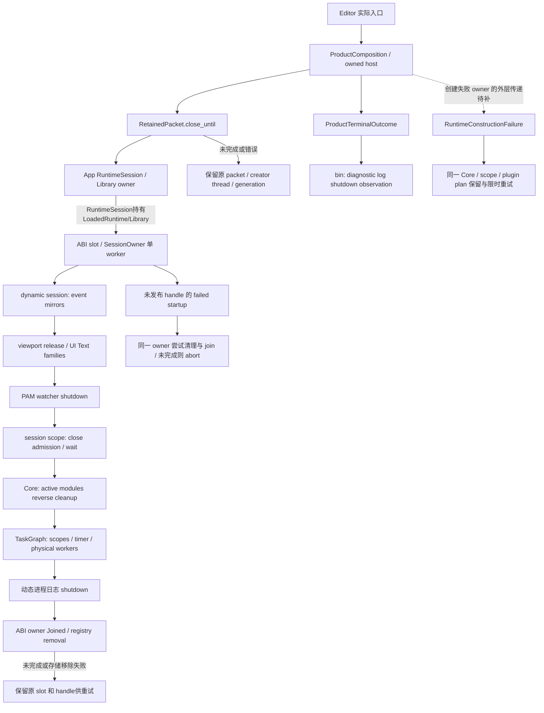

# 当前源码的关闭责任与阅读覆盖

最新引擎阅读覆盖和callee结论见第11节，records归档及执行输入差异见第12节；此前各节的“当前”保留各自切片的时间范围，独立复核只绑定准确指纹。

本记录补充[架构执行流](2026-10-04-architecture-audit-flow.md)，服务于 MVP `00/F0` 的失败与退出审查。Root 负责归属判断和问题去重，三路 Luna 按限定范围阅读全文，Sol 独立串联 pool、回调与 ABI 关闭契约。所有阅读绑定本表的实际源码字节；HEAD 相同并不能替代文件指纹。新正文阅读前核对了既有执行流和指定 module-reviews 中的同 pin 证据，未找到可复用的完整正文记录。

截至本记录初次写入，完成 46 个生产叶的全文阅读（8856 行），3 个生产叶的限定范围阅读，以及 2 个测试叶的全文阅读（383 行）。Root 独立重核前 49 个文件的全部指纹，并独立核对新增两 ABI 叶；没有声明全引擎、完整 package 或 compiler input closure 已读。后续追加阅读单独登记，不能反向扩大初次范围。测试正文阅读、源码约束和符号定位均不构成测试执行。

当前批次的 native 编译/测试、产品回归及性能样本为 0；`00/F0`、模块和里程碑验收仍开放。[已验收账本](review.md)不增加。当前六叶 App/Input 静态切片及其受管验证交接沿用执行流 7.41–7.43 的证据，不能由本记录提升为行为验收。

## 1. 实际责任链

图中runtime子链依据当前session、Core与TaskGraph的已读实现。第8节补读ABI actor/slot及创建/销毁FFI，第9节补读App RuntimeSession、真实Library持有与post-create failure保留链；这条局部持库边界改为实线。RuntimeEntryApp lifecycle、其他FFI/gateway/foreign-output消费者仍待覆盖，创建失败外层归属的虚线保留。未发布handle的failed startup与已发布handle销毁重试分开；图不证明路径已执行，也不把`Arc<()>`当实际Library卸载许可。

| owner | 实际责任与线程约束 | 失败/超期处置 | 证据边界 |
|---|---|---|---|
| App `RetainedPacket` / retained registry | 强持原 product/runtime、host pins、generation 和 native creator-thread 身份；仅同一创建线程可重试 native 关闭 | busy、跨线程、共享 session 尚不能独占、关闭或 destroy 失败时保留原 packet；Drop 不替代用户清理 | 外部 retry 调用、实际 DLL 与 host 释放待动态验证 |
| `RuntimeConstructionFailure` | 同一个 `CoreRuntime::clone`、可选 scope、原 plugin catalog/plan；保留主创建错误与 typed shutdown 次级错误 | `shutdown_until` 仅在 Core aggregate `Ok` 时清除 pending owner；`Err` 保留原 Core | 不代表外层 ABI 一定返回可重试创建 handle |
| 正常 `RuntimeDynamicSession` | 先 event mirrors，后 viewport/UI families，再 PAM、session scope、Core/TaskGraph，最后动态进程日志；共用绝对 deadline | 子步骤未完成立即返回 false；已成功的可重入步骤保持完成状态 | 本体 Drop 忽略返回 bool；必须结合 canonical registry owner，不能单凭 Drop 判安全或泄漏 |
| Core 模块关闭 | 根据 active ledger 反向关闭；Stopping后关闭service admission，排空guard，再cleanup、unload与retire；允许其他独立模块继续 | drain/cleanup错误保留Stopping owner；unload之后retirement错误的entry与对象状态需单独核验，不能笼统称全部原样保留 | 默认 `ModuleLifecycle::cleanup_until` 调同步 cleanup，不能中断不合作的插件 callback；Asset默认cleanup不主动停watcher |
| TaskGraph | 生命周期门统一控制 Running/Closing/Stopped；Closing 保留固定强 scope 集合，顺序关闭 scopes、timer、physical pools | 未 quiet 或未真实 join 时仍 Closing；成功 census 才 Stopped | `Scope.wait`、JobHandle 终态和实际线程 join 是独立门槛 |
| Pool / owned workers | admission 与 active count 共用原子状态；accepted submission token 覆盖等待、排队、执行与 unwind；真正 `join()` 后才计 joined | `close_and_join` 等 active=0 后才释放唯一 pool owner；timeout 保留尚未 join 的句柄 | worker body exit 早于 TLS 完成；Windows以零超时native wait探测，其他平台is_finished不能保证TLS阻塞时的硬期限 |
| Timer | 控制线程 closing 后停止取新 callbacks，保留超期 join handle；清 pending map 时在锁外释放 registrations | 已投递 closure/Subscription 可能仍持 captures；执行前检查 closing/cancelled | timer join 不替代 callback pool quiet，进入 callback 后不能被该检查撤销 |
| ABI session registry / actor | 单调不复用的u64 handle；slot action/wake/allocation barrier，单worker持Runtime state；owner Joined后再核ptr_eq/census移除 | Pending复用原cleanup receipt，Retryable可在原worker重试；Poisoned/Panicked的普通destroy不会成为Joined；最终失败保留原slot/handle | slot没有已证generation字段；code-owner token不证明DLL保活；显式poison recovery与外部消费者仍待核 |

## 2. 已闭合的局部疑点

`PendingScheduledWork` 的 `Mutex<Option<Work>>::take()` 是 launch 与 prelaunch failure/cancel 的共同单次消费点；同一工作体不会由这两路重复消费。Scope terminal retirement 通过 task map 的 remove guard 只计一次。端到端竞争、指标和 captures 释放仍需真实行为回归，不能把局部实现保证当测试通过。

JobHandle 在 node 锁内发布 terminal 并取走 dependents，锁外交给 dispatcher；wait 能早于 observer 完成。dispatcher 在锁外逐个运行普通 continuation、observer 和 completion，每个都单独 `catch_unwind`；同 envelope 的 callbacks 消耗完才尝试 completion。因此普通 callback panic 不会从 `mark_terminal` 向外传播、跳过 scheduler 随后的 pre/post retirement hook。completion 自身 panic 后其内部尚未执行的步骤、hook 自身和投递前 unwind 仍须分别核验。

Pool 的 canonical `close_and_join` 在 active 非零时保留 pool owner；已接纳 runner 的 token 在其执行 closure 返回前不会释放。关闭 ordinary admission 后，active 尚非零仍能取得 continuation。因此，“仅关闭 admission，让同池在飞 accepted runner 遇到 inline fallback 并把计数清零”这项条件在已读 canonical 路径内不成立。追加阅读已确认公开Graph Drop只关闭admission、scope/registration/handle链没有强Graph owner，见第8节；它与canonical关闭分开待证。reservation尚未投递、计数饱和等其他前提未闭合，不新增已复现问题。

未终态依赖的 continuation 会捕获 prerequisite handle；Scope 另外保留 canonical public dependency leases。正常 terminal 取走并消费 dependents，body 或 prelaunch hook 释放 leases。仅有 Arc/闭包捕获不能判泄漏；挂起 prerequisite、timeout 后解除阻塞并重试的完整释放仍待验证。取消策略继续归既有 `CR-RUNTIME-TASKS-0001` / `core_runtime_task_execution`，没有因三个 enum variant 名称新建重复根因。

## 3. 尚未闭合的调用前提

| 项目 | 当前静态事实 | 仍缺的最低证据 | 验收方法 |
|---|---|---|---|
| watcher lookup/resolve 错误被视为已完成 | dynamic shutdown忽略任一lookup/resolve Err并设置watcher completed；getter与resolver有独立registry锁阶段；Core可在Stopping/drain错误时保留未unload对象 | 活watcher与missing/stale/stopping状态是否在产品路径共存；精确service entry失效、guard admission与worker退出责任 | 注册真实watcher，控制注册/关闭时序，验证失败保原manager/JoinHandle、原generation可重试，实际线程停止后才释放；覆盖未安装PAM的partial startup |
| Asset lifecycle watcher responsibility | PAM为Immediate，aliases依赖它；Asset只实现ready；module cleanup helper仅委托trait，没有PAM专用hook，manager子树精确Drop检索无命中 | watcher worker/stop channel的退出语义、真实manager安装和调用顺序；不能由无显式join推断线程必然遗留 | standalone Core、正常dynamic close和失败启动三路分别覆盖，不仅调用watcher方法的局部fixture |
| watcher join panic 结果 | readiness 后 take+join；join 的 panic Err 被忽略并返回 true | bool 的外部契约是否只表示 quiet、panic诊断归属在哪里 | panic worker 的真实关闭与诊断；已退出的线程和业务 success 分别判断，不据这一 bool 自动新报缺陷 |
| 直接 Graph/Pool Drop 与 accepted work | Graph Drop关闭admission但不执行wait/join；Scope、registration、scheduler graph token均Weak，scope work只保ScopeInner；Graph dispatcher持无owner的pool clone | prerequisite终态后的observer实际投递、Work/Node析构补偿、保留handle时wait/status失效契约；DetachOnDrop/FinishOnShutdown的保证 | 控制真实accepted dependency、最后Graph Drop与成功dependency通知；检查dependent终态及queued retirement，不以计数归零或不崩溃代替 |
| startup failure fatal policy | 创建FFI先预写invalid；Slot创建成功才发布handle。failed-startup清理尝试5秒，只放行Joined/Panicked，其他receipt abort；catch_unwind不能转换abort | 外部App/interface持库和失败owner的传递；Panicked仅证明该worker已join，不能代表所有cleanup成功或DLL安全 | 区分普通错误invalid handle、fatal创建失败和已发布handle的销毁重试；与App factory→GUI typed owner问题按最低owner去重 |
| App terminal报告与恢复入口 | 正常 close 的 Core shutdown report在 Ok分支未进入终态；失败owner仍retain；editor中的 globalretry名字只有恢复提示字符串 | 外部消费者、后续 admission/显式恢复调用与产品退出协议 | 同creator thread重试同packet；两failed owners和一successful owner的全量结果、owner清除、后续准入分别验收 |

以上保留为静态事实、条件风险或未读前提，没有复现错误或成本采样。先完成 owner与调用方证据，再决定测试和修复；不以未找到直接调用删除 coordinator、retry、receipt或兼容路径。

## 4. Product terminal 投影与实际消费

`ProductShutdownCoordinator` 的 Arc/Mutex 管理 stop reason、相邻 phase、时间和 failure ledger；Executed/NoOwner/LegacyCombined由 caller上报。它不持关闭owner，也不加入线程。`ProductTerminalOutcome` 保留 primary并使 secondary失败sticky、去重。failure ledger保留最早16项，消息有512 UTF-8字节上限及 suppressed计数；attempt/generation关联须由调用方补充，不能从ledger本身推出来。

实际 Editor GUI链为 preflight/project prepare → product compose → manager/runtime load → RuntimeSession创建 → host/gateway → `finish_owned_editor_host` →成功 terminal outcome。manager/load错误用 `fail_until`，session创建错误用 `fail_with_runtime_until`，host成功和失败均进入owned cleanup。bootstrap失败的request路径及editor关闭都有显式deadline；native失败packet保留创建线程。help/commandlet以及取得product owner前的preflight错误是不同路径。

五个状态字段是 `shutdown_durability`、`report_write`、`ipc_write`、`profiling_flush`、`diagnostic_log_shutdown`。本次六个实际App caller中，只有两个bin的 `observe_diagnostic_log_shutdown` 有调用证据，其他四项不能登记 Completed。`receipt()` 返回单一 `ProductTerminalReceipt` view，当前caller没有实际调用证据。

module-selection receipt、plugin-selection outcomes、Core shutdown report、failure-ledger snapshot、terminal receipt view是不同对象，不能当成“五个已输出收据”。正常close丢弃report；ledger snapshot仅在host与close均成功时交给terminal helper。外部report/IPC/profiling和退出durability协议还没阅读全文或动态验证。

## 5. 当前全文阅读指纹

路径以表内指定的源码根为准。B/L是整个叶文件大小和行数，以下两表均已阅读全文；Reader为实际正文阅读者，Root指纹复核不扩大自己的正文覆盖。

### Runtime生产叶（源码根 `zircon_runtime/src/`）

| 路径 | B / L | SHA256 | Reader |
|---|---:|---|---|
| core/runtime/runtime/shutdown.rs | 6880 / 162 | `8f17c794d21276ae59a2e3e48c9acad6d65263ec65c2943ecdeceb5ee296f504` | Luna |
| core/runtime/shutdown.rs | 3379 / 95 | `83067e50bc5f4b18902969d3cc65e342c894552a2096e30d54899dbf93377cc0` | Luna |
| dynamic_api/session/shutdown.rs | 3001 / 89 | `952044e4e1effd03a76d9001782a98a8c54a1c37f646be13289431555eb6691f` | Luna / Root / Sol |
| core/runtime/handle/registration/service_lists/shutdown.rs | 2040 / 63 | `9c64b7bf89acea121f81b2a58b81904d4c7b976291e77855941bd06a9853bc16` | Luna |
| core/runtime/tasks/task_graph/engine_task_graph.rs | 14416 / 386 | `f4265b59759c126a849a9aad63e117f6f268c1f3021872e2bf981a3c3e66e116` | Luna |
| core/runtime/tasks/task_graph/admission.rs | 2507 / 73 | `d2e9edd50f5b811448c22b87fa5d41ea45c6108c4a0c5aa1fcc34832f6045a02` | Luna |
| core/runtime/tasks/task_graph/shutdown.rs | 1684 / 52 | `a2508d5daf02ee5db22a22b7093014a96d0046ae08ddb878ed81101185f476fa` | Luna |
| core/runtime/tasks/task_graph/task_handle.rs | 6956 / 205 | `8a16ae83b499c56d32a2f36cd8007d551361f0e89c6739b5dd36cb436ae385a2` | Luna |
| core/runtime/tasks/task_graph/worker_inventory.rs | 1344 / 46 | `a447cdb7c910f319c58f642ea36eeec2b5572a9bdaa6e05b1971dcf54bc8198c` | Luna |
| core/runtime/tasks/task_graph/scope.rs | 17975 / 498 | `7af68432c705dd3a1b0433e73b69bc6898b387f366c24b2ed0da539c1caccfad` | Luna |
| core/runtime/tasks/job_handle.rs | 15465 / 478 | `90b30b0d508d985783b76c02e2f8c4cefaa3e072df953c1ba31c82938bee7e26` | Luna |
| core/runtime/tasks/job_handle/task_node.rs | 5983 / 168 | `f16931220ea9fed35a8fbb384c48da332e9c47b594f6d8d60696f02df2f4d11d` | Luna |
| core/runtime/tasks/task_graph/scope/cancellation.rs | 922 / 31 | `ca898eea69feeb9151b5e2934652f19e5be36f9bb111f5fdedd5b5a8a13dd473` | Luna |
| core/runtime/tasks/task_cancellation_policy.rs | 511 / 11 | `7473997e1e036df7e78fa743022e6ae66bb1f26916a83726119bb565f7d27f01` | Luna |
| core/runtime/tasks/job_scheduler.rs | 16726 / 488 | `422a4bf16c3c1fe42fba19c2e121c4646189173196756cf2ccd7a44ce77ce141` | Sol |
| core/runtime/tasks/job_scheduler/pending.rs | 6431 / 173 | `a3098be196c0cfd0d2b12075ea7027a9a835f950fb315173a53e31279fca7a2c` | Sol |
| core/runtime/tasks/pool.rs | 15398 / 475 | `e28b5b99c7ff1ad70536e484bdf53c04409d201d9d32d4a332f07bd32880111e` | Sol |
| core/runtime/tasks/pool/owned_workers.rs | 6182 / 186 | `98f002ea30e95af31c546708d75270fb3035760eac55f1141e1a835ad5f2913f` | Sol |
| core/runtime/tasks/timer.rs | 14869 / 443 | `dc925cdd11995137cf072c2304e28f092ea539b97dca7fbf70b68840f693ab2f` | Sol |
| core/runtime/tasks/callback_dispatcher.rs | 11077 / 344 | `f9b409553d6762c1083b48fb591e0020b4f67c5fb6d706aec1852b15a12b72f8` | Luna |
| asset/pipeline/manager/assets/handle.rs | 387 / 11 | `a6ddcfccbdb264fa9e83dc2b4fa2b7c10554d3bfea4b67d34b3bcdf1476216f0` | Luna |
| core/manager/service.rs | 6117 / 170 | `40403e2250c2d50108a70b476c7c3f56e7adaf0d03547ace787972ce0e6a6006` | Luna |
| asset/module.rs | 4580 / 122 | `7ed2f67031499c29e2b85c6ad99ca62eb5864e0d2235a062bb8b0f0f49afb6d3` | Luna |
| asset/module/lifecycle.rs | 883 / 20 | `6a546edf53e95f74a1e01cff1b3574376bf2e1b7269bccbd96605b271c0c7b81` | Luna |
| core/runtime/lifecycle.rs | 3051 / 112 | `1c7b0a72497e9118257699b85e73c67b30151313ff58025db43159293fbe08b3` | Luna |
| asset/watch/asset_watcher.rs | 2471 / 70 | `5cda1bbf531b545e8bfb34243156e06a66968ed83a8cf5315853fea57abab55a` | Luna |
| dynamic_api/session/construction/cleanup.rs | 6533 / 194 | `b957900824fcb648cbbe07d47a2b7e54d81be4284732e34e143ca2db93b39a36` | Root |
| dynamic_api/session/registry/session_owner/runtime.rs | 11541 / 301 | `7024bdc2aeb047bbd6849f0f40f41c901266847120a4c3e32746ab0a88365f4a` | Luna |
| dynamic_api/session/registry/session_store.rs | 18674 / 516 | `216e26966462be7c7e036aecbc845add0260317a56525150bb751d7184d762ce` | Luna |

### App生产叶（源码根 `zircon_app/src/`）

| 路径 | B / L | SHA256 | Reader |
|---|---:|---|---|
| entry/product_shutdown/coordinator.rs | 7514 / 235 | `6132730e83a867c48743b4cd93e022158573e9b87577aa9199637005eb91a955` | Luna |
| entry/product_shutdown/terminal_outcome.rs | 6694 / 198 | `28cef866b034e6ea2408f577ef2c33bd052cbbd390b6fb4095b68db4787765ee` | Luna |
| entry/product_shutdown/terminal.rs | 3646 / 122 | `202eda990dafffe8360e29e1f97b255ff164b8a32734ff82c464d39b9e66b5bd` | Luna |
| entry/product_shutdown/failure_ledger.rs | 4218 / 116 | `3e3a21b09a9f6694d59e8199af0d8d21776c070d44a5f2fa7618252b3ccdb369` | Luna |
| entry/product_shutdown/mod.rs | 1247 / 37 | `5dbd9d89d31086e8d3a04ea391f611d625ddfe1c71f7db2d664d912ccffc8b1d` | Luna |
| entry/product_shutdown/phase.rs | 1693 / 46 | `a314abd20eabcd6b1ce142cdce52a595068dbce88f729670bab38b739ee4a388` | Luna |
| entry/product_shutdown/retained_owner/owner.rs | 4327 / 141 | `4af8a45966581f045128992493ea10f24b24123f27a5a9c68e3c81b90552d986` | Luna |
| entry/product_shutdown/retained_owner/packet.rs | 3783 / 114 | `e27cab525b27c7675b00cc985ef81fc7d4038153cf4e996182ca54130d3a1727` | Luna |
| entry/product_shutdown/retained_owner/registry.rs | 3473 / 110 | `145a99732a9575ab2a50f40e601bbd2298d6b994b6781f118bc801deb1c4979e` | Luna |
| entry/product_shutdown/retained_owner/failure.rs | 5296 / 166 | `11d2f7a82ac121c136238ab2a3b9bfd17a93be54fe5b07bf67965faaeb957031` | Luna |
| entry/product_shutdown/retained_owner/mod.rs | 475 / 16 | `95568ca928f2ed7e2760523a85f721f4281afc653cc2116fbcc85074d8df4803` | Luna |
| entry/product_composition/composition.rs | 11522 / 301 | `db065767ac963084a757100a85a079e8d67d1bc13a1bf8037c372a43d7a0c0ec` | Luna |
| entry/product_composition/request.rs | 15414 / 345 | `c9a961b611962791f4df0d6f8a6dcccc351a5c2ff40fea67637d00e60cd63879` | Luna |
| entry/entry_runner/editor/ownership.rs | 3363 / 89 | `2c4d7d4b1a5208032cfc1a7f350b321ebf1575a1461469db926a6187e36bfaad` | Luna |
| entry/entry_runner/editor.rs | 31305 / 723 | `6d9adbf002ba843abed38499017fa5c6306d37865a3bb75182c789c86051d07f` | Luna |
| bin/editor.rs | 2068 / 55 | `9b014c47b74038c5a87aff864b29d8493201da633b2e97a88fe7e3ae8df2ff6f` | Luna |
| bin/runtime_preview.rs | 2304 / 60 | `1a11d2aa60a09bf796e8bd11e54267e0b0caff21b53793d79b8ca0bf8b4363a5` | Luna |

## 6. 限定正文、测试阅读和未读下游

以下范围包含两端；文件 pin 覆盖完整字节，正文覆盖仅为明确列出的范围。

| `zircon_runtime/src/`路径 | 文件B / L | SHA256 | 实际正文范围与reader |
|---|---:|---|---|
| asset/pipeline/manager/assets/runtime.rs | 32477 / 854 | `6fb3046898f789470b778c449f1de5a93c8d5ddbd01a270ef6b2f9d99f84584c` | Luna：初次1–35、550–650；第9节追加488–528、530–544，累积192行；不是整个PAM运行叶 |
| core/runtime/handle/resolution.rs | 30219 / 818 | `683b0a6af866bcfefb8dbf3d26dc9e07fa91ea7c3f2c88d4802bd3bf081239b4` | Luna：初次208–278、450–510；追加297–341、731–768，合计215行；不是全文 |
| dynamic_api/session/state.rs | 32567 / 796 | `0c3b717c1dabcd981e1ab0cb30295a4584be449d7cad3aaf72af5af7dfe5b811` | Root：153–238；其他session/frame/input方法未在本轮阅读全文 |
| dynamic_api/session/shutdown/tests/cases.rs | 7125 / 211 | `5e78057ded114d12d03564ae8ad432347aee1a5507866d4ea2561620676f60df` | Luna：1–211；两cleanup用例只显式装ObservedShutdown，第9节闭合Core构造为空模块/不装PAM；未执行 |
| core/runtime/tasks/callback_dispatcher/tests/cases.rs | 6027 / 172 | `19dc8ec540fe2c08af0bc0068beddaf01619fa42af685ca503de53ae6f359fa6` | Luna：1–172；轮转、panic继续、64预算、10k fanout/completion、共享default；未执行 |

Root对已全文读取的EngineGraph额外复核1–125、340–386，对Scope额外复核1–85、430–498；Sol对ABI owner额外复核56–96、235–301，对registry额外复核344–460。额外范围是独立复核，不重复累加正文覆盖。

本段初次未读下游按第8、9节补齐CoreRuntimeInner构造、ServiceEntry失效、watcher worker、App实际持库与receipt failure。当前仍未读完整FFI/export其他操作、diagnostic-log worker、startup diagnostics、RuntimeEntryApp lifecycle及其他foreign-output/gateway/外部retry消费者。相关函数名/行号、相同pin的历史symbols/snippets不能替代当前完整实现。

## 7. 验证接入与保留

Jenkins两份records回复已关联Root原消息，native intake/formal acceptance均false；当前所选management胶囊仍从prepared pool cwd执行。已有a1请求引用、receiver build31及失败历史保留，没有换ID重发。合法identity、三迁移路径grant、实际checkout能力、完整compiler输入身份、无写入时段与原runtime恢复由对应owner继续处理，详见执行流7.43。

本源文档在创建前已登记于 `E:/cargo-targets/zircon-local/reports/engine-audit-20261009-01a12097/artifacts.json` revision6，登记时SHA256 `fc88d21456a0b3f8f1e13e65b58ff08e18a09f1b3ea6a5148049c2001c11c14a`／44565 B。复用同任务manifest，登记revision5的历史指纹而不再复制整份manifest。本文包含阅读结论、路径和哈希，不包含生产源码副本、源码树或可编译镜像。

本轮未创建构建目录或临时脚本，未删除文件，释放0 B；供给、共享缓存、未知归属及必要失败证据保留。清理和goal仍active。下一步依最低owner补齐尚未读的关闭调用前提；当前阶段不删除公开API，不实施依赖未满足的跨模块迁移，也不采纳未执行测试或历史产物作为验收。

## 8. 初次记录之后的限定追加阅读

以下11个生产叶由Luna阅读全文，Root负责核对新增指纹和与既有链条的归属；原46叶覆盖不反向扩大。截至第8节的214行切片，累积57个生产叶全文（11104行）、6个部分叶（624个不重复正文行）、2个测试叶全文（383行）；第9节另记后续范围，未声明全引擎或完整package覆盖。

| `zircon_runtime/src/`路径 | B / L | SHA256 | Reader |
|---|---:|---|---|
| core/runtime/handle/activation.rs | 25333 / 597 | `300677aa25c70587ccc5a1ef19177702211e5c6adeef668da640b5b8a2fcfa13` | Luna |
| core/runtime/runtime.rs | 16910 / 508 | `35add6ab63f42871c2f4199418d56494bff75378c00221d64e187368d03744d3` | Luna |
| core/runtime/handle/activation/module_lifecycle.rs | 5141 / 142 | `057a6188e0af660050acf4ed3395b135fbd684a5352b4ab6ab5762aac79498ec` | Luna |
| core/runtime/handle/activation/service_lifecycle.rs | 4216 / 117 | `c9da4ea533e3937bac9e7091cd5605b82625df091b3b069e4d8a032245068630` | Luna |
| core/runtime/handle/activation/unload_mutation.rs | 2906 / 66 | `9912805247e90502172c73b16674e5a42150080842cb37eba4f1564e557e91d9` | Luna |
| core/runtime/tasks/task_graph/scope_registration.rs | 742 / 24 | `dae21929729d53acd521855a9cab48c7564ec3f6b145f7b6049b7c5f0bfa85a3` | Luna |
| core/runtime/tasks/task_graph/lease.rs | 1019 / 30 | `cd13ce56ddffd241257db40020fb7afd0d315748f067a3cbb41a9ac03ff68807` | Luna |
| core/runtime/tasks/thread_completion.rs | 961 / 26 | `51f1fb5475e8305dfba9e61c31095a7e7c3a505d823fcad7cd6243350ed224de` | Luna |
| core/runtime/tasks/task_pool_descriptor.rs | 1300 / 51 | `dafc194c8c049447962b94257f69deb0b615378bf53d4cbc880fa448bc15bf38` | Luna |
| dynamic_api/session/registry/session_owner.rs | 16856 / 478 | `88364113b01be72b323ed5252487ec62fb3db702f6f874253b78c43f55e73dc1` | Luna |
| dynamic_api/session/registry/session_slot.rs | 7320 / 209 | `0953acd0c8c9539b72c3c16a310b589e3ee55e9610151161e11206048ebaa241` | Luna |

| 新增部分阅读路径（同源码根） | 文件B / L | SHA256 | 实际正文范围 |
|---|---:|---|---|
| core/runtime/tasks/mod.rs | 5107 / 130 | `efe3b22542529a0ec9e3187955671d1e148d3c0a0d8381559df3e90acfe519d1` | Luna：1–35、120–130，共46行；117仅名称定位 |
| dynamic_api/exports.rs | 10582 / 291 | `fb6564729a8cc2457f7eb5b356bb4cfee3e359f39caad61d2f9fab1b3f5f23a8` | Luna：82–110，共29行 |
| dynamic_api/session/ffi.rs | 33879 / 924 | `3aec2f4a0d61e0b327ba5f55222c5f2835cf8ee706a7135208c7e77955e922ea` | Luna：1–109、181–183，共112行 |

Core deactivation先检查依赖和veto，再将Running改Stopping、关闭service admission、排空guard、执行cleanup，之后逐项unload并在锁外retire对象。drain/cleanup失败不rollback状态，cleanup完成标记可用于重试。module cleanup helper只转发trait。unload leaf委托`invalidate_for_unload`并收集移出实例；第9节补读entry的generation/幂等细节。retire逐项catch destructor panic，记首错并继续其他对象；此时服务已经失效，不能把Stopping ledger视作仍拥有全部原实例。CoreRuntime构造未显式装PAM；第9节补读Inner并复核实际fixture，闭合这一前提，不能用fake模块测试证明真实PAM关闭。

ABI actor使用同一已全文读取的Core TaskPool实现，配置IO角色、一个worker和`zircon-session-owner`名称。创建、访问与销毁state在该owner worker执行；`SessionOwner`未join的Drop为abort。Pending等待原cleanup receipt而不重复callback；Retryable可重新提交，Poisoned需显式recovery，Panicked与Joined分开。cleanup成功且真实pool shutdown成立才Joined；actor的code-owner字段在Owner存续时保留，但Slot实际提供的`Arc<()>`不等于DLL guard。Slot允许RetryPending重新进入Closing，普通操作只允许Open，release类操作也有单独admission。Slot/Store的代次说法已排除：保留的是原handle、原Arc slot和原owner。

创建FFI在可写out指针上先置invalid handle，完成ABI、切片/profile/config校验并成功创建后才写有效handle；Store只在Slot成功后登记。普通error不发布handle，failed-startup abort不能由`catch_unwind`转为status。销毁FFI直接转交Store status；失败handle保留用于原slot的销毁重试，不保证一般session操作仍可用。`configure_app_session`的wrapper虽在exports阅读范围内，其FFI实现及实际App调用方未读。正常destroy、创建失败清理与poison recovery没有被合并成一条无条件成功路径。

平台helper借用Windows原生thread handle做零超时`WaitForSingleObject`，只有`WAIT_OBJECT_0`表示ready；helper不消费handle、不join，也不报告panic。其他平台使用`JoinHandle::is_finished()`，TLS destructor阻塞时不能由此保证硬期限。`spawn_named_thread`只设置名称、spawn并返回handle/ThreadSpawn错误，不显式设置stack。diagnostic-log worker也是readiness调用方，但目前只有名称定位，正文未读。

Graph Drop的231–240行只begin_shutdown并关闭scope admission，没有显式wait/join；registration只有Weak Graph，client lease只计公开scope clones。Scope任务body/hooks仅保ScopeInner，pending dependency与pool owner寿命的关系进一步缩小为可审查候选。追加精确复核确认Node/JobHandle没有Drop补偿，Scope retire是显式helper，保留TaskHandle会保Node，status/wait没有graph-invalidated终态出口。scheduler的Work被take后，若submission在进入Node body前丢失owner，不能由Node自动补终态或retire。底层Rayon Drop与实际worker继续路径仍未闭合，不能由Graph方法直接断言Drop非阻塞或真实遗留。

同一owner窗口也影响dispatcher：`dispatch`112–139行先enqueue/reserve，再在`schedule_runner`145–161行spawn；只有continuation reservation返回None才走inline fallback。reserve成功之后的spawn没有catch；owner在acquire→spawn间消失时的panic不属于`CallbackEnvelope::run`320–339行逐callback的catch范围。JobHandle310–329行可能已经发布自身terminal，但observer delivery、后继launch和scheduler后续post-retire不因此得到保证。当前证据不能简化为“最后dependency成功就一定launch后继”，也不能仅修Pending一处。此项与prelaunch窗口同归TaskPoolSubmission/dispatcher/scheduler accepted-work寿命契约，仍需真实时序回归。

Sol比较保留为条件方案：若policy要求Graph Drop后accepted work继续，需保executor寿命到closure、post-hook及token释放完成，并保留安全线程的真实join责任；不能只延长到handle terminal或强持整个Graph形成环。若契约允许未投递work因owner失效而失败，则checked submission须把确定未执行的work转入真实终态与原retire hook，并恢复已入队envelope，不能伪造用户panic或提前retire running work。把同步wait/join塞进无返回值Drop不能提供超期后的原owner重试权威；worker/self wait也要单独处理。方案尚未实施，policy承诺和动态复现为选择前提。

已找回只读历史issue输入 `docs/_data/source-comment-audit/round-02/issues/core_runtime_task_execution.jsonl` 第1行，文件SHA256 `ce31e2d857e2d17645097c3a2ec889c8441c9b19d18914e60f276c6aa45134e9`／7399 B／2行。`CR-RUNTIME-TASKS-0001`仍为open TODO，准确内容是DetachOnDrop与FinishOnShutdown的不同保证待确认，现有handle/scope-close只特判CancelOnDrop；不是pool owner消失或prelaunch补偿根因。新owner-lifetime候选先独立保留待证，引用policy契约作为依赖，没有修改历史issue或确认新缺陷。

初版文档SHA256 `56b9689d277e493d332b09d70e49d983c514b0123be932becebaa40a36374997`／21839 B／167行已由独立Luna复核：51源码pin及初次计数匹配、无阻断finding。第8节214行切片`36c4da3331946d239b432fd1f851d5a3c4e57921295e44dccd0b4898feb64dd0`／30841 B的65源码pin、57/11104与6/624及2/383计数也已独立复核无阻断。当前第9节及改动的图/前提需单独复核，旧切片不自动覆盖新正文；所有测试仍仅阅读，native/产品/性能和已验收计数不增。

## 9. 构造、watcher安装与App持库的后续闭合

本节新增11个生产叶全文（3134行）、2个测试叶全文（654行）；在原PAM部分叶追加56行，并新增Runtime入口部分叶289行。当前累计68个生产叶全文（14238行）、7个部分叶（969个不重复正文行）、4个测试叶全文（1037行），合计79个不重复文件pin。Reader的完整正文证据与Root只读元数据核验分开；编译输入闭包、package/模块、全引擎及任何运行验收仍未完成。

### 9.1 新增完整正文指纹

| 完整仓库路径（生产） | B / L | SHA256 | Reader |
|---|---:|---|---|
| zircon_runtime/src/core/runtime/state/core_runtime_state.rs | 15078 / 414 | `1dead3bad03db6b3efcd748b0cac9695025ebbdd7d7093383d8548310abf1f23` | Sol：全文1–414 |
| zircon_runtime/src/core/runtime/state/service_entry.rs | 5567 / 152 | `5d5473da92b05400eea088cb10de9a89217079b31c31fa7a1b3b29eff97c4d28` | Luna：全文1–152 |
| zircon_runtime/src/asset/watch/spawn.rs | 2843 / 80 | `8f8bb22fd0d81f2554bec8f0dbd0931db7813c81f891d1c0013aca6adaa09fdf` | Luna：全文1–80 |
| zircon_runtime/src/asset/watch/watch_loop.rs | 13983 / 410 | `41075bf0328c693d9957d3fc521547689eb0bb5e24c7ff1c9194e17a9c0699e8` | Luna：全文1–410 |
| zircon_runtime/src/asset/watch/shutdown_on_drop.rs | 236 / 10 | `7f40d2d4b4ef102aeaca748cc961ba552bd774ee2bbb84deef3dffaedeac641c` | Luna：全文1–10 |
| zircon_runtime/src/asset/pipeline/manager/assets/assets.rs | 5557 / 134 | `e6b2fabc534c647a772bc5aae10ff38888c3fca42643cd86239cfe31953187bf` | Luna：全文1–134 |
| zircon_runtime/src/asset/pipeline/manager/assets/open_project.rs | 4254 / 97 | `36a53891b3023454bebaea32f4f6f3b827c341091128daba01e3862ca83b8c89` | Luna：全文1–97 |
| zircon_app/src/entry/runtime_library/loaded_runtime.rs | 29146 / 746 | `dbed33b3ceaefbea03b9d6bf34d6639bd04a94f0c2fbbe43d72038ff9624dfbc` | Sol：全文1–746 |
| zircon_app/src/entry/runtime_library/runtime_session.rs | 33657 / 860 | `00ae7deb79203c1888028a0a7ccf918a2d370eb4647dbe06c95095174eb6f8d0` | Luna：全文1–860 |
| zircon_app/src/entry/runtime_library/runtime_session_create_failure.rs | 4719 / 131 | `2464d9010e98a775f810dbb5392f2d3fdb353b9ac7eeeb4aac5c2bc7efd08a67` | Luna：全文1–131 |
| zircon_app/src/entry/runtime_library/runtime_session/module_compose_receipt.rs | 3721 / 100 | `a77a0c1e8358b9f3d142785e733ce957c045f0318ffb949534247d0b12de5209` | Luna：全文1–100 |

| 完整仓库路径（测试） | B / L | SHA256 | Reader / 状态 |
|---|---:|---|---|
| zircon_runtime/src/core/runtime/tasks/task_graph/tests/cases.rs | 20020 / 502 | `c60b8a2c380f8c5856f5c161c35d3f02ba623ba5797c9c482010bbcb10cf3696` | Luna：全文1–502；未执行 |
| zircon_runtime/src/core/runtime/tasks/task_graph/scope/tests/ownership.rs | 5680 / 152 | `daee450c5637d516738a91cced2caaf320e133c4942aefbcd2b249a9a16aaab5` | Luna：全文1–152；未执行 |

| 后续部分阅读完整路径 | 文件B / L | SHA256 | 实际范围 |
|---|---:|---|---|
| zircon_runtime/src/asset/pipeline/manager/assets/runtime.rs | 32477 / 854 | `6fb3046898f789470b778c449f1de5a93c8d5ddbd01a270ef6b2f9d99f84584c` | Luna：新增488–528、530–544共56行；累积1–35、488–528、530–544、550–650共192行 |
| zircon_app/src/entry/entry_runner/runtime.rs | 28951 / 765 | `a7290584d9c4e2986259c93ad710c77c409493d5db703e9d64cd22ac647e4b27` | Luna：420–708共289行；未计为整叶全文 |

### 9.2 Core构造、真实fixture与失效状态

Root独立重读已完整覆盖的`core/runtime/runtime.rs`46–82、140–179、490–508：`default`→`new`→`try_new`→`try_with_options`→Graph创建→`CoreRuntimeInner::new`→字面`CoreHandle { inner }`，没有借另一个Handle构造隐式注册。Sol全文Inner的380–408确认modules/services、active order为空，frozen graph/observer为空；没有builtin PAM、Default或Drop注册。实际shutdown测试叶只有两用例（75–142、145–211），均`CoreRuntime::new()`并显式安装ObservedShutdown假模块；没有PAM。因此测试声明可保护fake-module顺序、aggregate retry与graph drain/join，不能作为真实watcher停止证据；这些测试未执行。

`ServiceEntry::invalidate_for_unload`50–60断言admission关闭、inflight=0且无init owner，取走实例、清owner/admission、推进非零generation并记Unloaded。它在实例已经None时仍推进generation；retire panic之后重试不再次退休旧实例。Core Stopping ledger、ServiceEntry Unloaded和已移出对象的析构结果是不同状态；静态重复generation推进不足以另判用户可见错误，handle反复绕回与真实消费者仍需独立证据。

### 9.3 watcher的存储活根与期限

`prepare_project_watchers`488–528对每个root取manager与error_manager两个值clone，move到worker回调；`ProjectAssetManager`97–126 derive(Clone)，`watchers`是强`Arc<Mutex<Vec<AssetWatcher>>>`。`activate_project_watchers`538–543以`mem::replace`将新handles装入这同一Vec。已安装、仍运行的worker因此通过callback→manager clone→watcher storage保住停止Sender；最后公共manager wrapper析构不会自动销毁该Vec或触发Watcher Drop。这里证明的是线程活根保持storage的条件路径，不以JoinHandle名字假定closure所有权，也不将其简写为纯Arc之间的引用环。

显式`shutdown_project_watchers_until`/`AssetWatcher::shutdown_until`仍有发stop并等待worker的路径，超时保留join handle。`AssetWatcher::Drop`4–9另直接try_send后take并join，忽略结果、没有deadline。watch_loop的stop或channel断开分支同步flush再return，notify error会同步调用on_error再继续；on_changes/on_error不返回时能阻塞stop。Core退休函数不传deadline；只有实际发生Drop时才有这条无界等待风险，不能从外层Stopping推出Drop已经执行。

准备阶段spawn/register失败与安装后的活根分开：spawn的ready错误返回未join局部handle，不能从send ready error推定caller返回时worker已经退出；prepare/open在安装前错误或拒绝时新watchers还是局部Vec，随后Drop会发stop并无界join。安装后新handles进入共享Vec才满足上述自保持条件。open caller在commit闭包先写active project再安装，新generation发布后drop旧watchers、drain，最后才`ensure_durable()?`；这个末端Err没有本caller显式回滚。底层resource commit/ensure_durable未在本切片读取，不能推断其内部回滚；这段顺序补充既有RecoveryDeferred问题，不新建重复持久化根因。旧watcher的显式drop若callback卡住也可能阻塞项目打开。

| 待处置项 | 触发/根因与影响 | 等级/owner/处置建议 | 验收证据与依赖 |
|---|---|---|---|
| watcher停止责任与退出期限 | 已安装watcher、worker运行、公共manager释放而无显式stop；callback强持共享Vec使自动析构停止不可依赖。实际Drop则无界join，callback不合作时可越过期限 | P1静态候选；AssetModule/PAM最低owner。先明确生命周期中的显式停止与原handle超时保留，复核dynamic lookup错误路径；未实施 | 原生真实watcher+受控callback/stop通道；standalone Core须显式安装真实PAM及watcher，正常dynamic close单列。partial startup须覆盖已有watcher成功spawn后再失败，并分别验证ready错误时未join的局部handle；证明stop、实际join和原owner重试。默认Core/fake fixture不能替代；当前未复现、非成本采样 |
| 未安装PAM的partial startup | 空Core+fake ObservedShutdown；missing PAM与仍活但Stopping/stale manager不是同一前提 | 前提已静态闭合；Core/测试owner。保留两类case分别回归，不能拿fake用例关闭真实资产项 | 原生测试仍pending；此处没有新增生产修复或独立模块验收 |

### 9.4 Library、create failure与Runtime入口

`LoadedRuntime`34–43直接持`libloading::Library`，没有Clone或自定义Drop/session census；getter复制函数指针，不能自行延长库寿命。加载只接纳V8并严格核版本、alignment、required tail和完整size，缓存20个必需Fn；可选操作与test bypass按cfg保留，不据静态加载称真DLL通过。局部加载Err进入RAII，不证明foreign get-api/DLL初始化资源完全回滚。

`RuntimeSession`成功创建后持原handle和`Option<LoadedRuntime>`、记录创建线程，已读App gateway owner链通过Arc持有RuntimeSession；这不证明所有gateway、复制的Fn表或其他foreign-output消费者自身都强持Library。status Err在session形成前返回；规范ABI producer的普通Err保持invalid handle。Err+valid handle属于provider违反这项返回契约的条件组合，不登记已复现App泄漏。成功+valid后receipt query失败才成为typed retained failure，原Session进入RetainedPacket/RetainedOwner；query要求响应、ok、receipt/schema和profile/target全部有效。retained pending时cleanup receipt不冒报成功，retry文档要求真实创建线程。

`try_destroy`先尝试surface解绑再调用ABI destroy；destroy Err在改handle/runtime前返回，原库与handle保留；成功后注销wake、invalid handle并take runtime。解绑错误会记录，但仍尝试destroy，业务影响待真实provider。此方法自身未检查caller thread；外部retained packet准入与ABI错误分开。Session Drop或host-resource release若destroy失败会abort，不能写成无条件返回pending。ABI未发布handle的failed-startup abort和post-create retained error仍为不同失败边界，`Panicked`不等于cleanup/DLL安全。

Runtime入口420–708已确认load/create失败调用recover/startup helper；成功将Session移进RuntimeEntryApp再交event loop。event loop返回后先计算terminal_status，再调用reporter并记录其Err、snapshot交finish_runtime_process。recover、finish helpers与RuntimeEntryApp退出/surface lifecycle只定位未读；本方法不足以证明owner最终关闭或reporter失败正确投影。图的创建失败外层与实际退出仍保留待证。

最低行为验收包括：合法create后receipt status=ok却缺receipt，形成原session/library retained failure；busy/wrong-thread destroy保原owner；真实创建线程retry成功后才释放并只一次unload sentinel。abort必须在子进程验证；当前没有新增测试实现、编译、执行或性能样本。

### 9.5 Graph测试与后续门槛

新增Graph tests全文只覆盖显式shutdown、observer/worker等待与retry；scope ownership中的source Graph先将prerequisite完成、显式shutdown/join后才drop。没有直接最后Graph Drop时accepted dependent仍pending且保留handle的case。现有FinishOnShutdown用法不足以决定该Drop保证。建议用单compute worker和started/release/observer channel控制prerequisite、dependent、last-Graph Drop及后续投递；bounded wait只作deadlock probe，terminal/retire期望须先按policy确定。逐callback catch不能证明runner submission或后续launch补偿，仍与第8节共同最低owner候选合并。

本节及图/前提的282行切片`a66f69fb5847f57535debe9fe0d49809a694bfb5f40688da33bc9e236d31c4d1`已由三Luna按范围独立复核，无阻断发现；本轮收紧App/ABI owner、已读gateway范围和真实PAM/partial-startup前提，本轮文字增量42905 B/282行切片`9e30646a9bc36dbb17767829b5ece918b76ce5166914360eec39878b48e04a02`也已由三Luna按范围聚焦复核，无阻断发现；此处仅登记复核终态。R4 records消息只绑定之前214行/65pin切片，新文档不能反向改写其历史消息字节。当前Jenkins latest selected、原请求和matching monitor reply另见执行流；native/产品/性能及已验收计数不增，Root删除/释放0 B，goal与清理active。

## 10. App关闭callee、PAM完整运行叶与资源提交边界

第1–9节的282行切片及复核身份保持历史范围。本节把PAM runtime与App entry runner两个部分叶转为全文，并新增14个生产全文叶；新增实际正文2758行。当前引擎累计84生产全文/17477行、5部分叶/488唯一正文行、4测试全文/1037行；93个唯一引擎source pin，96个表行。外部winit输入定位不计入这些引擎计数。全文阅读、source pin和ledger均不替代compiler input seal、native或模块验收。

### 10.1 本轮真实正文范围

| 引擎叶（相对checkout） | bytes / lines | SHA256 | 真实正文与reader |
|---|---|---|---|
| zircon_runtime/src/asset/pipeline/manager/assets/runtime.rs | 32477 / 854 | `6fb3046898f789470b778c449f1de5a93c8d5ddbd01a270ef6b2f9d99f84584c` | Luna：补36–487、529、545–549、651–854共662行；与既有192行合1–854全文 |
| zircon_app/src/entry/entry_runner/runtime.rs | 28951 / 765 | `a7290584d9c4e2986259c93ad710c77c409493d5db703e9d64cd22ac647e4b27` | Sol：补1–419、709–765共476行，与既有420–708合全文；必要回看不重复计数 |
| zircon_app/src/entry/runtime_entry_app/mod.rs | 10531 / 256 | `0fad5e8528dfb3e66b5ad0dc38929c9d4797e25a22af2e6036d70095a92f890a` | Luna：1–256全文 |
| zircon_app/src/entry/runtime_entry_app/construct.rs | 3709 / 88 | `fc43331d964aa6fda50e54338c336652c1f0a197912a83ba05dd9aa75ce47ea1` | Luna：1–88全文 |
| zircon_app/src/entry/runtime_entry_app/failure.rs | 2654 / 96 | `e33125abefd541f2b61a353e54de3c427a93343c2afa8036b4aab6284fbb0397` | Luna：1–96全文 |
| zircon_app/src/entry/runtime_entry_app/application_lifecycle/events.rs | 3821 / 98 | `858005c6bd4995b9963935fe545a705391988e37e18225f2537a99532b2885ba` | Luna：1–98全文 |
| zircon_app/src/entry/runtime_entry_app/application_lifecycle/machine.rs | 200 / 6 | `1b45534d6732bbfccefed66a4853161f9aa508c395e4eed1e5eae566489f1564` | Luna：1–6全文 |
| zircon_app/src/entry/runtime_entry_app/application_lifecycle/transitions.rs | 2937 / 74 | `4fef91452d0c656e50330cf6da2180c62514765151a7f2ff72cf49f479de46f7` | Luna：1–74全文 |
| zircon_app/src/entry/runtime_entry_app/application_lifecycle/state.rs | 371 / 12 | `a6f2b28d624277d05c81ff14849a5d7df08e54b393ca23c38e39406bcb572a92` | Luna：1–12全文 |
| zircon_app/src/entry/runtime_entry_app/application_lifecycle/action.rs | 270 / 11 | `e2c635f0d16801c197dd4c4ccec0d9fbe8120a68929ee0956d4f841492812625` | Luna：1–11全文 |
| zircon_app/src/entry/runtime_entry_app/application_handler/hooks.rs | 2342 / 69 | `8088b08d5170c8662be80f7926a142e3aa131fb59eb443ffd6cbc55e60a43204` | Luna：1–69全文 |
| zircon_app/src/entry/runtime_entry_app/window_lifecycle/close.rs | 1299 / 32 | `ba6ce01ec1616122d97a8902d7947c1763b0a22561921c6d75878fcf7dff593c` | Luna：1–32全文 |
| zircon_app/src/entry/runtime_entry_app/surface_present/lifecycle.rs | 4999 / 122 | `0270e484b610f01b36a6d4acfd42b406f01565fc44dc45b444baf76d41b18b88` | Luna：1–122全文；Sol同叶复核不增计数 |
| zircon_app/src/entry/runtime_entry_app/event_dispatch.rs | 1712 / 50 | `7e11039b2bdd383df47f366ce1ff8850c1bf663ea707dc4c860c2a6d49bee888` | Sol：1–50全文 |
| zircon_runtime/src/asset/pipeline/manager/assets/construction.rs | 7491 / 201 | `b7fe46018d024fd27ab44edada29e22f03f70789ec37a6335c144317a5cd6da4` | Luna：1–201全文 |
| zircon_runtime/src/asset/pipeline/manager/assets/resource_publication.rs | 20673 / 505 | `2dcc849548979429c4ae6b7b01474fab17c8c9fe5d6e617e025b6198e4ac2967` | Luna：1–505全文 |

### 10.2 入口错误传播与App owner

entry recover176–204仅在typed create failure的cleanup pending时尝试retry，合并retry错误与恢复上下文；602–637保留原create primary及StartFailed报告错误。成功Session在640–642给出共享teardown ledger，663进入App::new，664调用`winit::event_loop::EventLoop::run_app(app)`。event loop错误673–684入账；terminal_status686–695先按当时ledger选择，reporter错误696仍入账，697取snapshot并由finish返回错误，只有成功才写complete诊断。finish_runtime_process345–359和finish_startup394–413负责汇总，不执行cleanup/join。这里没有错误被丢弃或仅因status先算就成立的误投影；空ledger不能证明任务已join。

App mod有直接`session: RuntimeSession`，construct new接收并存入session、返回Self，没有Result分支；failure state仅保存原子recorded标记与共享ProductFailureLedger，record不关闭资源。因此App持有原Session/Library。后续已读锁定版本的Windows facade：run_app217–234以App值为参数，230将&mut app借给backend，232显式drop(app)，233才返回Result。该facade的普通返回路径中，backend返回的Ok或Err都在facade返回前执行drop(app)；App Drop与字段析构早于facade正常返回、也早于入口随后读取ledger snapshot，但不证明Runtime work已join。panic/unwind与abort另按其失败边界核，不套用普通Result保证。本轮App目录Drop定位在surface_present/lifecycle88；不能从mod内无Drop推整个App无析构。创建失败typed Drop/TLS retained继续复用既有证据，不因helper转String另判owner丢失，精确释放仍需真实创建线程验收。

### 10.3 lifecycle、exit与surface失败去重

状态机只在SurfaceActive允许帧泵。resume从Cold/Suspended进入AwaitingSurface；表面创建成功才进入Active；Active的destroy/suspend/exit先转AwaitingSurface/Suspended/Exiting再发Release，非Active相应路径Noop，重复suspend/exit不会再发动作。Release仅委派teardown_primary_window；状态名和动作不证明真实释放。handle_application_exit有未决TODO，在本轮限定App目录locator中未见外部调用，当前hooks没有显式exiting覆写；不把它登记为实际exit回调保证，也不据局部搜索删除方法。

close分发失败早退的条件候选已由实际dispatcher闭合：event_dispatch19–29在唯一false分支先record、28请求event_loop.exit再返回false。close15–18的早退符合这项局部契约，不登记漏退出缺陷。failure标记会抑制后续输入/帧泵，但exit请求仍不等于实际Drop或worker join。

surface unbind的Ok(true)及Ok(false/unavailable)都清标志并使teardown正常返回true；unbind Err记录失败并返回false。primary teardown15–28在false后调用Session::destroy_for_host_resource_release，正常返回后才清presenter/window，但仍返回原false、保留原诊断。复用Session已读语义：destroy成功失效handle并take/drop LoadedRuntime后正常返回；destroy失败保原handle/runtime后abort，在该路径不返回可重试Err。因此存在“unbind失败、销毁成功、资源已清但报告false”的正常返回分支，不能将所有false叫fatal。真正destroy失败不正常返回时，App窗口尚未take/None。Drop88–112总会执行teardown，不受此前false跳过。

状态提前推进、teardown false和fallback不能自动登记三个ownership缺陷；callee已明确保留诊断与fatal边界。当前没有这些条件候选的独立修复或00/F0升级依据。最小真实回归仍要分别覆盖dispatch Err请求exit、unbind Err+destroy成功的false与资源顺序、destroy失败的隔离子进程，以及run_app返回/Drop/ledger snapshot的顺序；当前均未执行。

### 10.4 PAM构造、commit与持久化边界

PAM runtime全叶继续支持线程活根的强引用链；activation retire和处理batch错误不停止watcher。construction32–63初始化空共享watcher Arc及其他状态，不负责服务注册。服务注销/模块卸载前谁显式有界停止、lookup错误是否能与活watcher并存仍待关闭owner可达性证据，不新建纯Arc环或动态泄漏结论。

commit_project_resource_sync209–226先准备commit，再运行commit_files；其成功后才更新source paths并运行无Err返回值的commit_project_state，通用路径483–500最后应用已准备的资源批次。prepare_commit Err发生在回调之前；commit_files Err时本helper不更新source paths、project state或应用资源批次，但不能替该回调回滚其已发生的外部副作用。该叶没有source/generation token；其普通Err不会在project-state安装后再返回。open的ensure_durable在成功提交后执行，late Err无caller rollback的既有边界保留，不归因为该helper，也不据此推底层RecoveryDeferred/耐久性归属。两个既有最低owner问题分开，未新增重复根因；commit_files、ensure_durable及资源提交实现仍未读。

### 10.5 外部输入与验收状态

Cargo.lock仅定位winit0.31.0-beta.2条目，manifest定位platform-winit/dep:winit。Root从已有E cargo-home读取缓存两份event_loop.rs的metadata，并仅在RAM比较对应既有crate archive条目一致，没有创建、提取到文件或修改源码/cache；winit archive SHA与lock条目一致。winit main event_loop pin `1d3aab32...`／18751 B/522行，win32 event_loop `8bf7dc58...`／109711 B/2661行；Sol已按下表范围补读，未称两库叶全文、native产物选择或完整input seal。win32 archive SHA `644ea78af0e858aa3b092e5d1c67c41995a98220c81813f1353b28bc8bb91eaa`也与lock9286–9289一致；当前lock pin `93a0b73716139efb41199093a21e0a2ae2e6d577c60cf0624889a9b0d3b9cf11`／247346 B/10355行，仅定位相关条目。此前一次metadata读因假定.cargo-checksum.json存在而FileNotFound，已改用实际文件/既有archive比对并exit0，不判缓存坏、权限拒绝或native失败。

Win32 run_app_on_demand250–279在257注册_app_resetter，等候/派发并检查exit，274调用loop_destroyed、276 reset_runner、278返回；panic分支371–373 reset后resume_unwind。截至03a58切片，set_app guard撤销/raw handler清除、loop_destroyed/reset以及ActiveEventLoop::exit的实现未读；后续限定guard阅读见10.7，不将正常App Drop窗口扩成所有线程安全保证。

| 既有外部输入（E cargo-home registry/src/index.crates.io-1949cf8c6b5b557f） | bytes / lines | SHA256 | 实际正文范围 |
|---|---|---|---|
| winit-0.31.0-beta.2/src/event_loop.rs | 18751 / 522 | `1d3aab32ef4a772f8ea7dcdf7fe8f5e20705f11187a7b461254c8e9d1c3aa971` | Sol：1–120、180–237、330–373，共222行；不是全文 |
| winit-win32-0.31.0-beta.2/src/event_loop.rs | 109711 / 2661 | `8bf7dc5859e0bb120499c6d7575d6dbbb7d73e8381419a73c6b87d44f3aea30d` | Sol：1–405，共405行；不是全文 |

本节的`03a58dd1cb4ac33f77ea082c0f7aa7dbf877f80405facbf67881149d449645dd`／54109 B/343行切片已完成三路Luna独立复核；计数已核对，初始重复加总意见已撤回。后续facade措辞、HEAD、records缺口与guard阅读增量的93a59041／58272 B/363行切片已由三路Luna独立复核，无新阻断。Win32 panic disposition、实际线程与release/join、真实DLL和失败恢复仍待证。没有Rust实施、测试执行或性能样本；历史R4创建与回复观察按原指纹保留，原请求身份保持，原native请求尚未形成当前验收。已验收账本不增，Root删除/释放0 B，供给/必要失败/共享/未知产物保留，goal与清理active。

### 10.6 当前HEAD与证据时点

共享checkout仍为main；Root观察并保留其他任务的HEAD移动：`5a547d4e2727d27ddf99578f548efb7e6d19d915`→`1de7f1af1f86b124645acdb2743bfe9064f6da8b`。该提交差异有1041个路径，与本表93个引擎文件的交集为0。Root在新HEAD前后稳定的窗口核对全部93个引擎pin、2个外部pin，以及六叶App/Input原native交接pin，均匹配既有字节；这只更新当前阅读范围的提交背景，不证明其余源码、配置或compiler input closure未变。原R4、原请求及历史文档切片仍绑定其创建时的5a547d4，不改写旧消息或回滚提交。

Jenkins installed pointer另已从84d4483切换至`0f4040edb188cda357a93bcff32345b0533a29eb2645552ad155f8517f757277`。新capsule的runner.py仍为`2dd91b66eb482135bfbe3cd80abdce18e59e6dc86980415630c63a9f8f3fa120`／232228 B/3331行，source_preparation.py仍为`42f8c8cd1bf7ee62c2f30c59057a49b1bebceada339994ce67c7b65832820b7f`／27188 B/435行。Sol已核新manifest metadata与两叶pin并复用同字节的普通single/batch正文：single3047/batch2269仍另设pool inputs/source，3102/2413–2418 materialize，3135/2487–2488仍以pool作为Cargo cwd。该限定路径的actual-checkout缺口未修，最低责任在正常Jenkins provider owner；没有核完整capsule输入闭包、底层复制/链接方式或物理输出。公开local-cargo两叶pin也未变；既有未提交原因、当前入口/identity/input seal及实际checkout执行仍需原任务正常受管路径核对。

Root随后发现R4原md及匹配monitor-response的原records路径均FileNotFound；指定records/outbox文件名搜索也未找到本任务/R4候选。历史创建pin和当时回复观察保留原时点；当前归档位置与原因未证，不将历史投递说成当前文件可读或指定聊天ACK。该两项证据缺口保持开放，R5使用新编号补交当前状态，投递结果另记执行流；旧消息未重建，清理仍开放。

### 10.7 Win32正常返回的handler撤销链

Sol新增读取一个既有外部部分叶20–147、254–272，共147唯一正文行；Root独立核对该leaf metadata。外部累计3个pin、774唯一正文行，单列于引擎84全文/5部分/4测试和93个pin之外；没有新增引擎覆盖。

| 既有外部输入（同E cargo-home） | bytes / lines | SHA256 | 实际正文范围 |
|---|---|---|---|
| winit-win32-0.31.0-beta.2/src/event_loop/runner.rs | 16494 / 446 | `14b12c79a8bb1202d6cd96c2be23caf305860a309224d910ec6848f5e7f84a63` | Sol：20–147、254–272，共147行；不是全文；已有archive RAM一致性证据复用 |

set_app99–127把App的借用经lifetime erasure存入Rc<Cell<Option<&mut ApplicationHandler>>>，返回带借用生命周期的Resetter；其Drop121–123置None，reset_runner129–147也置None。复用已读backend普通返回顺序：loop_destroyed→reset_runner→本地guard析构→facade显式drop(app)。正常返回后runner仍保存App handler的条件候选被排除；runner不持有App/RuntimeSession/Library的真实owner。这项静态链不证明Runtime worker join、全部callback完成或真实DLL卸载。

guard成功建立后的普通Rust unwind会执行Resetter，abort不提供该保证。call_event_handler263–270先取出handler、正常closure返回才恢复；closure panic会跳过恢复，实际catch_unwind的保存/转交正文未读。set_app114先replace、116再assert，assert失败在guard构造前，但合法普通路线能否在已有handler时二次进入未证，仅保留条件安全边界，不登记具体故障。loop_destroyed254–256仅委托move_state_to，该callee及take_panic_error仍未读。后续先按locator收窄panic disposition；Windows真实普通退出/App Drop一次与返回顺序、callback panic及真实关闭receipts均待执行。

## 11. 退出回调、直接帧循环与现有watcher回归增量

本节在R5消息创建与§10独立复核之后追加；旧93a59041／58272 B/363行reviewed cut、e06e0ba1／58343 B/363行管理切片及R5的不可变指纹保持原时点。新正文增量不得反向算入旧切片或R5。实际HEAD仍为1de7f1af1f86b124645acdb2743bfe9064f6da8b；Root本节写入前重核以下两叶和外部runner pin。

### 11.1 实际新增阅读与累计覆盖

| 完整源码路径 | bytes / lines | SHA256 | 阅读范围与归属 |
|---|---|---|---|
| zircon_app/src/entry/runtime_entry_app/frame_loop.rs | 2350 / 57 | `f5546eb2ac70b2738a6588c1bbebc15f7fc2f2b04b9ed97fdec82d43ffabf895` | Sol全文1–57；Contract同范围独立复核，不重复计数 |
| zircon_runtime/src/asset/manager/assets/runtime/tests/watcher_shutdown.rs | 11598 / 280 | `6fc08be16359cd8fec728ebe78f3c9db7df938001c3c0048a5d09f31a51c5248` | Budget全文1–280；前序只有locator，不冒称测试执行 |

外部同一runner14b12c79／16494 B/446行新增157–163、194–221、314–358共80行，随后359–393共35行；与旧20–147、254–272的147行无交集。Sol阅读、Anchors分别同范围独立复核；call_new_events完整函数仅359–388的30行，余5行为impl边界/空行/注释，不能称读到别的函数或全文。runner累计262/446唯一行，仍部分叶；外部3个唯一pin、889唯一正文行（222+405+262），与引擎单列。

引擎累计85个生产全文/17534行、5个生产部分/488唯一行、5个测试全文/1317行，95个唯一pin/98表行。增量只有生产1叶/57行和测试1叶/280行；hooks、event_dispatch与已有生命周期正文的复用/独立复读不加覆盖。模块、package、完整输入闭包和全引擎阅读均未完成。

### 11.2 外部panic disposition与Engine准入

catch_unwind194–219会捕获closure panic并保存payload；已有panic会短路closure，重入产生的已存payload优先。take_panic_error157–162取出并清空槽；复用backend消息分派371–373的take→reset→resume_unwind顺序，普通消息panic重抛链静态闭合。成功建立的handler guard在普通Rust unwind中撤销借用，facade显式drop(app)会跳过而owned App按unwind析构；abort不提供此保证，也不据此证明Runtime join或DLL释放。

move_state_to314–358先改状态，再按旧态调回调：Uninitialized→Destroyed走call_new_events(true)再about_to_wait；HandlingMainEvents→Destroyed仅about_to_wait；Idle→Destroyed无新增callback。call_new_events的init=true优先选Init，再调用new_events、can_create_surfaces和dispatch_buffered_events；已有panic可能使handler closure短路，buffered dispatch正文与trait默认new_events仍未读，不称全部回调实际执行。复用backend274 loop_destroyed→276 reset_runner的普通返回顺序，结束回调期间新保存的panic可能被reset清除；Uninitialized候选并不限于about_to_wait。此项仅为外部静态条件候选，尚无Engine合法触发或动态复现，不登记实际Engine缺陷、不提高MVP优先级、不修改依赖库。

Engine hooks47–52只在failure未记录且生命周期为SurfaceActive时调用pump_frame_loop；event_loop.exit本身不改变这两个gate。已读dispatcher事件Err先record再exit，因此其后泵被failure gate抑制。直接frame_loop9–48先由cadence.take_frame_request放行才tick；tick Err显式report_fatal_failure→exit→return，成功才更新demand、wake、host requests与redraw，host requests false时提前返回，其他路径才执行event-loop policy。该叶无显式panic/assert/unwrap/expect，也不检查exit flag；不能由此断言委托callee安全或最终回调必跳过。最低未闭边界仍为真实Session tick/FFI契约、cadence准入及宿主/feature分支；真实关闭、失败、线程join和库释放回归均待运行。

### 11.3 watcher回归的实际边界

新读测试使用真实PAM/default IO pool，但前3个shutdown竞态主要注入from_test_worker合成worker或只持operation guard；channel握手验证pending→释放→同owner重试，不能代替生产watcher loop。项目open失败用真实ProjectManager fixture；171行case以1 ms轮询preparation epoch，未独立证明worker ready或成功安装后的失败。open/close publication wake两case经真实生产路径和subscriber同步请求shutdown，再pending→retry清空watcher Vec，但没有经过CoreRuntime、AssetModule或service registry，也不模拟OS文件事件。

这些测试没有覆盖lookup/resolve失败时活跃watcher的owner保留、实际模块卸载顺序、关闭完成后的成功reopen或强callback自保持。最低回归仍须真实PAM安装到实际Core/module、真实watcher ready握手、受控callback与stop/join、期限届满保留原owner并重试，成功后才retire；已有直接PAM测试可复用，不足以关闭第9.3节根因。测试正文阅读完成，测试执行仍0。

### 11.4 records与当前入口的时间边界

R5在2026-10-13T14:48:09.618430+00:00成功创建并hash读回，随后Luna44按b4cb3ec9／6723 B/42行独立复核。后续仅records目录、本任务文件名的一次扫描未见候选；Root cell109及revision13直接读取R5原路径为FileNotFound。历史创建/复核证据保留，当前归档位置、原因与receipt均未证；不能宣告已被Jenkins消费、指定聊天ACK或native提交，也不重建R5/改写旧消息。它与R4及旧monitor原路径构成三个当前records证据缺口，此前25个历史缺失href仍保持其原范围，不重新声称全执行流链接通过。

Root cell110观察公开jenkins_validate.py已为4398ad8f／55766 B/842行；当前选中正式driver仍1dfff656、runtimeOperationId仍start-1791875329248257600。这里只核metadata/selector，不把新入口、selected标志或management同字节路线扩大为实际runtime、actual-checkout或编译能力。正常formal入口与原请求身份的最新能力另待Core窄读；Root未运行native、private fallback、service管理或生成源码副本。§7.47原R5链接在复核时存在、后续已缺失，按各自观察时间记录。

第11节的f0898b4e／64779 B/400行切片已由Anchors、Budget、Contract按分配范围独立复核，无阻断；Root cell114核对95个引擎及3个外部pin。没有新增Rust实施、测试执行、产品或性能样本，已验收账本不增。Root删除/释放0 B，供给、必要失败、共享及未知产物保留，原请求、goal和清理继续active/pending。

## 12. 受管归档、原请求输入差异与正式入口

本节不增加引擎源码阅读覆盖。第11节的95个引擎pin、85个生产全文、5个生产部分和5个测试全文仍是该复核切片的统计；f0898b4e与旧93a59041/e06e0ba1的指纹分别保留，不能称更新后的全文等于任一旧切片。Root在artifact registry revision14登记本节、执行流7.48、pending与R6消息的写入范围后集成。

### 12.1 已定位的归档及不同回执

| 对象 | 实际归档或回执 | SHA256 / bytes | 已核边界 |
|---|---|---|---|
| R4原消息 | [归档md](../../../.jenkins/state/records-queue/archive/3c138524391989e2a185645aa4d28a0ba18011be88cf7b1e8bb7c64e59387863/engine-audit-20261009-01a12097-current-state-r4-to-jenkins-01a0f6e1.md) | `3ebaf4b7d7c0a6a60d0fd8fabaacf2c7909b0cc59478ff30b437bbe945fc6d4f` / 5507 | records_queue_message精确键、task与followup12匹配；原路径当前不存在 |
| 历史monitor回应 | [归档json](../../../.jenkins/state/records-queue/archive/3c138524391989e2a185645aa4d28a0ba18011be88cf7b1e8bb7c64e59387863/engine-audit-20261009-01a12097-current-state-r4-to-jenkins-01a0f6e1.monitor-response-20261013T102109Z.json) | `ad9467da675cdcf6232c8d554cb1a73020a3ebc71f0a28ce2ff0b3b9aa59d898` / 10102 | 原名带current-state-r4前缀；此前shortened basename是错误候选，不能作为正确原路径缺失的证明；此次正确原路径也已核为不存在 |
| R5原消息 | [归档md](../../../.jenkins/state/records-queue/archive/2c3d031f0dab2f0667a1f3f29c821f77bb8ccec311762440859afe5af6ef262c/engine-audit-20261009-01a12097-current-state-r5-to-jenkins-01a0f6e1.md) | `b4cb3ec933af53ce77bded0386b1d003bcad248be371633656dc3e84583f1072` / 6723 | 42行与原消息逐字节一致；原路径当前不存在，未重建或改写 |
| R5状态回应 | [归档json](../../../.jenkins/state/records-queue/archive/2c3d031f0dab2f0667a1f3f29c821f77bb8ccec311762440859afe5af6ef262c/engine-audit-20261009-01a12097-current-state-r5-to-jenkins-01a0f6e1.response.json) | `55f8ea9afbd2e986b855ccc1defd2edd0d209354a868952214e94d09f54d93c7` / 19586 | Root与Luna45Reply核对task、inReplyTo和原身份；本回应intakeAccepted=false，formal/native=false，nativeExitAndEofProof=null |
| R5补充受理回执 | [queue receipt](../../../.jenkins/state/records-queue/followups/responses/2c3d031f0dab2f0667a1f3f29c821f77bb8ccec311762440859afe5af6ef262c.json) | `78d266c8bb5a04517bb2bebfcbce22f80120c4e78da03baac0bc58595e146a7f` / 19915 | Root核对实际字节、task与digest；intakeAccepted=true，formalAcceptance=false，newNativeRequest=false |

最新只读State仍是原task version35／payload c5f2d789，phase=waiting、done=false、formalAcceptance=false；R5 followup version2／payload54f6d830，attached-and-cleared并关联followup29。SQL使用已核验的项目Python、mode=ro、query_only和只读事务，退出前rollback/close；没有构造State或调用CLI/provider。R4两映射由Luna45Archive独立核对，R5归档与回应由Luna45Reply核对。上述证据闭合指定消息的归档位置及补充受理；指定聊天ACK、原native执行和独立cleanup receipt仍未证。State内嵌清理数字不计为Root释放空间。既有25个历史缺失href保持原时点，未据此宣称整份执行流链接通过。

### 12.2 当前源码与原formal DTO的实际差异

Root与Luna45DTO重新核对当前六叶SHA。原task中的compile/cleanup两份formalRequests仍登记App测试旧f263bc47，实际为0fd942d2；其余五叶的内容hash匹配。三个consumer仍登记src/tests/runtime_absorption旧路径，实际已经迁移到src/tests/contracts/structure/test_size/input_manager.rs、src/tests/contracts/input_stack/inventory/behavior_anchors.rs和src/tests/contracts/input_stack/contracts.rs。内容一致不代表新路径已进入原会话授权和source guard；当前DTO、迁移scope和输入seal必须由原provider/source owner按正常受理流程协调。

原formal receipt仍是pending／formal_input_pending，原因“Existing external submodules require explicit index and HEAD registration”。原App A1、cleanup A1、session、receiver31及历史2/8/14/23/26保持；queue attempt1和recovery attempt6是另两层字段。完整Cargo/config/build scripts/dependencies/toolchain/features及外部zr_vm HEAD/index、产物兼容指纹仍未签发；六个文件hash不能替代它们。

### 12.3 当前正式入口的限制

实际main已移至d588b90c0e3ca36503ac6b4f2c5d2d96ba7acfef，父提交1de7f1af仅变更tools/jenkins/tests/test_frontend.py；R6当前六个checkout pin再次匹配，原formal DTO的差异仍见12.2。selected driver仍1dfff656，但selector字节已为b9a72d6f，runtimeOperationId已变为start-1791949844649660400。这些是当前指针观察，不证明runtime进程、actual-checkout能力或Cargo验收。

R5所引用的公开entry是tools/jenkins-management/entry.py，不能替代tools/dev/jenkins_validate.py的正式入口证据。Core对selected immutable formal实现的窄读进一步确认：normal launcher进入CLI，CLI构造State会mkdir、设置WAL并初始化schema；request.query按repo/session/request三个字段查记录，不能独立确认attempt/generation/stage。实际formal repository_id是物理root字符串SHA256的前32位，实算与原76b56a19e17c4b8203865215a6d1c078一致，不得仅按长度另造身份。

正式already-applied准备会seal_candidate，再校验patch metadata；seal_candidate将源码字节写入inputs/objects，collect_cargo_evidence强制materialize并在inputs/runs准备目录执行Cargo metadata。workflow/planning.py将recipe cwd固定为preparations/<key>/inputs/source，workflow/execution.py在新native launch前调用materialize_preparation；execution_host.py139–140明确拒绝cwd等于sealed.repositoryRoot，返回recipe_cwd_unsealed。所选实现的静态契约拒绝实际checkout作为Cargo cwd，复用旧副本也不改变cwd。已有checkout resolver、query、selected marker或预览均不能满足该契约。

| selected driver内工具文件（单列，不计引擎覆盖） | SHA256 | Core实际新增正文范围 |
|---|---|---|
| tools/jenkins/source/__init__.py | `c28e01515289a2583d3354d10e1f87639cdbaaee9234da920ade6158abdb860f` | 113–117、477–528、551–640 |
| tools/jenkins/workflow/planning.py | `eb0003e5e3fa1fa5131e25a667a26914acd0c240234c436caf73c4a8edb45af0` | 487–510 |
| tools/jenkins/workflow/execution.py | `b00a89a114246f7e9b600b971ea69c588493d19546116390b82953c42850a3dd` | 249–295 |
| tools/jenkins/processes/execution_host.py | `194d430231b04f2f207878b80aa7ce89885f0b7a97cb1719e2f627c4dd025833` | 107–163、306–335 |

Core本轮共读13个工具pin的741新增正文行，均为限定范围；baseline_ref authoritative resolver也尚未实现。最小修复由合法provider在canonical实现中增加受管actual-checkout契约，贯通无源码复制的seal/metadata、planner/pools/preparation及native host，分开验证物理源码root和批准产物root；不能只改cwd或关闭安全gate。还须按原身份刷新App测试hash、迁移scope和完整编译/外部输入seal，提供真实cwd、退出与输入稳定性证据。R6原消息已创建并保持immutable（3c071557／7936 B/51行），Luna45Reply复核时原路径存在，精确records_queue_message键0075c5cc查询无记录；尚无归档映射、受理或聊天ACK。消息标题的“复现”只指静态源码限制，本批没有动态复现；未创建新native request。

本节0d1604ff切片（72570 B/441行，line12、400和402–441）经Luna45Archive、Luna45DTO、Luna45Reply按各自任务范围复核，无阻断；本次仅消除六个pin和静态结论的歧义并更新复核/消息状态，旧复核指纹保留在registry。Root当前批次Rust实施、native命令、测试运行、产品和性能样本均0；已验收账本不增。旧工具host中断的只读尝试保留终态未知，新的成功只读不能证明旧进程退出；没有杀未知进程或采用private fallback。Root删除/释放0 B，保留必要失败、供给、共享及未知产物；goal和清理继续active。

### 12.4 R6归档与ordinary路线的新证据

在12.3限定复核之后，Root只读查询精确records_queue_message键0075c5cce47d7734e5ce6af060d22f84d53502028665f2a554c42586328007bc，已为version1／payload051968cf；R6原路径现不存在，[实际归档](../../../.jenkins/state/records-queue/archive/5979d0fc8bc1384f3475873922140e51170e9584273a3f29ce133ed8e6679a27/engine-audit-20261009-01a12097-current-input-r6-to-jenkins-01a0f6e1.md)与原消息逐字节一致，3c071557／7936 B/51行。此前Luna查询row=null且原路径存在仍是其准确时点，没有重建或改写原消息。

[实际补充回执](../../../.jenkins/state/records-queue/followups/responses/5979d0fc8bc1384f3475873922140e51170e9584273a3f29ce133ed8e6679a27.json)为de99b643／14768 B，task、messageId、followupDigest、原identity和原receiver31匹配；followup36 State version2／payload45f2a61e，intakeAccepted=true、formalAcceptance=false、newNativeRequest=false、actualFlowSubmitted=false、nativeValidationAccepted=false。原task现version36／payload15edfdf8，waiting/done=false；原A1的formal_input_pending、两个旧DTO的App hash与三个旧consumer路径仍在，尚无原native退出或EOF证据。补充受理没有修改原会话授权或输入seal，也不证明指定聊天人工ACK或独立cleanup receipt。

此回执明确区分ordinary management与canonical formal Flow：当前ordinary capsule b48ac30b报告validate_prepared把checkout分派给validate_checkout及continuous-read guard，引用runner3d548037／307909 B、checkout_guard453c7cb7／42657 B；formal Flow仍prepared-source、compatibility pending。Root核到installed.json实际6bc951a6／515 B和公开entry.py f13dfc57／38591 B，但尚未以这些metadata证明活runtime或完整guard/native行为。此前针对旧ordinary runner的prepared cwd证据保留旧切片；不得据其概括所有当前management路线。Core正在限定复核当前ordinary实现，实际执行仍须合法owner协调原scope、输入闭包、artifact identity和稳定读区间。

本增量与R6在registry revision15登记：Root只更新canonical文档和transport metadata，没有执行模块、State、CLI、provider或native，也未部署或复制源码。MVP、模块、产品和性能验收继续pending；Root释放0 B。World/render/Gateway另起已登记的限定M0正文阅读，12.4本身不增加引擎源码覆盖。
