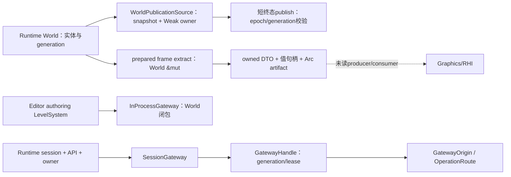

---
related_code:
  - zircon_runtime/src/scene/world
  - zircon_runtime/src/scene/world_publication.rs
  - zircon_runtime/src/core/framework/render
  - zircon_editor/src/core/gateway
plan_sources:
  - docs/plans/performance/index.md
  - docs/plans/performance/2026-10-04-architecture-audit-flow.md
  - docs/plans/mvp/index.md
doc_type: current-source-architecture-review
status: static_partial_dynamic_pending
source_head_observation: d588b90c0e3ca36503ac6b4f2c5d2d96ba7acfef
---

# World、渲染抽取与 Editor Gateway：当前源码限定阅读

创建时点：2026-10-14T10:56:23.684540+00:00。任务 engine-audit-20261009-01a12097；Root chat 01a12097-5c69-7753-b694-f02c04d45968；实际 checkout E:/Git/ZirconEngine/main。registry revision15 在创建本文件前登记路径、Root归属和保留条件。本文不包含源码副本，也没有运行模块、测试、构建或产品。

## 1. 覆盖与验收边界

本切片共37个源码pin：31生产叶，6273行去重正文（30叶全文，render/mod.rs为141/568行部分）；6个测试叶，353行正文（4全文、2部分）。World分组8叶2057行；渲染9叶1800行；Gateway14生产叶2416行。Root先读scene/mod.rs1–160、world/mod.rs1–102、gateway/mod.rs1–42；Luna补读或复核后的统计取并集。Root随后重新核对这些pin，metadata读取不算新的正文覆盖。Sol对World/identity的353行是独立复核，不再计生产正文。

Luna45Archive、Luna45DTO、Luna45Reply均使用 gpt-6-luna/max/none，首轮三任务并行；Sol46使用 gpt-6.1-sol/max/none复核根因和执行路线决策。最多三个helper同时运行，以适应当前含Root的四个并发槽。各次外层/嵌套只读命令均按各自报告保留并监督到数值退出；此前工具host中断和Luna丢失查询handle的未知终态仍保留，不据本轮成功称全部自有进程关闭。

既有[App/Core/资产/关闭局部阅读](2026-10-13-shutdown-ownership-current-audit.md)第11节的95个引擎pin统计绑定f0898b4e切片；本文独立记局部覆盖，尚未证明全引擎清单与模块验收。World实体注册、完整Schedule、LevelSystem、render producer/consumer、RHI和Gateway外部消费者等仍有未读边界，不能把入口或全部指定叶阅读当整个模块完成。

MVP 00/F0最低门槛仍开放。R6已[逐字节归档](../../../.jenkins/state/records-queue/archive/5979d0fc8bc1384f3475873922140e51170e9584273a3f29ce133ed8e6679a27/engine-audit-20261009-01a12097-current-input-r6-to-jenkins-01a0f6e1.md)，followup36的[实际补充回执](../../../.jenkins/state/records-queue/followups/responses/5979d0fc8bc1384f3475873922140e51170e9584273a3f29ce133ed8e6679a27.json)只接受intake，formal/native=false且没有新native request。原A1仍formal_input_pending；输入、迁移scope、实际执行与产品验收不得由静态阅读替代。

## 2. Owner、数据流与线程边界

| 边界 | 当前正文支持的owner/行为 | 尚未证明的契约 |
|---|---|---|
| World数据 | Runtime scene::World直接持有实体、组件/资源/事件/消息/观察者、Schedule、索引、派生状态和generation；修改入口使用&mut self | EntityRegistry内部slot/generation、所有mutator与World Send/Sync |
| live World publication | WorldPublicationOwner保存Arc/Mutex World、replacement epoch、lifecycle epoch；Source是World快照和Weak owner/lifecycle | LevelSystem唯一capture调用点及全部replacement写入者 |
| World schedule桥 | World转交owner identity与系统计划；取出native system，执行后按owner与计划身份归还，panic重新传播 | scene::ecs实际生产compiler、phase、worker/pool与线程亲和 |
| 帧抽取 | World的&mut prepared入口运行RenderExtract系统，生成有world/generation的值句柄与owned DTO；journal/artifact经Arc | producer的锁区间、payload长期owner、最终Graphics/RHI消费 |
| Editor authoring通道 | InProcessGateway包装editor authoring LevelSystem，提供World闭包与query/watch；session handle无效/identity detached | live LevelSystem锁、实际重入者及authoring写入政策 |
| Session Gateway | 持有runtime owner/API/releaser/session/full identity；包装通过校验的V8 ABI，不直接借用World闭包 | Runtime端线程安全、写权限和foreign-output状态实际实现 |
| 可替换Gateway | ArcSwap发布generation，replacement Mutex串行replace/detach；调用在固定lease上、不持替换锁 | 全部消费者是否保存正确origin、替换期间结果/副作用约定 |
| 长期operation | EditorRuntimeOperationRoute保存GatewayOrigin；tick/submit/poll/harvest均同endpoint | 外部消费者是否全用该route、operation取消合同 |

图中实线只表示本切片的存储或调用边界；虚线对应尚未闭合的产品消费链，不证明完整帧路径已运行。

## 3. World：发布、提交与持久化

world/world.rs94–146定义存储owner；identity.rs11–42将stable EntityId解析到InternalEntity、row和archetype location，82–99用swap_remove同步dense vector与row map。公开EntityId是u64；InternalEntity/EntityRegistry定义未读，不把它说成带generation的公开handle。

world_publication.rs127–181先upgrade Weak World owner与lifecycle，取得World锁再lifecycle锁，依次核对replacement epoch、live World generation、Loaded及lifecycle epoch，全部匹配才调用短终态closure。Poison恢复采用into_inner；closure收到&World，不能因此直接修改live World。该API拒owner dropped、lifecycle dropped、替换/generation/lifecycle变化与unload/reload ABA。注释还规定callback只发布已准备状态、禁止加载asset或外部callback和重入；实际调用方遵守情况未读。

schedule.rs101–132取出native system，以catch_unwind运行；相同World owner及stage plan时恢复，发生替换/计划变化时交还原return owner，随后resume panic。135–284的worldless batch/worker buffer是cfg(test)辅助，不是当前生产worker能力证据。world_time/mod.rs全文只证明reexports与内部controller入口，没有证明fixed-step运行语义。

records.rs99–119整批预检当前/registry/批内重复ID、transform、临时allocator、容量和mobility；123–170再提交实体/组件行，更新visibility、dirty/cache、World与scene-binding generation，写Spawned事实并分发暂存生命周期事件。分发中target替换返回LifecycleTargetReplaced，但此前提交和部分分发已发生；这是target失效边界，不能按“Err必无副作用”盲目重试。replacement后旧World是否丢弃、事件如何隔离仍需caller/observer动态验证。

World Clone（148–231）复制持久/运行数据、node_cache等并重建registry/component projection，subscription sink重置。序列化仅保存durable scene字段；from_persistent_state（427–543）重建运行索引/存储，schedule、runtime registries、events/resources/cache等默认化。它并未把全部Runtime运行态持久化。

## 4. 渲染抽取：新旧入口与恢复扫描

scene/world/render.rs48–55的兼容入口to_render_snapshot → to_render_extract → build_viewport_render_packet显式self.clone。141–226的build_prepared_render_frame_extract_for_request通过&mut World执行RenderExtract系统、写入world_generation并收集mesh/sprite/particle/light/visibility；此函数正文未克隆World。inactive camera返回空场景但保留scene_changes artifact。旧入口是否仍在产品热路径、实际World锁范围和抽取失败传播待producer/caller阅读，不据静态克隆数量报性能收益。

RenderWorldSnapshotHandle只有world ID与generation两个值字段，为Copy且不持World引用。RenderDirtyEntityJournal是带world/journal/source generation、tick、all-entities标记和Arc entity IDs的不可变数据；component changes artifact通过Arc发布。具体journal推进、重绑定和长期payload回收在未读state/producer/consumer。

projector.rs在initial、rebind、source generation/tick drift、all_entities、journal代数断档、removal history loss时走全量stable IDs扫描；增量按journal候选探测5类component ticks并处理5类removal windows。mesh upsert会复制morph weights、primitive/LOD和material override集合。已有stats记录full_scan_entities、候选、tick probes、payload clones等，但没有本次频率、耗时或分配证据；恢复扫描本身不定为冗余。

selected camera位置用于mesh LOD，而layers可能合并符合条件的其他target cameras（render.rs149–168、228–270、310–358、525–542、667–716）。是否违反多视图合同取决于下游共享几何/每view消费设计，当前只列待核对，不能恢复8月“所有首camera投影错误”的旧结论。

## 5. Gateway：身份固定、协议与释放

contract.rs定义Send+Sync Gateway能力，默认明确CapabilityMissing或RequiresSerializedAccess；同一trait也有with_world_mut，因此整个Gateway不是只读投影。InProcess借用World回调以thread-local RAII guard防同线程重入，unwind也清除guard；typed query未走此guard，LevelSystem内部锁和实际嵌套调用未读，不能认定死锁。

SessionGateway构造核session、identity中的ABI handle、V8精确shape和release/pick必需入口，保留runtime owner使函数指针提供者持续存活。frame demand核ABI/kind/delay（上限60秒），invalid协议拒绝；capture接管raw output并校ABI和RGBA尺寸，验证失败也release并进入reject。成功frame保留owner直到显式release或Drop。显式release可返回错误，Drop只能把失败送入foreign-output状态，实际quarantine诊断/恢复策略待host叶复核。

World query/invalidation解码有预算与item count校验，watch token/unwatch bool也校验。Handle用identity lease固定操作，query有执行前后current身份检查；其他固定old lease完成的返回值/副作用是否可接受需consumer约定，不能从前后query类推所有方法。

扩读operation_route.rs后撤回初步普通handle跨replace误投P1的产品定级：现有EditorRuntimeOperationRoute持固定origin，tick/submit/poll/harvest均同endpoint。普通handle方法仍按当前lease转发，而文档要求可替换消费者使用pinned route；只有查到违反者才形成产品缺陷。session/operations校submit handle、poll ABI/handle/phase/detail、harvest ABI/handle/items，失败reject协议。该接口没有cancel_operation；pick另有request/poll/cancel与票据匹配校验，不把pick取消推广成operation取消。

## 6. 统一候选队列与验收方法

| ID / 等级 / 证据 | 位置、触发、根因与影响 | Owner与下一步 / 验收 |
|---|---|---|
| EA46-WORLD-001 / P2 / 独立确认静态panic路径，未动态复现 | world.rs427–560 → identity.rs134–148；损坏持久化entities重复且component keys/next_id前检通过。orphan检验把entities折成set而未拒重复，rebuild第二次dense-row insert触发assert | Runtime world persistence；先核allocator和实际load调用链。基于正常单实体World序列化value重复entities[0]，public Deserialize不panic且Err，内部from_persistent_state回DuplicateEntity；产品保存/重开与失败保留原项目仍需动态验收。F0阻塞优先，不提前F3实施 |
| EA46-WORLD-002 / P2契约待查 / 静态 | records123–170先commit后dispatch target changed可Err；盲重试可能重复副作用，尚未发现实际违规caller | World lifecycle/caller；observer第一事件替换World，核精确Err、剩余事件隔离和原World终态 |
| EA46-RENDER-001 / 未定瓶颈级别 / 静态 | 兼容World clone，仅在真实调用者使用时有复制成本；prepared函数未见同克隆 | render extract/caller；先证明热路径，再用现有scope采耗时、分配和复制bytes |
| EA46-RENDER-002 / 恢复路径待采样 / 静态 | projector全量恢复触发、增量payload复制；频率和噪声未知 | World journal/projector；统计reason/full次数/full_scan_entities、tick probes、clone数量/bytes，5次独立运行，预热后30秒 |
| EA46-RENDER-003 / P2契约待查 / 静态 | 合并layers仍以selected camera做mesh LOD；没有证明消费者违反共享几何合同 | producer/多view consumer；核每view合同后构造两个target/view差异场景，再验LOD/可见性和输出 |
| EA46-GATEWAY-001 / 契约待查，初步产品P1撤回 / 静态 | 专用origin operation route已固定；全产品消费者用法未读 | Editor操作consumer；核submit/poll/harvest均同origin，replace测试不得把旧handle送新endpoint |
| EA46-GATEWAY-002 / P2契约待查 / 静态 | InProcess callback重入guard不覆盖typed query；FFI Send+Sync并发合同与实际host状态未读 | LevelSystem/Gateway/Runtime ABI；核锁与线程合同后设计重入/并发回归，不预判死锁或权限绕过 |

frame Drop诊断、operation取消以及pick替换期间票据仍是开放合同边界，不另造已复现错误。所有候选的产品影响、性能成本和动态验收均保持开放。

Sol独立读world235–560、identity125–151，确认Deserialize → PersistentState → from_persistent_state → rebuild中dense-row重复assert先于另一expect；并指出0/TERMINAL/u64::MAX等next_id会先错误，不能拿这些不满足前置条件的输入作为重复ID复现。allocator实现未读，不能推断完整合法域。现有insert_node_records重复测试不是Deserialize回归。

## 7. 历史去重与待扩读

8月[World/ECS旧审查](02/2026-08-15-world-ecs-frame-extract-current-architecture-review.md)Root只读1–160，pin6d8cc664／13549 B/201行，只作历史背景。该计划已纠正逐帧stage重编译、dense双存储和逐command Box；其中worldless worker、dirty全域、三路径深复制和首camera问题都绑定8月证据。本文既没有继承它们为当前故障，也没有用局部API新实现宣称旧问题全部关闭。

后续准确阅读范围：EntityRegistry/World generation与mutators、LevelSystem capture/replacement、scene::ecs Schedule的生产执行者、WorldTime controller；render frame_extract的extract_producer/extract_context/shared_scene_domain/frame/scene_payload及render_dirty_journal/state；Gateway viewport pick route、prepared_publication、实际operation消费者、Runtime host foreign-output状态与线程合同。扩读由Root统一分配；未读范围保持unknown。

## 8. 当前源码pin与正文清单

### 8.1 World（8生产叶 / 2057行）

| 当前源码 | SHA256 | bytes / 总行数 | 实读正文 |
|---|---|---:|---|
| [zircon_runtime/src/scene/mod.rs](../../../zircon_runtime/src/scene/mod.rs) | eb9f55d7dcb7a73c5f48b8eb6d1e43773f31c85db55d992c6bfda6f5dd4141d4 | 8059 / 168 | 1–168（全文） |
| [zircon_runtime/src/scene/world_publication.rs](../../../zircon_runtime/src/scene/world_publication.rs) | 849a8a81fe8ef38844f3bf4094f4842a5a0aaa643ea9ec7de1f8b27dd30a560e | 7067 / 187 | 1–187（全文） |
| [zircon_runtime/src/scene/world_time/mod.rs](../../../zircon_runtime/src/scene/world_time/mod.rs) | 631cd56b51a889b50161f7777ec1f3e12b5549816490229b8587a34e48637791 | 759 / 22 | 1–22（全文） |
| [zircon_runtime/src/scene/world/mod.rs](../../../zircon_runtime/src/scene/world/mod.rs) | d0c13e07adac0558273cad9c3902d09e84357c20d324a6eefc83806b2bcbcce5 | 3130 / 102 | 1–102（全文） |
| [zircon_runtime/src/scene/world/world.rs](../../../zircon_runtime/src/scene/world/world.rs) | ff4c2c14f4e553c0524780a10ace61a61247885c2e826a09cbb5b684680ea55a | 27458 / 606 | 1–606（全文） |
| [zircon_runtime/src/scene/world/schedule.rs](../../../zircon_runtime/src/scene/world/schedule.rs) | e7d8e8d5a676a049568ccf312eae2e6f8ae84a35f25e67847dc36d943a163c04 | 10295 / 285 | 1–285（全文） |
| [zircon_runtime/src/scene/world/identity.rs](../../../zircon_runtime/src/scene/world/identity.rs) | a199852c4c1a982acc0a77dfbb5c745d5b0b2a0a313a6973ce6c77a63cd7b4ab | 13166 / 329 | 1–329（全文） |
| [zircon_runtime/src/scene/world/records.rs](../../../zircon_runtime/src/scene/world/records.rs) | 6db36f7f785fe85571c865555792395288dd28595345f1fa58ca6b6298ab7462 | 14774 / 358 | 1–358（全文） |

### 8.2 渲染（9生产叶 / 1800行）

| 当前源码 | SHA256 | bytes / 总行数 | 实读正文 |
|---|---|---:|---|
| [zircon_runtime/src/core/framework/render/mod.rs](../../../zircon_runtime/src/core/framework/render/mod.rs) | c5b7fce122f946d06e9ff8f375dc77d51a59b5fd2d7046e07335291e1241c726 | 34291 / 568 | 1–44、255–285、420–485（部分） |
| [zircon_runtime/src/core/framework/render/frame_extract.rs](../../../zircon_runtime/src/core/framework/render/frame_extract.rs) | 2e438cbcf1ad32b7e2346e0a341d8bdb4745fdcb1f2c8a073e64f64d4600bff2 | 3047 / 77 | 1–77（全文） |
| [zircon_runtime/src/core/framework/render/frame_extract/world_snapshot_handle.rs](../../../zircon_runtime/src/core/framework/render/frame_extract/world_snapshot_handle.rs) | 0a86083e760bdd849aeedda95ba924c322741629ac91d0209a21d58f1a302a01 | 975 / 40 | 1–40（全文） |
| [zircon_runtime/src/scene/world/render.rs](../../../zircon_runtime/src/scene/world/render.rs) | deff3955ad963ab16a97a8b39f218d4721ffd921b4f0251fd897cd503dad23d7 | 33134 / 826 | 1–826（全文） |
| [zircon_runtime/src/scene/world/render_visibility.rs](../../../zircon_runtime/src/scene/world/render_visibility.rs) | 5f2ae1f2c6b424bcbd9f8fd576b10b1baf7fc9fec6e326a3f5124a2e3190dca3 | 4121 / 114 | 1–114（全文） |
| [zircon_runtime/src/scene/world/render_dirty_journal/mod.rs](../../../zircon_runtime/src/scene/world/render_dirty_journal/mod.rs) | b7a1aedb82346938652a4c121dfd5c90110094ecfa215dee2f27e96f4c0fda5c | 425 / 17 | 1–17（全文） |
| [zircon_runtime/src/scene/world/render_dirty_journal/journal.rs](../../../zircon_runtime/src/scene/world/render_dirty_journal/journal.rs) | cbc991e585c6428d8c7f66e439e004f04ef6b9b3fc101e0d27d472828d653414 | 2418 / 91 | 1–91（全文） |
| [zircon_runtime/src/scene/world/render_component_changes/mod.rs](../../../zircon_runtime/src/scene/world/render_component_changes/mod.rs) | bddd714563b00bd341b2b263138b43e55f92796caef2d7c7c64539ca2f248f58 | 1693 / 44 | 1–44（全文） |
| [zircon_runtime/src/scene/world/render_component_changes/projector.rs](../../../zircon_runtime/src/scene/world/render_component_changes/projector.rs) | 4db2d162742b18909935261db3ee2f4d43a40da063723864dda26b30f0b8afd8 | 15803 / 450 | 1–450（全文） |

### 8.3 Gateway（14生产叶 / 2416行）

| 当前源码 | SHA256 | bytes / 总行数 | 实读正文 |
|---|---|---:|---|
| [zircon_editor/src/core/gateway/mod.rs](../../../zircon_editor/src/core/gateway/mod.rs) | e8003265987fb0f130d51b47c7817318dd10f0affba2aec3e1ca1924fe3b580d | 1298 / 42 | 1–42（全文） |
| [zircon_editor/src/core/gateway/contract.rs](../../../zircon_editor/src/core/gateway/contract.rs) | f51967115b4b45d83016dee3b784d478225e75e84b4aa75efffe2fb196484192 | 12275 / 394 | 1–394（全文） |
| [zircon_editor/src/core/gateway/handle.rs](../../../zircon_editor/src/core/gateway/handle.rs) | 589c4313f9a369060e0fec40b8c9b85c68ee01a6e340385ef06be8fd7d2443a8 | 20070 / 585 | 1–585（全文） |
| [zircon_editor/src/core/gateway/in_process.rs](../../../zircon_editor/src/core/gateway/in_process.rs) | 04ed091822184dbd3b5b7400f9a5c43137af144ea5ba95504eeac55cafb8217b | 4992 / 160 | 1–160（全文） |
| [zircon_editor/src/core/gateway/session/mod.rs](../../../zircon_editor/src/core/gateway/session/mod.rs) | b222b2b16019b0405c433e32ccae79f49ac2f2562de3a1f1bd1d7bbc874531f4 | 553 / 29 | 1–29（全文） |
| [zircon_editor/src/core/gateway/session/gateway.rs](../../../zircon_editor/src/core/gateway/session/gateway.rs) | 88faab5e235123154d281829f4a0fff212566e26a602cbabb62b44068336faec | 8041 / 222 | 1–222（全文） |
| [zircon_editor/src/core/gateway/session/contract.rs](../../../zircon_editor/src/core/gateway/session/contract.rs) | b3407eaa288b2b570afbfbae6102a63ff38fbef8cab6eb7ded5dbf3935e4b072 | 5605 / 164 | 1–164（全文） |
| [zircon_editor/src/core/gateway/session/frame.rs](../../../zircon_editor/src/core/gateway/session/frame.rs) | c17b78999a8b4c96141982e1ed86b8c8af0a3ef76f0aa4b1a3d389f2b701e375 | 4424 / 121 | 1–121（全文） |
| [zircon_editor/src/core/gateway/session/world_sync.rs](../../../zircon_editor/src/core/gateway/session/world_sync.rs) | 17544881d7d8c5b9ecee6a7ec53afe6be471b759b53567651efffbea380302da | 5558 / 139 | 1–139（全文） |
| [zircon_editor/src/core/gateway/session/output.rs](../../../zircon_editor/src/core/gateway/session/output.rs) | 98ee9ed09a36d487422b0ff0727ca84d74bfb6554c30209edbf9c3e8cb97e789 | 4324 / 139 | 1–139（全文） |
| [zircon_editor/src/core/gateway/session/protocol.rs](../../../zircon_editor/src/core/gateway/session/protocol.rs) | 5ff2116fdaaf6530f7b917f36d9fd32b03adad6e4ad5d47316f5232c23808fc9 | 5441 / 166 | 1–166（全文） |
| [zircon_editor/src/core/gateway/operation_route.rs](../../../zircon_editor/src/core/gateway/operation_route.rs) | fa9d822a66ff584c470d58308cd6021f015ff4eaa8e3ba6d1effe549a7c95457 | 2566 / 68 | 1–68（全文） |
| [zircon_editor/src/core/gateway/session/operations.rs](../../../zircon_editor/src/core/gateway/session/operations.rs) | fb9f77b220222d7724f4a79d8df81508b9ce1903b662f32227975d14b770d8a8 | 4189 / 102 | 1–102（全文） |
| [zircon_editor/src/core/gateway/session/viewport_pick.rs](../../../zircon_editor/src/core/gateway/session/viewport_pick.rs) | f9d719f61ff37fe4e393920d474f548b2b0f2b86aee84ce76291aa7ecb5814e5 | 3254 / 85 | 1–85（全文） |

### 8.4 相关测试（6叶 / 353行，仅阅读）

| 当前源码 | SHA256 | bytes / 总行数 | 实读正文 |
|---|---|---:|---|
| [zircon_editor/src/core/gateway/tests/handle.rs](../../../zircon_editor/src/core/gateway/tests/handle.rs) | e74c6d7c20588ca638171e3952c233585fd05d3a0ef77715826344d89f7f6c5e | 304 / 12 | 1–12（全文） |
| [zircon_editor/src/core/gateway/session/tests/cases.rs](../../../zircon_editor/src/core/gateway/session/tests/cases.rs) | d9ad91eb6fa1285e07a742f2b8fbfcc463c4c83498f71d375faba033be593e5b | 25334 / 768 | 75–190、680–768（部分） |
| [zircon_editor/src/core/gateway/session/tests/protocol.rs](../../../zircon_editor/src/core/gateway/session/tests/protocol.rs) | 195c503182489dce3cdd0a417a1ee5f44322b210b87ee3d14b81efb1382f3ce9 | 1113 / 29 | 1–29（全文） |
| [zircon_runtime/src/scene/world/tests/world.rs](../../../zircon_runtime/src/scene/world/tests/world.rs) | fb54ae0ce4e82aee283cdd22bbb8ab796886e80db7f3d441be6adee11ad8b684 | 635 / 18 | 1–18（全文） |
| [zircon_runtime/src/scene/world/tests/entity_id_allocator.rs](../../../zircon_runtime/src/scene/world/tests/entity_id_allocator.rs) | 22891c8e5eba1f2b447aca9b50a25299b69d5a16a2610799ec86198c6f99dcea | 1077 / 34 | 1–34（全文） |
| [zircon_runtime/src/scene/world/tests/records.rs](../../../zircon_runtime/src/scene/world/tests/records.rs) | a40d256eb6974bc5f2468553e1f69ae0004c09b9223abf3e70cf3e1f3b5319ca | 19031 / 444 | 135–189（部分） |

测试现有body：Gateway handle overflow、pick happy path、unknown frame demand与foreign-output fuse、尺寸边界；World next_id错误、insert_node_records重复。没有发现指定阅读段中的operation route replace回归或World重复Deserialize回归，不能把有限rg/片段当整个测试树不存在这些用例。

## 9. M1执行路线的新静态证据与后续验证

R6补充回执引用ordinary capsule b48ac30b。Sol限定读runner250行、guard180行、public entry141行，核selected checkout分支提前进入validate_checkout、拒worktree/donor、root==plain(repo)，实际helper调用把physical canonical root作为cwd并要求native回执匹配。guard在pins前启动监视、文件只分享READ并在结束时核稳定/取消join。此证据高于marker，但未读helper内部、模块装载副作用、完整native monitor与final release/reconcile，仍不证明真实执行无复制或物理对象验收。

canonical formal driver1dfff656的seal/metadata/planner/host prepared-source拒live checkout证据单独保留；不能据它概括所有ordinary。原A1仍因external HEAD/index登记、App旧hash/3迁移scope、原driver/runtime lineage与输入seal协调pending。ordinary遇既有capture/launch/report或输入变更还有continuity gate；不得改同ID的payload、新g1或private State来伪装原attempt复用。下一步由canonical provider与原输入owner走公开受管契约协调，验证真实cwd、合法输出根、完整compiler/外部输入与退出EOF。

当前无性能前后样本。基线仍需相同源码与产物指纹、toolchain/features、硬件/显示/场景/输入/缓存；优化前后各至少5次独立运行，稳态预热后30秒，帧时p50/p95/p99、CPU/GPU、内存、分配、等待和上传量。Tracy、RenderDoc MCP/capture、GPU timestamp及WPR实际能力仍待M1产品链验证。Root本批释放0 B，保留必要失败、供给、共享和未知产物；没有源码副本、构建输出、提交/推送/发布或外部通知。本文6ab8fc1e切片（25889 B/179行）经Luna45Archive、Luna45DTO、Luna45Reply按World/render/Gateway任务范围独立复核通过；本次只更新此复核状态句，旧准确切片保留在registry。模块和里程碑尚未验收，goal/清理继续active。
