---
related_code:
  - zircon_runtime/src/scene/world
  - zircon_runtime/src/scene/world_publication.rs
  - zircon_runtime/src/core/framework/render
  - zircon_editor/src/core/gateway
plan_sources:
  - docs/plans/performance/index.md
  - docs/plans/performance/2026-10-04-architecture-audit-flow.md
  - docs/plans/mvp/index.md
doc_type: current-source-architecture-review
status: static_partial_dynamic_pending
source_head_observation: d588b90c0e3ca36503ac6b4f2c5d2d96ba7acfef
---

# World、渲染抽取与 Editor Gateway：当前源码限定阅读

创建时点：2026-10-14T10:56:23.684540+00:00。任务 engine-audit-20261009-01a12097；Root chat 01a12097-5c69-7753-b694-f02c04d45968；实际 checkout E:/Git/ZirconEngine/main。registry revision15 在创建本文件前登记路径、Root归属和保留条件。本文不包含源码副本，也没有运行模块、测试、构建或产品。

以下§1–40保留各自阅读时点；S41 的保存、关闭契约与当前 M1 准入观察见§41；原A1、M0/M1、模块与动态验收仍开放。

## 1. 覆盖与验收边界

本切片共37个源码pin：31生产叶，6273行去重正文（30叶全文，render/mod.rs为141/568行部分）；6个测试叶，353行正文（4全文、2部分）。World分组8叶2057行；渲染9叶1800行；Gateway14生产叶2416行。Root先读scene/mod.rs1–160、world/mod.rs1–102、gateway/mod.rs1–42；Luna补读或复核后的统计取并集。Root随后重新核对这些pin，metadata读取不算新的正文覆盖。Sol对World/identity的353行是独立复核，不再计生产正文。

Luna45Archive、Luna45DTO、Luna45Reply均使用 gpt-6-luna/max/none，首轮三任务并行；Sol46使用 gpt-6.1-sol/max/none复核根因和执行路线决策。最多三个helper同时运行，以适应当前含Root的四个并发槽。各次外层/嵌套只读命令均按各自报告保留并监督到数值退出；此前工具host中断和Luna丢失查询handle的未知终态仍保留，不据本轮成功称全部自有进程关闭。

既有[App/Core/资产/关闭局部阅读](2026-10-13-shutdown-ownership-current-audit.md)第11节的95个引擎pin统计绑定f0898b4e切片；本文独立记局部覆盖，尚未证明全引擎清单与模块验收。World实体注册、完整Schedule、LevelSystem、render producer/consumer、RHI和Gateway外部消费者等仍有未读边界，不能把入口或全部指定叶阅读当整个模块完成。

MVP 00/F0最低门槛仍开放。R6已[逐字节归档](../../../.jenkins/state/records-queue/archive/5979d0fc8bc1384f3475873922140e51170e9584273a3f29ce133ed8e6679a27/engine-audit-20261009-01a12097-current-input-r6-to-jenkins-01a0f6e1.md)，followup36的[实际补充回执](../../../.jenkins/state/records-queue/followups/responses/5979d0fc8bc1384f3475873922140e51170e9584273a3f29ce133ed8e6679a27.json)只接受intake，formal/native=false且没有新native request。原A1仍formal_input_pending；输入、迁移scope、实际执行与产品验收不得由静态阅读替代。

## 2. Owner、数据流与线程边界

| 边界 | 当前正文支持的owner/行为 | 尚未证明的契约 |
|---|---|---|
| World数据 | Runtime scene::World直接持有实体、组件/资源/事件/消息/观察者、Schedule、索引、派生状态和generation；修改入口使用&mut self | EntityRegistry内部slot/generation、所有mutator与World Send/Sync |
| live World publication | WorldPublicationOwner保存Arc/Mutex World、replacement epoch、lifecycle epoch；Source是World快照和Weak owner/lifecycle | LevelSystem唯一capture调用点及全部replacement写入者 |
| World schedule桥 | World转交owner identity与系统计划；取出native system，执行后按owner与计划身份归还，panic重新传播 | scene::ecs实际生产compiler、phase、worker/pool与线程亲和 |
| 帧抽取 | World的&mut prepared入口运行RenderExtract系统，生成有world/generation的值句柄与owned DTO；journal/artifact经Arc | producer的锁区间、payload长期owner、最终Graphics/RHI消费 |
| Editor authoring通道 | InProcessGateway包装editor authoring LevelSystem，提供World闭包与query/watch；session handle无效/identity detached | live LevelSystem锁、实际重入者及authoring写入政策 |
| Session Gateway | 持有runtime owner/API/releaser/session/full identity；包装通过校验的V8 ABI，不直接借用World闭包 | Runtime端线程安全、写权限和foreign-output状态实际实现 |
| 可替换Gateway | ArcSwap发布generation，replacement Mutex串行replace/detach；调用在固定lease上、不持替换锁 | 全部消费者是否保存正确origin、替换期间结果/副作用约定 |
| 长期operation | EditorRuntimeOperationRoute保存GatewayOrigin；tick/submit/poll/harvest均同endpoint | 外部消费者是否全用该route、operation取消合同 |

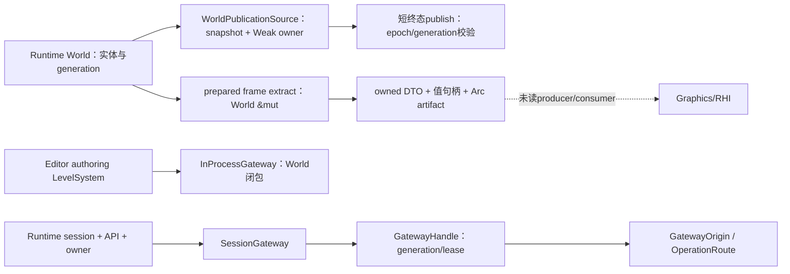

图中实线只表示本切片的存储或调用边界；虚线对应尚未闭合的产品消费链，不证明完整帧路径已运行。

## 3. World：发布、提交与持久化

world/world.rs94–146定义存储owner；identity.rs11–42将stable EntityId解析到InternalEntity、row和archetype location，82–99用swap_remove同步dense vector与row map。公开EntityId是u64；InternalEntity/EntityRegistry定义未读，不把它说成带generation的公开handle。

world_publication.rs127–181先upgrade Weak World owner与lifecycle，取得World锁再lifecycle锁，依次核对replacement epoch、live World generation、Loaded及lifecycle epoch，全部匹配才调用短终态closure。Poison恢复采用into_inner；closure收到&World，不能因此直接修改live World。该API拒owner dropped、lifecycle dropped、替换/generation/lifecycle变化与unload/reload ABA。注释还规定callback只发布已准备状态、禁止加载asset或外部callback和重入；实际调用方遵守情况未读。

schedule.rs101–132取出native system，以catch_unwind运行；相同World owner及stage plan时恢复，发生替换/计划变化时交还原return owner，随后resume panic。135–284的worldless batch/worker buffer是cfg(test)辅助，不是当前生产worker能力证据。world_time/mod.rs全文只证明reexports与内部controller入口，没有证明fixed-step运行语义。

records.rs99–119整批预检当前/registry/批内重复ID、transform、临时allocator、容量和mobility；123–170再提交实体/组件行，更新visibility、dirty/cache、World与scene-binding generation，写Spawned事实并分发暂存生命周期事件。分发中target替换返回LifecycleTargetReplaced，但此前提交和部分分发已发生；这是target失效边界，不能按“Err必无副作用”盲目重试。replacement后旧World是否丢弃、事件如何隔离仍需caller/observer动态验证。

World Clone（148–231）复制持久/运行数据、node_cache等并重建registry/component projection，subscription sink重置。序列化仅保存durable scene字段；from_persistent_state（427–543）重建运行索引/存储，schedule、runtime registries、events/resources/cache等默认化。它并未把全部Runtime运行态持久化。

## 4. 渲染抽取：新旧入口与恢复扫描

scene/world/render.rs48–55的兼容入口to_render_snapshot → to_render_extract → build_viewport_render_packet显式self.clone。141–226的build_prepared_render_frame_extract_for_request通过&mut World执行RenderExtract系统、写入world_generation并收集mesh/sprite/particle/light/visibility；此函数正文未克隆World。inactive camera返回空场景但保留scene_changes artifact。旧入口是否仍在产品热路径、实际World锁范围和抽取失败传播待producer/caller阅读，不据静态克隆数量报性能收益。

RenderWorldSnapshotHandle只有world ID与generation两个值字段，为Copy且不持World引用。RenderDirtyEntityJournal是带world/journal/source generation、tick、all-entities标记和Arc entity IDs的不可变数据；component changes artifact通过Arc发布。具体journal推进、重绑定和长期payload回收在未读state/producer/consumer。

projector.rs在initial、rebind、source generation/tick drift、all_entities、journal代数断档、removal history loss时走全量stable IDs扫描；增量按journal候选探测5类component ticks并处理5类removal windows。mesh upsert会复制morph weights、primitive/LOD和material override集合。已有stats记录full_scan_entities、候选、tick probes、payload clones等，但没有本次频率、耗时或分配证据；恢复扫描本身不定为冗余。

selected camera位置用于mesh LOD，而layers可能合并符合条件的其他target cameras（render.rs149–168、228–270、310–358、525–542、667–716）。是否违反多视图合同取决于下游共享几何/每view消费设计，当前只列待核对，不能恢复8月“所有首camera投影错误”的旧结论。

## 5. Gateway：身份固定、协议与释放

contract.rs定义Send+Sync Gateway能力，默认明确CapabilityMissing或RequiresSerializedAccess；同一trait也有with_world_mut，因此整个Gateway不是只读投影。InProcess借用World回调以thread-local RAII guard防同线程重入，unwind也清除guard；typed query未走此guard，LevelSystem内部锁和实际嵌套调用未读，不能认定死锁。

SessionGateway构造核session、identity中的ABI handle、V8精确shape和release/pick必需入口，保留runtime owner使函数指针提供者持续存活。frame demand核ABI/kind/delay（上限60秒），invalid协议拒绝；capture接管raw output并校ABI和RGBA尺寸，验证失败也release并进入reject。成功frame保留owner直到显式release或Drop。显式release可返回错误，Drop只能把失败送入foreign-output状态，实际quarantine诊断/恢复策略待host叶复核。

World query/invalidation解码有预算与item count校验，watch token/unwatch bool也校验。Handle用identity lease固定操作，query有执行前后current身份检查；其他固定old lease完成的返回值/副作用是否可接受需consumer约定，不能从前后query类推所有方法。

扩读operation_route.rs后撤回初步普通handle跨replace误投P1的产品定级：现有EditorRuntimeOperationRoute持固定origin，tick/submit/poll/harvest均同endpoint。普通handle方法仍按当前lease转发，而文档要求可替换消费者使用pinned route；只有查到违反者才形成产品缺陷。session/operations校submit handle、poll ABI/handle/phase/detail、harvest ABI/handle/items，失败reject协议。该接口没有cancel_operation；pick另有request/poll/cancel与票据匹配校验，不把pick取消推广成operation取消。

## 6. 统一候选队列与验收方法

| ID / 等级 / 证据 | 位置、触发、根因与影响 | Owner与下一步 / 验收 |
|---|---|---|
| EA46-WORLD-001 / P2 / 独立确认静态panic路径，未动态复现 | world.rs427–560 → identity.rs134–148；损坏持久化entities重复且component keys/next_id前检通过。orphan检验把entities折成set而未拒重复，rebuild第二次dense-row insert触发assert | Runtime world persistence；先核allocator和实际load调用链。基于正常单实体World序列化value重复entities[0]，public Deserialize不panic且Err，内部from_persistent_state回DuplicateEntity；产品保存/重开与失败保留原项目仍需动态验收。F0阻塞优先，不提前F3实施 |
| EA46-WORLD-002 / P2契约待查 / 静态 | records123–170先commit后dispatch target changed可Err；盲重试可能重复副作用，尚未发现实际违规caller | World lifecycle/caller；observer第一事件替换World，核精确Err、剩余事件隔离和原World终态 |
| EA46-RENDER-001 / 未定瓶颈级别 / 静态 | 兼容World clone，仅在真实调用者使用时有复制成本；prepared函数未见同克隆 | render extract/caller；先证明热路径，再用现有scope采耗时、分配和复制bytes |
| EA46-RENDER-002 / 恢复路径待采样 / 静态 | projector全量恢复触发、增量payload复制；频率和噪声未知 | World journal/projector；统计reason/full次数/full_scan_entities、tick probes、clone数量/bytes，5次独立运行，预热后30秒 |
| EA46-RENDER-003 / P2契约待查 / 静态 | 合并layers仍以selected camera做mesh LOD；没有证明消费者违反共享几何合同 | producer/多view consumer；核每view合同后构造两个target/view差异场景，再验LOD/可见性和输出 |
| EA46-GATEWAY-001 / 契约待查，初步产品P1撤回 / 静态 | 专用origin operation route已固定；全产品消费者用法未读 | Editor操作consumer；核submit/poll/harvest均同origin，replace测试不得把旧handle送新endpoint |
| EA46-GATEWAY-002 / P2契约待查 / 静态 | InProcess callback重入guard不覆盖typed query；FFI Send+Sync并发合同与实际host状态未读 | LevelSystem/Gateway/Runtime ABI；核锁与线程合同后设计重入/并发回归，不预判死锁或权限绕过 |

frame Drop诊断、operation取消以及pick替换期间票据仍是开放合同边界，不另造已复现错误。所有候选的产品影响、性能成本和动态验收均保持开放。

Sol独立读world235–560、identity125–151，确认Deserialize → PersistentState → from_persistent_state → rebuild中dense-row重复assert先于另一expect；并指出0/TERMINAL/u64::MAX等next_id会先错误，不能拿这些不满足前置条件的输入作为重复ID复现。allocator实现未读，不能推断完整合法域。现有insert_node_records重复测试不是Deserialize回归。

## 7. 历史去重与待扩读

8月[World/ECS旧审查](02/2026-08-15-world-ecs-frame-extract-current-architecture-review.md)Root只读1–160，pin6d8cc664／13549 B/201行，只作历史背景。该计划已纠正逐帧stage重编译、dense双存储和逐command Box；其中worldless worker、dirty全域、三路径深复制和首camera问题都绑定8月证据。本文既没有继承它们为当前故障，也没有用局部API新实现宣称旧问题全部关闭。

后续准确阅读范围：EntityRegistry/World generation与mutators、LevelSystem capture/replacement、scene::ecs Schedule的生产执行者、WorldTime controller；render frame_extract的extract_producer/extract_context/shared_scene_domain/frame/scene_payload及render_dirty_journal/state；Gateway viewport pick route、prepared_publication、实际operation消费者、Runtime host foreign-output状态与线程合同。扩读由Root统一分配；未读范围保持unknown。

## 8. 当前源码pin与正文清单

### 8.1 World（8生产叶 / 2057行）

| 当前源码 | SHA256 | bytes / 总行数 | 实读正文 |
|---|---|---:|---|
| [zircon_runtime/src/scene/mod.rs](../../../zircon_runtime/src/scene/mod.rs) | eb9f55d7dcb7a73c5f48b8eb6d1e43773f31c85db55d992c6bfda6f5dd4141d4 | 8059 / 168 | 1–168（全文） |
| [zircon_runtime/src/scene/world_publication.rs](../../../zircon_runtime/src/scene/world_publication.rs) | 849a8a81fe8ef38844f3bf4094f4842a5a0aaa643ea9ec7de1f8b27dd30a560e | 7067 / 187 | 1–187（全文） |
| [zircon_runtime/src/scene/world_time/mod.rs](../../../zircon_runtime/src/scene/world_time/mod.rs) | 631cd56b51a889b50161f7777ec1f3e12b5549816490229b8587a34e48637791 | 759 / 22 | 1–22（全文） |
| [zircon_runtime/src/scene/world/mod.rs](../../../zircon_runtime/src/scene/world/mod.rs) | d0c13e07adac0558273cad9c3902d09e84357c20d324a6eefc83806b2bcbcce5 | 3130 / 102 | 1–102（全文） |
| [zircon_runtime/src/scene/world/world.rs](../../../zircon_runtime/src/scene/world/world.rs) | ff4c2c14f4e553c0524780a10ace61a61247885c2e826a09cbb5b684680ea55a | 27458 / 606 | 1–606（全文） |
| [zircon_runtime/src/scene/world/schedule.rs](../../../zircon_runtime/src/scene/world/schedule.rs) | e7d8e8d5a676a049568ccf312eae2e6f8ae84a35f25e67847dc36d943a163c04 | 10295 / 285 | 1–285（全文） |
| [zircon_runtime/src/scene/world/identity.rs](../../../zircon_runtime/src/scene/world/identity.rs) | a199852c4c1a982acc0a77dfbb5c745d5b0b2a0a313a6973ce6c77a63cd7b4ab | 13166 / 329 | 1–329（全文） |
| [zircon_runtime/src/scene/world/records.rs](../../../zircon_runtime/src/scene/world/records.rs) | 6db36f7f785fe85571c865555792395288dd28595345f1fa58ca6b6298ab7462 | 14774 / 358 | 1–358（全文） |

### 8.2 渲染（9生产叶 / 1800行）

| 当前源码 | SHA256 | bytes / 总行数 | 实读正文 |
|---|---|---:|---|
| [zircon_runtime/src/core/framework/render/mod.rs](../../../zircon_runtime/src/core/framework/render/mod.rs) | c5b7fce122f946d06e9ff8f375dc77d51a59b5fd2d7046e07335291e1241c726 | 34291 / 568 | 1–44、255–285、420–485（部分） |
| [zircon_runtime/src/core/framework/render/frame_extract.rs](../../../zircon_runtime/src/core/framework/render/frame_extract.rs) | 2e438cbcf1ad32b7e2346e0a341d8bdb4745fdcb1f2c8a073e64f64d4600bff2 | 3047 / 77 | 1–77（全文） |
| [zircon_runtime/src/core/framework/render/frame_extract/world_snapshot_handle.rs](../../../zircon_runtime/src/core/framework/render/frame_extract/world_snapshot_handle.rs) | 0a86083e760bdd849aeedda95ba924c322741629ac91d0209a21d58f1a302a01 | 975 / 40 | 1–40（全文） |
| [zircon_runtime/src/scene/world/render.rs](../../../zircon_runtime/src/scene/world/render.rs) | deff3955ad963ab16a97a8b39f218d4721ffd921b4f0251fd897cd503dad23d7 | 33134 / 826 | 1–826（全文） |
| [zircon_runtime/src/scene/world/render_visibility.rs](../../../zircon_runtime/src/scene/world/render_visibility.rs) | 5f2ae1f2c6b424bcbd9f8fd576b10b1baf7fc9fec6e326a3f5124a2e3190dca3 | 4121 / 114 | 1–114（全文） |
| [zircon_runtime/src/scene/world/render_dirty_journal/mod.rs](../../../zircon_runtime/src/scene/world/render_dirty_journal/mod.rs) | b7a1aedb82346938652a4c121dfd5c90110094ecfa215dee2f27e96f4c0fda5c | 425 / 17 | 1–17（全文） |
| [zircon_runtime/src/scene/world/render_dirty_journal/journal.rs](../../../zircon_runtime/src/scene/world/render_dirty_journal/journal.rs) | cbc991e585c6428d8c7f66e439e004f04ef6b9b3fc101e0d27d472828d653414 | 2418 / 91 | 1–91（全文） |
| [zircon_runtime/src/scene/world/render_component_changes/mod.rs](../../../zircon_runtime/src/scene/world/render_component_changes/mod.rs) | bddd714563b00bd341b2b263138b43e55f92796caef2d7c7c64539ca2f248f58 | 1693 / 44 | 1–44（全文） |
| [zircon_runtime/src/scene/world/render_component_changes/projector.rs](../../../zircon_runtime/src/scene/world/render_component_changes/projector.rs) | 4db2d162742b18909935261db3ee2f4d43a40da063723864dda26b30f0b8afd8 | 15803 / 450 | 1–450（全文） |

### 8.3 Gateway（14生产叶 / 2416行）

| 当前源码 | SHA256 | bytes / 总行数 | 实读正文 |
|---|---|---:|---|
| [zircon_editor/src/core/gateway/mod.rs](../../../zircon_editor/src/core/gateway/mod.rs) | e8003265987fb0f130d51b47c7817318dd10f0affba2aec3e1ca1924fe3b580d | 1298 / 42 | 1–42（全文） |
| [zircon_editor/src/core/gateway/contract.rs](../../../zircon_editor/src/core/gateway/contract.rs) | f51967115b4b45d83016dee3b784d478225e75e84b4aa75efffe2fb196484192 | 12275 / 394 | 1–394（全文） |
| [zircon_editor/src/core/gateway/handle.rs](../../../zircon_editor/src/core/gateway/handle.rs) | 589c4313f9a369060e0fec40b8c9b85c68ee01a6e340385ef06be8fd7d2443a8 | 20070 / 585 | 1–585（全文） |
| [zircon_editor/src/core/gateway/in_process.rs](../../../zircon_editor/src/core/gateway/in_process.rs) | 04ed091822184dbd3b5b7400f9a5c43137af144ea5ba95504eeac55cafb8217b | 4992 / 160 | 1–160（全文） |
| [zircon_editor/src/core/gateway/session/mod.rs](../../../zircon_editor/src/core/gateway/session/mod.rs) | b222b2b16019b0405c433e32ccae79f49ac2f2562de3a1f1bd1d7bbc874531f4 | 553 / 29 | 1–29（全文） |
| [zircon_editor/src/core/gateway/session/gateway.rs](../../../zircon_editor/src/core/gateway/session/gateway.rs) | 88faab5e235123154d281829f4a0fff212566e26a602cbabb62b44068336faec | 8041 / 222 | 1–222（全文） |
| [zircon_editor/src/core/gateway/session/contract.rs](../../../zircon_editor/src/core/gateway/session/contract.rs) | b3407eaa288b2b570afbfbae6102a63ff38fbef8cab6eb7ded5dbf3935e4b072 | 5605 / 164 | 1–164（全文） |
| [zircon_editor/src/core/gateway/session/frame.rs](../../../zircon_editor/src/core/gateway/session/frame.rs) | c17b78999a8b4c96141982e1ed86b8c8af0a3ef76f0aa4b1a3d389f2b701e375 | 4424 / 121 | 1–121（全文） |
| [zircon_editor/src/core/gateway/session/world_sync.rs](../../../zircon_editor/src/core/gateway/session/world_sync.rs) | 17544881d7d8c5b9ecee6a7ec53afe6be471b759b53567651efffbea380302da | 5558 / 139 | 1–139（全文） |
| [zircon_editor/src/core/gateway/session/output.rs](../../../zircon_editor/src/core/gateway/session/output.rs) | 98ee9ed09a36d487422b0ff0727ca84d74bfb6554c30209edbf9c3e8cb97e789 | 4324 / 139 | 1–139（全文） |
| [zircon_editor/src/core/gateway/session/protocol.rs](../../../zircon_editor/src/core/gateway/session/protocol.rs) | 5ff2116fdaaf6530f7b917f36d9fd32b03adad6e4ad5d47316f5232c23808fc9 | 5441 / 166 | 1–166（全文） |
| [zircon_editor/src/core/gateway/operation_route.rs](../../../zircon_editor/src/core/gateway/operation_route.rs) | fa9d822a66ff584c470d58308cd6021f015ff4eaa8e3ba6d1effe549a7c95457 | 2566 / 68 | 1–68（全文） |
| [zircon_editor/src/core/gateway/session/operations.rs](../../../zircon_editor/src/core/gateway/session/operations.rs) | fb9f77b220222d7724f4a79d8df81508b9ce1903b662f32227975d14b770d8a8 | 4189 / 102 | 1–102（全文） |
| [zircon_editor/src/core/gateway/session/viewport_pick.rs](../../../zircon_editor/src/core/gateway/session/viewport_pick.rs) | f9d719f61ff37fe4e393920d474f548b2b0f2b86aee84ce76291aa7ecb5814e5 | 3254 / 85 | 1–85（全文） |

### 8.4 相关测试（6叶 / 353行，仅阅读）

| 当前源码 | SHA256 | bytes / 总行数 | 实读正文 |
|---|---|---:|---|
| [zircon_editor/src/core/gateway/tests/handle.rs](../../../zircon_editor/src/core/gateway/tests/handle.rs) | e74c6d7c20588ca638171e3952c233585fd05d3a0ef77715826344d89f7f6c5e | 304 / 12 | 1–12（全文） |
| [zircon_editor/src/core/gateway/session/tests/cases.rs](../../../zircon_editor/src/core/gateway/session/tests/cases.rs) | d9ad91eb6fa1285e07a742f2b8fbfcc463c4c83498f71d375faba033be593e5b | 25334 / 768 | 75–190、680–768（部分） |
| [zircon_editor/src/core/gateway/session/tests/protocol.rs](../../../zircon_editor/src/core/gateway/session/tests/protocol.rs) | 195c503182489dce3cdd0a417a1ee5f44322b210b87ee3d14b81efb1382f3ce9 | 1113 / 29 | 1–29（全文） |
| [zircon_runtime/src/scene/world/tests/world.rs](../../../zircon_runtime/src/scene/world/tests/world.rs) | fb54ae0ce4e82aee283cdd22bbb8ab796886e80db7f3d441be6adee11ad8b684 | 635 / 18 | 1–18（全文） |
| [zircon_runtime/src/scene/world/tests/entity_id_allocator.rs](../../../zircon_runtime/src/scene/world/tests/entity_id_allocator.rs) | 22891c8e5eba1f2b447aca9b50a25299b69d5a16a2610799ec86198c6f99dcea | 1077 / 34 | 1–34（全文） |
| [zircon_runtime/src/scene/world/tests/records.rs](../../../zircon_runtime/src/scene/world/tests/records.rs) | a40d256eb6974bc5f2468553e1f69ae0004c09b9223abf3e70cf3e1f3b5319ca | 19031 / 444 | 135–189（部分） |

测试现有body：Gateway handle overflow、pick happy path、unknown frame demand与foreign-output fuse、尺寸边界；World next_id错误、insert_node_records重复。没有发现指定阅读段中的operation route replace回归或World重复Deserialize回归，不能把有限rg/片段当整个测试树不存在这些用例。

## 9. M1执行路线的新静态证据与后续验证

R6补充回执引用ordinary capsule b48ac30b。Sol限定读runner250行、guard180行、public entry141行，核selected checkout分支提前进入validate_checkout、拒worktree/donor、root==plain(repo)，实际helper调用把physical canonical root作为cwd并要求native回执匹配。guard在pins前启动监视、文件只分享READ并在结束时核稳定/取消join。此证据高于marker，但未读helper内部、模块装载副作用、完整native monitor与final release/reconcile，仍不证明真实执行无复制或物理对象验收。

canonical formal driver1dfff656的seal/metadata/planner/host prepared-source拒live checkout证据单独保留；不能据它概括所有ordinary。原A1仍因external HEAD/index登记、App旧hash/3迁移scope、原driver/runtime lineage与输入seal协调pending。ordinary遇既有capture/launch/report或输入变更还有continuity gate；不得改同ID的payload、新g1或private State来伪装原attempt复用。下一步由canonical provider与原输入owner走公开受管契约协调，验证真实cwd、合法输出根、完整compiler/外部输入与退出EOF。

当前无性能前后样本。基线仍需相同源码与产物指纹、toolchain/features、硬件/显示/场景/输入/缓存；优化前后各至少5次独立运行，稳态预热后30秒，帧时p50/p95/p99、CPU/GPU、内存、分配、等待和上传量。Tracy、RenderDoc MCP/capture、GPU timestamp及WPR实际能力仍待M1产品链验证。Root本批释放0 B，保留必要失败、供给、共享和未知产物；没有源码副本、构建输出、提交/推送/发布或外部通知。本文6ab8fc1e切片（25889 B/179行）经Luna45Archive、Luna45DTO、Luna45Reply按World/render/Gateway任务范围独立复核通过；本次只更新此复核状态句，旧准确切片保留在registry。模块和里程碑尚未验收，goal/清理继续active。

## 10. 下游续审：generation、共享场景、产品消费者与原 A1 补交

续审登记时点：2026-10-14T12:53:12.978182+00:00。§1–9及§8的37pin表是初始限定切片；本节新增28个生产叶、6689行唯一正文，均全文读取且前后SHA/bytes/lines/mtime稳定。新增分组为World/ECS及项目桥12叶3244行、render6叶537行、Gateway与foreign-output消费者10叶2908行。本文范围累计65个源码pin：59生产叶12962行（58全文、1部分），6测试叶353行（4全文、2部分，仅阅读）；World调用链组20叶5301行、render15叶2337行、Gateway调用链组24叶5324行。metadata复核和Root重复读关键错误链182行不增加正文计数。旧95pin shutdown审查仍单列，不把这些切片当全引擎M0完成。

本节更新§3/§6/§7的已读边界：allocator、registry、LevelSystem、六个render DTO/journal叶及十个Gateway消费者已读；完整ECS生产Schedule执行器、WorldTime控制器、AssetManager恢复桥、实际render producer实现、Graphics/RHI消费者与整个app退出链仍未读。Root统一分配准确范围，三路Luna只读并行，Sol/max独立核原A1补交和provider合同；没有Rust实现变更或动态执行。

### 10.1 World身份与两个项目入口

public stable EntityId是u64；World-owned EntityIdAllocator从1分配，0 absent sentinel、u64::MAX terminal，persisted next只接受可分配范围。InternalEntity是crate-private的(index:u32,generation:u32)，slot从generation1起；despawn核stable ID/index/generation，递增generation，溢出则退役slot。WorldGeneration和LifecycleVisibilityRevision是另两个runtime revision域，saturating推进，不是slot代数。EntityRegistry::rebuild_from_stable_ids先用HashSet验证重复并检查容量，然后clear/rebuild；它能返回DuplicateStableId。旧InternalEntity不得跨owner重建复用，World clone和持久化恢复在新World上重建；同owner原位重建/旧缓存存活尚无产品调用证据，不另立已复现ABA故障。

EA46-WORLD-001的最低owner现已明确为World持久化恢复投影。World::from_persistent_state(world.rs427–543)只先校验orphan和next_id，随后调用rebuild_entity_registry；identity.rs134–148先填entity_dense_rows并assert重复，之后才到registry typed Result/expect。公开World::load_project_from_path(document.rs102–132)的WorldPersistentState解析会直接进入此链，DefaultLevelManager::load_world(level_manager_project_io.rs45–49)又调用该公开文件API并在成功后才try_create_level。因此是公开API静态可达的panic候选；保持P2静态风险，未动态复现。该加载路径不写输入文件，构造成功前不创建level或replace现存World；Editor完整打开事务和其他副作用不能据此验收。

Editor open_project的已读链是editor_manager_project_session.rs37–50/299–335的session activation，再以Runtime effect调用EditorUiHost::open_prepared_project(347–364)；project_access.rs22–54进一步调用AssetManager::open_prepared_project和EditorProjectDocument::load_from_activated_project。后两者实现仍未读，不能把同名“project”API拼接成Editor Open直接调用上面的World文件入口。

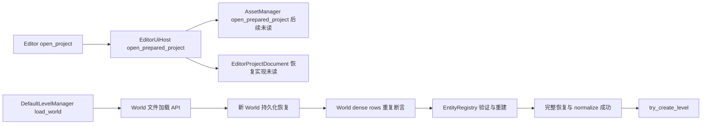

LevelSystem捕获在World/lifecycle锁内记录clone、world generation、replacement和lifecycle epoch(237–254/333–355)。replace_world_and_reset_runtime_state在World锁内递增replacement epoch，为新World推进component/binding/World generation、换World、重挂订阅和reset运行时状态，记录WorldReplaced，解锁后drop旧World(453–495)。带generation的条件替换先核generation/binding，随后递增epoch、清事件并调用可失败commit_staged_scene_state(419–450)；包装器没有显式恢复epoch/事件，但commit内部与实际失败条件未读。EA46-WORLD-002的“已commit后target变化返回Err”继续开放；前置epoch/事件是否违反失败原子性另作为P2契约待核，不凭fallible签名认定已丢事件。

最低修复方向是恢复投影构造前的可传播重复ID预验证，复用现有唯一ID集合/registry合同，向World serde与SceneProjectError返回typed错误；不是去掉正常运行时不变量。最小动态验收仍为复制正常序列化单实体条目、保持合法next_id/组件表，decode/load不panic而返回错误；另测合法save/reopen和失败保留原文件/活动World。只读审核不代替这些回归；实施遵守最低未完成00/F0和受管验证窗口。

### 10.2 Render共享scene、每view派生与journal边界

RenderFrameExtract持Arc<RenderFrameScenePayload>，for_camera_submission派生view而共享scene。payload内world token按值保存，geometry、animation poses、lighting、environment、post-process、debug、sprites、particles、visibility九个域各自Arc<T>；frame与相应域的修改通过Arc::make_mut分别COW。因此EA46-RENDER-003仍只核每view/共享scene的LOD产品合同，不能据选定camera直接判bug。RenderExtractProducer仅声明trait、context仅有world handle/request；这些叶没有实际producer实现或World锁持有范围。

RenderDirtyJournalState初始generation0/pending_all；publish对实体排序去重、checked generation+1、以新的Arc immutable journal发布，旧Arc可继续读。mutation sink的unsafe recorder要求sink在整个World分配期有效且保持owner/借用约束。has_pending计mutation但publish早退只看pending_all/entity列表；mutation到dirty entity的汇聚顺序在未读derived_state.rs/dirty_state.rs，不能孤立推断漏事件。from_snapshot adapter注释限定preview/roundtrip/synthetic，构造空animation/sprites/particles，完整sideband消费者若越界才有风险；无越界调用证据。COW首次写复制、full fallback频率和耗时仍待产品实测。

### 10.3 Gateway真实pick消费者、释放错误和历史BUG去重

CoreEditContext::runtime_operations(context.rs410–426)按active EditWorldRoute identity捕获固定origin；EditContext默认返回不支持。有限生产符号搜索未命中submit_operation/poll_operation/harvest_operation caller，只说明本次范围，不说明功能缺失，EA46-GATEWAY-001跨替换产品P1继续撤回。

实际UI play_viewport_pick持instance、route、request、ticket、selection mutation。request按显示帧identity捕获route；poll前核Play/domain/gateway identity，route按旧origin poll并核ticket/request。新请求、World retirement、pointer Cancel、gizmo抢占尝试cancel；失败保留pending并suppress selection。pointer Cancel/gizmo安排错误重试；World retirement记录cancel错误后继续retire/ack，origin不会转发到新endpoint。poll返回终态后未再核identity；只有并发replace能在该窗口发生且apply消费者没有保护时才形成条件风险。整个app stop/退出/Drop caller和apply线程合同仍未覆盖，不作产品故障或退出已验收结论。

foreign-output同步错误通过with_cleanup_failure合并release错误文本；拒绝路径计数/fuse，成功decode后的release失败也由gate拒绝/fuse。error对象没有结构化cleanup/source字段，diagnostic_line只保留fuse/计数而不保留具体message；真实session如何共享状态、调用方是否丢Err未读，不能定性诊断已丢失。

沿用state.rs149–155既有ZCA-HST-001，不另造重复故障：invalid/oversize status diagnostics经error.rs63–78成为ProtocolViolation，但output ownership和release都成功时ensure_call_succeeded的(None,None)分支直接Err而不reject/fuse。源码注记给4097字节初始化诊断条件；当前是P2静态路径，未动态执行，未证明正常producer生成此输入。验收须覆盖malformed status+规范空output时Err/rejected/fuse与清理次数、合法status行为、实际producer/ABI路径；不根据注记关闭BUG。

### 10.4 更新后的问题归属与实施次序

| 队列 | 现在的证据与owner | 状态及必要验收 |
|---|---|---|
| EA46-WORLD-001 | World恢复投影早于registry Result的duplicate assert；公开文件/LevelManager API可达 | P2静态；Editor后续恢复桥未读，正常fixture duplicate/load不panic、typed Err及原文件/live World保护待动态 |
| EA46-WORLD-002 | World/LevelSystem commit后target changed Err；caller错误/重试合同未闭合 | P2合同；补commit内部和消费者，验证Err分类及是否应重试 |
| EA46-WORLD-003 | epoch/events导致第二次binding普通Err的假设已排除 | 静态撤销，见§11.2；不进入修复队列 |
| EA46-RENDER-001/002/003 | compat clone、fullfallback/COW、共享scene LOD | 实际producer/consumer和相同条件动态成本仍待，未确认热点/冗余/bug |
| EA46-GATEWAY-001/002 | operation固定origin、真实pick cancel链；reentry/线程/终态identity条件未闭合 | 原产品P1撤回；pick并发窗口为合同候选，测试/完整退出链待验 |
| ZCA-HST-001 | RuntimeForeignOutputState malformed status的无reject/fuse分支 | 沿用既有BUG，P2静态；producer reachability、回归、正常ABI行为待验 |

F0最先恢复当前实际源码可归因native baseline，以上持久化、编辑和渲染实现按MVP依赖推进；没有删除任何实现、改公开ABI/数据格式或宣称性能收益。本轮差异是源码阅读、错误链归属、原A1具体输入补交与文档，不是模块验收。

### 10.5 新增28个生产pin与全文范围

下表叶均由对应Luna正文读完，前后完整pin/mtime稳定；Root再次读取metadata。其余37pin保持§8。Root关键错误链重复读不累加，所有新增命令到numeric exit/EOF；此前丢失query handle及旧Root只读cell65的未知终态不由新成功查询替代。

#### World/ECS及项目桥（12叶 /3244行）

| 实际生产叶 | SHA256 | bytes / lines | 完整正文 |
|---|---|---|---|
| [zircon_runtime/src/scene/world/entity_id_allocator.rs](../../../zircon_runtime/src/scene/world/entity_id_allocator.rs) | 7509d56c37c776135b63bf611768b361e0c28eac67e401f8638079a32140f950 | 2388 / 77 | 1–77（全文） |
| [zircon_runtime/src/scene/world/project_io/document.rs](../../../zircon_runtime/src/scene/world/project_io/document.rs) | 6dada0ca4274cfbcf8e618c3cb01b5c7fcd0a063d243b74e39c830984f2a24a1 | 10101 / 280 | 1–280（全文） |
| [zircon_runtime/src/scene/world/generation.rs](../../../zircon_runtime/src/scene/world/generation.rs) | e39e6153ab3a590911ed0260c0de52dca04a6d89edca61ff76cfab441b8613e6 | 5044 / 148 | 1–148（全文） |
| [zircon_runtime/src/scene/world/bootstrap.rs](../../../zircon_runtime/src/scene/world/bootstrap.rs) | d05865f8fafb0b6b2e586f07cd3c8ccf8e4313775c48cb6d9c579099d9a36545 | 8211 / 198 | 1–198（全文） |
| [zircon_runtime/src/scene/ecs/entity/internal.rs](../../../zircon_runtime/src/scene/ecs/entity/internal.rs) | 20de7f1889a90bc52d1ebf60b4f3cc66f76141d6d3e41ce21512296074ee4b15 | 660 / 23 | 1–23（全文） |
| [zircon_runtime/src/scene/ecs/entity/slot.rs](../../../zircon_runtime/src/scene/ecs/entity/slot.rs) | e0e31d9b3367b7cb4fb1bcfaec5b4048204c1b641fd65cb80d9a41b4e5990189 | 754 / 27 | 1–27（全文） |
| [zircon_runtime/src/scene/ecs/entity/registry.rs](../../../zircon_runtime/src/scene/ecs/entity/registry.rs) | ed432fe352943cbaf318905c9b9d517a6acbe376d0f0b0130d277a52458144c0 | 8250 / 244 | 1–244（全文） |
| [zircon_runtime/src/scene/ecs/entity/error.rs](../../../zircon_runtime/src/scene/ecs/entity/error.rs) | 90abee6ea26086112dafabdb6b9740567f8bcc2ae3670a01abfac9704668ed7b | 547 / 15 | 1–15（全文） |
| [zircon_editor/src/ui/host/editor_manager_project_session.rs](../../../zircon_editor/src/ui/host/editor_manager_project_session.rs) | cd84b526aac64642b7670d6a5125728c24362408520406572c7ec07b680bdc3f | 38160 / 808 | 1–808（全文） |
| [zircon_editor/src/ui/host/project_access.rs](../../../zircon_editor/src/ui/host/project_access.rs) | 38def9cd56fd366d94f63754d43b279e7d048d9a5976388f6b793e44af0705eb | 22875 / 626 | 1–626（全文） |
| [zircon_runtime/src/scene/module/level_manager_project_io.rs](../../../zircon_runtime/src/scene/module/level_manager_project_io.rs) | ae8ff1ad38d2dddd96a61c6586b81ef98236f9edac1f13e45f6931b34c0c64ee | 4645 / 127 | 1–127（全文） |
| [zircon_runtime/src/scene/level_system.rs](../../../zircon_runtime/src/scene/level_system.rs) | bf78da1953c7eeefa614a16b24fd47440021c98cf936285735e892ff0266bf55 | 25124 / 671 | 1–671（全文） |

#### Render DTO/journal（6叶 /537行）

| 实际生产叶 | SHA256 | bytes / lines | 完整正文 |
|---|---|---|---|
| [zircon_runtime/src/core/framework/render/frame_extract/extract_producer.rs](../../../zircon_runtime/src/core/framework/render/frame_extract/extract_producer.rs) | fe22d3f7532495f9e4b3b29aee3ff7fa814f01c0d3dbaadd5bad2a47f53a4227 | 361 / 7 | 1–7（全文） |
| [zircon_runtime/src/core/framework/render/frame_extract/extract_context.rs](../../../zircon_runtime/src/core/framework/render/frame_extract/extract_context.rs) | c24d8994b591a85ca7ddbceb1c9dfec2ededd84223df5b51ce360e06049a90e2 | 582 / 16 | 1–16（全文） |
| [zircon_runtime/src/core/framework/render/frame_extract/shared_scene_domain.rs](../../../zircon_runtime/src/core/framework/render/frame_extract/shared_scene_domain.rs) | b65dc1860024df49bac57d87797dfa18923c9ec20c8d2b69ecb16ff78c39946e | 1113 / 50 | 1–50（全文） |
| [zircon_runtime/src/core/framework/render/frame_extract/frame.rs](../../../zircon_runtime/src/core/framework/render/frame_extract/frame.rs) | 0ecff352da050c7d5a8f973d140c69331ac34cff14ac7e5942f7f7eb4ef66169 | 9285 / 263 | 1–263（全文） |
| [zircon_runtime/src/core/framework/render/frame_extract/scene_payload.rs](../../../zircon_runtime/src/core/framework/render/frame_extract/scene_payload.rs) | bfc4c0f60f07cfff7cd91e33dcd56d19f9027e7ebe913551c33c5600fcc307c9 | 2608 / 62 | 1–62（全文） |
| [zircon_runtime/src/scene/world/render_dirty_journal/state.rs](../../../zircon_runtime/src/scene/world/render_dirty_journal/state.rs) | bc4112b567ddf23bd21a84a46ef6bb42de8363b7fb8f638b547f93ad6d07654c | 4398 / 139 | 1–139（全文） |

#### Gateway/UI/foreign-output（10叶 /2908行）

| 实际生产叶 | SHA256 | bytes / lines | 完整正文 |
|---|---|---|---|
| [zircon_editor/src/core/editing/context.rs](../../../zircon_editor/src/core/editing/context.rs) | 3f6f028d42d639700f445a1c7a88ec436b331264bc565f25798dbce365356947 | 15715 / 448 | 1–448（全文） |
| [zircon_editor/src/core/editing/engine/command.rs](../../../zircon_editor/src/core/editing/engine/command.rs) | cb21eff2c5bb1af9eee928869dce6b7e71de7b0fbedf43ab892a99cd1a38ec26 | 10654 / 316 | 1–316（全文） |
| [zircon_editor/src/core/gateway/viewport_pick_route.rs](../../../zircon_editor/src/core/gateway/viewport_pick_route.rs) | 4d15c6a580ec504cc2f3577202ffab100f66de0c18438abab8df9f121bf1342e | 3466 / 94 | 1–94（全文） |
| [zircon_editor/src/ui/retained/app/play_viewport_pick.rs](../../../zircon_editor/src/ui/retained/app/play_viewport_pick.rs) | 11a8d94cdec2c55c72e840c1c00883bd3ac8c419dde54813f42a1d17d3e99a25 | 12993 / 365 | 1–365（全文） |
| [zircon_runtime_host/src/foreign_output/state.rs](../../../zircon_runtime_host/src/foreign_output/state.rs) | 3c82599857fc4bb43970f6138c6a846879e6c75b736f59aabda4f6e51a9ed778 | 19074 / 439 | 1–439（全文） |
| [zircon_runtime_host/src/foreign_output/owned_buffer.rs](../../../zircon_runtime_host/src/foreign_output/owned_buffer.rs) | ff51a7201b8b1579a325cfd2262112ba35db08c82d13afee20bc9ce073045a88 | 8738 / 204 | 1–204（全文） |
| [zircon_runtime_host/src/foreign_output/error.rs](../../../zircon_runtime_host/src/foreign_output/error.rs) | 7b2dd7608e0a6674abb17a97b4a1d41be73bb9a6e3be5192a6bd90bb89afb66e | 4276 / 104 | 1–104（全文） |
| [zircon_runtime_host/src/foreign_output/state/diagnostic.rs](../../../zircon_runtime_host/src/foreign_output/state/diagnostic.rs) | bc55f093030de9c9cc6bf1d58b1fc1e84f418db461cadbae637a98861a32f7df | 3477 / 101 | 1–101（全文） |
| [zircon_editor/src/ui/retained/app/host_lifecycle/scene_hierarchy_refresh.rs](../../../zircon_editor/src/ui/retained/app/host_lifecycle/scene_hierarchy_refresh.rs) | d726425c37813f6006afb246823dada66c7834c64d0709b8975a4d099ca2e86d | 20016 / 469 | 1–469（全文） |
| [zircon_editor/src/ui/retained/app/viewport/pointer_event.rs](../../../zircon_editor/src/ui/retained/app/viewport/pointer_event.rs) | c829546ad06bf5a6e8c154f41b5fc0e680ba2b2ca4c039cc980cb6a3291aecbf | 13493 / 368 | 1–368（全文） |

### 10.6 R7具体补交、准入与尚缺的公开续接协议

用户指定records消息已于2026-10-14T12:15:09.449778+00:00创建：engine-audit-20261009-01a12097-current-gitlinks-r7-to-jenkins-01a0f6e1.md，SHA256 941c619cc520edc1ad6088b6236d7e668d6c57ba67412119b229d40ad2cdbbfd /7530 B/72行。canonical handoff位于.codex/outbox同任务current-gitlinks-r7-to-jenkins-01a0f6e1.md，保持同字节。registry17先登记draft/records两路径，18在records创建前登记最终pin。Sol47Gitlinks独立完整读7191B/72行的66285956切片、核七个child的actual HEAD/index/physical root、原六叶pins和provider正文；两句准入/公开迁移说明由Sol明确认可，Root在RAM逆替换准确还原66285956，无冻结文件/源码副本。

具体externalGitlinks覆盖zr_vm index全部7个mode160000，Root与Sol两次独立前后稳定。external HEAD de7b26dfc2d4ce1e0c68d2160a8f3eb036a404fa；真实.git/index SHA256 26758b17c2b8c66e43185873a061863b5f4173c552ef64505ef5fc100761f1a1 /939983 B；stage-z SHA256 06f315f75e7a38ff22b4726b62a69993d6a82335fe0c9e635b9a0001d1f594bb。此metadata没有封存dirty源码/全部Cargo/build/config/toolchain/features，不能称完整compiler closure。

普通public entry443–494要求candidate==original及整个payload inputDigest相同；resume376–440只续有durable checkpoint的batch，仍核相同payload/digest及原queue/build/native终态。installed runner4370–4396拒different input，checkout3771–3777的旧read/execution/launch/report或sealed/prepared/request缺complete checkpoint会unknown/guard_continuity_unproven。补7字段、App新hash和3迁移scope不等于允许改同key原执行payload；source/provider、授权和runtime/driver owner须提供公开合法迁移/原身份及连续读guard证据。Root保持A1/cleanup/session/auth/receiver31历史，不用新request/g1/attempt掩盖原pending，不改private State。

Root2026-10-14T12:47:03.310839+00:00的新只读timecut仍task version36/raw15edfdf8、waiting/done=false/formal_input_pending；R7 original path存在且pin匹配，exact message/followup查无R7匹配，所以R7“已写入”不能写成受理/目标chat ACK。R6此前归档+intake证据继续保留，不能用作R7/原native验收。

普通DriveInfo只读2026-10-14T12:35:36.7515070Z见E盘124502433792 B/115.952 GiB可用。之前Get-Volume管理查询exit1拒绝访问，不能算当前准入成功；前者只为新普通文件系统观察，不是native前预算reservation验收。已读runner准入需要reserve+amount.disk_bytes，本配置amount4GiB、reserve默认35GiB，实际以policy/预算为准；至少35GiB不单独充分。native launch前重核，产物/cache只物理E:/cargo-targets/zircon-local，同任务配置复用。Root本轮Rust/构建/测试/产品/性能0、源副本0、删除与实际释放0 B，保留供给、失败、共享/未知证据；cleanup与完整goal active。

本节正文及增量账本已通过World、Render、Gateway三路限定独立文档复核，未发现内容阻塞；源码范围与pin不变。个别旧只读handle/EOF未知继续保留，复核通过不构成清理关闭、动态或模块验收，已验收账本不增。

### 10.7 R7受理与归档的新增证据（2026-10-14）

上节12:47:03Z无匹配受理是原timecut，保留原记录。Root只读新cut2026-10-14T13:50:39.827138+00:00已见R7对应message354214a4…v1/raw31a99dc1…及followup a6c927b6dba45ffcd5dd39b03a1672cc8f2ffa1a09df653aae7e1dfccbc2f554 v2/raw2460b685…，intakeAccepted=true、attached-and-cleared、zircon-records-followup #42/queue1844。原task升v37/raw0e0a95737a019e1b75dd38389e8f5a69c3055fc1ffd1f2116fe2461c04cde44a，仍waiting/done=false/formalAcceptance=false，receiver31与原A1身份保留。

原records R7文件已不存在，不能重建。实际归档位于.jenkins/state/records-queue/archive/a6c927b6dba45ffcd5dd39b03a1672cc8f2ffa1a09df653aae7e1dfccbc2f554/同名md，完整SHA941c619cc520edc1ad6088b6236d7e668d6c57ba67412119b229d40ad2cdbbfd /7530 B/72行。actual response为.jenkins/state/records-queue/followups/responses/a6c927b6dba45ffcd5dd39b03a1672cc8f2ffa1a09df653aae7e1dfccbc2f554.json，SHA98dae15cdfc9d0275f2ffc822e84f84326e0e3c700b61d626176be8fa13bae09 /24739 B/1行。Root13:55:24.253602Z核两file前后hash/mtime稳定，归档md与canonical outbox逐字节相等；不把State payload SHA当file SHA。

response明确actualFlowSubmitted=false、nativeValidationAccepted=false、formalAcceptance=false、newNativeRequest=false，actualTargetChatDeliveryReceipt与actualNativeOperatorDeliveryReceipt均null；这证明补充材料已受理，不证明已送达指定chat/native operator、编译或产品验收。response列public-entry drift仍阻塞submission，正式registration/native receipt也null；完整compiler seal、App旧hash和3consumer scope合法迁移、原payload/driver-runtime/sourceguard续接继续开放。补充受理的sourceReferenceHashChecksAreAdmissionGates=false不豁免实际execution输入与权限。

Root13:50:39Z只读State followup a6c927…v2/raw2460b685…的cleanup字段记录旧inbox md7530 B已移出；它不是98dae response文件内的cleanup receipt。逻辑deletedBytes不能推算磁盘净释放或Root自有清理。Root本轮实际删除与释放仍0 B；归档/response/canonical交付、历史失败/供给/共享/未知handles保持，goal与cleanup active。本新增归档段已通过限定独立复核，并按review纠正cleanup字段的证据归属；不改变§10三路已审状态或任何MVP/模块/动态验收。

## 11. World失败合同与实际渲染producer续审（2026-10-14，静态）

### 11.1 范围、归属与源码时点

本次由Sol49只读核World恢复/发布合同，Luna49只读核producer/cache/derived/dirty四叶；Root独立复读决定性函数。相对§10的65pin新增9个生产pin、1816行正文：6全文、3部分。当前本文去重覆盖74个源码pin，68生产14778行（64全文、4部分）、6测试353行（4全文、2部分，仅阅读）。新增9路径均不在§8/§10的65pin表或10月13日旧95pin表；不把不同审查范围相加成全引擎验收。

Root另观察foreign HEAD由d588b90c0e3ca36503ac6b4f2c5d2d96ba7acfef推进到f28ba39a5095f4964c046ecc702778627f80cfd5，原65pin的SHA/bytes/lines仍一致。提交差异的404行输出被截断，不能称完整审过该提交；没有Root提交或其他Git写入。正文pin是当前阅读证据，不能替代compiler input seal。EditorProjectDocument/SceneAsset四叶另有只读任务进行中，不计入本节。

### 11.2 World问题去重与失败边界

EA46-WORLD-001保持P2静态：World私有持久化恢复先填dense rows并断言重复，后面的EntityRegistry已具有重复/容量前检，却来不及返回typed错误。公开World serde与文件API可达；DefaultLevelManager::load_world只在完整构造和normalize成功后try_create_level，重复失败早于prepare和registry发布，文件加载本身不写输入文件。Editor项目默认SceneAsset恢复与此原始World文件入口仍须分开追证。

最低修复设计是World恢复投影前做可失败身份预检，必要时先准备dense rows、registry与stable order，再一次提交；重复传播为WorldPersistentStateError::Scene(SceneError::DuplicateEntity { entity })，serde转为D::Error、文件API保持SceneProjectError::Scene错误。既有公开load_project_from_path、Deserialize和load_world已经返回Result；此最小方案无需改公开签名或v2格式。拟议try_from_*/from_*命名不能当作实际已有API或虚构消费者迁移。保留合法ID、camera/light、active camera及现有allocator归一化行为，不要求任意persisted next_id原值保留。

**EA46-WORLD-003撤销。**transaction.rs552–565/575的唯一typed失败来自同一组component registry比较；LevelSystem433已在持续World锁内对同一candidate前验，434只推进独立Atomic epoch，435的clear_all_events只清self.events。ComponentRegistry是owned Vec/HashMap，preserves_ids_of115–124纯比较descriptor/column layout，没有被两步操作改变。第二次前验不会由epoch/events操作转为普通Err。Root以chunk a8cf52 numeric exit0/EOF和稳定pre/post pin复核决定性函数；不为此移动epoch或恢复事件。这是静态排除该假设，不是整个transaction动态验收。

EA46-WORLD-002继续开放：commit先换存储，再分发生命周期回调；外层最后可返回LifecycleTargetReplacedDuringCommit。该错误不能盲目重试或恢复旧World，否则可能覆盖回调建立的新目标。PreparedLevel publication guard对Install Err/panic移除本次临时entry并释放lease，但未拥有消费者current slot/epoch，不能声称消费者整体回滚；prepare后段失败可能消耗单调handle，不回减next_handle。

后续真实契约回归仍待00/F0基线与实施窗口：

| 条件 | 验收 |
|---|---|
| 只复制正常fixture的数字entities ID，保留合法next_id/组件表/格式 | serde/file typed Err且不panic；原文件hash不变；manager失败保留既有level、World、epoch/events |
| 合法保存/重开 | stable ID、durable组件和既有归一化保持，后续spawn不碰撞 |
| 实际Admission/Install失败与提交后target变化 | 撤销本次临时entry；提交前消费者保留旧slot/epoch，提交后保留真实新目标并正确分类Err |

既读records测试保护批量前检/stale identity，world测试保护allocator terminal；不替代上述持久化入口回归。未读其他manager/transaction测试正文，不据模块引用宣布缺测。本轮没有编写或执行测试。

### 11.3 实际producer、cache与dirty汇聚

§10.2的“只有trait”限于当时读取的DTO leaf。新增scene/render_extract/producer.rs中，World的RenderExtractProducer实现会clone World再调用prepared builder；离线to_render_frame_extract也clone并用snapshot handle0/default request。RuntimeFrameExtractCache以snapshot/change tick/visibility revision/active camera/viewport组成key，命中返回extract clone，失配经LevelSystem producer、viewport和摘要更新后替换单槽缓存。不能据World兼容实现推断正式会话每帧clone World。

新增dirty/derived正文表明准备顺序为hierarchy→active→world transform→node cache，frontier在标记时积累、由mem::take取走；active/transform的导出值发生变化才mark render entity，随后RenderExtractPrepare发布dirty journal/component changes，其clear是空操作。若某条实际mutation只增加recorder pending而没有dirty entity/pending_all，是否遗漏仍须证明调用可达和代际观察；未成立新的漏事件故障。单槽缓存遇相机/viewport交替会失配，不等于已测热点。

render.rs、render_component_changes/mod.rs及render_dirty_journal/state.rs已在§8/§10本文范围读过，不因本次子任务未重读而退回全局unknown。仍需闭合实际LevelSystem producer/锁范围与session extract/state调用者，并复用先前prepared builder/journal证据。准确符号搜索未在限定范围找到try_capture_render_extract，不能把假定名称当实现。锁竞争、捕获失败、多view合同、复制与fallback成本仍待实际调用链和动态验收；未作性能收益结论。

### 11.4 新增生产pin与实际正文

所有新增正文pre/post SHA、bytes、mtime稳定；下列行数为全文件真实行数，正文按实际范围计，Root552–580额外含566–570的5行函数说明，已并入transaction连续范围；metadata和其余重复复核不重复计覆盖。

| 实际生产叶 | SHA256 | bytes / 总行数 | 实读正文 / 去重行数 |
|---|---|---|---|
| [zircon_runtime/src/scene/module/default_level_manager.rs](../../../zircon_runtime/src/scene/module/default_level_manager.rs) | d76bd61c219292ffdc352c223a7eba81a69d96259b0957d6c64d0bfcf56f01e0 | 2602 / 82 | 1–82全文 /82 |
| [zircon_runtime/src/scene/module/level_manager_lifecycle.rs](../../../zircon_runtime/src/scene/module/level_manager_lifecycle.rs) | a2066f797869c31bfbdf7ec563747d8bc3d13f5c5113428d48eff3cae79aefba | 7260 / 206 | 1–206全文 /206 |
| [zircon_runtime/src/scene/world/transaction.rs](../../../zircon_runtime/src/scene/world/transaction.rs) | 2bfad6e41823ebda7cf7e7a11d404e1cad473ae13f056b6c4ce9f0732a3af76c | 27411 / 631 | 552–631部分 /80 |
| [zircon_runtime/src/scene/world/events.rs](../../../zircon_runtime/src/scene/world/events.rs) | a109544764b6b6a96008fa6d189c96c182c4eb8ff793318bf786f89eac1272ce | 4353 / 152 | 42–44部分 /3 |
| [zircon_runtime/src/scene/ecs/component/registry.rs](../../../zircon_runtime/src/scene/ecs/component/registry.rs) | 63c5f735cdaa24cbdffd581553ce11015c875bcda0a3556e19ca614d2052bf19 | 6014 / 184 | 1–60、105–129部分 /85 |
| [zircon_runtime/src/scene/render_extract/producer.rs](../../../zircon_runtime/src/scene/render_extract/producer.rs) | 43061abd9d4618b064a5bbb6dcee9c314655b5716acb20c25f41b8385efde4e0 | 1136 / 29 | 1–29全文 /29 |
| [zircon_runtime/src/dynamic_api/session/extract_cache.rs](../../../zircon_runtime/src/dynamic_api/session/extract_cache.rs) | 53acb47bf3bfa6a3e04ed9466ea12ecfca8c89833dfbfa373dbecbe96a4bc7ee | 3959 / 119 | 1–119全文 /119 |
| [zircon_runtime/src/scene/world/derived_state.rs](../../../zircon_runtime/src/scene/world/derived_state.rs) | fc4fe7e3451952252fccf820791f7dc3b1fdd5079e4b379fe39594a7806b1946 | 32544 / 879 | 1–879全文 /879 |
| [zircon_runtime/src/scene/world/dirty_state.rs](../../../zircon_runtime/src/scene/world/dirty_state.rs) | 5d2e3a0da69bc25ee591a2b2a47574625689e8690c7ca4a49a5c132c5d79a1a8 | 11360 / 333 | 1–333全文 /333 |

### 11.5 验证与仍开放的证据

Sol的World reader已返回21个numeric exit0/EOF正文chunk；批准定位路径漏scene的一次exit1/EOF单列，首个spawn_ready拒绝无identity/EOF仍unknown。Render reader的26393/64250沿同handle得到exit0；derived601–750曾仅返回到703且无session/exit，补读704–750成功只补内容，不关闭旧unknown。此前Root65及其他review未知handle仍保留，未查询猜测PID或终止。

R7的真实受理/归档仍沿§10.7，不复写原inbox；原A1/native与MVP00/F0未验，正在只读核当前public入口的合法续接。本轮Root/子任务Rust写入、build/test/product/perf、源码副本及实际清理释放均0，cleanup/goal active。新增§11与Flow/pending及补计transaction说明5行的行政差异均已通过Luna50限定独立复核；不增加已验收账本。

## 12. 正式渲染抽取与 Editor 场景准备桥（2026-10-14，静态）

### 12.1 新增阅读及准确边界

Luna50读正式producer/session三pin185行（2全文106、1部分79）；Luna49读Editor/asset十pin1191行（5全文887、5部分304），Sol49限定复核Scene别名与入口合同。Root复读producer/extract全文、session state592–670及Editor决定性调用；重复复核不再计覆盖。相对§11新增13个生产pin1376行（7全文、6部分），当前本文去重87个源码pin：81生产16154行（71全文、10部分）、6测试353行（4全文、2部分，仅阅读）。全表75全文、12部分；这是本文限定范围，不与旧95pin相加成全引擎验收。

最后editor_manager_project的217–267是完整激活方法51行，268–272是下一方法注释5行，合计56；仍是部分文件。scene_asset只读1–100，内部loader81–100尚未闭合，converter实现未读；scene/module只读112–124，runtime_services只读103–111。metadata、符号定位、Root重复正文及旧host caller复核均不增加覆盖。新增源码pre/post hash、bytes、lines、mtime稳定；Reader同时见文档从4193c172切片变为8e66c609，文档不是稳定源切片，越过获准文档范围的§10.2–10.3内容已排除其任务推论。

### 12.2 Scene/World、DTO恢复与准备/发布owner

既读[scene/mod.rs](../../../zircon_runtime/src/scene/mod.rs)164是 `pub type Scene = World;`，Sol与Root定位一致；Scene不是另一个Rust类型。可区分原始World持久化serde/file入口与SceneAsset DTO恢复入口，不能以类型名或wrapper名排除WORLD-001影响Editor。新读scene_asset47–100显示URI入口取得项目component serializer registry，经load_artifact_with_raw_payload_limit检查ImportedAsset::Scene并调用from_scene_asset_with_component_registry；转换函数定义126的正文尚未读取。WORLD-001保持World持久化投影P2静态，Editor是否复用问题条件或触发panic仍未证。

EditorProjectDocument加载激活项目的settings/workspace和默认scene，文档字段world承载Scene；项目document codec经SceneAuthoringDocument的序列化/引用映射产生SceneAsset DTO，不能据此宣称原始World持久化serde必被使用或已被绕过。startup26–78取document.world，经runtime_services103–111的prepare_authoring_world准备AuthoringWorldSeed，再构造EditorState、激活/bind startup scene document并恢复viewport。module/mod112–124通过DefaultLevelManager的enter/try_prepare_level得到PreparedLevel；所读方法只准备，不安装Runtime当前slot。

editor_manager_project217–267的激活方法核项目snapshot/session，解析startup URI，调用document_lifecycle.activate_scene_with_binding、journal.bind_project_document，释放旧journal并发布document messages；它不执行可见的World替换。另一条scene submission路径先clone恢复材料并prepare_authoring_world，再调用EditorState::replace_world；活动scene reload在项目generation提交闭包中调用reload_active_scene_world。EditorState构造、replace/reload和PreparedLevel实际消费owner尚未读；PreparedLevel registry/lease guard不证明消费者slot/epoch或整个项目打开事务回滚。

下一批须分别追converter身份预检/实体重映射及失败退出，和EditorState真实安装/当前slot/epoch/取消恢复；以最低实际owner定根因，不给已读wrapper增加未经证明的发布权威。

### 12.3 正式session producer、World锁与UI旁路

session/state592–621 capture_frame与652–669 present_viewport都先处理resize，再取得current_extract与current_ui_submission，然后交给render bridge。所读方法即使bridge为None仍先做两种抽取，随后capture返回空frame或present返回Ok；这是可见静态工作，不是已测性能问题。session/extract13–22取得viewport，调用main cache，更新摘要/status，最后叠加editor camera/timing。缓存失配经LevelSystem producer：先取frame_state_snapshot，再在with_world_mut持有同一World锁期间运行prepared builder和动画组件读取，绑定pose须同World generation、可见mesh和skeleton。

该正式会话主抽取调用链直接使用持锁World的prepared builder，未调用§11.3的World兼容producer clone实现；不能把兼容路径clone推成每帧主路径深复制。既读cache仍有hit/miss的RenderFrameExtract clone成本，是否热点需当前产品运行证据。current_ui_submission的project runtime UI分支与LevelSystem World锁内UI cache fallback是独立旁路，不走主RenderExtractProducer。UI停止/布局/cache与render bridge是可见Result边界；main producer/cache自身非Result，外层ABI dispatcher尚未在此批读完，不能宣布所有失败路径已闭合。

snapshot handle保留raw World identity，with_generation只更新generation。cache key采样、miss context handle采样及producer World锁分开：如果替换实际发生在context采样与锁之间，可能把旧raw identity与新generation配对；key与context也可能不同。当前范围没有证明实际替换可达、线程交错或消费者误用，因此仅记录条件合同，未新增缺陷/热点，也未实施重试、合锁或handle改造。

### 12.4 新增生产pin与正文覆盖

| 实际生产叶 | SHA256 | bytes / 总行数 | 实读正文 / 去重行数 |
|---|---|---|---|
| [zircon_runtime/src/scene/level_system_render_extract.rs](../../../zircon_runtime/src/scene/level_system_render_extract.rs) | a39c7729def289f36e8c2122763b787ee847d278487c41855acb799681f1f7f2 | 1672 / 42 | 1–42全文 /42 |
| [zircon_runtime/src/dynamic_api/session/extract.rs](../../../zircon_runtime/src/dynamic_api/session/extract.rs) | f860a8eb0cb1340ffd40030fc65e4d39b74c8c27e3960a0c15ec686f4da9d72b | 2527 / 64 | 1–64全文 /64 |
| [zircon_runtime/src/dynamic_api/session/state.rs](../../../zircon_runtime/src/dynamic_api/session/state.rs) | 0c3b717c1dabcd981e1ab0cb30295a4584be449d7cad3aaf72af5af7dfe5b811 | 32567 / 796 | 592–670部分 /79 |
| [zircon_editor/src/ui/workbench/project/editor_project_document.rs](../../../zircon_editor/src/ui/workbench/project/editor_project_document.rs) | bd72fd53e2d8e0e9f3e931f25433fe170e403c2b05ab11223318193fc69993c4 | 2619 / 77 | 1–77全文 /77 |
| [zircon_editor/src/ui/workbench/project/editor_project_document_load.rs](../../../zircon_editor/src/ui/workbench/project/editor_project_document_load.rs) | 9daefd123ba6552020d6fc6dce5e8eeaaf81a560e8851901595ac2690d867268 | 2544 / 76 | 1–76全文 /76 |
| [zircon_runtime/src/asset/pipeline/manager/asset_manager/asset_manager.rs](../../../zircon_runtime/src/asset/pipeline/manager/asset_manager/asset_manager.rs) | 94bcc61eb7a9ab5e1b69cee937141c4e36d4dfbc164014f594b79dfae7bebf2d | 2841 / 59 | 1–59全文 /59 |
| [zircon_runtime/src/asset/assets/project_document/scene.rs](../../../zircon_runtime/src/asset/assets/project_document/scene.rs) | 9c51c0e0484e6bdd5d1ede7724d488f4f05ee8c09f105a1e7775fdda1f041e0b | 20507 / 581 | 1–581全文 /581 |
| [zircon_editor/src/ui/retained/app/startup.rs](../../../zircon_editor/src/ui/retained/app/startup.rs) | f46f2d8717ef3a30bcb936c207c82d50baf44d0955b99438b84163de456d251e | 4190 / 94 | 1–94全文 /94 |
| [zircon_editor/src/ui/host/editor_scene_document_submission.rs](../../../zircon_editor/src/ui/host/editor_scene_document_submission.rs) | f118ff8f82f50532cdf43af8fee0c4acdb597e2e4e8245d6a630d24124cd653a | 10466 / 263 | 1–126部分 /126 |
| [zircon_editor/src/ui/host/runtime_services.rs](../../../zircon_editor/src/ui/host/runtime_services.rs) | b58b5b0608e835704c89286b72060c5681f2d0a0acdda069999098b0ab694201 | 9280 / 262 | 103–111部分 /9 |
| [zircon_runtime/src/scene/module/mod.rs](../../../zircon_runtime/src/scene/module/mod.rs) | 52e1912e4dab02b84a472293562da334f7f796b021a3bca37b5c2fdf8160d6c9 | 5648 / 158 | 112–124部分 /13 |
| [zircon_runtime/src/scene/world/project_io/scene_asset.rs](../../../zircon_runtime/src/scene/world/project_io/scene_asset.rs) | 3f0949ef27f80ccf5a5511cb91ea37e85c09a4d3201047d4577e1caa884b2e77 | 39316 / 820 | 1–100部分 /100 |
| [zircon_editor/src/ui/host/editor_manager_project.rs](../../../zircon_editor/src/ui/host/editor_manager_project.rs) | 0c693b98d7b727c274fb7317b6e740670356411d8edff49a52689f002dd33185 | 26113 / 681 | 217–272部分 /56 |

### 12.5 当前公开原A1续接与R8已投递事实

Sol核当前selected普通capsule e815bfbd7c12109453c7f1a932469874c4f5a829e0ddbd361ab9ac5c54804840，installed pointer SHA0d3fe98e/515 B，driver1dfff6569bbcb4e6653d805d3f084c361c7937eb197c61b4fc4fbb0cfceef35e/runtime start-1791949844649660400。该capsule runner3d548037和guard453c7cb7的完整SHA与先前受限实现审查相同，复用对应正文证据不等于新execution验收。

public entry完整SHAf13dfc57bbca39f7cae9ae986f74d59aa9b6efe77b8e8311cef577c75ff8e4a3 /38591 B/629行，dispatch548–551在query_only之前调用input_payload；337–338无条件核当前driver/runtime。因此旧A1携原driver121af96c/runtime start-1791789846374705900的只读查询会先遇runtime准入不匹配，这是源码推导，Root未执行该入口。若原operation/marker已存在，457的candidate==original与483的inputDigest又禁止直接换成当前payload；其存在性及实际A1 checkpoint仍未检查，必须保持条件表述。resume不是旧合同迁移入口。source release和formal staging也不提供本任务实际checkout的原身份迁移。最低公开owner修复方向为保留原身份/issuer/runtime lineage的historical readonly reconcile，先归因原状态，再处理授权范围、App hash/3path与compiler seal的append-only合法迁移。

用户指定records消息R8已实际投递：[canonical handoff](../../../.codex/outbox/engine-audit-20261009-01a12097/original-a1-reconcile-r8-to-jenkins-01a0f6e1.md)，message_id engine-audit-20261009-01a12097-original-a1-reconcile-r8，SHA daea0b5a38d695cef33a59c77e57b6316081a15b75405fd1c2bbe95afa73be56 /6529 B/39行。Sol完整39行独立复核passed，Root在2026-10-14T16:35:36.495367Z写入.jenkins/records并逐字节核与canonical相同；16:40:03.395692Z首次只读观察仍有该file。尚未观察到R8受理、archive、目标chat/operator delivery或native receipt；不把posted当ACK。R7原inbox已归档，沿§10.7保留，不重建。

R8请求Jenkins owner按原A1 identity先query/reconcile，有完整当前输入及连续guard才推进原compile/cleanup；Root不改private State/auth、安装provider、伪造runtime/contract、重复提交新request/g1/attempt或复制源码。原compile engine-audit-20261012-app-compile-a1、cleanup engine-audit-20261012-app-cleanup-a1及原session沿用，MVP00/F0保持待验收。E盘115.952 GiB仍只是12:35:36Z普通DriveInfo cut，native必须重新完成reserve+amount、物理输出根与输入准入，不据旧余量宣布当前预算通过。

### 12.6 复核、transport与验收状态

新producer/session三pin读取均numeric exit0/EOF；Editor正文成功读取与session8523沿原handle数值exit0/EOF，startup及scene_asset各一次spawn_ready拒绝没有identity/EOF仍unknown。Sol alias reader原session85355沿9b2527收到exit0/EOF；Root错误加入不存在project_io/mod.rs的locator exit1/EOF，不作为正文覆盖。旧未知handles继续保留，新成功读不能补旧EOF，也未查询/杀猜测PID。

本节及Flow/pending增量已通过Luna50限定独立文档复核。Root/子任务Rust写入、构建、测试、产品/性能执行、源副本、临时脚本与实际清理释放均0；保留canonical交付、复用供给/构建、必要失败和共享/未知证据，cleanup与goal active。M0全引擎、模块、MVP00/F0、原native与产品/性能均未验收，不增加已验收账本。

## 13. SceneAsset 候选构造与 Editor authoring gateway 安装（2026-10-14，静态）

### 13.1 本轮范围与覆盖增量

Sol49新读既有scene_asset.rs126–455，实际converter函数126–454、455空行，共330新正文；Luna49读三个Editor新部分pin173行；Luna50全文读component serializer registry新pin395行。相对§12新增4个源码pin，加既有pin扩读，合计898新正文（1全文、3新部分）；当前本文去重91个源码pin：85生产17052行（72全文、13部分），6测试353行（4全文、2部分，仅阅读）。全表76全文、15部分、17405正文；不是全引擎或模块验收。

Editor173行来自实际union：construction86–10924、project55–155101、authoring16–3217及290–32031。construction86–107为方法22行，108空行、109为test cfg属性；project replace55–99与reload102–154，范围还含空行及101注释；authoring seed/From16–31及replace290–319，32/320空行。上述上下文计实际阅读，三个文件均非全文。既有SceneAsset全文件pin继续3f0949ef…/39316 B/820行，本文实读union为1–100、126–455共430行，仍为部分文件；101–125、456以后未算正文。components新pin不在§12的87pin中，Root fd8b79仅是独立metadata，不计正文。

Core为新converter复核旧全文pin：records79–318/327–331，document134–280，identity45–62/82–88/102–105；复读421行增加覆盖0。Root独立复读records79–124/document134–180，以及Editor project55–155/authoring290–320，pre/post pin稳定，正文与上述union重合，不再计数。旧§12 cut继续保留其当时的未读范围，不把后续阅读倒填为当时证据。

### 13.2 Converter局部候选及World持久化风险的收窄

scene_asset126–454的直接顺序是validate_scene133 → Self::empty134 → install_into_world135 →逐entity转换和serializer instantiate395 → insert_node_record396 → 动态组件/后处理写入 → normalize_scene_asset_after_load452 → Ok(world)453。本体只构造局部候选World，无旧World/current level/发布slot参数；返回Err时不会作为成功候选交出。project/scene/registry是共享引用，资产加载和serializer内部副作用未由这种签名排除；候选commit后出错也不等于候选状态整体回滚。

初始NodeRecord.id在287直接取entity.entity，parent在290直接复制、joint connected entity在380直接复制；无可见ID remap表。instantiate持有可变record，不能假定插入时ID始终等于原DTO ID。本体不直接调用from_persistent_state或World反序列化；script/prefab的serde调用编码组件值，不能混为整个World恢复。

决定性旧helper链为396 → records.insert_node_record79 → insert_owned_node_records327 → prepare83 → validate99–120。最终record.id在当前World/stable registry/本批中重复，106–110返回SceneError::DuplicateEntity，发生在commit前。成功才经commit123–170、insert_prevalidated173–253、register_identity257–266，调用identity45–61/82–87的逐个stable注册与增量dense追加。这不同于WORLD-001的私有批量持久身份恢复断言；末尾452 → document134–138 → normalize_loaded_state(false)144–244也不调用该批量恢复，且不补默认camera/light。

这收窄了已核World直接链；不能写成完整SceneAsset/Editor入口无panic或无WORLD-001间接可达。外部SceneAsset::validate_component_references、资产helper、serializer callbacks及系统flush仍有未读合同。重复“最终record ID”的typed前检已经有静态证据，重复原始DTO ID在回调前后如何保持或改写仍需具体serializer证明。parent复制/mobility预检也不是通用MissingParent或引用重映射保证。EA46-WORLD-001仍为原始持久投影P2静态；未发现证据要求改变SceneAsset converter既有Result签名。WORLD-003保持撤销；WORLD-002提交后目标变化的Err继续按真实提交状态分类。

### 13.3 Component serializer registry实际职责与条件边界

components.rs的registry validate_scene调用外部SceneAsset::validate_component_references，再逐entity validate_rows；本叶没有自身的entity ID唯一性集合。row去重分别按type_id及(schema_id, schema_version, provider_id)，之后核注册serializer的完整身份。不能把component row duplicate规则或注释写成entity ID唯一性证明。注册准入核非空/版本、descriptor type与serializer type、descriptor plugin与provider；拒重复type_id和(schema_id, version)，检查后push，撤销按owner过滤。validate_provider_for_owner的_owner未参与本叶验证，不据此创建已证权限缺陷。

install_into_world220–267对传入World先检查descriptor批内/既有冲突，在world.clone上逐个register_component_type预检，之后在真实World顺序注册并把注册错误映射为SceneAsset(String)。本次converter135明确传刚创建的候选World；此方法其他消费者是否传已发布World、clone预检与真实提交是否等价仍待实际调用者/注册合同，不能据顺序写入宣布partial-commit故障。clone只证明这条加载路径存在复制，不是已实测热点。

instantiate298–323先validate_rows，再按row顺序调用保存的fn pointer，参数含&ProjectManager与&mut NodeRecord，收集动态组件；方法自身不接收World、不写SceneEntityAsset。本叶无record identity/parent后检或回调失败恢复，因此回调具有修改这些字段的能力；当前builtin/custom是否实际修改、是否写项目内缓存或有其他副作用尚未读，不宣称已发生数据丢失。错误经?传播；capture亦调用外部回调，持&World/&NodeRecord不等于排除ProjectManager内部副作用。删除callback层、去除clone或合并投影都没有当前等价与成本证据，本批未实施。

### 13.4 Editor实际消费owner与失败前后状态

EditorAuthoringWorld::replace290–319消费PreparedLevel：try_publish_with的安装closure把published.clone()交给InProcessGateway::for_authoring_level，再self.gateway.replace(gateway)。成功后才刷新gateway_identity、loaded与access failure；Admission映射GatewayError::Runtime(message)，Install保留原error，EditorState外层包装ExternalEffect。这里可确认authoring LevelSystem与Editor gateway通过closure绑定；不能称它安装了Runtime全局current slot。§11已读的PreparedLevel registry/lease guard证据仍有效，但没有因此获得消费者gateway/history/selection/epoch整体回滚证据。

project_with_context86–107把seed交EditorAuthoringWorld::loaded，错误分支为expect；loaded实现在本批未读，能否触发及startup首次安装是否同replace链尚未证。replace_world55–99在exclusive scene transition中，有history时clear_history_and_context的closure先context.clear_scene再world.replace；无history则直接replace。成功后才清document binding、改project_path、bind settings、切Project状态、清selection、reset viewport并sync。settings或viewport在replace后仍是可见?边界，实际触发条件/事务恢复未闭合，不能笼统写Err保留所有旧状态。

reload102–154先拒play、取得history context、拒gizmo，再begin_history_transition，核discard授权并preflight_clear_scene；之后cancel interactive transform、take一次性seed、在clear history/context closure内clear_scene和world.replace，再清selection/reset viewport/sync。take之前的失败保留caller Option，take之后失败已消费该seed，不应盲目重试该Option。旧generation提交adapter提供代次准入，不等于World安装或历史回滚。exclusive/history helper、loaded、gateway.replace及settings/viewport的实际恢复责任仍待精确范围续审；本轮未据潜在?或expect新增已复现故障。

### 13.5 新pin、下一组明确依赖与验收状态

| 实际生产叶 | SHA256 | bytes / 总行数 | 实读正文 / 去重行数 |
|---|---|---|---|
| [zircon_editor/src/ui/workbench/startup/editor_state_construction.rs](../../../zircon_editor/src/ui/workbench/startup/editor_state_construction.rs) | e44b170de8e49fdcad4ce348f82216cd84f5245ad918d391cd09c437764ad181 | 7930 / 231 | 86–109部分 /24 |
| [zircon_editor/src/ui/workbench/startup/editor_state_project.rs](../../../zircon_editor/src/ui/workbench/startup/editor_state_project.rs) | a52b0ca5994e96b8043d526e34220a6ec35d312776b6e8c005d36fcc2bd679c5 | 9090 / 238 | 55–155部分 /101 |
| [zircon_editor/src/core/editing/authoring_world.rs](../../../zircon_editor/src/core/editing/authoring_world.rs) | 5c3922d48f7e35a08b88b92ac8f7e372269bf6033d9b6ce856d6d6362e1d60ca | 12527 / 342 | 16–32、290–320部分 /48 |
| [zircon_runtime/src/scene/world/project_io/components.rs](../../../zircon_runtime/src/scene/world/project_io/components.rs) | f7e3d3c4dd4f7b4dd7ee1ab66d4079a539a53d219903d4603953f85a30a63ffe | 14713 / 395 | 1–395全文 /395 |

下一组只读依赖先定位loaded、exclusive/history transition、gateway slot replace以及SceneAsset::validate_component_references和实际builtin/custom serializer；精确pin与range由Root批准，旧全文合同优先复用。是否调整恢复投影或安装API须等最低owner/触发条件及MVP00/F0基线，新增回归覆盖重复ID、保存重开、Admission/Install和提交后Err，不用implementation镜像测试替代真实入口。

新converter两chunk e7ef4b/db8667、Core旧helper七chunk及Editor173范围均numeric exit0/EOF；components全文单chunk同样exit0/EOF，新body任务无新增unknown。Editor前一locator报告两次spawn_ready失败没有identity/EOF，次数与旧失败的关联未完全去重，继续unknown，不用成功重试关闭；Root schema旧unknown也保留。本增量文档及Flow/pending已通过三路限定独立复核。

R8在17:19:51.949951Z只读cut仍records存在、SHA daea0b5a/6529 B稳定；限定response/archive精确locator无命中（正常exit1/EOF），未观察到受理/chat/operator/native receipt，不能据搜索范围之外宣布全局不存在回执。原A1/native及MVP00/F0继续待验，R7历史intake/归档不变。Root/子任务Rust写入、构建、测试、产品/性能、源码副本、写入临时helper和实际清理释放均0；保留交付、复用构建/供给及必要失败/共享/未知证据，goal/cleanup active，不增加已验收账本。

## 14. SceneAsset DTO、authoring World 完整合同与 R8 实际受理（2026-10-14，静态）

### 14.1 当前阅读范围与去重覆盖

Sol49全文读SceneAsset DTO asset.rs1–158；Luna50将既有authoring_world.rs由16–32、290–320的48行扩至1–342全文，净增294行。本节合计452新正文、1新生产pin；当前本文限定范围累计92源码pin：86生产17504行（74全文、12部分）、6测试353行（4全文、2部分，仅阅读），共78全文、14部分、17857正文。§13表格保留当时的部分覆盖；本节将authoring_world最新union明确更新为全文，不重复添加同路径表行。Root90689c完整复读上述两文件且pre/post稳定，重复500行增加union 0。

| 新增实际生产叶 | SHA256 | bytes / 总行数 | 实读正文 / 去重行数 |
|---|---|---|---|
| [zircon_runtime/src/asset/assets/scene/asset.rs](../../../zircon_runtime/src/asset/assets/scene/asset.rs) | 3b84d0bdd0ae583cbb04558cc0ce9a7b54a8f339c59fbf9ccf8381e3410305d7 | 6344 / 158 | 1–158全文 /158 |

authoring_world沿既有SHA 5c3922d48f7e35a08b88b92ac8f7e372269bf6033d9b6ce856d6d6362e1d60ca /12527 B/342行；本节范围1–342，mtime_ns1791160540514595600。DTO mtime_ns1791121933001643200。Root HEAD只读915fdb numericexit0/EOF仍f28ba39a5095f4964c046ecc702778627f80cfd5；不是整个foreign commit或完整compiler-input seal的复核。

### 14.2 DTO验证的实际层次

asset.rs23–32仅逐entity调用外部SceneEntityAsset::validate_direct_references，并在错误中附entity index。本叶无跨entity ID集合、parent/joint重映射或完整组件schema核验，不把方法名当成这些保证。正式to_project_toml_string43–45及from_project_toml_str54–58执行此验证并映射ProjectDocumentError::Schema；serialize_scene/deserialize_scene仍由project_document消费。后者scene.rs581行已在§12全文读，不退回全局unknown；新依赖是super::entity实际validator及它的直接callee。

cfg(test) from_toml_str62–63直接toml::from_str，不能代表正式项目读取准入；direct_references72–86自身是infallible投影，注释要求正式调用方先验证，实际调用者的顺序仍须具体核对。DTO本体没有World构造/持久身份restore；最终record ID的typed前检继续复用§13已核合同，原始DTO ID/引用及serializer可变record的约束仍开放。本批未新增已复现故障、ID迁移或API改动。

### 14.3 Facade替换、共享slot及借用回调边界

loaded137–149先建local facade再replace，unloaded151–160先建facade再clear，均只在成功时返回；因此§13 startup expect依赖已读loaded→replace链，但GenerationExhausted/Admission等在真实startup的可触发性尚未动态证明。replace290–319及clear321–328仅在gateway替换成功后刷新本地identity/loaded和去重诊断；Prepared分支消费既有try_publish_with合同，Admission在install closure之前，Install保留gateway错误。

Luna50复读旧全文handle.rs及in_process.rs的决定性范围（新覆盖0）：replace146–148转replace_for_play150–163，writer由共享replacement mutex串行；唯一显式GenerationExhausted在ArcSwap store之前。新GatewayGeneration的capabilities/module receipt/session identity查询也在store前，但不是Result且不catch panic。正常store后直接Ok，未见“slot已store再显式Err”的路径。因此该替换调用自身返回Err不会写新slot，facade本地字段也因?不更新；这不是排除其他writer或后续EditorState settings/viewport失败的整体恢复保证。当前pin沿589c4313…/20070 B/585行与04ed0918…/4992 B/160行，预后稳定。

handle Clone共享Arc<GatewayOwner>，其ArcSwap是当前slot权威；identity-fenced access加载并pin一个完整lease后比较identity，再经该lease dispatch。校验之后另一clone替换slot，已经取得的lease仍指向旧gateway；替换之后新调用旧identity才会StaleGeneration并跳过callback。Origin/Lease继续持有旧generation；这几段本地源码不证明旧gateway立即析构或固定析构线程。in_process for_authoring_level63–72保存传入LevelSystem和Editor默认capabilities，不证明Runtime全局slot安装。

with_world170–201区分unloaded Ok(None)、callback未执行、duplicate callback及dispatch错误；FnOnce仅消费一次，回调后dispatch失败仍为外层Err。with_world_mut203–243在callback未执行时返回外层Err；已执行时保留业务result，并将duplicate callback或dispatch错误作为post_callback_error放入Ok(Some(AuthoringWorldMutationOutcome))。消费者须检查into_parts并负责所需补偿，这层没有World事务rollback。snapshot166–168存在Scene clone，但没有频率/成本证据；不标记实测热点。

### 14.4 已完成与仍需阅读的依赖

§13文档433–482及pointer20、Flow929–933、pending346–348已通过World、registry、Editor三路限定独立复核。Luna49两次旧locator noidentity/spawn_ready失败关系未去重，仍unknown；本轮正确文档和源范围的71888/37728原session已到numericexit0/EOF，错误文档路径metadata不作为正确pin证据。SceneAsset DTO、authoring全文及旧gateway复读均numericexit0/EOF，新正文任务无新增unknown；Root系统Python alias启动失败为numericexit1/EOF，随后显式受管Python90689c完成，不能用成功重读修补早期未知EOF。

exclusive/history helper仍只定位：editor_state_project::with_exclusive_scene_transition候选196–211、exclusive_transition::begin_history_transition34–60及clear_history_and_context215–302。后两者同一新候选pin76d49c5cab9c88b40a1ce8c9594fff393f4cfe9b56517903cfff805c7863483a /13052 B/318行，mtime_ns1791020757033715700；范围末尾依据下一同层header，未核brace或读正文，不计覆盖。下一批核这些helper、SceneEntityAsset validator/serializer实际callee，以及facade post-callback outcome消费者与并发writer约束；旧全文合同优先复用。

### 14.5 R8实际archive/response与原生验收边界

Root在18:31:19Z核到R8已从records移出；实际[archive](../../../.jenkins/state/records-queue/archive/cba9932a66b682e7faf1e50d5d26e61d7956d5d8683462628807b052b0333ba6/engine-audit-20261009-01a12097-original-a1-reconcile-r8-to-jenkins-01a0f6e1.md) SHA daea0b5a38d695cef33a59c77e57b6316081a15b75405fd1c2bbe95afa73be56 /6529 B/39行与canonical逐字节相等；完整[response](../../../.jenkins/state/records-queue/followups/responses/cba9932a66b682e7faf1e50d5d26e61d7956d5d8683462628807b052b0333ba6.json) SHA fb5b345f76754d9fb10d1bb196ec3fed6b4211dc4ef79a96a2d565a7d9c28821 /13383 B/1行预后稳定。Root7e5f96及Sol5ff424/017f28均numericexit0/EOF，Sol限定独立复核通过。§13的17:19Z无matching cut保留为历史观察，不重建已归档inbox。

response实际intakeAccepted=true，formalAcceptance/nativeValidationAccepted/newNativeRequest=false，supplementBuildUrl指records-followup/51。receiverReconciliation报告原#49 FAILURE/queue1983、metadataReceiverAttempt2后受理；变化仅receiver lineage metadata，原message/identity/native attempt保持，不能称新native重试或已独立核#51 SUCCESS。named-chat/operator delivery字段未提供，requestedReplyPath只是请求路径，不补成字段值null或送达回执。

historicalA1Observations中两原compile/cleanup的operation/marker absence是外部response报告，Root未查询其私密State或引用marker；actualNativeExitAndEofProven=false、checkpointAbsenceProven=false，不能升为全局absence、checkpoint不存在或native关闭。当前public historical query准入缺口及原owner合法安装/append-only合同迁移、完整compiler input/连续guard和实际原compile→cleanup证据仍待；原身份与失败沿革保留，不提交新native request或rebind。MVP00/F0、模块、产品/性能、M0全引擎与cleanup/goal保持开放；Root实际Rust写入、构建/测试/产品/性能、源码副本、写入临时helper及清理释放均0。本节及对应Flow/pending已通过三路限定独立复核。

## 15. Editor 事务恢复边界与 SceneAsset 直接引用 owner（2026-10-14，静态）

### 15.1 完整阅读与去重增量

本批Luna49读exclusive_transition.rs1–318新全文，并把既有editor_state_project.rs由55–155扩为1–238、editor_state_construction.rs由86–109扩为1–231全文，净增318+137+207=662行。Luna50新读entity.rs1–78、management.rs1–420、render2d.rs1–168全文，净增666行。两路正文及最终pre/post SHA、bytes、总行数、mtime_ns均稳定，合计1328新正文、4新生产pin、2旧部分升全文；本文限定范围累计96源码pin：90生产18832正文行（80全文、10部分）、6测试353行（4全文、2部分，仅阅读），共84全文、12部分、19185正文。按文件归属计数包含实读cfg(test)上下文，不表示测试执行或生产可达。

| 新增实际生产叶 | SHA256 | bytes / 总行数 | 实读正文 / 去重行数 |
|---|---|---|---|
| [zircon_editor/src/core/editing/engine/transaction/exclusive_transition.rs](../../../zircon_editor/src/core/editing/engine/transaction/exclusive_transition.rs) | 76d49c5cab9c88b40a1ce8c9594fff393f4cfe9b56517903cfff805c7863483a | 13052 / 318 | 1–318全文 /318 |
| [zircon_runtime/src/asset/assets/scene/entity.rs](../../../zircon_runtime/src/asset/assets/scene/entity.rs) | 1bd72aacff95bef0fcbc16bc4a75c565f3027c793211e9dfa490df934a30648b | 3291 / 78 | 1–78全文 /78 |
| [zircon_runtime/src/asset/assets/scene/management.rs](../../../zircon_runtime/src/asset/assets/scene/management.rs) | a2b57499e28684f2a69c9ce53ae1cb019a286b734a0bcab5452384f62b820b1e | 16324 / 420 | 1–420全文 /420 |
| [zircon_runtime/src/scene/world/project_io/render2d.rs](../../../zircon_runtime/src/scene/world/project_io/render2d.rs) | 7a9218c9c34ad851d4e744b9d63fa82f0995b4963530142d8cdca2d7ba87b7ca | 5779 / 168 | 1–168全文 /168 |

旧project pin仍a52b0ca5…/9090 B/238行，construction仍e44b170d…/7930 B/231行，当前union均全文；§13表行保留历史部分cut，不重复添加同路径行。六叶mtime_ns依次为exclusive1791020757033715700、project1791806140044594200、construction1790483623764966100、entity1791133882192164700、management1791806142497995700、render2d1791121926259453100。Core新live_link.rs（4a6af59b…/7583 B/238行）与controller.rs（3f07163d…/29943 B/814行）的稳定metadata/header locator c2d6bd/e77437均numericexit0/STABLE_LOCATOR_EOF，无session；未读新函数正文，增加覆盖0。旧全文复读亦增加覆盖0。

### 15.2 Exclusive/history helper的实际恢复责任

begin_history_transition先取得exclusive observation，核dirty token/discard decision与route、执行prepare_history_clear，再flush engine-owned pending group。prepare拿出的context在closure结果后恢复；flush失败按是否有active scope恢复open group或清组，manual scope不能借此越过finalize。ExclusiveTransition析构释放reservation后才发布deferred event；这些合同管理编辑引擎的操作和历史，不包办外部项目设置。

clear_history_and_context先锁定operation、取context、核类型/route并取得reservation；明确早期Err恢复context。update返回Err时恢复selection snapshot，恢复失败把engine置faulted并返回RollbackFailed；history移除、record更新和finalize只在update成功后执行。对旧全文CoreEditContext::clear_scene127–131的独立复核确认它只改selection。因此此特定closure中clear_scene成功、gateway.replace自身Err时有selection恢复路径且history未清；不能推出任何外部T副作用都由helper回滚。此前“Core clear_scene留下非selection状态”的怀疑撤回。

### 15.3 EditorState提交后错误与启动构造

project.rs83–95的replace_world在world/history成功后清document binding、写project_path，再settings.bind_project?；若该callee确实失败，mode/project_open/welcome尚未赋值。成功后清selection，再经world.with_world执行viewport reset?，其后才sync selection。clear_project183–191也先提交world/history清除并清document/path，再settings.clear_project?；之后才切模式与重置selection/viewport。不能把这些外层Err统一解释为旧项目完整保留；settings内部真实失败条件仍待读，当前不是已复现故障。

reload133–152先cancel interaction，随后Option::take消费一次seed，再清history并替换World；成功后先清selection，viewport访问仍可Err，sync尚未执行。take前后仍须区别重试责任。exclusive wrapper208的cancel错误则发生在业务closure之前，但在begin/flush之后；也不能据此声称整个前缀从未产生状态变化。reset_from_scene的调用本身在这些closure中未以?传播，当前显式?来自World访问包装；其内部状态修改及设置helper需沿具体callee核对。

construction的project_with_context先loaded(...).expect再构造State、绑定document、默认选择与sync；loaded/replace的显式Err合同复用§14。new_with_world159–166对settings.bind_project错误只记录并继续构造；select_default_node的访问错误也记诊断。没有据expect或?单独新增已复现P2。最低协调owner是EditorState：若后续失败可触发，应明确World是否已提交及恢复责任；纯验证可以提前，真实副作用不能只调顺序就获得原子性。受保护补偿须核本次提交identity仍有效，避免覆盖其他publisher。

### 15.4 DTO直接引用与builtin serializer的收窄

management.rs271–275的validate_direct_references仅遍历generic component row.validate_references，不核entity ID/parent唯一性，也不遍历camera/mesh等typed字段。正式SceneAsset DTO逐entity调用它，不能写成全部引用完整校验。generic row投影283–326与计数328–359使用相同validate_references().is_ok条件：有效row计入，无效row在infallible投影中跳过，正式validator返回首个错误。typed projection/count委托外部helper，当前只见配对调用，未证明所有typed状态的等价性；overview是DTO汇总，不是World权威。

render2d.rs56–79的builtin sprite/mesh callback只填对应NodeRecord字段，不改ID/parent，也不直接写项目对象；引用通过handle_for_reference，capture通过reference_for_handle。这两个资产helper的cache/ProjectManager副作用仍未知。callback类型仍接受可变NodeRecord，不能由builtin行为排除custom修改identity；限定locator只见测试注册，不等于全仓库生产custom不存在。

§13已核的converter局部候选与最终record.id的typed DuplicateEntity前检继续有效，不退回全局unknown；新增DTO validator本身不能闭合WORLD-001原始持久恢复前检，也不能推出重复ID会被World接受/覆盖。实际custom注册者、原始DTO ID在回调前后约束及资产helper副作用是下一组明确依赖。移除clone预检/回调层或宣称性能收益尚无等价与实测依据。

### 15.5 Publication身份与下一步验收范围

Sol49复核旧全文facade/handle/InProcess/Prepared/context：gateway替换调用自身显式Err在store前；但facade成功replace后另取current identity，两步间在API能力上允许clone writer介入。替换mutex覆盖generation检查、构造及store所在替换方法，不覆盖facade随后identity读取，单个facade的可变借用与identity-fenced lease不证明跨publisher整段串行。旧context默认new及handle detached构造复核表明每次新建GatewayOwner，默认playhandle反写authoring尚无证据；显式注入参数alias、handle clone交付及实际线程/actor约束仍待新owner精确范围。该窗口保持API条件风险，未确认产品竞态P2。context.bind_scene是cfg(test)，不再算生产writer；已开始callback的lease可继续指向旧generation，后续外层Err不能自动解释为callback未执行或允许盲重试。

下一组先定位settings bind/clear、cancel_interactive_transform、viewport reset和play writer的实际owner/header，再由Root批准最小正文范围；旧全文依赖优先复用。Luna49完成新body/post-pin exit0、无当前pending session；工具未提供独立raw EOF标记，早期cell103未保留session identity、cell104/106两次spawn_ready拒绝仍unknown。Luna50七次新正文read报告numericexit0/EOF，最后cell49明确session NONE；前六的chunk身份未保存在当前摘要，不补造，旧cell38两次拒绝继续unknown。Core三条旧pin stdout尾部缺口与context首次spawn_ready拒绝也保留；后续成功重读不补旧EOF。新transport已完整则不把旧unknown用于否认当前正文完整。

§14及其Flow/pending三路限定文档复核通过。本节及对应Flow/pending已通过三路限定独立复核。R8实际intake/archive及原A1 pending复用§14，不重建inbox、不发新native request/rebind。Root1f24b7 numericexit0/ROOT_READ_EOF核当前pilot active.json缺失，仅为该精确路径当前观察，不推出formal driver停用；按已读Jenkins技能保持只读，不代替原owner安装或native执行。MVP00/F0、模块/产品/性能、M0全引擎与cleanup/goal均开放；本批Rust改动、编译/测试/产品/性能、源码副本、临时helper与实际释放空间均0，保留原任务/失败/共享/未知证据。

## 16. Settings准入、取消顺序与资产引用槽位合同（2026-10-14，静态）

### 16.1 已接收正文与去重覆盖

本批Sol49实际读play/live_link.rs142–203、212–224共75行和play/controller.rs58–89共32行，并全文读context/builder.rs1–183与ui/host/editor_host_event_controller.rs1–283共466行；Luna49读editor_context.rs1–158、settings/mutation.rs1–754、reset_from_scene.rs1–28及editor_state_viewport.rs241–251的cancel函数，共951行；Luna50读component.rs1–145与project_io/references.rs1–111共256行。十叶pre/post SHA、bytes、总行数和整数mtime_ns一致，合计1780新正文、10新生产pin。当前限定范围累计106pin：100生产20612行（87全文、13部分），6测试353行（4全文、2部分），共91全文、15部分、20965正文。文件归属计数包含已读cfg(test)声明/上下文，测试源码和产品可达性须另核，不表示执行测试。

| 新增实际生产叶 | SHA256 | bytes / 总行数 | 实读正文 / 去重行数 |
|---|---|---|---|
| [zircon_editor/src/core/play/live_link.rs](../../../zircon_editor/src/core/play/live_link.rs) | 4a6af59bb3e33afdf13a6874db354ddb0802a9f81e11d76d7d1f37b5e7f97dd5 | 7583 / 238 | 142–203、212–224 /75 |
| [zircon_editor/src/core/play/controller.rs](../../../zircon_editor/src/core/play/controller.rs) | 3f07163db017a31133b1ed180d270084962f8f44fbb03bca5fa9b119deba430e | 29943 / 814 | 58–89 /32 |
| [zircon_editor/src/core/context/editor_context.rs](../../../zircon_editor/src/core/context/editor_context.rs) | 0850ec84bb9f7c98995fa56382400fd286941f2e3ecd49bd45a0e2f9e656bdae | 4662 / 158 | 1–158全文 /158 |
| [zircon_editor/src/core/settings/mutation.rs](../../../zircon_editor/src/core/settings/mutation.rs) | fa05ebc4671a531efd76f5a7eb9ef601186204710970cc17af77bb7c47ca0b97 | 25727 / 754 | 1–754全文 /754 |
| [zircon_editor/src/ui/workbench/state/editor_state_viewport.rs](../../../zircon_editor/src/ui/workbench/state/editor_state_viewport.rs) | 2fb1409a2cc20954ed01624fade193c30ae7f83cfd7afc3535f5ede93c86a64d | 20114 / 475 | 241–251 /11 |
| [zircon_editor/src/scene/viewport/controller/reset_from_scene.rs](../../../zircon_editor/src/scene/viewport/controller/reset_from_scene.rs) | 289e069348e353d99272f93507ea506faf728236f6d31cbd96dab3a8c235fc3f | 962 / 28 | 1–28全文 /28 |
| [zircon_runtime/src/asset/assets/scene/component.rs](../../../zircon_runtime/src/asset/assets/scene/component.rs) | 6be1938392a3230be0d9bbb30536988ecfaf76b5490c8596e8d73b6ff3df6470 | 5992 / 145 | 1–145全文 /145 |
| [zircon_runtime/src/scene/world/project_io/references.rs](../../../zircon_runtime/src/scene/world/project_io/references.rs) | c712bc4dfa0c45b717f115edd56d2c1e323104f2b435f86e95dfaad5bbd05c52 | 3711 / 111 | 1–111全文 /111 |
| [zircon_editor/src/core/context/builder.rs](../../../zircon_editor/src/core/context/builder.rs) | bc2da0b09e94fa1f35f8b4dc85d6451b08869cdd0dae43ad8c31fc5b8915f434 | 7368 / 183 | 1–183全文 /183 |
| [zircon_editor/src/ui/host/editor_host_event_controller.rs](../../../zircon_editor/src/ui/host/editor_host_event_controller.rs) | 2763506b7bcf5205c0dc1fc56327a424f85867e12177959dfb9d829bf1e4b813 | 11250 / 283 | 1–283全文 /283 |

§15的96pin及之前部分范围保留原cut；本批十叶均新路径，无重复计入旧全文。两阶段locator与命中行不增加正文覆盖；后续实际composition、authority、health、reset及registry callee尚未读完，不能据本表宣布模块完成。

### 16.2 Play锁与两类context的构造边界

controller.rs58–69默认链每次创建fresh detached owner；显式构造72–88把传入play_gateway交给PlayDomainLink，link142–148原样保存。attach154–167在attachment写锁内完成检查、instance申请、gateway替换和attachment更新；detach177–202持同一锁，身份不匹配返回Err，成功后才清attachment。196再次读identity用于错误诊断，不是另一次slot写入。next_instance_id225正文未读，不宣称失败时instance计数完全回滚。

link212–224两个getter返回同handle的clone，attachment锁不约束clone直接调用handle替换的writer。这证明本对象attach/detach串行，不能证明facade替换与随后identity读取跨publisher串行；§15的API窗口维持条件风险，产品竞态未确认。已有lease的generation语义、最终record typed DuplicateEntity前检和WORLD-001私有恢复问题的边界均保持，不因本批改变。

必须区分CoreEditContext与EditorContext：旧CoreEditContext::new会创建fresh play owner；EditorContext::new38–53显式接收authoring/play两个handle，56–71原样存入对应字段，143–149交付对应字段。容器的两个字段本身不证明底层owner独立。本批实际读到Builder::build71–152：108每次新建detached play owner，110–113向CoreEditContext交付authoring/play的clone，136–150向EditorContext交付同一对handle。结合已读handle的新建Arc合同，这个Builder产出的两域owner独立。

Host::new81–119是另一段已核局部合同：85从manager取context，87–90将其play handle交给PlaySessionController，109–111调用controller getter并把返回值交给runtime event consumer。getter所在preview_routing.rs仅定位到139–142/委托140，未读其正文。尚无可准确引用的已核outer caller证明这个Builder产出的同一EditorContext实际安装进此Host使用的manager；旧startup94阅读记录不能补足该连接。Sol将此前“Builder→Host→PlayController整链”表述收窄为两段局部参数交付；其他显式构造的alias及跨clone actor/线程约束仍开放，不在容器层臆加alias拒绝。

下图实线仅表示已核构造/传参，虚线为待核manager安装链，不表示线程串行或回滚保证。

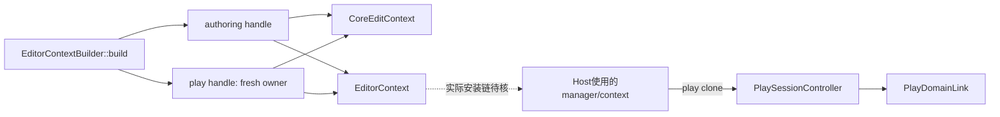

不能以这个Builder的play attach/detach推定它改写authoring owner；authoring API窗口仍需真实共同owner的第二publisher及可达并发才能提升为产品问题。本批没有该证据。

### 16.3 Settings的真实准入错误与状态顺序

EditorContext139–141交付SettingsMutationCoordinator的Arc，135–136从同coordinator取得settings authority。mutation.rs670–681的begin_phase在持state Mutex时仅当phase非Idle返回SettingsMutationError::OperationInProgress { active }，保留当前操作者phase；active来自194–202的project-transition/mutation名称。没有RAII phase guard；本包Coordinator方法可见的普通Result路径显式finish或复位Idle，不能由此推定phase泄漏或产品冲突。

bind_project465–501的显式Err只有begin_phase忙碌和project generation checked_add溢出。溢出先复位Idle，旧binding尚未清。成功路径推进generation，take/cancel project pending并清state.project，调用authority.load_project_layer_from_store，安装Some(binding)，497复位Idle后499更新health。load返回SettingsProjectLayerLoad状态而非这里的Result；Invalid仍安装binding并置writable=false，不能把它写成加载I/O Err或整体rollback。

clear_project503–515的显式Err只有开始阶段的busy；随后take binding/pending、取消待办、authority.clear_project_layer、finish和health.clear_project按序调用。普通mutation的authority Err在complete_mutation308–320先finish再上报；持久化admission失败在702–713保存Deferred并返回AppliedPendingAdmission receipt，不向上伪装为该路径的Err。begin_mutation584–620与begin_persistence_retry632–657的准入后target错误有显式Idle恢复。health、authority与persistence callee的内部状态/线程合同仍未读，不把直线调用当作全系统无副作用证明。

§15 EditorState项目转换在World/history成功后才调用settings bind/clear的顺序仍成立；现在将潜在返回错误收窄为上述busy/overflow条件。确认产品问题还需同一coordinator忙碌时的实际转换可达性、composition/重入/并发约束及上层Err恢复策略；极值注入只证明overflow边界，不证明普通产品触发。当前不新增confirmed P2。最低协调owner为EditorState，settings owner提供phase/generation准入能力；修复设计须保护发布前准入或明确发布后已提交阶段/identity，保持Invalid→不可写绑定语义，补偿先核当前identity，不用调换两次有副作用调用冒充原子性。MVP00/F0前不实施该跨模块迁移。

### 16.4 取消与viewport本地状态前缀

cancel_interactive_transform241–251先take interactive_transform；存在session/drag时调用reset_interactive_transform并保存其Result，随后sync_selection_state，最后传播reset错误。所以Err时session已消费且selection同步已调用；reset helper及sync helper内部未读，不能由本地前缀断言World恢复成功、回滚失败或盲重试安全。

reset_from_scene9–23自身返回()，按序invalidate extract、调用reset_camera_from_scene、设置orbit target、清hover/drag和pointer bridge。reset_camera_from_scene与selected_world_position仍是未读直接依赖；调用方World访问的Result和这些本地写入分开归属，不能把外层Err解释成callback未执行。

### 16.5 Generic引用槽位与资产解析是不同合同

SceneComponentAssetRecord是management实际校验的generic row类型。component.rs49的validate_references恢复并校验payload中的引用marker与references槽位表：拒绝畸形marker、非u64/不可表示索引、越界、重复使用同槽及未使用的表项，返回首个String错误。不同槽可保存相等AssetReference值；槽位使用完整性不是资产值唯一性。from_typed序列化payload并递归抽出引用，拒绝已有保留marker和索引溢出；decode_typed另做serde typed decode。该validator不验证provider/schema/type语义、entity ID或外部资产存在；143–145仅cfg(test)模块声明，未读对应测试正文、未执行测试。

references.rs28–45的handle_for_reference对builtin直接用ResourceId::from_locator；非builtin经project.asset_registry().resolve_asset_id_for_reference，resolver Err映射为DanglingAssetReference。68–83的反向helper先查registry，再查已知builtin ID→locator映射，仍无解则返回UnresolvedResourceHandle { id, role }。本地model/material与capture wrapper委托这两个helper；六项builtin映射由OnceLock惰性初始化，解析后expect。这里只能确认可见调用及错误映射，没有显式ProjectManager写入/cache写入；asset_registry及resolver内部副作用、ResourceId构造和custom callback合同仍未读。

因此management的generic-row validator和infallible projection/count跳过无效row属于不同声明合同，不能据差异确认缺陷；真实typed转换/捕获的资产身份解析另走refs helper。本批未证明全引用有效、typed状态等价或custom回调安全，未移除clone/校验层，未宣称性能收益。

### 16.6 当前回执、后续范围与验收边界

Sol107 reader9b538e numericexit0、两叶SOURCE_STABLE_EOF与PLAY_OWNER_107_READ_EOF完整，无session；新增717bf1 numericexit0、两叶完整正文/PRE/POST/SOURCE_STABLE_EOF及CORE_COMPOSITION_466_READ_EOF完整，无session。locator1b22c8总体exit1（末尾getter regex子rg2），仅前段构造命中和consumer metadata有效；007dc1与212697分别exit0/明确EOF，不改写旧失败，preview metadata/header不增加正文覆盖。Luna49 cell120–123及125报告nested numericexit0、无session；125的原stdout完整，外层因三次重复序列化出现44901-token截断，已从同一保存result在RAM续取完整范围和post metadata，没有重启reader。一次JS wrapper ReferenceError发生在exec_command调用之前；它没有nested source输出/exit/session，保留为构造失败。Luna49未提供单独raw EOF标记，不能补造；Luna50 cell52报告numericexit0、session NONE、完整UTF8 pre/body/post及正常EOF，独立raw marker未报告。旧unknown仍保留，新的完整接收不闭合旧执行身份。

§15及Flow/pending的三路限定复核通过；Root197b68的四处status/锁表述修改按byte offset反向校验还原原复核cut，Sol d306d7独立核565/569通过，Root06dff4 scoped diff/registration通过。本§16及对应Flow/pending已通过三路限定独立复核。下一组先核实际manager安装caller及上述未读直接callee；新locator仅归属，不计正文或动态验收。

Root19c80b保留R8 canonical/archive同daea0b5a…、response同fb5b345f…/13383B的观察。新增898f47 numericexit0/ROOT_PUBLIC_REPLY_MINIMAL_EOF完整读到指定reply：de489094…/2000B/22行，确认其声明A1 compile/cleanup仍pending。6db34f numericexit0/R8_NAMED_SUPPORTING_PROOFS_EOF进一步全文核closeout、receiver reconciliation与失败记录三个JSON；closeout实际Build记录#51/queue2002 SUCCESS，intakeAccepted=true、formalNativeValidationAccepted=false、newNativeRequest=false。#49/queue1983 FAILURE及Pinned records entry source changed失败继续保留，恢复没有把失败改写成功。worker归档后移除6529B原inbox消息是logicalInboxBytesRemoved，physicalSpaceFreedMeasured=false；不能计为Root释放空间或原A1 native cleanup。第四份historical route证据95793B在该reader只核metadata/top keys，后续限定字段读取另记，不冒称全文消费。Root60bd71虽然exit0/末尾EOF，输出在nested tool截断，不能作为中部reply正文已接收依据；898f47才是完整消费证据。接收恢复与原A1验收分开，已归档inbox不重建，不新native request/rebind。

Root1d244a numericexit0/R8_HISTORICAL_A1_SELECTED_KEYS_EOF只消费第四JSON的11个指定字段。historicalA1Observations里的原compile/cleanup分别保留旧request/input digest/runtime/源码归属；该报告时点的operation和精确submission marker观察为absence，actualNativeExitAndEofProven=false、checkpointAbsenceProven=false，不能推广为现在全局无活动或checkpoint已不存在。authorizationOwnerCurrentRuntime=false，ordinaryQueryWouldRequireCurrentBinding=true；不重绑旧input来查状态。此文件是跨任务容器，requiredTerminalReceipt指向另一优化任务的batch13，不能导入为本任务A1验收门槛。95,793B文件全文语义仍未全读；本批仅对明确A1字段及范围边界作结论。精确pilot active.json仍不存在，仅为该路径观察，不证明formal driver停用；Jenkins技能SHA未变。原A1注册/迁移、compile/cleanup与MVP00/F0继续开放，M0全引擎、模块/产品/性能及goal/cleanup均未完成。本批Rust写入、编译/测试/产品/采样、源码副本、临时helper及实际释放空间均0，保留旧任务/共享/失败与未知证据。

## 17. manager入口、settings观察者与导入准入（2026-10-15）

### 17.1 当前限定覆盖与源码漂移

新增19个全文叶、4758行（18生产4641、1测试117）；另将generation.rs的旧148行pin更新为当前179行全文，旧版本证据保留，不把两版相加。当前切片125pin/25754行：118生产25284（105全文、13部分），7测试470（5全文、2部分），总110全文、15部分。旧startup.rs94同pin刷新为新增0；locator、元数据和RAM复核不计正文。所有测试仅读，未执行。

| 类型 | 实际源码 | bytes | 本批实读 | SHA256 |
|---|---|---:|---|---|
| 生产 | [zircon_editor/src/ui/host/editor_manager.rs](../../../zircon_editor/src/ui/host/editor_manager.rs) | 16262 | 1–426全文 | 695b4a7b32e1e9376b471fe194c6862e90b93dbb3f30a565b4974c0eecb8b1fa |
| 生产 | [zircon_editor/src/ui/host/editor_host_startup.rs](../../../zircon_editor/src/ui/host/editor_host_startup.rs) | 3524 | 1–93全文 | 4c0d4f854ca4104c2a87f09252231785793289e730aecf8b1400d49b305961a6 |
| 生产 | [zircon_editor/src/core/play/controller/preview_routing.rs](../../../zircon_editor/src/core/play/controller/preview_routing.rs) | 5380 | 1–142全文 | e2bd9e0524a59e01315aa84093e5fa84c87d6132c99aed65e71bf5ffb25d9269 |
| 生产 | [zircon_editor/src/core/settings/authority.rs](../../../zircon_editor/src/core/settings/authority.rs) | 16827 | 1–439全文 | ad5ab7ed5d990dce201f3b0fc54443d00649ce2abaaa639ccd0aebe011a0e106 |
| 生产 | [zircon_editor/src/core/settings/mutation/health.rs](../../../zircon_editor/src/core/settings/mutation/health.rs) | 9499 | 1–307全文 | 2d457ab2c8544c692a8d1702c284622e04aceb9e58c8edeca2c58c45634a9fa9 |
| 测试仅读 | [zircon_runtime/src/asset/assets/scene/tests/component.rs](../../../zircon_runtime/src/asset/assets/scene/tests/component.rs) | 3970 | 1–117全文 | 5f9c3ed9016265f031a0ee1387df17df86a0967cd62aace8c474800e9968ef76 |
| 生产 | [zircon_editor/src/ui/host/module.rs](../../../zircon_editor/src/ui/host/module.rs) | 5472 | 1–144全文 | 2f866d882a5925ee54d94f86d85975fc085f296eab7dc8e582dd1f3b731d1ad4 |
| 生产 | [zircon_editor/src/ui/retained/app/startup/with_viewport/session_state.rs](../../../zircon_editor/src/ui/retained/app/startup/with_viewport/session_state.rs) | 1233 | 1–34全文 | 065211e271c9249162ed63f02b44eceacfd80a825f1f5258f69d53a946b2f2e5 |
| 生产 | [zircon_runtime/src/asset/registry/dependency_extractors/scene.rs](../../../zircon_runtime/src/asset/registry/dependency_extractors/scene.rs) | 148 | 1–5全文 | 67519c6ca7295f33522a488cec01da7ff5008cb09c4ea40874cb14d605926f6e |
| 生产 | [zircon_runtime/src/asset/registry/dependency_extractors/mod.rs](../../../zircon_runtime/src/asset/registry/dependency_extractors/mod.rs) | 3032 | 1–71全文 | 5e860adf33de98374f80adf9400cdc9a83b1d1907a9008785b85026b00871d6f |
| 生产 | [zircon_editor/src/core/context/builder/settings_locale_sync.rs](../../../zircon_editor/src/core/context/builder/settings_locale_sync.rs) | 1443 | 1–39全文 | c790d481847dabf4074c5e60ad51a5f5923e86cf9980328d61e7c345e25d3ba4 |
| 生产 | [zircon_editor/src/core/context/builder/settings_persistence_health.rs](../../../zircon_editor/src/core/context/builder/settings_persistence_health.rs) | 3440 | 1–92全文 | 21ff51586155799b2a9be39e92997034d94d96239c95d970f3c96d1d00823c6b |
| 生产 | [zircon_runtime/src/asset/project/manager/scan_and_import/targeted.rs](../../../zircon_runtime/src/asset/project/manager/scan_and_import/targeted.rs) | 32722 | 1–811全文 | d8530d7bb0aa2c34d750cfb0b2a95aa31a03b612aaac9a8c4f5f1522e683381d |
| 生产 | [zircon_runtime/src/asset/project/manager/scan_and_import/full_generation.rs](../../../zircon_runtime/src/asset/project/manager/scan_and_import/full_generation.rs) | 32868 | 1–784全文 | a1ed02e88c6015f72cd1da34e3fc3f14e99cac068618723841cacb73461c0222 |
| 生产 | [zircon_editor/src/core/i18n/service.rs](../../../zircon_editor/src/core/i18n/service.rs) | 16928 | 1–481全文 | 3f67c1a59d4e2cbde8e6da2e807afa6f9219e776369dc52cca80bb51437fc1f9 |
| 生产 | [zircon_editor/src/core/recovery/autosave_service.rs](../../../zircon_editor/src/core/recovery/autosave_service.rs) | 11129 | 1–329全文 | f20e1f31a465aee45de648ac33089be32fed0112cb8ffd23c3210f253f39e9ec |
| 生产 | [zircon_editor/src/core/notifications/service.rs](../../../zircon_editor/src/core/notifications/service.rs) | 4567 | 1–135全文 | 30f6f1a391bc518babeb088b23d61d74cc51c2b68fab32808655e811be8ce81b |
| 生产 | [zircon_runtime/src/asset/project/manager/scan_and_import/metadata.rs](../../../zircon_runtime/src/asset/project/manager/scan_and_import/metadata.rs) | 6704 | 1–214全文 | 7ff66c8e0529b7a7b4e15313e7bbbbdf19aad2a6cb7be83cdc267c0a6aef0eeb |
| 生产 | [zircon_editor/src/ui/retained/app/host_lifecycle/startup/with_viewport.rs](../../../zircon_editor/src/ui/retained/app/host_lifecycle/startup/with_viewport.rs) | 4253 | 1–95全文 | a71c29aed38a7ffe5b15ff3500c88972060a6dd279ea66f7a642beaa1eea1573 |

generation当前pin 6e209662a405ae253755b5e380c05346108f2b661e92f05da617a7b1f9890f06 /7477B/179行，替代e39e6153…/5044B/148行；精确mtime_ns字符串、reader/EOF及历史记录在同任务artifacts.json。Root读两个subscriber共131行，Luna49对收到片段的RAM复核不算其独立全文。Root ef3ebe归档前发现漂移，在任何文档/registry写前失败；e78359证明旧106pin只这一处变化，三文档和registry35未动。当前表的19叶由8de306独立重核仍匹配各自阅读pin。Root5a81d0已全文读当前179行并获Sol限定RAM事实复核。该叶定义World运行时修订：普通/pending计数、独立lifecycle和dynamic键修订，replacement按键并集取max后饱和加一；不是owner身份或publication epoch。饱和不保证极值严格增长，unsafe叶子的Safety要求不等全部caller已核。旧148正文不能再从RAM取得，未推定新旧仅注释变化，WORLD-003撤销与其他已核入口边界保持。

### 17.2 manager到Host的参数链

EditorManager::new201–259调用Builder.build，235–238存同返回context，getter261–263取同字段；Builder→Manager.context连接已核。module.rs56–68、141–142仅声明Lazy factory/descriptor，不证明Core实际安装或执行服务。

EditorHostStartupSession::open21–33把传入ServiceHandle交state构造，再交from_parts47–58→Host::new。旧startup.rs只定义build_startup_state，其19/56/85将manager.context clone交EditorState，不是handle来源。session_state.rs14–22生产分支调用open，24–32的cfg(test)走另一state路径，不能以普通测试覆盖生产入口。

retained/app/host_lifecycle/startup/with_viewport.rs26–94在41取得startup_access、42–43调用resolve_startup_managers、62–66把startup_managers.editor_manager.clone交session resolver。字段→resolver→open→Host的传参已核；resources::resolve_startup_managers实现和Core安装/lookup仍未核。实线仅表示构造/传参，虚线保留断点。

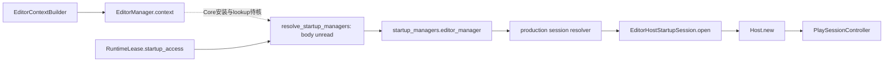

preview_routing139–141委托同PlayDomainLink handle。capture/input/simulate的本controller transition_gate与身份检查不约束所有clone writer；构造链不证明全局线程串行。发布后identity读取的条件风险未升级为产品竞态。

### 17.3 Settings同步回调的边界

authority load/clear持project_layer_operation mutex跨操作与同步subscriber；registry和subscriber mutex在callback前释放。Coordinator外层保留ProjectTransition phase值，不持续持state mutex。Invalid load返回typed状态、缓存并装不可写binding，不是上层普通Result的I/O Err。普通Result中的Idle复位不证明expect/panic或任意回调安全。

locale/autosave subscriber将可返回的本地Err记录日志后继续，无直接settings写入。I18n143–190按generation过滤并入有界队列，本地锁释放后同步调用sink；project load的外层操作锁仍在栈中，真实sink重入未核。AutosaveService113–122持service.state锁更新policy并调用adapter；adapter未读。NotificationService60–65只委托ToastNotificationCenter::publish_at，去重/准入合同未读。

health在自己的state/subscriber锁释放后回调；subscriber遍历User/Project，构造/publish错误log后继续，Unavailable不生成失败toast。另一document更新共享generation时，持续失败document可获新toast ID并再次尝试发布；这是静态重复尝试条件，不等可见重复或性能热点。普通Err不会经这些subscriber传回EditorState，下游重入/panic与产品busy可达性继续开放。

### 17.4 组件槽位与导入校验范围

已读117行测试保护不同槽保存相等AssetReference的roundtrip，未执行。Scene extractor委托direct_references；依赖集合按URI去重承担另一合同，无合并/删除依据。

targeted538–551和full-generation275–316的新鲜导入先调用validate_import_entries再投影。metadata.rs35–73只校验非空、URI/source一致、label唯一和恰好一个root，不检查payload或component marker/slots。不能从函数名推定组件有效，也不能在上游合同未核前登记为已证功能缺陷。畸形Scene row若可由生产importer交付，projection可能跳过该行；真实触发和影响未验证。

artifact恢复207–269直接合并handwritten dependencies并投影，dependency_resolution helper/artifact-store校验未核。targeted277–298在clone上prepare、提交并确认durable后替换；212–265的batch prepare及full-generation445–448直接更新receiver，full commit52–66分离，生产caller是否隔离候选未核。没有据此判数据损坏、添加镜像测试或实施MVP00/F0前的资产迁移。

### 17.5 原A1证据与下一门槛

Root完整消费R8补充reply2f5ab5b7…/6100B及dispatch42491db7…/3296B，限定消费route72b43184…的16字段和messagePin；原ACK字节匹配，消费可归因。R9由b4fd0a创建前登记、读回校验（5c2e1bef…/6583B），三旧路径当前SHA与原输入相同，App测试旧f263bc47…→当前0fd942d2…保持lineage；六叶匹配既有静态复核，不能替代完整seal或自动迁移授权。

ffe7e4完整读取R9回复0c01bb14…/4027B/27行；2ccc42全文核dispatch136e00ab…/1452B，83ef77消费route88f0258b…/22849B的16字段，messagePin匹配R9。对方消费及映射核对已可归因；公开submit digest ba8eae87…在02:51Z因process39236 unavailable、在input/marker前拒绝，未入队。这是该调用时点证据，不宣称当前全局无活动。回复所述#91/#92持久记录成功和6965B同盘归档尚未由Root消费支撑材料；Penpot属另一任务，不导入Engine验收，逻辑消息清理不计物理释放。

原A1验证授权active，无需重请；旧driver/runtime查询拒绝及公开append-only准入未闭合。部署/生命周期与zircon-authorization owner须给出受支持的恢复及迁移方案、准确所需维护授权；Full Access不替代准入，也不授权Root改私有State/auth。保留原request/inputDigest/attempt、覆盖预算及失败历史。原执行/checkpoint owner的真实exit/EOF/join/cleanup、compiler/toolchain/config/lock/features/外部Git-link和持续checkout guard仍待；旧R7保留旧时点，执行前重核。

三个domain事实包已通过限定RAM复核，非三路物理文档复核；Root另核落盘、链接、去重、source pre/post与scoped diff。generation新版本由Root全文读入、Sol仅核所供事实包。旧unknown和失败保留：空stdin6d797e不计阅读；RAM续接KeyError b53c12与ef3ebe均在写前失败；JS长度检查未调用nested exec。1595行读取原stdout完整，仅外层展示截断，未重跑。原A1、MVP00/F0、全引擎M0、模块/产品/性能、goal及cleanup未验收；本批Rust写入、编译/测试/产品/采样、源码副本、临时helper、实际释放空间均0。

## 18. Core 启动查询、Toast 准入与提交 durability（2026-10-15）

### 18.1 当前限定范围

本批8个生产叶新增1062行（4全文、4部分），累计133pin/26816行：126生产26346行（109全文、17部分）、7测试470行（5全文、2部分）。总计114全文、19部分；测试仍仅阅读。Root写前元数据核对133/133匹配；locator、metadata、RAM复核、注释修复不重复增加正文。M1的R10另读8个Python控制入口/879行，并补读checkout driver绑定guard26行；合计9叶905行，单独记账。

| 实际源码 | bytes | 实读范围 | SHA256 |
|---|---:|---|---|
| [zircon_editor/src/ui/retained/app/host_lifecycle/startup/resources/managers.rs](../../../zircon_editor/src/ui/retained/app/host_lifecycle/startup/resources/managers.rs) | 1715 | 1–38 全文 | 492235bcc37fa732f224bbbd85707fa912bcee10a339b7b147cb6a9c2a272342 |
| [zircon_editor/src/ui/retained/app/host_lifecycle/startup/resources.rs](../../../zircon_editor/src/ui/retained/app/host_lifecycle/startup/resources.rs) | 228 | 1–9 全文 | e49563cfa2037d6018d4bc4725a9c2670272d61d34c7632959594313d8731777 |
| [zircon_editor/src/ui/retained/app/runtime_lease.rs](../../../zircon_editor/src/ui/retained/app/runtime_lease.rs) | 2166 | 1–67 全文 | 736570beb195b9ce322af5361b1f885a1bfe5aa6a76c79551f274e743116b9c7 |
| [zircon_app/src/entry/builtin_modules.rs](../../../zircon_app/src/entry/builtin_modules.rs) | 10297 | 1–160 部分 | eaa44a529977b010bbfd2920464512efd0788dd05a31deac14a14799a41341fd |
| [zircon_runtime/src/asset/project/manager/scan_and_import.rs](../../../zircon_runtime/src/asset/project/manager/scan_and_import.rs) | 15000 | 1–220 部分 | e713aaf592a7d362218ad7322d6ced55f3669149af6767949c225d4f35b57731 |
| [zircon_runtime/src/asset/artifact/store.rs](../../../zircon_runtime/src/asset/artifact/store.rs) | 26818 | 1–175、420–455 部分 | db7ee65f852b13086927ad0331594755e38022004ccc450b39992fa81456e44f |
| [zircon_runtime/src/asset/project/manager/durable_transaction.rs](../../../zircon_runtime/src/asset/project/manager/durable_transaction.rs) | 17162 | 1–190 部分 | 01804a739e64a93d6a9df48d068e72b56c5803921719083d60393279cca29f3f |
| [zircon_editor/src/core/notifications/toast/center.rs](../../../zircon_editor/src/core/notifications/toast/center.rs) | 4732 | 1–167 全文 | cbaa7c4025cadb8d01e3fd9370cd02ba349f513c9fc286a162d39e273e512d73 |

八叶的SHA/bytes/精确mtime_ns、实际范围、reader和exit/EOF登记在同任务artifacts.json。builtin_modules.rs仅1–160/275、scan_and_import.rs仅1–220/403、store.rs仅1–175及420–455/745、durable_transaction.rs仅1–190/491；未读后段不归全文。Toast首次输出的非ASCII注释仅1/79两行，以相同pin的UTF-8补读修复，净增0；原输出与修复回执保留。

### 18.2 同一 handle 的 Core 查询边界

runtime_lease.rs19–25保存CoreHandle；startup access持CoreWeak，53–62升级后调用按EDITOR_MANAGER_NAME的typed EditorManager handle查询，升级失败返回ServiceUnavailable。resources/managers.rs9–38取得asset access、同一editor handle、asset services及订阅，再把原变量装入StartupManagers；结合§17已读caller，resolver到session/open/Host的字段传参链已接通。逐步取得资源不等于所有失败都有回滚。

App builtin_modules.rs117–141仅在target-editor-host feature和Editor profile下加入EditorModule；缺feature的Editor路径返回初始化错误。90–115只核到模块组合与compile调用。Core resolve内部、真正注册/实例化/activation及compiler实现仍未读，不能把push或compile认作安装完成，也不据此闭合startup运行身份、线程和退出合同。

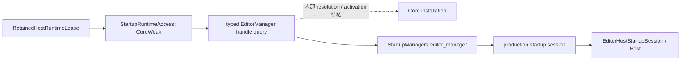

### 18.3 Toast 本地准入与可见性边界

ToastNotificationCenter::publish_at80–114检查到期时间、加本地Mutex、回收expires_at<=now记录，再检查活跃ID与容量并更新两张表。活跃同ID返回DuplicateNotification，不替换旧项；容量满返回CapacityReached，新通知不入库。错误返回前可能已经移除过期记录，不能把失败描述成中心状态完全不变。此叶没有UI/settings callback，因而排除这一直接同步重入路径；authority外层操作锁、真实I18n sink/autosave adapter仍开放。

snapshot_at116–123回收并克隆存活数据；注释要求发布和快照共用同一单调纪元。同一失败document与同一global generation的活跃ID被拒重复；generation变化可能生成新ID，与未过期旧项同时存在。实际UI消费者及其时间源未读，不能报告用户可见重复、实测热点或性能收益。subscriber吸收并log普通Err，不代表toast成功准入。

### 18.4 候选隔离、commit 结果与未定提交点

scan/watch包装器104–112、114–126持generation lock并clone candidate，准备和commit普通Err都在发布candidate前返回；commit成功后先替换self，再ensure_durable。§17的targeted单次入口277–298先ensure再替换。durable_transaction.rs34–43、50–77确认：Core的CommitRecoveryDeferred映射为RecoveryDeferred，ensure将其转为“commit marker durability未定，需restart/reopen恢复”的Err；Durable和CleanupDeferred均映射为Durable。

这确认了Ok(RecoveryDeferred)之后的两种控制流顺序，尚未确认一致性缺陷。底层Core transaction的文件替换、commit point、同步和回滚合同未读，无法断言磁盘应匹配新candidate还是旧self，也不能直接交换赋值作为修复。普通commit Err与post-commit durability未定须分开复现。

ArtifactStore::read131–137委派到带raw payload limit的读取；139–175仅核到inventory、解码、完整度/大小检查和into_imported起点，后续kind/实体校验未读。435为CountingReader::read，不是第二个ArtifactStore校验入口。prepare_write81–128会在高层manifest/meta提交前stage payload并publish chunks；失败/孤儿清理owner未核，不构成删除缓存依据。dependency_resolution helper由path属性定位到asset/manager/scan_and_import/dependency_resolution.rs，但正文未读；组件slots与恢复验证继续开放。

### 18.5 M1：R10 已有监控回信，原 A1 未验收

Root在registry37登记后写入[R10](../../../.jenkins/records/engine-audit-20261009-01a12097-m1-keeper-recovery-r10-to-jenkins-01a0f6e1.md)，SHA437484c15a335283aacfd0167414fa82447c03749f2ab7768a1a21ec61f65e1d/11498B/61行；b8e006取得numeric exit0、无session、字节校验和source pre/post EOF。Sol与Luna50的限定RAM复核应用了“身份不可核不等于死亡”和“keeper控制请求独立对账、不替换A1”等边界。公开actor脚本的--check-only也写holder状态，未执行。

Root49984c全文读入[匹配回信](../../../.jenkins/records/engine-audit-20261009-01a12097-m1-keeper-recovery-r10.reply.md)，SHA d4c70270ff605878cdcbc8a37d3e261ff2892e59d47da1879de932220759859a/5891B/38行。consumer为monitor chat01a12fdb-4d74-75d1-92fa-ca578416c6ab，与原目标Jenkins owner不同；精确消息消费可归因，原owner亲自消费及维护准入未证。

回信04:56Z报告所选driver b62b293f…d9e62/runtime start-1792034703256392600、4个进程birth/executable匹配且live、169个sealed成员匹配；完整argv/boot、公开Ready、release审批及新动作准入仍缺证。安装的management仍绑定1dfff656…ef35e/runtime start-1791949844649660400，实际capability调用被driver_context_mismatch / “Control must use the selected sealed driver”拒绝。这与旧R9的process39236不可用是两个时点的不同故障，不据此无条件重启。命名附件heartbeat-20261015T044445.coordination-preflight.json（2de81ea8…66963/47955B）的限定安全字段已由Luna50读入并转交Root：消息pin、两driver/runtime、4组identity样本、169成员计数、实际capability错误、原授权及5个operation键；8876ba exit0、前后pin稳定。此为外部观测附件的部分消费，非Root fresh process query；release/approval/descriptor值未读。

上述回信时点未产生新keeper控制请求、原A1补交、formal inputs/marker/queue；旧两个A1操作在当前State未见不证明idle或终态。原request/inputDigest/attempt/immutable driver/features/catalogue/预算/失败和unknown保持。Sol另读checkout driver.py236–261（aef74483…d7d9/13972B/275行）确认guard比较执行模块__file__是否为所选sealed模块、ZIRCON_DRIVER_DIGEST、ZIRCON_DRIVER_LAUNCHER及JENKINS_PYTHON四项；未读_plain/verify_driver，不替callee副作用背书。错误无法区分具体哪项失败；checkout与所选immutable实现同源未核。下一最小范围是tools/jenkins-management/entry.py实际bootstrap/模块/launcher绑定与driver_environment222–235，尚不足以要求rebind或改guard。必要迁移再由原维护owner给公开append-only lineage；完整compiler/toolchain/config/lock/features/外部Gitlinks及持续checkout seal仍待闭合。FullAccess环境不代替维护授权。

E盘82.406GiB仅为本次观察，执行前仍需当前物理根/容量/锁准入。Root无native/service命令、Rust改动、源码副本、删除或提交推送发布，实际释放0B；外部#91/#92不计Engine验收。

### 18.6 复核与保留项

三domain RAM事实/算术复核通过，非三次物理文档复读；Root另做当前源码metadata、正文前缀可逆性、链接/结构和scoped diff检查。Settings locator的spawn_ready拒绝无reader；下一次outer0但inner rg2为失败；fixed-string定位才成功。误简写的subscriber路径已更正，错误路径无coverage。Core locator133条只显40、durability locator44条只显40，均保留截断，不能作全caller或负命中证明；所有旧unknown及失败回执保留。Root注释显示编码失败的doc context读取不算独立中文内容复核，沿用相同pin的既有S17证据并在本次writer显式UTF-8。

WORLD-003撤销保持；未新增已复现错误或实测瓶颈。Core lookup/activation、底层transaction提交点、恢复校验、UI snapshot消费者和真实settings sink/adapter为下一独立范围。MVP00/F0、全引擎M0、原A1、模块/产品/性能、goal与cleanup全部开放。

## 19. S19：事务核心续审与公开 installer 预检（2026-10-15 UTC）

本节继续最低 MVP 00/F0 的只读归因工作，观测 HEAD 为 `f28ba39a5095f4964c046ecc702778627f80cfd5`。复用实际 main checkout，保留既有修改与其他任务归属；本轮没有 Rust、Cargo、共享契约实现或数据格式变更。Root 负责归并，Luna49、Luna50 和 Sol49 复用既有任务并行复核，模型分别为 gpt-6-luna/max/none、gpt-6-luna/max/none、gpt-6.1-sol/max/none；同时运行上限为三个 helper。

### 19.1 源码覆盖与证据范围

相对§18新增六个生产叶，扩完两个已有部分叶：`301 + 183 + 1427 = 1911` 行。累计139个 Rust source pin、28727行去重正文；生产132 pin/28257行（117全文、15部分），测试7 pin/470行（5全文、2部分），合计122全文、17部分。测试未新增覆盖。元数据核验、重复独立阅读和 locator 命中均不增加正文覆盖；这个清单仍不是全引擎完成证明。

下表 manager 路径相对 `zircon_runtime/src/asset/project/`；transaction 路径相对 `zircon_runtime/crates/zr_resource/src/io/`。每个叶的字节数、总行数、mtime、实际阅读区间和 transport 限制保留于本任务 registry。

| 叶 | 本轮区间 | SHA-256 |
| --- | --- | --- |
| `manager/durable_transaction.rs` | `191–491；现全文491` | `01804a739e64a93d6a9df48d068e72b56c5803921719083d60393279cca29f3f` |
| `manager/scan_and_import.rs` | `221–403；现全文403` | `e713aaf592a7d362218ad7322d6ced55f3669149af6767949c225d4f35b57731` |
| `transaction/engine.rs` | `1–582全文` | `66e449587bc86a0e50c8e39f2fd1182689accd02f7b34ede2ac6ebb9fe5739c3` |
| `transaction/commit.rs` | `1–377全文` | `1b8bf9eaee25b9ff258e0cccac90a33670dc9b96b3391505372d4367bf2df6c8` |
| `transaction/recovery/mod.rs` | `1–84全文` | `c6a87c9eccee8db1624fa34933bb46729203d727f97a95cdebcfe82678be1d70` |
| `transaction/recovery/replay.rs` | `1–120全文` | `02bae8bb548e595db8b90d6118780182bfc135a7f01a49ec02b7b93a05399673` |
| `transaction/journal/append.rs` | `1–170全文` | `0e8c42d49f9bb6c6ecc4d8df3d4722c4e71c204ccd32a09f0d79d807843f58fd` |
| `transaction/journal/recovery.rs` | `1–94全文` | `89ffd3ff4f3c17cb3a0e79b7b808ca2c6f1576860515cc0dc6955e9597a4c534` |

`scan_and_import.rs` 新读221–403是父模块的 source-removal / PreparedTargetedWatchRemoval 续段，不是单源导入277–298。Root 先前任务描述中的文件归属已更正；183行仍按实际父模块阅读记录，未把它当 targeted 方法的独立证据。

### 19.2 最低事务 owner 与提交边界

资产层经 [durable_transaction.rs](../../../zircon_runtime/src/asset/project/manager/durable_transaction.rs) 的 `zr_resource::assembly::io::transaction` 路径使用资源事务核心；提交、日志及恢复实现由 [transaction/engine.rs](../../../zircon_runtime/crates/zr_resource/src/io/transaction/engine.rs)、[commit.rs](../../../zircon_runtime/crates/zr_resource/src/io/transaction/commit.rs) 和 journal/recovery 负责。资产包装将 Core 的 CommitRecoveryDeferred 映为 RecoveryDeferred；CleanupDeferred 则保留 durable 分类。

`journal/append.rs:93–116` 的 commit frame 完整写入后，`sync_all` 失败返回 PublishedWithoutSync。engine 在该分支返回 `Ok(CommitRecoveryDeferred)`，保留当前已发布文件与恢复证据；不能将它改成普通 Err 并假定文件已回退。普通提交 Err 会尝试回滚与清理，回滚自身仍可能失败，因此也不能声称所有 Err 都恢复旧文件。恢复倒序执行；restore 失败在清理前保留证据，后续 append/cleanup 失败需分别判断剩余状态。

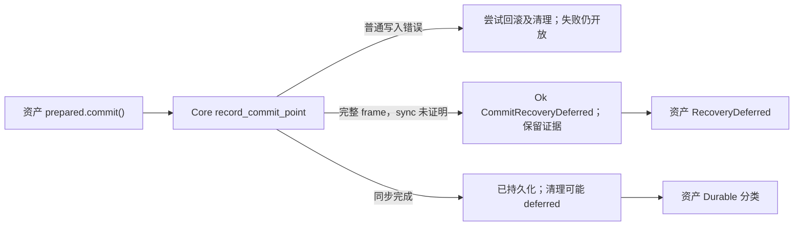

`journal/recovery.rs` 先完整载入日志并解析每个 frame，再对成功载入的有效前缀截短 torn tail。其检查包括首帧 Intent 无 transitions、后续 frame 恰一 transition 与 TOML 解码；解析错误向上传播。已读 replay 的 Active + RestoreOriginal 会恢复旧文件，完整 AllCommitted 走保留新文件的清理路径。`journal/frame_codec.rs` 和 `recovery/discovery.rs` 尚未读，不能据此推断任意损坏都可变成安全 Active 状态或精确断言 torn/corrupt 的解码分类。

现有 FailCommitPointSync 测试钩子在真实 commit-point 操作之后改写分类结果，能保护分类与调用方分支；它不能替代真实 OS 同步失败或断电恢复实验。本轮没有执行该测试或注入文件系统故障。

### 19.3 EA60-ASSET-001：targeted 单方法静态合同候选

位置和调用链：[targeted.rs](../../../zircon_runtime/src/asset/project/manager/scan_and_import/targeted.rs) 的 `import_targeted_source` 委派 `import_targeted_generation`；后者294行 `prepared.commit()?`，295行 `outcome.ensure_durable()?`，296行才替换 `self = candidate`。若得到 RecoveryDeferred，方法以错误返回并保留旧内存视图，而 Core 当时可见的新文件及完整 commit frame 仍存在。这是方法内结果与可见视图协调的静态候选，当前没有动态数据损坏证据或已确认产品级别，尚不授予生产 P2。

owner 是资产 targeted 更新边界；建议先明确该对象错误后的读取、重试、reopen 合同，再选择发布候选视图并返回明确的 已应用、持久性未证明 状态，或限制旧视图使用至恢复完成。不能通过改变 Core 的 PublishedWithoutSync 语义或直接交换赋值顺序完成修复。普通回滚成功、回滚失败与恢复债务也需分别保护。

独立限定 locator 在整个 `zircon_runtime/src` 搜索上述两个精确方法名，共12命中、未截断：两个定义、一个内部委派、九个 tests 路径调用。已核模块链、外层 impl 和两方法无测试门控，方法可编入非测试构建；当前只观察到测试调用。这不是完整调用图、不可达证明或删除依据，产品可达性和失败后的使用合同继续开放。重复核对 targeted.rs 1–40、208–211、268–298共75行，原全文pin未变，覆盖增量为0。

后续验收需在已确认的真实消费者上保护 deferred 后的返回值与读取语义、普通失败的恢复结果、保存重开及失败恢复；动态验证沿用最低 MVP 门槛和受管验证协议。当前仅完成候选根因定位，未实施或验收。

### 19.4 M1：R11 回信与当前公开 installer 只读预检

[R11 消息](../../../.jenkins/records/engine-audit-20261009-01a12097-m1-public-client-binding-r11-to-jenkins-01a0f6e1.md) 的 [匹配 reply](../../../.jenkins/records/engine-audit-20261009-01a12097-m1-public-client-binding-r11.reply.md) 已完整消费，SHA为 `a0050955285fcddb6705c7905d18556f5a903d8b2ff14d0bfeb56192f219c881` / 4772B。回复来自 monitor 01a12fdb，证明其消费；原 owner 01a0f6e1 的亲自消费与维护处理仍未证明。原 owner 的用户授权保持有效，monitor 明确未获本任务维护授权。

当前 public entry 全文667行已经阅读，clientSources 校验先于旧 capsule runner boot。installed pointer `6df91961…` 仍绑定旧 driver `1dfff656…` / `start-1791949844649660400`；deployment pointer `1480a60a…` 选中 `b62b293f…` / `start-1792034703256392600`。六个 public client 中 wrapper 与 entry 两项 pin 不匹配；当前 entry 在 client 校验处即可拒绝。其后旧 runner 的 bootstrap、四项 driver binding 和原 A1 输入约束仍须分开处理，进程 import-cache 清理不能重绑原 A1。

Sol49 完整阅读 [install-jenkins-management.ps1](../../../tools/dev/install-jenkins-management.ps1) 473行与 [submit wrapper](../../../tools/dev/submit-jenkins-management.ps1) 29行。Root 随后执行一次已有公开 installer 的 `-CheckOnly`，expected driver/runtime/installed/entry hashes 与 R11a 逐项绑定。实际在 installer 第222行抛出 `Unreviewed public entry change`；外层捕获包装主动 exit2，nativeCargoExitCode=null，cell72/chunk88c965/无 session，terminal EOF已收到。installer、wrapper、entry、installed pointer、deployment pointer、capsule 六项 PRE/POST pin 一致。本次调用在安装、HTTP、提交及 native 步骤前拒绝，没有修改这些观察文件或 State。它证明本次预检门槛已复现，尚不等于安装缺陷、迁移完成或 native 失败。

当前 wrapper SHA `e98bc09a321a19a44deb8a484c5d9bb8537aab1b124b5f65683dc81b4e9c32d5`，capsule 记录 `acf2ff5e0bf650a5de0fd4ad3a91f91b4bc2b8522cdd63e7534274f6217af858`；本次已审 expected entry hash 不能覆盖 wrapper 原 pin，第221–222行校验仍要求匹配。已向原 owner 放置一次 [R11a 补充](../../../.jenkins/records/engine-audit-20261009-01a12097-m1-public-installer-checkonly-r11a-to-jenkins-01a0f6e1.md)，请求依既有流程审查 client 变更，再给出现有公开 capsule 入口的受审迁移与真实回执；不从监控回信推断维护授权，不假定重启可解，不绕过 gate。

独立限读 foreign B005 dispatch receipt `a4e93a48d7e32bffc7fee2c8685b7f187e03287820050f6ffb558dafbe91ff4e` / 2486B，任务为 source-comments-20261014-01a13a81。它记录一次 public records_followup.submit 在 formal input/marker 前以 ordinary_entry_unproven / Pinned public entry source changed 拒绝，acceptedQueue、新 native request、native acceptance 均 false。没有读取其引用的其他 input/State，也不能据此说明原 A1 曾执行。R10 driver_context_mismatch 保留为历史后层证据。

M1 控制路径累计阅读按各次物理叶与实际源码pin记录为16叶/2372行，含 Python 与 PowerShell；该计数与139个 Rust pin 分开，不表示当前完整 control closure。公开 installer 的非 CheckOnly 分支涉及不可变 capsule、job config 与 pointer 激活，本轮没有执行。capsule 迁移与原 compile/cleanup A1 的 append-only 历史准入、终态、清理证据分别保持开放。

### 19.5 复核、失败记录与验收状态

Luna50 和 Sol49 的 RAM 事实/决策复核通过了覆盖算术、Core 结果分类与候选问题级别；Luna49 复核了 foreign B005、安全边界和本地 R11a 文案。RAM 复核不替代落盘文档复核、构建或产品验收；Root 的后续文件结构、source pins、链接和 scoped diff 检查分别记录实际回执。

保留 transport 限制：Core 最初 cell20/21 正文与稳定 EOF 已接收，但嵌套 numeric exit/session/chunk 未保留，仍为 UNKNOWN；后续成功不能补写原回执。cell26 首次错误 shell 形式虽然外层 exit0，但空输出/无EOF，覆盖0；cell27 更正后才接收 engine 341–582。durable 行数元数据首次因 literal backslash-n 得到1，metadata-only 更正为491；没有因此重复计数。B005 首次 Python 参数 SyntaxError exit1，未解析 JSON；后续 cell26/27 限定读取 exit0。这些都不是 native 编译失败。

最低 MVP 00/F0、原 A1 compile/cleanup、M1 可运行基线、RenderDoc/Tracy 实际捕获、产品回归、性能基线和全引擎 M0 均未验收。Root 本轮自有只读预检进程已取得终态；历史未知终态不据此关闭。未删除或清理任何产物，实际释放0B，共享缓存、foreign 产物及未知归属继续保留，cleanup.closed=false。

## 20. S20：M1 client pin 修复与事务边界续审（2026-10-15 UTC）

### 20.1 当前源码版本与覆盖

本节续接§19，保留前文各自时点。Root 的 source pin 批次（cell109/chunka46cf4，exit0，无session，R12_S20_CURRENT_141_SOURCE_PIN_RANGE_BATCH_EOF）验证141个 Rust pin /28964行去重正文：生产134/28494（119全文、15部分），测试7/470（5全文、2部分），合计124全文、17部分。新读两个生产叶235行；另一任务更新 world_time/mod.rs 后重新全文读24行并以旧22行退历史，当前覆盖净增237行。PS installer 与 Python 工具测试不混入 Rust 覆盖统计。这是限定读取并集，不是模块或全引擎M0验收。

| 当前文件 | 指纹、大小与范围 | 本次证据边界 |
|---|---|---|
| [frame_codec.rs](../../../zircon_runtime/crates/zr_resource/src/io/transaction/journal/frame_codec.rs) | 9911f63f65fefe4e6ad7132daf687b86577bd7acc0d839e7d3dda23b7497ce24；4528B/132L；1–132全文 | Luna49 cell31/chunkf092ce2及cell32 UTF-8注释补读，均exit0、PRE/POST稳定；首次乱码注释已补，不当作已读。 |
| [discovery.rs](../../../zircon_runtime/crates/zr_resource/src/io/transaction/recovery/discovery.rs) | 4b36120e3ac3311af93eab79b23cb2b0636283e87d08b6236186d78acf365bd3；3754B/103L；1–103全文 | Luna50 chunk99a80b，exit0、无session、PRE/POST稳定。 |
| [world_time/mod.rs](../../../zircon_runtime/src/scene/world_time/mod.rs) | b7b2134da0fb192555b37984612d4a123a2b902175155bba7c47dc65f95d3627；974B/24L；1–24全文 | 旧631cd56b…/759B/22L已退历史。Luna49 cell36/chunkb92b13，exit0、无session、PRE/POST稳定；保留foreign修改。 |

首次全pin核对在旧 world_time 指纹处失败（cell104/chunka67d01，exit1），随后限定盘点证明其余138 pin稳定，HEAD仍f28ba39a5095f4964c046ecc702778627f80cfd5。只读全24行刷新后才进行上述141 pin批次。早一条过长只读命令被Windows 206在创建进程前拒绝，没有执行子进程或写入；不把这两次失败计为通过。

frame codec 为8字节长度、32字节BLAKE3与payload，单帧上限64MiB。intent首帧严格拒绝短读/坏校验；后续帧短头、短payload，或坏校验且恰处EOF时返回None且不推进offset。中间坏校验、无效长度、溢出与上限错误仍拒绝；UTF-8/TOML和transition结构错误不因位于EOF而降级。discovery 同步枚举、排序与校验journal，完整收集后才validate_journals；任何错误都不返回部分列表，该叶不截断/写入/删除，扫描成本与触发频率尚未实测。

Luna49另对已读 recovery.rs1–94、append.rs80–120、engine.rs228–246做重复独立复核（cell33，exit0、明确EOF，chunk未可靠保留），新增覆盖0。decode成功且transition结构有效才fold；decoder返回None后使用有效前缀offset，后续truncate_torn_tail仅在当前长度更大时截断并sync，较短则拒绝。完整EOF帧坏checksum可能舍弃最后transition，目前仍是尾写入/媒体损坏失败模型边界；没有证据升级为已确认产品缺陷。谁在何时调用截断、decode到重开path之间的序列化保护、真实sync/恢复故障实验继续开放。

world_time当前模块重导出只证明公开surface及“每个Level串行持有时间权威、事务能力限crate、观测不能替代begin/commit/abort”的声明；没有追读foreign新实现或证明其锁、调度与实际行为。未把具体导出猜作相对旧版本的新增项。

### 20.2 M1公开工具源码修复

R11a reply cc38aedd…/4125B由monitor返回具体协议建议；该建议不构成维护授权。Root依据用户既有M1阻塞修复授权，先在registry42登记两文件owner并交接R12写入窗口，再由Sol独占installer、Luna50独占新测试。R11a历史公开CheckOnly拒绝绑定cfc前像；修复后尚未重新执行CheckOnly。

| 交付 | 当前SHA256 | 大小 |
|---|---|---|
| [installer](../../../tools/dev/install-jenkins-management.ps1) | c07eedaadd86b93bf16da222007eb46dbbeb1d6531c47f2aabe132bd2b6184d4 | 41680B/510L |
| [契约回归测试](../../../tools/jenkins-management/tests/test_installer_client_pins.py) | fdd1959d163dc270ee2b01899c4aba95231b4e2e0d49b085d76a747059a957b2 | 17357B/470L |
| [owned patch](../../../.codex/outbox/engine-audit-20261009-01a12097/m1-installer-client-pin-r12.patch) | 8a299bff6d1bdbfd99670ff015ce89ee4ffb6fd4699f20b5b6278538b52b13be | 24785B/580L |

installer前像为含既有foreign修改的cfcfb82bc93e60c25308b251f83fabe18288970bf89d6d0142c852f3e79d6aee/40566B/473L。只有3个owned hunks：ExpectedSubmitSourceSha256参数、统一纯校验函数和client调用方。Root（cell101/chunkc623e8）与Luna49（cell35）分别在RAM反向还原出精确cfc前像，四段未变字节一致；没有以HEAD差分冒充本任务增量，没有创建源码副本。driver/runtime/installed/capsule/job/history/原子激活守卫均保留。

新增submit pin只对应精确tools/dev/submit-jenkins-management.ps1。四种provided pin各自先校验实际raw摘要，错/空/null值不能退回首装、旧raw或entry兼容分支；未提供时首次安装、旧raw和entry既有CRLF兼容保持。未知changed路径不能借用其他文件pin；生产caller仍固定六项inventory。PowerShell比较保留既有不区分大小写语义，不能称严格小写。正确摘要仅绑定字节，不代替源码审查和维护授权。

### 20.3 已完成的静态验证与执行边界

Sol生产语法Parser最终cell21/chunk7dff88，exit0、零错误、无入口执行，PRE/POST稳定。首个Parser transport cell20/chunk270f8b虽child0但stdout空、缺marker，外层exit1，单列保留为未证实。Python ast.parse最终chunkd7932e与Root cell107/chunk9b5421均exit0；没有import或运行测试。

Luna49生产gate逻辑与RAM反向diff独立复核PASS；Sol先审初版32 case，后全文/增量审最终37 case与对应断言（cell23/chunk4fde88，exit0、无session、PRE/POST稳定），均为源码复核。六个unittest方法拟执行37个gate场景及独立SHA向量，涵盖路径隔离、旧raw、首装、错/空/null provided值、审核后字节漂移、BOM和entry独有换行兼容。runner仅将canonical installer的两项唯一AST函数定义到内存后真实调用，缺PowerShell、非零退出、超时、缺/多marker、坏JSON、结果数量或ID异常都会失败；尚无执行结果。

Root cell109/chunkbbcb7b对完整两文件owned patch执行reverse/whitespace检查及zircon-change-guard，均exit0，errors/warnings/suppressed全0，包含新untracked测试的明确路径和write-grant检查。该结果只证明静态结构与声明范围，不证明权限profile实测强制、功能回归、安装原子性或native验收。

### 20.4 交接与仍开放的验收

[R12最终交接](../../../.jenkins/records/engine-audit-20261009-01a12097-m1-installer-pin-patch-r12-to-jenkins-01a0f6e1.md) e6ec0679e566269af1e6069563b1bf9d81f7e8eb952e45f1aeabab4b8b3cfb41/5159B已本地落盘（Root cell110/chunkb9a14f，exit0）。只释放上述源码窗口；原owner消费、Jenkins聚焦测试、修复后公开CheckOnly与实际安装/接纳回执分别待实证，不把monitor代读或历史产物计作当前通过。

原A1 compile/cleanup的request、input digest、snapshot/driver历史身份和append-only准入保持pending，不重绑、不重提、不扩大预算。EA60-ASSET-001仍为targeted单方法静态合同候选、产品级未定；不据此修改Core或删除路径。MVP00/F0、M0全引擎、M1/native、产品、性能与模块验收均开放，没有执行构建、运行测试、产品或采样，也没有性能收益声明。

Root本轮实际释放0B；保留canonical source、owned patch、任务账本、本地交接及必要失败证据，无自有临时源码/脚本/夹具。其它会话、共享缓存和未知归属均保留，历史未知进程/回执未据本轮终态关闭，cleanup.closed=false。

### 20.5 R12回信与正式入口、运行代次取证

[R12回信](../../../.jenkins/records/engine-audit-20261009-01a12097-m1-installer-pin-patch-r12.reply.md) 050460726abfc46d5004c1dfde78efe6e1896f7484808b7a1dc224b7dfdbac6c/4494B/25L已由Root全文1–25读取并PRE/POST稳定（cell112/chunkbef349，exit0）。monitor确认完整消费e6ec0679…/5159B，原owner实际消费/接纳仍未证实；没有把代读当维护授权。

Root另按精确pin全文读取该monitor的dispatch-result（0f95a6a8094a0acded1151c9c4557a5fd2f6f8d5fa8c3c4c0a33b84010d358e5/2331B，cell113/chunkc86ac1，exit0）。一次records_followup.submit针对本工具修复，followupDigest=dadb3e7e6469047a26d45b4c0414566487990e6843a18739bbdf654b25893f69；在正式input/marker/State创建前以ordinary_entry_unproven / Pinned public entry source changed拒绝，receipt=null，未排队、聚焦测试执行0次。它没有重复或改绑原A1，不是Rust编译失败或测试失败。route-read-only文件a9000415…/11360B本轮只读JSON locator和选定生命周期字段，未据此声称全文审阅。

原generation start-1792034703256392600的实际deployment-operation.json（95c024942bf8f694834d88bbad0bde7cd7c6bcf84da8975645008468f1c13853/2334B/63L）由Root直接读取选定字段并核pin（cell114/chunkb0ac86，exit0），state=stopped。该operation记录本身的agentTerminationProof与nativeTerminationProof两组字段均记录processExitCode=1、stdout/stderr EOF及childrenGone=true；本节只按字段名归因，未另核对两组进程的组件身份。这些是该运行代次的生命周期证据，不能充作本工具测试、原A1/native或历史全部进程的终态。引用的独立stop-result ddf1d008…在本轮没有另行全文读取，也没有再做活PID探测或健康HTTP。

因此当前M1仍需要原owner处理实际运行代次与公开client/capsule迁移，随后取得聚焦回归、公开CheckOnly/安装、原A1准入与运行各自证据；正确源码补丁不会自行刷新安装清单。Root/monitor均未因本次拒绝而重提A1、重启/停止服务、安装或写State/auth；原预算和全部动态验收保持开放。

## 21. S21：World 时间与资源持久化 owner 续审（2026-10-15 UTC）

### 21.1 实际覆盖与证据归属

本节续接§20。本轮全文读取30个新 Rust 叶5780行：生产27/4671、测试3/1109。Root按Windows路径规范化去重后核对当前171 pin/34744行并集：生产161/33165（146全文、15部分），测试10/1579（8全文、2部分），合计154全文、17部分。HEAD仍为f28ba39a5095f4964c046ecc702778627f80cfd5，main；这是限定源码覆盖，模块、M0全引擎及动态验收继续开放。

| 实读范围（各叶均为1至文件末行） | 新pin | 生产／测试行 | 正文接收与终态 |
|---|---:|---:|---|
| world_time/controller、fixed_step、interpolation、snapshot、tests/controller；core/framework/time的policy、clock、fixed、fixed_step_plan；core/runtime/time | 10 | 1674／270 | Sol cell26/22d36d、27/465861、28/7644eb；exit0、无session、逐叶PRE/POST稳定与EOF。 |
| transaction/mod、schema、error、journal/mod、journal/intent、journal/tests/cases | 6 | 704／205 | Luna49 cell43–48，chunk6500bd/0ebe20/0fe005/9a214f/75a380/b5a944；均exit0、无session、FILE_STABLE_EOF。 |
| transaction/recovery/validation、evidence、policy、tests/cases | 4 | 713／634 | Luna50 cell54–57，chunkf75a96/531d33/c8a9ce/429337；均exit0、无session、逐叶EOF。 |
| io/mod、artifact_identity；atomic_file/mod、transaction、pathing、directory、platform、recovery | 8 | 1257／0 | Root cell133/526b51及966e77，exit0、无session；外层截断处由cell134 RAM补显directory108–126及platform1–133，未重复读取文件。 |
| foundation/runtime/config_manager及config_manager/writer | 2 | 323／0 | Luna50 cell59/5d2fa3，exit0、无session、两叶PRE/POST稳定与CONFIG_MANAGER_ATOMIC_RECOVERY_CONSUMER_READ_EOF。 |

各新叶完整SHA、bytes、lines、mtime、实际范围和reader记于[任务manifest](E:/cargo-targets/zircon-local/reports/engine-audit-20261009-01a12097/artifacts.json)的actual_source_leaves。Root当前批次cell143/fb4109（exit0、无session、S21_CURRENT_171_SOURCE_PIN_RANGE_UNION_EOF）核对全部字节身份和范围并集；104个历史条目未存mtime，按已有SHA/bytes/lines核对并验证本次PRE/POST mtime，不回填成历史读证。先前cell142把缺失mtime误作漂移而exit1，未写文件、未作为成功证据。RAM组包cell140因不可用structuredClone在调用工具前失败，也不计覆盖。

Luna49首次cell42遭runner spawn_ready拒绝，无可追踪child/session/EOF；启动和终止状态仍为UNKNOWN，后续成功读取不关闭它。Luna50最初合并输出cell53截断，未据其宣称正文完整，覆盖来自四个独立终态读取。其它历史unknown照存；本批没有创建脚本、源码副本或测试夹具。

### 21.2 World 时间的最低 owner 与条件问题

RuntimeTimeAuthority保存真实时钟及未来World的默认策略；WorldTimeController保存每个World的虚拟时钟、固定债务、预约单步和提交观测。Fixed先以u128整除再限于u32预算，固定步成功提交才扣债并推进时钟；abort保留债务和已提交历史，不回滚World系统写入。snapshot/plan是复制观测，不是提交或持久化凭证。这里尚未闭合实际Level/WorldDriver锁、系统执行、commit/abort/Drop及reset调用链；不能用模块注释代替这些实现。

- **S21-WTIME-ENDPOINT，条件性静态错误，产品级未定。** [controller.rs:296](../../../zircon_runtime/src/scene/world_time/controller.rs)以current_elapsed减timestep重建前一端点；policy只拒零步长、非有限或负倍率，clock成功提交采用饱和累计。若两次成功提交使elapsed饱和，真实前一提交端点可为MAX，重建值却为零，破坏tick与端点的对应。最低owner为WorldTimeController；修复设计应记录真实前一成功端点，abort不推进历史，reset重建基线。当前不实施；完整外帧fixture还缺Virtual::effective_speed_for_next_delta等直接callee，产品触发还缺实际Level调用链。验收需覆盖饱和、普通提交、abort和reset，再核消费者插值。
- **S21-WTIME-STEP-BUDGET，合同待决。** [controller.rs:200](../../../zircon_runtime/src/scene/world_time/controller.rs)为暂停预约单步选择plan_steps(1)，普通预算零则计划零步；runtime/time已区分正常预算和调试单步例外。当前不能判为硬预算违规。owner为Runtime/World时间合同；先明确优先级，再验证零预算预约、无效外帧、预约消费和abort重试。
- 十叶内未发现第二套共享World可变时间权威；默认策略如何进入实际Level仍待核。advance活动步前提仅有debug_assert，是否可在合法调用序列中违背仍待caller验证。浮点缩放溢出被截断、插值因舍入可等于1.0均有已读合同，不重复报告缺陷。

已读controller测试由真实cfg(test)模块绑定，7个测试覆盖独立暂停/倍率、显式提交、abort、策略冲突和普通插值，未覆盖上述MAX端点和预约边界；本轮只读测试源码，执行0次。

### 21.3 journal与批量恢复的责任分界

plan_intent拒绝空写入，并在创建文件前检查target、stage、backup、rollback-stage及retirement路径与journal/owner-lock的别名、祖先/后代重叠。persist_intent序列化版本7的intent首帧，以atomic_write_new创建并同步文件和父目录；后续transition由schema状态机约束准备、激活、提交、回滚及清理顺序。返回Err不代表磁盘没有变化：首帧创建后的sync失败也可能留下文件，必须沿事务引擎恢复合同处理。

recovery在整个发现集上先校验版本、非空、fold、域validator、路径身份及保留命名角色，以跨journal集合拒绝重复身份和祖先重叠，再核digest/evidence；全部通过才进入上游replay。单次EvidenceCache复用摘要。RestoreOriginal和CleanupArtifacts对缺失target及退休路径的要求不同；已提交/清理状态要求新target摘要正确、退休live路径缺失。域callback、PathIdentity及普通文件校验的底层实现尚未全部读完；外部替换/reparse与TOCTOU不能据此宣称已解决或已复现。

journal用例补强了不覆盖已有intent、transition各截断长度、损坏intent与EOF尾帧区分、截断后追加和大小上限；recovery用例涉及无效版本/id、词法别名、跨journal祖先冲突先于摘要I/O拒绝、坏backup和逆序多文档恢复。它们不是完整phase/路径替换矩阵，均未执行。完整EOF transition坏checksum继续合并到§20既有尾写入/媒体损坏失败模型问题，不另造重复发现。journal测试helper在缺环境变量时含仓库target备用目录；实际执行入口必须核实输出变量与物理目录，不直接运行该备用分支。

### 21.4 单文件原子写与配置恢复链

单文件atomic_file负责独占stage、写入/flush/sync、备份、替换和发布后的barrier/清理；多文件transaction保留自己的journal/backup，通过带rollback_required分类的发布接口调用它，不是两套重复事务权威。ArtifactSequence耗尽后拒绝，不回绕复用；跨进程仍需create_new。Windows新文件发布不带REPLACE_EXISTING，替换及恢复失败的磁盘状态须按各分支判断，不能把所有Err视作旧内容仍在。

配置调用链在当前两叶中如下；图中的fence为已核实的调用边界，其具体锁和跨实例实现仍需底层owner证据。

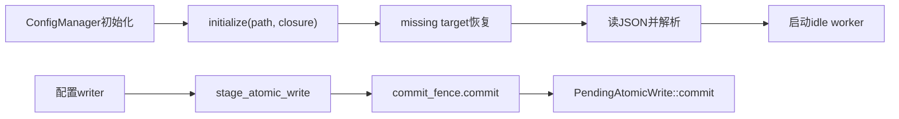

生产初始化在initialize回调内先恢复、读取、解析，再启动worker，全部成功后才合并配置值；失败不合并本轮值。writer先暂存，再通过commit_fence.commit发布。显式new_with_file_path仅检查非空与绝对路径，本叶未拒非UTF-8 basename；默认config_file_path和实际产品调用尚未读，不能由PathBuf参数宣称产品允许相应输入。一个生产恢复调用与另一个cfg(test)恢复调用已区分，没有声称全引擎只有这些caller。

**S21-ATOMIC-RECOVERY-IDENTITY，静态条件风险，产品级未定。** [pathing.rs:39](../../../zircon_runtime/crates/zr_resource/src/io/atomic_file/pathing.rs)将不能转为UTF-8的basename映射为共同命名stem zircon.data；名称shape明确不证明目标身份。Windows缺失目标恢复按该stem前缀扫描，唯一普通候选即rename到传入目标并sync。因此，若同目录两个不同非UTF-8 basename共享fallback命名空间，B缺失且只剩A备份时，B可能接收A内容，随后进入配置读取/解析。Root全叶及Luna50独立窗口复核（cell58/dc6964，exit0、无session、PRE/POST稳定）一致；重复阅读新增覆盖0。

最低owner是Resource I/O atomic_file，影响是条件成立时的目标/配置身份错配。备份实际产生与保留、Windows可表达文件名、真实产品路径和唯一候选状态尚未复现，未升级为产品缺陷。修复方向是使用不丢失目标身份的命名/验证，旧备份不可按含糊fallback自动归属。先由Windows受管fixture验证“两目标仅A备份，B不得错配”，再保留同名单目标成功、多候选拒绝及失败保留原文件；当前没有修改ABI、API或持久化格式。

### 21.5 M1与性能验收仍开放

cell130入口盘点没有取得新R12/owner接纳回执，active.json缺失；没有可用聊天、Jenkins或捕获工具。沿用§20.5的一次公开入口拒绝及原A1历史身份，本轮未重提、重绑、安装、维护服务或写State/auth。公开client/capsule迁移和真实聚焦测试仍由已授权的原Jenkins owner处理；没有把源码正确或静态复核充作执行结果。

本轮没有编译、测试执行、产品运行或采样。文件同步、备份、目录扫描、摘要及分配只作为成本候选，频率与当前产品可达性尚未测量；没有性能收益或预算达标结论。MVP00/F0、M1/native、M0全引擎、模块、产品和性能验收均开放。实际释放0B，保留canonical源码、补丁、账本、本地交接与必要失败证据；无自有新临时文件可清理，foreign/共享缓存/未知归属及历史未知进程保留，cleanup.closed=false。

## 22. S22：固定步退出、配置 gate 与资源暂存 owner（2026-10-15 UTC）

### 22.1 覆盖与取证边界

续接§21。本轮新增16个完整 Rust 叶2707行：生产12/2119、测试4/588；三路 Luna/max 首批并行，扩围由 Root 限定，核心时间合同由 Sol/max 复核。当前范围经 Windows 路径规范化去重为187 pin/37451行：生产173/35284（158全文、15部分），测试14/2167（12全文、2部分），合计170全文、17部分。HEAD仍为f28ba39a5095f4964c046ecc702778627f80cfd5、main。阅读与静态核对不构成模块或M0全引擎验收。

| 本轮全文新叶 | 新pin | 生产／测试正文行 | 实际reader终态 |
|---|---:|---:|---|
| core/framework/time/virtual_clock；scene/module/world_driver | 2 | 497／0 | Luna51 cells2/3/4组回执，chunksdd7f96/fbcc10/87c994，均exit0、无session；首批末行ALL_PINS_STABLE=True，无单独EOF标记，后两批打印EOF。此组还含既有Level窗口，新覆盖不重复计入。 |
| foundation/runtime/config_path；config_manager/commit_fence的fence、registry、path_key、tests/cases | 5 | 438／335 | Luna49 cells1/2/4/5/6，chunksb53712/26627f/9c5d12/7b94a6/e7151a，均exit0、无session、各叶稳定EOF。 |
| zr_resource transaction的pathing、stage、owner_lock、observation、tests/pathing、tests/stage、tests/owner_lock | 7 | 1051／253 | Luna50 cell1/0e6784及cell2/970d5b，均exit0、无session，S22_TWO_LEAF_READ_EOF及S22_OWNER_LEAVES_READ_EOF。 |
| foundation/module；runtime/config_manager/commit_fence模块绑定 | 2 | 133／0 | Root cell161/343aaa，exit0、无session、S22_ROOT_FOUNDATION_DESCRIPTOR_AND_FENCE_BINDING_133_BODY_EOF。 |

[任务manifest](E:/cargo-targets/zircon-local/reports/engine-audit-20261009-01a12097/artifacts.json)保存各新叶四字段pin、全文范围及reader。Root cell165/3b208d（exit0、无session、S22_CURRENT_187_SOURCE_PIN_RANGE_UNION_EOF）核对187个当前身份与范围并集；104个历史叶缺失mtime时，仅核既存SHA/bytes/lines及本次PRE/POST稳定mtime，不补造历史证据。Root cell168/6abe80重复核config_manager1–160、path_key1–35，新增0。Luna50重复核transaction/mod1–38和engine90–499、512–562，新增0；LevelSystem原已全文671行，本轮重复窗口不再计数。

本轮Root cell160/129737的locator因不存在的scene_schedule.rs路径exit1，保留其有限命中，不作正文读证；cell163/3e29b4的Git状态输出截断，不据此宣称完整盘点。历史Luna49 cell42的启动/终止仍UNKNOWN；成功后续reader不关闭它。没有源码副本、临时脚本或生成夹具。

### 22.2 时间 owner 与固定步失败合同

实际链路已追到LevelSystem::tick→WorldDriver::tick_level：先接受并推进外帧时间，再取固定计划；每步begin后执行固定阶段，核World generation，最后commit。固定阶段Err会显式abort当前时间步并取走token；若panic/unwind等路径留下未结算token，活动guard的Drop会尽力abort并忽略返回值。已读controller/Driver不提供通用World回滚，系统写入可能保留；runner/system自身是否补偿尚未读。普通失败路径保留前序成功固定步、已接受外帧及本帧虚拟时间推进。下一次begin可复用未提交tick ID，但相同外帧不能直接重放；后续重试还受新外帧、暂停与预约规则约束。

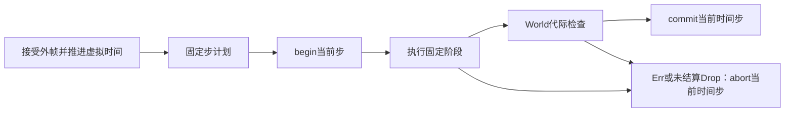

commit在World锁内核代际并取时间锁；World替换同样持World锁后reset时间。时间mutex只证明逐方法串行化，当前证据不能证明整个tick pipeline全局串行，也未据此报告实际竞态。换World期间的完整系统/调用线程合同和插值消费者仍待核。

**S21-WTIME-ENDPOINT继续开放。** Virtual默认未暂停、允许MAX上限和倍率1；clock172–191在MAX×1达到上限时直接返回原Duration::MAX。该缩放实现早已包含在§21的clock全文pin内，本轮“局部scope未读”不代表全局缺失。Sol独立确认：若两次固定步成功提交并饱和，真实历史端点均可为MAX，controller296–304却以MAX减MAX重建为0，Driver不补偿该历史。最低修复owner仍是controller的真实前一成功端点记录及abort/reset基线；当前没有实施修复。实际宿主MAX输入、完整调度成功与产品影响未证，产品级保持未定。

**S21-WTIME-STEP-BUDGET仍为合同待决。** 现有代码让暂停预约单步选择一步；Sol建议外层预算作为上界、零预算保留预约、调试例外由外层显式授予额度。这是设计建议，不将当前行为判为已违约，也不在本轮改变合同。

Sol重复正文1126行、新增0：cell3/d568b0（exit0、无session、S22_TIME_DIRECT_CONTRACT_DUPLICATE_READ_EOF），cell4/97f933（exit0、无session、LEVEL_DIRECT_TICK_REPLACEMENT_DUPLICATE_184_EOF及locator EOF）；均PRE/POST稳定。Runtime::advance_time_by、RuntimeHandle时间入口与SceneScheduleRunner仅定位并核元数据，正文未读、未计覆盖，留作下一范围；未读Driver测试不能被称为缺少回归。

### 22.3 配置路径、epoch 与新条件风险

生产默认Foundation工厂调用DefaultConfigManager::new；[bind_config_file_path](../../../zircon_runtime/src/foundation/module.rs)会验证非空绝对路径，再替换规范manager工厂以调用new_with_file_path。默认构造器另走new_with_options，保留选择器的相对路径；ZIRCON_CONFIG_PATH使用原OsString，默认平台分支用config.json，最终fallback为相对.zircon-config.json。没有读取实际环境值。两种生产工厂均已读，不将显式路径API误记为仅测试可达；真实宿主传入值仍未知。

registry全局锁只查找/创建gate，释放后再锁单路径。初始化持单路径gate，用try_lock拒绝正在初始化/提交的同键owner；回调成功才推进epoch，Err/panic保留旧epoch并取消候选。提交在同一gate中验证cancel与epoch，再同步执行闭包；cancel不会等待或撤回已准入操作。初始化panic在解锁后继续传播；提交panic可使mutex中毒，helper会恢复内部guard。析构按强引用数与Arc身份回收Weak条目。fence不负责文件操作回滚，也不提供跨进程锁。

**S22-CONFIG-PATH-KEY：条件性静态身份／可用性风险，产品级未定。** [path_key.rs:27](../../../zircon_runtime/src/foundation/runtime/config_manager/commit_fence/path_key.rs)在Windows将词法绝对路径经to_string_lossy().to_lowercase()作键。若两个不同目标因此碰撞，后一次成功初始化推进共享epoch，可能使前manager的提交返回Interrupted；实际I/O继续使用各自原路径，fence本身没有把写入路由到另一目标。最低owner为Foundation的path_key/registry；应明确身份合同并采用无损平台键，同时保留真正同目标替换语义。Windows文件名可表达性、产品输入及动态后果仍未证。文件系统别名也可能落在不同词法gate下，但源码已明确此边界，未另报已复现并发缺陷。

该问题与S21-ATOMIC-RECOVERY-IDENTITY分属gate取消与备份归属两个owner，不合并为同一故障。新的配置选择器/工厂证据缩小了后者的调用缺口；真实Windows双目标备份状态及恢复fixture依然待证。

335行fence测试由真实cfg(test)绑定，涵盖失败/panic初始化保留旧owner、候选取消、成功替换拒绝旧闭包、同路径忙、异路径不持全局锁、epoch耗尽和末次回收。未覆盖lossy键碰撞、文件系统别名、跨进程竞争、commit中的cancel/active及commit闭包panic恢复。ignore benchmark只是map模型，未执行，不作性能证据。

### 22.4 资源路径与暂存错误的外层责任

PathIdentity对已存在路径使用canonicalize，对缺失后缀从最深已存在祖先解析，按组件处理分隔符、点和祖先关系；最终symlink由后续ordinary-file检查拒绝。身份按路径namespace而非文件ID，硬链接别名和Windows非symlink reparse类型未获动态保证。检查、打开、摘要与复核仍按路径进行；外部替换窗口只有条件风险，没有动态复现。

stage先创建/同步暂存和备份，再复核摘要，尚未改变live target；中途Err可留产物，正常外层commit_prepared_files会调用abort_pre_active。可安全追加时先记CleanupIntent再清产物、移除journal；追加状态不确定时先移除journal再清产物，后续清理失败可留未登记孤儿，但该分支尚未改变live target。不能由stage局部缺少清理直接报告live数据损坏。

owner_lock以固定sidecar和File::try_lock串行化合作调用者，RAII释放；commit在pending检查至stage/commit/rollback/cleanup期间持锁，残留journal阻止下一提交。txid仍是owner token、PID和进程内序号，非持久代际；PID复用与仅残留sibling产物的名称复用属于待证清理边界，未证有害后果，不新增缺陷编号。

测试源码涉及路径组件/owner token、ID形状及耗尽、非UTF8 basename摘要；stage测试只分NotFound与PermissionDenied，owner-lock测试仅同进程双handle。没有跨进程、重启或完整stage故障清理矩阵的执行证据。测试helper在缺输出环境变量时含仓库target备用路径，今后实际入口须核实物理输出位置；本轮未运行它。

### 22.5 验收与保留

本轮未取得新R12原owner接纳/迁移或原A1执行回执，active.json缺失；没有可用聊天、Jenkins或捕获工具。沿用§20–21的原请求和一次公开入口拒绝证据，不重复提交或重绑，也未维护服务或写State/auth。MVP00/F0与M1/native仍开放。

本轮测试执行、编译、产品运行和性能采样均0；路径规范化、锁、同步、复制和摘要只作为待测成本。S22只完成上述源码和静态证据，模块、M0全引擎、产品及性能预算验收不关闭。实际释放0B；保留canonical源码/补丁/账本/交接及必要失败证据，没有本轮自有临时文件可清理；foreign、共享缓存、未知归属与历史未知进程保留，cleanup.closed=false。

## 23. S23：Runtime 时间入口、真实宿主与阶段失败边界

### 23.1 当前源码覆盖

本节接续§22的187 pins / 37451行。新增9个完整叶、一个完整identity叶和paths.rs的31行部分范围，并把既有DynamicSession部分叶补全；新增正文2753行（生产2421、测试332）。另完整重读4个既有配置生产新版本736行，替换旧612行，净增124行；外部组件registry当前完整220行替换旧部分85行，净增135行。本任务cases消费者335→331行，净减4行；随后外部追加到465行，净增134行；另刷新编辑命令316→326行（净+10）及World records测试旧部分55行→当前完整446行（净+391）。按本节已读源码版本合计198 pins / 40994行：生产182 pins / 37974行（完整168、部分14），测试16 pins / 3020行（完整15、部分1）。完整叶合计183、部分15。DynamicSession复用592–670的79行，只新增1–591、671–796的717行。重复复核和locator命中不计正文增量。

源码指纹与精确reader回执登记于既有artifacts.json和delivery-state.json。最新元数据核查发现组件registry随后又变为d5a878ee…e047c9（226行），resource/io facade变为bf2d9985…ec5026（17行）；这两个后续版本未补读，所以上述40994行是已读版本账本，不能称当前198-pin闭包通过。相关结论仅绑定各自已读指纹，后续foreign刷新与当前源码验收继续开放。下表前10叶与identity叶在当前版本下均完整覆盖，paths.rs只覆盖194–224；Runtime、Handle、FrameClock/source与Runner五个新叶已于S23首段读完，后续复核不重复计数。

| 范围（zircon_runtime/src/下） | 当前文件行数／已读范围 | 本轮新增行 |
|---|---:|---:|
| core/runtime/runtime.rs | 508 | 508 |
| core/runtime/handle/time.rs | 155 | 155 |
| core/runtime/frame_clock.rs | 153 | 153 |
| core/runtime/clock_source.rs | 168 | 168 |
| dynamic_api/session/state.rs | 796 | 717 |
| scene/ecs/schedule_runner.rs | 416 | 416 |
| scene/ecs/schedule_execution.rs | 72 | 72 |
| scene/ecs/tick_context.rs | 124 | 124 |
| scene/ecs/schedule_runner/tests/mod.rs | 34 | 34 |
| scene/ecs/schedule_runner/tests/panic_recovery.rs | 298 | 298 |
| asset/project/paths/identity.rs | 77 | 77 |
| asset/project/paths.rs | 454／194–224 | 31 |

### 23.2 时间权威与真实宿主

CoreRuntime::advance_time_by（runtime.rs:231–232）→CoreHandle（handle/time.rs:53–54、75–86）→RuntimeTimeAuthority（runtime/time.rs:89–108）原样转发Duration与正常固定步预算；clock.rs:111–114保留原始delta，累计elapsed与frame index分别饱和。公开宿主增量路径没有MAX拒绝或截断。该链是静态API可达证据，尚非真实产品MAX输入证据。Runtime默认策略只影响新Level，已有Level需独立更新。

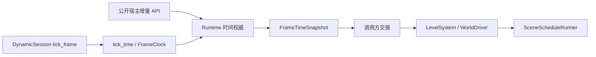

本次完整读到的正式DynamicSession帧路径（state.rs:263–311）选择tick_time(ProductTimePolicy预算)，把快照交给Level；该叶未调用手动advance_time_by。默认FrameClock取SystemMonotonic→Instant::now；tick反向样本返回零并保留旧基线。ManualClockSource检查Duration与Instant的加法及倒退，失败不更新状态。当前源码没有证明平台/真实采样能或不能产生MAX。rebase代际饱和且只交付最新receipt；违反单调契约的样本可保留旧基线，不能把receipt等同基线必已更新。克隆FrameClock的实际消费者语义未核，不据此另立缺陷。

公开manual advance与tick_time每帧择一是文档约定，未见宿主帧去重。采样器与时间权威分开取锁，不能据单次Mutex推出整条宿主流水线已串行。

### 23.3 既有时间问题与阶段失败契约

S21-WTIME-ENDPOINT继续保留为条件性静态正确性问题，产品等级未定：合法Level MAX固定步/MAX虚拟上限、未暂停、倍率1，两个不同外帧各成功提交一步时，controller.rs:296–297从饱和后的MAX减MAX，重建出0而非实际前端点MAX。公开输入链已补齐；完整固定阶段成功、实际产品MAX输入及插值消费者影响仍待验证。最低修复owner仍为WorldTimeController：保存实际成功提交端点，abort保留历史，reset以保留时长建立无tick基线；本轮未实施。S21-WTIME-STEP-BUDGET继续是暂停预约步与零正常预算的合同待决，不作为已确认产品违规。

Runner在stage内首Err后停止后续步骤，捕获panic完成局部清理后恢复传播；其worker失败路径丢弃仍持有的payload并归还系统，行332明确不撤回已提交World变化。此Runner和已读controller/Driver未提供通用World回滚；不能据此断言所有系统写入必然保留。系统自补偿、JobScheduler::join兄弟任务、merge/apply的原子性与队列失败后状态仍需最低callee证据。缺少原子承诺时，不把这一边界新定为P1。

DynamicSession先推进外层时间，再执行reload、Level、operations、输入与UI timer；reload/Level/input/timer的后续Err在本方法没有回滚既已推进的外帧，调用方补偿未核。operations调用未检查Result，不能写成已证的operation Err路径。此固定阶段失败语义与EA46-WORLD-002的“发布后lifecycle target替换、publication guard不拥有consumer slot/epoch”具有不同触发和owner；分别保留契约范围，不合并为同一根因，也不据此新增严重等级。

ScheduleExecution按World owner与schedule plan检测替换；Drop只释放原active计数，不能证明序列化。SystemTickContext虽记录world_generation，这两叶未用它校验上述绑定；SceneStageTickContexts只选择预制Virtual/MonotonicReal/Fixed context，底层clock构造与pause策略在调用方，不能将路由等同来源校验。

### 23.4 配置当前版本刷新

全pin核查发现config_manager、fence、registry和path_key在§22后已有变化，非本任务代码修改；保留原改动与旧版本证据，完整重读当前四叶后再登记。行数分别274→276、171→206、132→228、35→26，当前覆盖净增124行；本轮未增加这四个pin，也未将736重读行当全新覆盖。

当前path_key直接有损小写字符串键已被physical_path取代：final symlink先拒绝，再委托ProjectPaths::resolve_identity。S22-CONFIG-PATH-KEY原位置的实现已被替换；本轮补读resolve_identity的194–224和identity叶77行，确认身份对象保留操作路径，Windows比较委托平台比较函数，非Windows使用Path排序；Windows比较函数与resolver其他最低callee未读，Windows别名、实际I/O身份等价及迁移/动态验收仍需证据，不能直接宣布风险彻底修复。当前manager经initialize_owned在恢复读取、解析和worker创建前预留路径，操作使用解析后的地址；初始化成功才发布epoch，失败候选保留旧epoch。lease存活与Core存活/取消不同，cancel不撤回已准入commit，commit_active只是状态快照，不是持久化或退出回执。当前版本与测试兼容性的结论仍受最低callee和受管验证范围限制。

归档核查另发现组件registry已外部更新，完整重读当前220行后替换旧版本部分85行。generation返回descriptor数量；preserves_ids_of检查重叠descriptor、retention provider与table layout，retain_missing_ids_from补回缺失尾部及映射，不删除staged-only项。本叶不能证明完整rollback、lookup cache失效或调用方串行性，非本任务实现变更。

外部编辑command叶完整刷新为326行，runtime route绑定GatewaySessionIdentity；Unchanged/Applied/Interrupted错误分类、选择快照恢复及retention permit接口不等于World回滚回执，执行器语义不在本叶。外部World records测试完整刷新为446行，10项测试/57个静态assert表达批量可见性、archetype assignment、dense/sparse retention、非法记录预检、World/schedule替换时lifecycle取消、诊断与deferred及staging前缀合同；callee和宏实现未随本叶扩读，实际测试未执行。旧版本与范围保留在历史，不把这些重读当新pin。

### 23.5 M1 配置测试消费者迁移

R13迁移前，三路审查发现path_key仅导出physical_path，已绑定的cases.rs仍导入并六次调用absolute_path；registry的contains_path也已改为接收ResolvedProjectPathIdentity，旧Path包装函数类型不符。根因为生产接口迁移遗漏测试消费者，owner是配置commit_fence测试；这是迁移前的静态编译阻塞证据，尚未执行编译。

Sol在唯一授权文件cases.rs中将五个行为测试内的六处路径构造统一解析为physical identity，直接查询contains_path，错误路径断言取operation_path；移除薄包装与未用Path导入。六个test属性、39个assert宏及一个ignore属性保留，失败初始化、panic、epoch耗尽、busy与回收断言继续存在；未增加生产兼容层。前像514868eb…7dcc331（11725B/335行）→后像1b221e31…8db9294（11643B/331行）。有界R13补丁5260B，SHA256 ed96bdef1c0fbb2a447550a31578d2f66486f870e4692ec67cc85176035e6fa9，根代理在内存逆应用后逐字节匹配前像；静态change guard通过（agent模式，写权限检查通过，0错误、0警告、0抑制），这些结果不替代受管编译和测试。 这些行为fixture走cfg(test)入口，不覆盖生产initialize_owned的owner冲突与lease生命周期；ignored benchmark仍是合成PathBuf基准，不属于物理身份行为测试。

一次write_bytes返回Errno22，立即核实前像完全未变；标准apply_patch随后成功。另一次只读核查因mtime_ns经JS Number舍入100ns失败，后续统一使用字符串，不把舍入误报当作源码变动。原R12/A1身份与门槛保持，R13仅补充测试消费者变更及所需runtime聚焦验证，不表示原Jenkins owner已接纳或执行。

上述331行、39个assert和6个test属于本任务已复核后像。随后外部将cases.rs追加为3e82e60f…85f789a（17393B/465行）：当前9个test、1个ignore、62个静态assert调用点，ignored benchmark本体4个、外部环境helper2个。Luna完整重读确认五个旧行为fixture及physical identity构造保留；新增三项owner lease测试分别覆盖冲突先于prepare、error/panic及旧candidate回收与新reservation竞争、Core退出/cancel后lease持续到最后clone释放。这里只描述测试源码意图，动态结果未知。unique_path还新增测试二进制必须实际位于E:/cargo-targets/zircon-local的前提；synthetic benchmark不经此helper。后续受管批次必须满足并记录该前提。

当前完整文件同时包含本任务迁移和外部追加，后者不归本任务。R13保留为精确限定delta与历史前后像证据；不得盲目重套或逆向覆盖当前foreign内容。当前checkout验证应绑定465行实际指纹与独立review，不能复用331行后像作为当前输入。

### 23.6 回归、后续与验收边界

runner的cfg/path→tests/mod→panic_recovery绑定已核。五项测试检查runtime/worker/command panic后可再次调用，以及callback/sibling批次失败时计数不发布、干净重试仅发布一次；没有World写入或时间token补偿断言，也不直接断言join API，support实现未读。这仅是测试源码覆盖，未执行。后续从World的系统取出/归还与worker命令merge/apply owner继续核清理边界，并复用已有时间插值测试设计MAX成功提交、abort、reset及失败后继续执行的真实回归。每stage/batch可见的Vec、锁和分配仅是待测成本，无性能收益结论。

本轮三路Luna并行审查，核心失败契约与测试迁移由Sol处理；源代码与文档复核只赋予其实际范围内的静态结论。首段runner曾有编码异常，已UTF-8重读；部分初读chunk ID未保存，由独立完整源读回执补充追溯。续行时Root195与两个未返回的追加reader句柄不可用，启动/子进程终态仍unknown，后续成功读取不关闭这些历史项。

原R12 Jenkins owner接纳/迁移与原A1执行尚无新回执；active.json仍缺失。保留原请求身份，R13作为独立补充交接，指定records文件已落盘并通过独立文字复核，原owner接纳/命令执行仍待回执；不维护服务或写State/auth。本轮测试执行、构建、产品运行、性能采样均0；MVP00/F0、M1/native、模块、M0全引擎、产品与性能验收保持开放。实际释放0B，保留canonical交付、共享/foreign/未知归属及必要失败证据；无新临时脚本、源码副本或生成夹具，cleanup.closed=false。

R13监控回执已读取（reply SHA f7a60621…a5bc55d，监控会话01a12fdb…c6ab，并非指定owner）。回执报告入口capability预检exit=1、ordinary_entry_unproven／Pinned public entry source changed，原owner处理服务恢复；新提交、测试及构建均0。其State42 intakeAccepted=true/done=false指既有任务，不能转记为本次R13正式接纳。monitor未调用会提前清除未完成inbox的补充submit；Root也未用旧删除授权、State/auth、HTTP或服务绕路。保留原消息与回执，原owner接纳及当前测试终态仍待回收。

## 24. S24：命令窗口、Windows 身份与恢复交接（2026-10-15）

本节是限定静态读审，未形成新的已验收模块或 MVP 里程碑。三个 Luna/max/none 并行读取生产边界，Sol/max/none 独立裁决核心契约；Root 统一范围、指纹、覆盖并集和交接。本轮没有修改 Rust 实现。

按实际已读版本，账本由 198 pins / 40994 正文行增至 **209 pins / 43655 行**：生产 190 pins / 40580 行（177 完整、13 部分），测试 19 pins / 3075 行（17 完整、2 部分）。新增 11 pins；新增正文 2644 行（生产 2589、测试 55，包含同版本 paths.rs 从31行补至454行的423行）。组件 registry、resource/io facade 与配置 path_key 三个版本刷新净增17行。重读、元数据核对和历史版本不重复计数；路径用 Windows 形式归一后合并。

| 已读边界 | 本轮范围 | 确认的职责与限制 |
|---|---|---|
| World 与延迟命令 | world/commands.rs 185行；command.rs 291行；command_queue.rs 533行；queued_command.rs 349行；inline_command_arena.rs 287行 | World 持有窗口及活动tick；queue保留owner/plan并执行命令，inline arena保管负载；报告正常返回，既有写入不回滚 |
| 调度步骤 | scheduled_scene_step.rs 315行 | 保存和排序ApplyDeferred步骤；本叶不执行barrier、不消费报告，不能据此证明产品执行或失败重试 |
| 项目路径 | windows.rs 154行、lexical_identity.rs 52行；paths.rs补全454行 | 现存前缀canonicalize后附加新尾段；operation path保留，display/lexical视图各有约束 |
| 已有版本刷新 | component/registry.rs 226行、resource/io/mod.rs 17行、commit_fence/path_key.rs 35行 | retention provider身份/版本与保留检查；I/O facade仅重导出；配置路径一次捕获绝对上下文、拒绝最终symlink后resolve_identity |
| 关联测试源码 | queue metrics 11行、World metrics 13行；paths/tests/cases.rs 340–370 | 仅静态阅读55行；没有执行测试，也不能替代panic、alias或产品验收 |

命令调用链为 World::apply_deferred → 移出当前CommandQueue → queue.apply → typed/boxed command；回调追加内容进入下一窗口。World恢复活动tick后，仅在原World及plan仍匹配时合并并恢复队列。Sol确认应限定为：**命令执行panic被捕获后，若剩余命令析构及恢复步骤正常完成，则恢复活动tick和下一窗口队列，并重新展开原payload。析构再次panic时，不保证原payload或队列继续可用。** 清理在执行catch之外；尾部Drop再次panic本身不等于必然双panic abort。未发现任意Drop panic恢复承诺，不新增catch、不新定P2。

Windows identity明示保守折叠writer别名；lexical identity明示不探测文件系统。目录大小写敏感确实存在，但目前缺少该目录模式的产品支持承诺及具体误用消费者，不能直接升级为当前P2；严格containment与保守writer admission仍须分别验收。若扩展支持，owner为asset::project::paths，应固定身份/排序契约，不能在Ord比较中临时查询可变化的目录属性。参见[Microsoft目录大小写敏感说明](https://learn.microsoft.com/en-us/windows/wsl/case-sensitivity)。

verbatim前缀会改变Windows解析规则，但当前paths.rs保存原operation_path，只有display_path及lexical视图做前缀规范化；35行配置path_key仍调用resolve_identity，没有把display用于I/O。因此撤回“当前前缀删除已使physical I/O改指”的推断，保留特殊名称、UNC/junction、长路径和containment的原生覆盖要求。参见[Microsoft路径命名空间说明](https://learn.microsoft.com/en-us/windows/win32/fileio/naming-a-file)。

Root复核schedule.rs 165–285时确认其中native dispatch处于cfg(test)，不计作产品可达性；derived_state.rs 64–68有内部ApplyDeferred分发并忽略返回报告。生产runner的生成/分发、报告消费及失败策略仍按既有契约队列核对，不从这两个窗口新定产品缺陷。两份均为既有同版本覆盖，新增正文0。

全体旧pin与本轮版本的元数据复核发现，另有15份World项目I/O、Editor及resource transaction文件已被其他任务更新，当前新版本尚未读完。保留旧版本指纹和结论，列入刷新队列；不将新元数据计为正文，不把209-pin账本当作当前源码闭包。M0全引擎与模块验收仍false。

M1恢复新增线索已写入[R14本地原owner交接](../../../.jenkins/records/engine-audit-20261009-01a12097-m1-interpreter-ownership-r14-to-jenkins-01a0f6e1.md)（SHA 7b03e389…12f1823，3614B/29行），没有新增Cargo请求。现行Jenkins skill要求专用runtime/python只供受管生命周期使用，ad hoc进程可能阻挡部署owner check；本轮已停止以其做普通读取。launcher列出的C:/Python311已失效；真正通用Python 3.14.4已执行确认，后续使用该解释器的-X utf8 -B -I或PowerShell/.NET。Root只读CIM探测被拒，未获得全局进程清单、未终止进程。

Luna58只保存stdout/外层EOF，七次读取的内层exit/session未留存；后续Luna59分发复核遇429、未返回收据，启动与退出未知。已完成读取的终态与这些未知分开保留，后续成功读取不关闭历史未知。Root用现有同版本窗口完成了必要分发限定；本节未据丢失收据增加覆盖。

原A1与R12/R13仍待指定Jenkins原owner对账，active.json观察仍缺失；R14只证明本地文件创建，尚无原owner接纳。Root本轮构建、测试、产品运行、性能采样均0；MVP00/F0、M1/native、模块、M0全引擎及性能门槛保持开放。没有新临时脚本、源码副本或生成夹具；实际释放0B，canonical交付、复用构建、共享/foreign/未知产物及必要失败证据保留，cleanup.closed=false。

R14监控回执已读取（SHA e70ff13f…d6e569c，2699B/17行；监控会话01a12fdb…c6ab，并非指定owner）。该回执将专用Python归属线索关联原恢复请求ef231c56…b1e67a；报告当前PID14896/creationTime134365468212280602仍存在、Jenkins未监听且deployment stopped。以上是监控观察，Root未自行核实进程或网络，也未获得终止授权。State42 waiting/done=false/formalAcceptance=false；入口仍ordinary_entry_unproven／Pinned public entry source changed。没有新提交、构建、测试或删除；原owner接纳、原A1/R12/R13执行与产品验收继续开放。

## 25. 2026-10-15 续读：当前版本、保存回执与生产屏障报告

本轮三名 `gpt-6-luna/max/none` 代理并行续读 World 项目 I/O、资源事务和 Editor 消费者，`gpt-6.1-sol/max/none` 独立裁决生产屏障及 Scene/workspace 发布边界。以下是静态源码与契约证据；MVP `00 → F0–F5`、模块、原生和性能验收继续开放。

**所选版本账本。** S25 刷新 16 个既有 pin：原已读正文 3,560 行替换为当前版本全文 5,337 行，净增 1,777；其中 4 个原部分叶转为全文。另新增 4 个 pin、770 行：命令 façade 1–100，ProjectManager scoped document transaction 全 532 行，UI 保存 gate 全 45 行，document 保存 authority 全 93 行。合计 `43,655 − 3,560 + 5,337 + 770 = 46,202` 行、213 pin、201 full / 12 partial；生产为 194 pin / 43,127 行 / 184 full / 10 partial，测试仍为 19 pin / 3,075 行 / 17 full / 2 partial。版本替换净增包含原未读范围，不能再作为另一次独立增量相加。重复生产调度、World 恢复及 session helper 阅读计数为 0。

Root 在 M54 固定观察时对所选 pin 的实际字节核对未发现版本偏移；仍有 12 个部分叶及其余 owner/动态证据未闭合。当前叶 mtime 为 123 项存在、0 项 null、90 项缺失；历史 cut 的 104 项未知保持原记录。精确 pin、范围、旧版本差量和 nested 收据在本任务 canonical `artifacts.json` 的 `s25_source_review_result`、`s25_read_evidence`、`s25_core_reviews`；三个 source review 别名保持相同。M54 归档时文档别名仍是 S24 cut，S25 文档与独立复核在后续归档更新。

**保存的责任与状态。** Resource transaction 负责磁盘发布、source revision 和恢复材料；scoped Scene/workspace 层绑定物理项目及 catalog generation，并返回实际 staged target 的 revision。后者不代表运行 World、catalog 或 Editor 投影已经更新。底层 `CleanupDeferred` 在此映射为内容 durable，清理材料可能仍保留；`CommitRecoveryDeferred` 保留待恢复 receipt。错误不保证磁盘未变，`SourceRevision` 检查也没有针对非参与写者的外部 CAS 保证。

实际 Editor 消费者区分磁盘文档基线与历史 clean checkpoint：durable receipt 可以推进 document source revision，只有完整 `Persisted` 才发布 `DocumentMessage::Saved` 并进入 `mark_saved_if_unchanged`。投影同步失败与待恢复结果都保留 receipt，不推进 clean checkpoint；checkpoint 自身失败也会携带 receipt 向上传播。先前“投影失败可能被错误标 clean”的条件 P1 被实际消费者反证，撤回候选、不新建 issue。项目打开入口存在 effect ledger、guard 保留和 `RecoveryRequired`；已发布项目的具体失败分类仍依赖 effect executor，尚无已确认的项目激活缺陷。

**仍开放的旧问题与契约缺口。** EA46-WORLD-001 的当前文件加载链仍到达 `World::from_persistent_state`，后者调用 dense registry 重建中的重复 ID assert；历史 P2 静态候选保持开放，未执行损坏输入回归。新的文件发布 receipt 边界没有 World/consumer slot/epoch 或 registry entry/lease guard，不能作为 EA46-WORLD-002 生命周期 target guard 的修复证据；该旧问题单独保持开放。journal-first 清理的崩溃窗口仍缺恢复/残件识别策略证据，未证明数据损坏。

生产 `SceneScheduleRunner`、worker barrier 和内部 `ApplyDeferred` 确认会丢弃普通 `DeferredCommandReport`。公开 API 要求依赖后续状态前检查 `is_success`，但自动屏障如何暴露拒绝、是否继续调度及何谓成功帧的政策尚未明确。Sol 将其裁决为可观察性/回归覆盖缺口，未登记独立 P1/P2，也未推导全局回滚义务或允许静默忽略的政策。后续回归须通过真实 native/runtime/worker/internal 自动屏障提交有效写入与 checked-parent 拒绝，检查下一系统的 World 观察和类型化结果；方案未运行。

**M1 和保留项。** Root 已实际读取 [R13 输入差异监控回应](../../../.jenkins/records/engine-audit-20261009-01a12097-m1-config-identity-consumer-r13-source-delta-20261015.reply.md)（SHA256 `2618c469…b70a064`）。回应描述的 path_key 35 行版本已在 S24 阅读；外部归属记录与补丁只按监控方声明保留，Root 未另读它们。回应并非 original owner 输入接纳；原 A1、R12/R13/R14 身份及 native 参数保持原状，无新提交。S25 未修改 Rust/Cargo 源码，未执行构建、测试、产品运行或性能采样，未产生性能收益结论。新读者均报告自有命令已结束；Luna63 首次 PRE 的独立 chunk 未保留，已记录该限制。历史 5 组与 S24 2 组未知仍保留，cleanup=false，释放 0 B。

## 26. 2026-10-15 续读：启动归属、World 事务与激活补偿

三名 Luna 并行补读启动桥接、World 事务/事件/命令、资产缓存，Sol 复核项目激活执行器及注册/ledger/guard 四个依赖。所选已读版本为 **218 pin / 49,799 行 / 213 full、5 partial**；生产 199 / 46,724 / 196 full、3 partial，测试仍为 19 / 3,075 / 17 full、2 partial。7 个同版本部分叶由 576 行补为全文 2,640 行，净增 2,064；新增 5 pin / 1,533 行，合计 `46,202 + 2,064 + 1,533 = 49,799`。Sol 的 session 重读 165 行、Root 重读和 project_access 仅取 metadata 均未新增正文。当前叶 mtime 为 132 存在、0 null、86 缺失；旧 cut 的 104 未知记录不回填。

M56 固定字节观察发现 `scene/level_system.rs` 已由旧已读 SHA256 `bf78da…bf55`（671 行）变为未读 `12769b…f0d5`（676 行）；该 cut 保留旧 pin，单列这一版本偏移，后续续读另计。其余所选 pin 在该次观察没有字节偏移。12 项本轮阅读的准确 pin、范围、row-index 映射和终止收据见 canonical `artifacts.json` 的 `s26_source_rows`、`s26_read_evidence`、`s26_core_reviews`。所选当前版本闭合、M0 全引擎及模块验收均未完成。

**入口与权威。** App 选择并编译 profile/manifest 的模块组合；Runtime Scene 依赖 Asset/Time，注册 WorldDriver、DefaultLevelManager 与 LevelManager 别名；Editor runtime_services 通过 CoreWeak 与服务句柄消费 Runtime。实际模块安装、替换、关闭及 prepared-level 回滚仍有未读依赖。Core 不可用时诊断返回默认快照只是已见分支；Default 的可用性字段和消费者未读，未立可见性缺陷。异步导入提交后的服务再校验也保留待核对。

**项目激活的静态控制流。** effect 顺序为 Runtime → Diagnostics → ProjectPlugins → Documents → UserInterface → Ready → RecentProjection；UserInterface 调用 `finish(document)`。

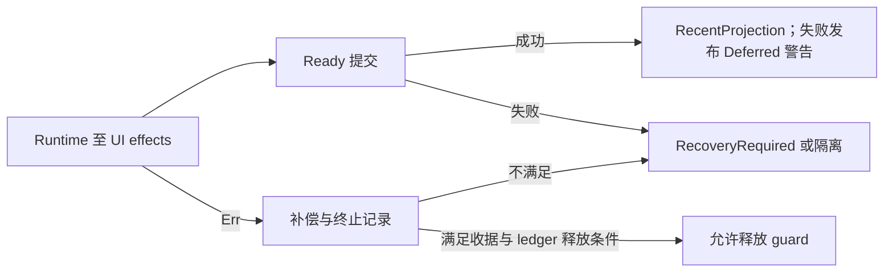

prepare/activate/commit 的错误进入统一补偿；只有 Runtime 终止收据、项目注册终止条件与 ledger 回滚/终止记录均满足，才返回 releasable，否则 quarantine。Ready 提交失败也要求恢复；RecentProjection 的失败按现有政策延后警告。这反证先前“Runtime 发布后 Documents/UI 失败无条件按未发布释放 guard”的条件 P1，未创建新问题。注册 terminal 只证明当前 manager snapshot 无 Project 条目，旧 Arc、native 卸载与执行中调用终止未由此证明。

ledger Store 先 clone、迁移、验证/编码，再调用 atomic_write，成功后交换内存；Err 不推进该 Store 内存，但磁盘结果仍依赖未读原子写内部。RecoveryRequired 不被批量 rollback 强行关闭，Ready 在重开检查中属于 Incomplete；仅 Closed 可清理。恢复释放先成功记录 RecoveryRequired，再取走 lease 字段并保留 session.lock；普通释放在 remove_lock 成功后标记 released。已有 slot guard、本次 guard 的存活与磁盘恢复记录是不同责任；SessionGuard 本文件无 Drop，ownership lease 的平台 Drop 仍未读。取消、panic、断电、native 卸载和故障恢复均待真实验收。

**统一问题队列。** WORLD001 继续保留静态 P2：实体 Vec 的 orphan 检查先收集 BTreeSet，只验证组件 key，不能拒绝重复实体；allocator 仅接收 next_id，后续 dense 重建仍可到达重复 ID assert，未跑损坏输入回归。WORLD002 的全文证据显示，World 发布后回放生命周期回调，目标替换错误可以发生在部分回调之后；调用者重试与收据契约继续开放。资源文档 receipt 不替代这个生命周期边界。ArtifactStore 先发布派生 chunk 再准备 manifest；RAM residency trim 不做磁盘 GC。staging 删除失败和未引用 chunk 合并为一个 P3 残件清理候选，未复现、未测空间、GC/caller owner 未核实；未知前缀 zasset 的 URI 可达性只作契约问题，未立案。

**M1 与保留。** 本轮只读观察为 E 盘剩余 28,037,959,680 B（约 26.1 GiB），低于 35 GiB 准入；Jenkins active.json 缺失，selected driver 仍为 selected-for-runtime-start、cargo/runtime acceptance=false，R13/R14 回应哈希未变且没有原 owner 新接纳。原 A1/R12/R13/R14 和 16 项身份字段未变，无新原生提交。S26 未修改 Rust/Cargo，构建、测试、产品和性能运行均为 0。新读者自有命令均已报告终止；历史 7 组未知保持原位，cleanup=false、释放 0 B。

## 27. 2026-10-15 续读：所选正文、World 收尾与历史覆盖更正

三名 Luna 并行补全选定文件，Sol 负责 WORLD002 根因与最小方案，另一 Luna 对方案作有限独立静态复核。M58 的所选已读版本为 **222 pin / 52,726 行 / 222 full、0 partial**；生产 203 / 48,352，测试 19 / 4,374。这是选定版本的正文覆盖，不是全引擎、模块或产品验收。

| 变化 | 正文计算 | 净变化 |
|---|---|---:|
| 5 个同版本部分叶补全文 | 484 → 3,155 | +2,671 |
| level_system 外部新版本重读 | 671 → 676；保留旧 leaf | +5 |
| 4 个新 pin | 47 + 18 + 39 + 147 | +251 |
| 2 个已全文 helper 重读 | 357，重复 | 0 |
| atomic_file 独立复核 | 777，重复；support 402 行仅取 metadata | 0 |

总量为 `49,799 + 2,671 + 5 + 251 = 52,726`。12 个输入行及对应正文/终止收据在 canonical `artifacts.json` 的 `s27_source_rows`、`s27_read_evidence`、`s27_core_reviews`；source leaf digest 为 `1e36c0a4523e3de556e351ed119fa730dd764b5edd0523c2ae0c6d5678914feb`。当前叶 mtime 为 141 存在、0 null、81 缺失；历史 cut 的 104 未知不回填。render facade 的读者报告 PRE/POST pin 一致及命令终止，但未能恢复这两次独立 chunk 编号，账本保留该收据缺口，不猜测编号。

M58 固定观察又发现 `zircon_editor/src/core/editing/engine/command.rs` 的已读 `659edd4fca0525d312279d5a82ba42ca50ff83f33828547a14cebb1227052e54` 已变为未读当前 `4b7a55ceefd3f2514e62d85c16066896950c01fc8ff964c90387651b0eaf1926`；保留所选旧版本并单列偏移。level_system 的 676 行新版本已补读，不能据“222 full”推导当前 checkout 覆盖完成。M0、当前源码闭合和模块验收仍为 false。

**WORLD002 的最低 owner 与修复准备。** World 发布事务内容后，生命周期执行以 `Arc::ptr_eq` 判定逻辑 owner；同 owner 下计划变化为 Schedule，owner 变化为 World。`DetachPreparationOwner::PartialEq` 不能代替该身份比较。当前 LevelSystem 的 `is_none()` 收尾 gate 同时跳过二者，故方案限于 `scene/level_system.rs`：只排除 `Some(LifecycleTargetChange::World)`；None/Schedule 对锁内实际当前 World 完成 reset、订阅重挂和 fact，保留原错误、旧回放取消及回调安装的新内容/计划。World 分支保留第三方新 owner；retired payload 仍在 World 锁外析构。

该方案在有限源码内未发现静态阻断，但尚未实现或运行。必须验证同 owner Schedule 的原错误和新计划保留、正确 epoch 单次 fact、订阅/reset、旧 generation 重试不重放，以及不同 owner World 不受原提交影响、锁外析构。直接调用搜索限于 runtime/src 与 editor/src，未找到 guarded 方法的直接生产调用；普通 restore 使用另一条无条件替换路径。因此本节未证明产品触发或 P1，不把方案复核计为修复验收。

**测试与 Play 的范围。** Gateway 的 16 个用例主要保护 fake ABI 转发与内存 binding，未证明真实 World replacement、异步 poll/cancel/close/Drop 或 origin 合同。共享 recorder 的 clear/call/assert 在并行 runner 下可能互相干扰，登记为 `S27-GATEWAY-TEST-RECORDER` 条件静态 P3；父模块和实际 runner 的隔离尚待核对，未复现。路径测试已读全文；忽略的微基准未运行，不构成性能证据，未来验证必须显式提供允许的物理输出根，避免测试 helper 的仓库内 target 回退。Play 的 link/controller 已读全文，但 backend retirement 失败后的可重试入口仍需 ownership helper 补证，只保留契约问题，不立确认 P2。render/mod.rs 是声明/reexport facade，不能据此证明实际帧开销或提交、失败与关闭行为。

**历史覆盖更正。** §25–26 中“原子写内部未读”只描述当次激活执行器审查没有展开该内部；canonical 账本此前已包含六个 atomic_file 文件在相同 SHA 下的全文证据（Root cell133、cell134 截断补段）。Root 本轮委派前漏查了这项覆盖，现明确更正，不重写历史正文，不把 777 行独立复读或取消的 support metadata 算作新增。atomic_write 的发布后 Err 是已见合同可能性，本身不构成新 P2；待补的是调用方恢复与磁盘/内存一致性，`S21-ATOMIC-RECOVERY-IDENTITY` 仍开放。未证明资产残件与它具有同一根因。

**M1 与保留。** 2026-10-15 21:18 UTC 的只读观察为 E 盘 30,025,502,720 B（约 28.0 GiB），仍低于 35 GiB；active.json 缺失。selected driver digest 已变为 `3d012e8c5f480778c58ca68c9d253e910f243cb29db6f21c3bf4bd899171a65a`，状态仍为 selected-for-runtime-start、cargo/runtime acceptance=false；R13/R14 回应哈希未变，不构成原 owner 新接纳。原 A1/R12/R13/R14 和 native16 冻结，无新原生提交。S27 Rust/Cargo 修改、构建、测试、产品和性能运行均为 0；新增已知读者命令报告终止，历史 7 组未知保留，cleanup=false、释放 0 B。最终有限归档复核另由 M59 收据记录，不能替代 M1 或动态验收。

## 28. S28：Play 退役恢复入口、命令报告消费与 Gateway 测试装配（2026-10-15）

本节记录当前指纹下的正文阅读与静态合同推导；不授予 M0、模块、native、产品或性能验收。§1–27 保留各自时点，尤其不能用旧版 command.rs 的 390 行覆盖当前 412 行，也不能用单个事件泵的条件分支推定没有生产恢复入口。

### 28.1 所选正文增量与复用边界

- 所选 Rust 正文从 S27 的 222 pins／52,726 行推进至 **227 pins／53,722 行**，其中全文 225、部分 2；生产 207／49,323（全文 206、部分 1），测试 20／4,399（全文 19、部分 1）。这是所选文件范围联合，不代表全引擎或模块完整阅读。
- 新增 Play ownership helper 230 行、runtime event consumer 215 行、runtime shutdown 470 行，共 915 行；后者由 Sol66 原读 376–465 的 90 行与 Luna 本次补读 380 行合成全文，同版本复读 90 行计新增 0。controller 同版本必要重复 323 行计新增 0。
- command.rs 当前指纹 `4b7a55ce…` 全文 412 行替换历史 `659edd4f…` 的 390 行，所选正文净增 22，旧 leaf 保留版本历史。新读 scope.rs 365–398（34 行）和 recovery.rs 1058–1082（25 行）均为部分覆盖；原授权上界超过 EOF 的行数不计。
- Gateway session/mod.rs 的 29 行为同版本必要重复；cases.rs 的 768 行沿用 S27 全文证据。zircon_editor/Cargo.toml 48–59 的 12 行单列为构建／测试配置证据，不加入所选 Rust 正文计数。查询与哈希不计正文。
- checkpoint 61 的实际哈希扫描发现 editing/context.rs 与 transaction/exclusive_transition.rs 两处外来新版本；所选 leaf 保留此前已读指纹，本轮未将新版本计为已读，也不改写它们。当前源码闭环保持 false。
- 精确 SHA、bytes、lines、mtime、范围与 reader 收据见 `E:/cargo-targets/zircon-local/reports/engine-audit-20261009-01a12097/artifacts.json#s28_read_evidence`、`#s28_source_rows`、`#s28_core_reviews`；旧 cut、未知 mtime、历史 reader 句柄缺口与版本均保留。

### 28.2 Play：恢复入口存在，失败后的继续推进仍待验证

`session_ownership::Terminal.backend` 持有 backend，只有成功 retirement 才清除；Gateway 尚未 detach 时不退役。事件泵在 detach 成功而 retirement 失败后，CleanupFailed 的 poll 返回 unchanged 且 gateway 已不 attached，使该泵本身不再满足重试门槛。这是该泵的局部静态性质。

`runtime_shutdown.rs` 提供 `shutdown_play_session_for_project_close`（267–283）和 `shutdown_runtime_session`（290–310）。418–455 的恢复阶段在 Gateway 已 detach 或未附着且存在 pending owner 时尝试退役，失败保留 owner 并返回 RetirementDeferred。两个入口本身均为单次尝试；因此“没有恢复入口”已被反证，外部调用频率、回执门控、真实 backend/App lease Drop 与失败触发仍未证明。合并沿用 S27 Play 合同问题，不新建已确认 P2，也不宣称永久阻塞或泄漏。

项目关闭 readiness（115–140）要求各阶段到达规定终态：event consumer 本地停止而远端 cleanup 失败仍可允许关闭，Play／plugin cleanup 失败则不满足。实际关闭方如何遵守回执尚未覆盖。验收需真实 backend 首次退役失败、后续成功时仍保留并最终释放 owner，Gateway 已脱离，plugin cleanup 独立完成后才允许下一次 Play；永久失败应保留必要 owner。

### 28.3 命令报告：嵌套恢复失败的字段合同

`interrupted_with_post_callback_error`（command.rs 117–141）可把 RollbackFailed 包进 LifecycleInterrupted；`is_interrupted` 对后者为 true，而 `bounded_failure_report_v1`（387–409）的 recovery_failed 仅检查顶层变体。在该组合下静态结果是 category=lifecycle、interrupted=true、recovery_failed=false。scope.rs 378–398 的 Drop 在 cancel 非 busy Err 时生成并保存摘要，再在 state lock 外释放原错误树；已读代码不按 recovery_failed 分支。recovery.rs 1068–1082 只证明现有 budget fixture 期望 RetainedFailureReport 的 recovery_failed=true，未证明 fixture 包含该嵌套形状。字段无语义注释，Sol67 因而将其保留为兼容性／观测性合同问号，不能替代真实恢复流程验证。

保留 `S28-COMMAND-RECOVERY-REPORT` 为条件静态合同问题，产品等级未定；不与 `ZCA-HST-001` 仅凭“报告”名称合并。完整 producer／journal consumer、恢复与 UI 行为、是否新回归仍待证据；没有写入修复或运行测试。

### 28.4 Gateway 测试装配与 M1 门槛

session/mod.rs 19–21 将 cases.rs 作为 cfg(test) 单元测试模块；Cargo.toml 56–59 的 integration_contracts 为另一个显式目标，不能替代单元测试的实际 runner 证据。有限范围内未见整段 clear/call/assert 的外层串行保护，Jenkins 实际线程参数未知；`S27-GATEWAY-TEST-RECORDER` 继续保持条件静态 P3，未复现并行失败，也不是已证实产品问题。

2026-10-15 22:26 UTC 只读观察：E 盘可用 23,093,141,504 B（约 21.5 GiB），低于构建／测试前 35 GiB 策略门槛；active.json 不存在，driver 为 selected-for-runtime-start，cargoAcceptance/runtimeAcceptance 均为 false，三个既有回执未变化。原 Jenkins owner 的 R14 交接仍保存在 .jenkins/records；没有新提交、原生运行、测试、产品运行或性能采样。没有源码副本、临时 helper 或生成夹具；释放 0 B，7 组历史未知 reader 归属继续保留，清理未关闭。后续先完成原 owner 回执核对及当前门槛，再做可归因的 native／产品验收。

## 29. S29：事务状态、项目关闭回执与跨版本阅读边界（2026-10-16 UTC）

本节仅归档所选指纹的源码阅读和条件静态结论；M0、模块、native、产品与性能验收均未完成。

- 所选 Rust 联合为 **230 pins／55,618 行**（全文 227、部分 3）；生产 210／51,219（全文 208、部分 2），测试 20／4,399（全文 19、部分 1）。三个新 pin 为 engine_state.rs 全文 629 行、project_close.rs 全文 608 行、core/editing/command.rs 的旧 53c199… 部分 631 行（1–540、1000–1090），新增 1,868 行。context.rs 448→459、exclusive_transition.rs 318→335 两次换版净增 28，所选正文合计净增 1,896；旧 leaf 与未知历史 mtime 保留，复读、定位和哈希不重复计数。
- core/editing/command.rs 第四块读取时已变为 a65635…；该块 PRE/POST 稳定但 expected mismatch／exit 1，已停止后续读取。其 541–720 的 180 行不纳入 canonical，也不与旧版拼接；旧版 541–999、1091–1127 仍未读。曾将 Delete apply/revert 的 541–639 行归到旧版的摘要已被 Root 排除。另有 World bootstrap、WorldTime controller 及其测试三个外来新版本仅完成元数据观察。四处已观测版本变化继续保持未读，不能称为当前源码闭环。
- CoreEditContext 分离 callback 结果与写后 Gateway 错误；exclusive transition 在 selection 恢复失败时设 faulted 并构造根 RollbackFailed。事务状态文件确认 context 在 callback 期间移出 state，状态锁不跨 callback；这些是局部所有权事实，不证明所有取消与 unwind 路径完备。
- 旧 53c199… 的生产 helper 在特定生命周期目标变化输入下可生成 LifecycleInterrupted(RollbackFailed)，无需附加 post-callback error；这补齐局部转换机制，仍未证明实际 cancel→Drop 可达链。take_drop_error 仅取走已存摘要；当前 src locator 未发现生产消费者，不能外推外部 API 无消费者。字段是否承诺涵盖后代恢复失败仍无合同证据，S28-COMMAND-RECOVERY-REPORT 不升级产品等级、不改摘要算法，也不与 ZCA-HST-001 合并；新 a65635… helper 尚未复核。
- 项目关闭入口在 Play receipt 未就绪时返回 PlayTeardown，早于 Play effect commit、begin_committing 与 manager project commit；Quiescing 分支允许再次取得同一 operation。再次进入仍要经过 AssetJobs／UI effect，已提交和已 prepare effect 的重复调用合同尚未读，因此只证明重入入口，不保证重试到达 Play 或成功。下一最低 owner 是 manager 的 prepare_project_close_effect／commit_project_close_effect 状态机，其后再核对 UI 重投和真实 backend 失败；无自动 loop 不构成卡死或已确认 P2。
- 新增 S29-TX-UNWIND 条件静态风险，owner 为 engine operation／context 持有与 retained-provider 合同：with_context／with_context_mut 在 callback 正常返回后才 finish_operation；retention measurement 临时取出 active，常规 Result Err 会归还，panic unwind 则可能跳过归还。Sol 独立确认局部无 restoration guard／catch；只有 unwind 后引擎仍存活、被复用且合同要求继续时，才形成产品恢复义务，abort 不涉及进程内恢复。实际 containment 与 panic 合同未读，未复现、不定产品等级、不写 patch，也不与 WORLD panic 或报告项按字面合并。

精确指纹、范围、reader／工具收据、缺失 chunk_id 和拒绝覆盖记录见 artifacts.json 的 s29_source_rows／s29_read_evidence／s29_core_reviews。源码与 Cargo 修改、编译、测试、产品运行和采样均为 0；静态归档不能替代实际验收。

02:32 UTC 观察：E 可用 12,091,957,248 B（约 11.3 GiB），低于构建／测试前 35 GiB；active.json 缺失，driver 与 R14 回执哈希未变，原 Jenkins owner 交接继续开放，native16 归属与参数不变。既有七组历史未知 reader 与本轮宿主重置失联调用分别保留，不推算进程总数；其中新的 Sol 复核旧调用句柄丢失，后续一次有界新读已成功，但不据此判旧 child 已退出。未删除未知／共享产物，释放 0 B，清理未关闭。

## 30. S30：Play 传播、实际调用方与关闭持久化合同

本节绑定 `s30_source_rows` 的实际已收正文与 PRE/POST 指纹。新增 19 pins／3,418 行（生产 17／3,169；测试 2／249），累计 249 pins／59,036 行：生产 227／54,388，测试 22／4,648；245 全文、4 部分。1,515 行复读不增加覆盖；历史未读新版本继续开放，当前源码闭包未完成。

- **Play / TX-UNWIND：** `queue.rs:313–354` 捕获 panic 后重排 intent 并 `resume_unwind`；`edit_protection.rs:126–135,194–234` 的 guard 清理自身 resolving／publishing 标记。局部清理未建立 editing engine 的展开后恢复合同。`retained_memory.rs:169–184` 及对应测试保护普通 `Err` 的 depth 恢复；engine 使用局部 meter，未建立 panic 后复用该 meter 的生产路径。S29-TX-UNWIND 保留条件静态风险，等级未定。
- **实际 apply 调用方：** `play_pending_decision/resolve.rs:91–111` 的闭包调用宿主 `invoke_operation(UiBinding, invocation)`，随后转换非空 recorded error；`controller.rs:407–412` 转发 budget／apply。engine 绑定与同实例续用仍归 `invoke_operation` 后续路由；最近待查 containment owner 是 `consume_resolved_receipts` callback wrapper（resolve:41–45）及 `runtime_event_consumers.rs:64` 泵。后者仅定位，未读正文。
- **关闭重复转换：** 同 root／operation 的有效 Closing guard、正常加载状态下，`store.rs:94–118` 对 Prepared／Committed 的重复 prepare、Committed 的重复 commit 返回 `Ok`。结合实际关闭调用链，可关闭 S29“已提交 effect 的重复转换本身是否拒绝重入”这一静态未知项。重入仍再次执行外部动作；AssetJobs／UI／Play 动作幂等、receipt 推进、自动重试与最终成功继续开放。
- **持久化及 UI：** store:213–228 先 clone／apply／encode／write，成功后替换内存 ledger；错误保留旧内存，磁盘原子性与崩溃恢复归未读 I/O owner。persistence:205–283 校验 root／operation／Closing，release 成功才取走 guard 槽。UI dispatch:22–25 每个 close intent 调用 request，Err 写状态栏；completion:14–38 清 prompt 后按 Project／MainWindow／FloatingWindow 分支处理，未建立自动重试保证。
- **独立复核：** Sol 实际复核 queue／测试 152 行及关闭合同 448 行，均为重复覆盖；关闭、TX 和 retained-memory 材料没有形成新增产品缺陷或 patch 依据。本节归档局部合同，M0 全引擎、模块、native、产品和性能验收保持开放。
- **M1 与保留：** 2026-10-16 05:27 UTC 的 E 盘余量 5,243,953,152 B（约 4.9 GiB），低于 35 GiB 门槛。新 driver pin `b2ba53d4…` 仍为 `selected-for-runtime-start`，runtime／Cargo acceptance=false；R14 仍是监控事实回执，原 owner 验收待回。无新请求、源码／Cargo 修改、构建、测试执行、产品或性能运行。实际释放 0 B；历史未知 7 组、S29 新未知 8 组、S30 启动失败 5 个请求分开保留，不合计为进程数，cleanup 未关闭。宿主读取已恢复不消除旧失败与未知生命周期。

## 31. S31 receipt 提交、事务实例与关闭重入（所选指纹静态证据）

本节由 3 个 gpt-6-luna/max/none 并行包与 gpt-6.1-sol/max 核心复核形成。新增 9 pins / 2,178 行：production 1,973、test 205；其中 5 full、4 partial。规范所选集合候选 union 为 258 pins / 61,214 行（production 235 / 56,361，test 23 / 4,853），250 full / 8 partial。新增正文分别为 editor_operation_dispatch 全 702、adapter 全 443、receipt_consumption 全 205、command_palette 全 282、operation_group 全 335，以及 deletion 105–117、relocation 66–78、workspace 457–609、hub_focus_binding 8–39 共 211 行；partial 不代表文件读完。原集合 digest 1897ed6e…，新增后 f8d121bc…；逐 pin/range 与收据见本任务 artifacts.json 的 s31_source_rows、s31_read_evidence、s31_core_reviews。此前四个已观察但未重读的源码版本保持开放，未把这些所选版本写成全 checkout 闭合。

已核对的产品调用边如下；route 的 Queued 分支提前返回，只有工厂的 ApplyNow 分支进入此事务调用：
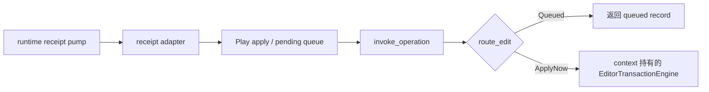

adapter 202–277 在整次 consume 期间持 receipt_gate，state 临时锁不跨 callback；每个 callback 成功后才缓存 outcome，整批完成后才登记 completed tickets、推进 cursor、清缓存。普通 Err 或 escaping unwind 均跳过当前项缓存与整批 cursor 提交，较早成功项的缓存保留；这不回滚 callback 的外部效果，也不证明产品 containment。selection 尾部只接受已知 ticket 的 Apply/Discard。测试源码覆盖成功只消费一次、普通失败后重试、post-effect reconcile 失败后重泵为 0 且 pending_count 为 1；未运行测试，不把该 fixture 外推为 panic 恢复。

controller.context 返回既有 context，transactions 返回 self.transactions.as_ref，handle 仅 Arc clone 同字段；因此关闭了 factory 派发是否使用 context 既有事务实例的类型/分配疑问。operation_group 的普通错误已有初始化取消、按 Busy/active scope 清理或保留、flush 恢复 Open 或清组分支。若下游向外 unwind，Initializing 与 Flushing 没有本文件的 phase restoration guard；reservation 是身份 token。将这两个条件分支附于 S29-TX-UNWIND，分别保留触发点和字段，不新增产品 bug/P2。下游 containment、panic 后同实例继续使用及恢复承诺仍未证实；本轮不据此实施修复或删代码。

关闭侧已证明一次完成触发的局部重入：workspace 496–508 取得模型导入结果且 close_requested 时调用 commit_project_close，错误写状态栏。deletion/relocation/model import 的等待型取消会取走 pending；无结果则标记 close_requested 并放回，重复调用可再次请求 jobs.cancel，其返回值被忽略。结果被取走后若 Play 仍非 ready，本窗口未证明后续自动重试或最终完成。活动场景重载取消不等待结果。palette 成功关闭后重复 close 短路为 Ok(false)，失败中途及 setter 合同未闭合；shutdown wrapper 只证明顺序聚合六个子 receipt，不证明各动作幂等或最终 ready。§30 的正常同 guard/store 关闭持久化合同继续有效。

M1 只读观察绑定 fd9213 / 2026-10-16T05:54:36.181048+00:00：E 空闲 6,741,159,936 B（约 6.3 GiB），低于 37,580,963,840 B；active.json 缺失，driver 为 selected-for-runtime-start 且 runtimeAcceptance/cargoAcceptance 均 false。R14 reply 仍为 monitor 事实回执，不能替代 owner acceptance；不重复提交 Cargo 请求。当前 callable 工具未暴露 RenderDoc/Tracy/Jenkins/thread，不据此否定已安装程序。原 A1、R12/R13/R14、M1/native、模块、产品和性能验收继续开放。

本轮 0 Rust/Cargo 修改、0 测试执行、0 native/product/performance 运行。Luna RD-6、RD-7 及 Root cell44 共 3 组 spawn_ready 失败均无 exit/session/PID；e944ea 仅证明失败写入后 M68/D67 未变，不证明旧调用生命周期。其余已列成功调用均终态；各历史未知归属分别保留，不合并为进程数。实际释放 0 B，无新增 helper/源码副本或自有临时文件，cleanup 保持 false。以上仅供静态归档审查，不宣告 M0、模块或动态验收通过。

## 32. S32：事务 operation、tick containment 与文本测试合同（2026-10-16）

本轮由三个 Luna / max / none 并行阅读，Sol / max 独立复核底层事务与实际 tick 边界；Root 只集成证据和计划。新增 6 个完整 pin、1 个同版本 coverage extension，并完整重读 1 个更新版本，canonical 净增正文 1,611 行（production 1,435、test 176），没有 Rust/Cargo/测试源码修改、编译或产品运行。累计 **264 pins / 62,825 body / 257 full + 7 partial**；production **240 / 57,796 / 235 full + 5 partial**，test **24 / 5,029 / 22 full + 2 partial**。完整 pin 只说明该版本文件已读完，不说明模块或当前源码闭包已验收。

| owner leaf（均在 zircon_editor/src） | 实收范围 | 本轮净增 |
|---|---|---:|
| core/editing/engine/transaction/lifecycle.rs | current 1–552；旧 1–551 证据保留 | 552 |
| core/editing/engine/transaction/operation_gate.rs | 1–93 | 93 |
| core/editing/engine/transaction/scope.rs | 1–398；同 pin 原 365–398 保留 | 364 |
| ui/retained/app/callback_wiring/host_shell/runtime.rs | 1–96 | 96 |
| ui/retained/app/callback_wiring/host_shell.rs | 1–26 | 26 |
| ui/retained/app/host_lifecycle/tick.rs | 1–304 | 304 |
| ui/retained/app/host_lifecycle/tests/tick.rs | 1–176 | 176 |

**S29-TX-UNWIND 细化。** `push` 预留 operation 后取出 active/context，再调用 command.apply；commit 的 after_apply 同样发生在显式归还前。`take_top_scope` 返回裸元组；已取出的目标令 scope Drop 的 has_active_scope 检查直接返回，gate 只在显式 clear 时通知等待者。本链已排除“另有底层守卫保证归还”的未知项。若回调向外 unwind 且同 engine 继续使用，可能遗留 operation 和空 context 槽；实际外层 catch、同实例复用、恢复或冻结政策仍未证明，维持条件风险、未定产品等级、未修复。正常 Result 的恢复与 Condvar 谓词路径没有新增丢唤醒证据。

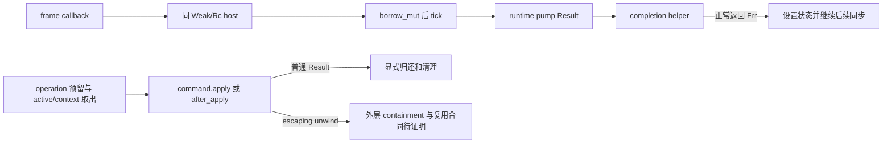

**普通错误与线程边界。** tick 的 plugin-watch 或 heartbeat deadline 错误可提前结束本次 tick；completion helper 正常返回 Err 时，tick 设置状态后继续后续同步。不能把所有 pump Err 都等同为 helper Err，也不能把 panic 当作 Result 错误。已读 wiring/tick 没有局部 catch；事件生产与外层 dispatcher、实际线程身份及持续 frame 触发仍开放。

**S32-TICK-TEXT-CONTRACT-DRIFT（静态测试合同，未执行）。** 六个 tick 测试均用同源 include_str、字符串查找或位置比较。两条旧连续表达式 `self.editor_manager.pump_runtime_task_diagnostics(0)`、`self.editor_manager.pump_project_recovery_decisions()` 在当前 production 全文各 0 次；生产已通过 enter().and_then manager closure 调用。三项测试若被选中，其 find().expect() 无法满足。locator 确认 production:302–304 有 cfg(test) 模块声明，未证明实际 build/cfg 选择或测试执行失败。覆盖缺口不构成产品 bug；实现遵守 MVP00 门槛。

**后续验收设计。** 用可控 jobs/manager/runtime 记录执行次数，注入普通错误并区分提前返回和继续分支；先确定 panic 政策，再检查注入 unwind 后 context/active/group/operation 与等待者符合恢复或冻结合同。人工 catch 不代替产品 containment。关闭回归继续要求同 operation、模型完成与非 ready Play receipt 的下一次真实触发和重复动作合同。

**M1 与保留。** 07:18:34Z 的只读观察为 E 盘 396,156,928 B，低于 37,580,963,840 B 原生编译门槛；driver 为 selected-for-runtime-start，runtime/Cargo acceptance 均 false。Jenkins 新指引允许普通本地请求自动登记；不再要求用户补手工 identity 文件。Root 在 .jenkins/records 留下原请求续接消息，未发新 Cargo 请求，实际 driver/capsule 与当前输入接纳仍待 owner 回执。保留原 A1、R12/R13/R14、八项回归、四个历史观察未读版本及所有 unknown lifecycle；本轮释放 0 B，cleanup 未关闭。M0 全引擎、模块、native、产品和性能验收均 false。

**独立复核期间的版本续接。** lifecycle 的 foreign 当前版本从 2e4eab…/551L 变为 2c91fd…/552L；Luna 与 Sol 各完整读取新版本 552 行，未拼接旧内容，也未覆盖该修改。新版本仍返回裸 context/active tuple、依靠显式清理；当前 after_apply 位于 228 行，take_top_scope 为 487–497。此前旧 pin 仅作为历史证据；version refresh 的 canonical 净增为 1 行，实际完整复读分别为 552 行，不能混计。

**当前 M1 续接。** 08:16:10Z E free 为 120,166,014,976 B，磁盘门槛已通过。08:29:23Z 已独立核对 selected capsule 的 195 个文件（3,026,399 B）、manifest digest 与无多余文件；这是静态完整性，未证明 runtime liveness，driver 的 runtime/Cargo acceptance 仍 false。原 public-entry lifecycle 匹配为 0；未捏造 attempt 或重复提交原请求。原 job31 地址的只读查询连接失败，未获得新的正式回执；继续等待 records 中的 owner 续接结果。所有原生、产品及性能验收保持开放。

## 33. S33：World/time 与 command 当前版本复审、原 A1 查询身份（2026-10-16）

本节记录当前版本的只读结论。没有修改 Rust/Cargo、执行构建或测试，也没有作出模块、M0/M1、产品或性能验收。

### 33.1 当前版本与阅读范围

| owner 文件 | current SHA-256 | bytes / lines / mtime_ns | 实际完整阅读 |
|---|---|---|---|
| `scene/world/bootstrap.rs` | `2f5f9ccc0a043069021fdc2849aea614dff10b6b5cee5a115eaab077c7045d03` | 8671 / 216 / 1792104867831328100 | 1–216 |
| `scene/world_time/controller.rs` | `22642660fd271d0ae9b3bcff7b2d95723d0bec31e59d01875967211dd673e946` | 20909 / 482 / 1792119566960001300 | 1–482 |
| `scene/world_time/tests/controller.rs` | `2d62ed28d48d670da992fab0ae614afc5618335b196f8d9466ba9b6528d06e13` | 11378 / 307 / 1792119566961508800 | 1–307 |
| `core/editing/command.rs` | `37369ca3b70e11d55f26a49d813f3878f185807efa333dfa6853f252fba41371` | 43530 / 1193 / 1792138274982639900 | 1–1193 |

三个 Luna 使用 gpt-6-luna/max/fork-none 并行完成 A1 证据、World/time、command 任务；Sol 使用 gpt-6.1-sol/max 独立重读 command1193 与 controller482。主阅读 raw2198 行；Sol1675 与 Root572 行均属重复合同阅读。四个历史 row 原样保留，当前版本不拼接历史正文；canonical 净增620＝生产583＋测试37，并非源码差异行数。覆盖为264 pins/63445行/258 full/6 partial（生产240/58379/236 full/4 partial；测试24/5066/22 full/2 partial），仍不代表全引擎当前版本闭合。

### 33.2 当前合同与问题队列

- `S21-WTIME-ENDPOINT`：当前实现保存实际 previous_committed_fixed_elapsed，旧的饱和 elapsed 减 timestep 根因已移除。当前测试193–228包含两次 Duration::MAX 提交与重置断言，未执行；更新为“当前实现静态可见、动态验收开放”，保留旧证据，不记 Root 修复或已验收。
- `S21-WTIME-STEP-BUDGET`：暂停且已预约单步会采用 plan_steps(1)，208–209仍保留优先级 TODO；调试单步与外帧硬预算的合同尚未决定。需要预算0/1、预约消费、错误外帧保持、abort重试的行为回归，不能直接定性为预算违规。
- 当前 create 成功后 gateway 报错时先保留 record；delete 的普通 Err 分支保留或回填 batch。provider breach 未保存 create record、多字段 replay 的后续失败和 escaping unwind 仍各依赖真实 producer、Scene 原子性、poison/复用与 panic 合同，均未确认为新增产品缺陷。
- `S33-COMMAND-POST-ERROR`：1114/1124 的普通主 Err 分支丢弃 post_callback_errors，context157–188可表达主结果与后错误。已读 InProcess91–95在 guard 成功后调用 Level，再正常返回 Ok；默认 trait231–233在回调前拒绝，因此尚无合规后错误的实际产品 producer。重复回调、自定义 gateway 与必须保留的 lifecycle/诊断后果继续开放；它与 S28/S29 错误树根匹配及 summary 语义保持独立根因关联，无 P2 或补丁。
- InProcess 借用 guard 的 Drop 只恢复线程借用标志，不捕获 unwind，也不恢复 transaction 的 active/context/operation；`S29-TX-UNWIND` 仍需真实 outer containment、同 engine 存活复用与恢复/冻结政策。bootstrap 复合创建失败、typed registry、Scene 多字段写入和 Level 回调次数只留下明确 owner 范围，未扩大为已复现问题。

### 33.3 原 A1 与验证边界

r8 route 实证为 `E:/cargo-targets/zircon-local/reports/jenkins-records-monitor-20261012/heartbeat-20261015T010050-engine-r8-a1.route-read-only.json`（SHA256 `72b4318448b59a55bf6231268f9478eb2bb575b6dfc8d7445539cf782a1772f6`，27678B/1L/mtime1792026972572715900）。两个完整 originalInput 保存原 session/repository/driver/runtime/inputDigest；buildRoot 配置为 E:/cargo-targets，没有真实 attempt 输出子目录、attemptId 或 patchRequestRef。

历史两次 query-only 均因 Original request differs from installed driverDigest 被拒绝；该拒绝与原 native delivery/terminal/EOF 未知分开保留。12个管理候选中4个只是 requirementText/pending，另8个属于 startup ef231c56b41b4e9bb90d4e7033b1e67a；unknown-stop 87148aa9f78c4aa7a5190bba71258439 不能转记为原 A1。限定采样中 marker/lifecycle 缺失不证明连续缺失、从未执行或已终止。

原 query 的真实 identity 仍不足；入口会写 request-query.json 或 patch-query.json 及同目录 pending 临时文件，本轮未执行 query、补造默认 attempt、替换请求、编译或清理。原 owner 仍需 append-only 跨 runtime 映射、真实 attempt/ref/receipt 与必要 PID/exit/stdout-stderr EOF/join/checkpoint/cleanup 归属，再封存当前源码及 toolchain/config/lock/features/gitlinks 输入、协调停写窗口并验原请求范围。

已按用户约定在 `.jenkins/records/engine-audit-20261009-01a12097-s33-original-a1-query-identity-gap-to-jenkins-01a0f6e1.md` 留下具体身份缺口与证据。E盘35GiB门槛在本轮写前实测通过；管理 capsule/runtime 的变化不构成原 A1 续接或原生验收。冻结16项原生字段保持不变，R12/R13/R14、MVP00、M1、产品和性能验收继续开放。

本轮 Root 实际释放0B；保留原证据、复用目录和所有未知归属。Root cell88 的 spawn_ready 未明生命周期、一次 metadata checker KeyError 和已恢复的子代理 locator/截断输出分列保留；后续成功阅读不替代未知进程终态。

## 34. 资产适配层、恢复测试与当前版本差异（S34）

三名 gpt-6-luna/max 分读 recovery、pending edit cases、workspace，Root读三个小适配文件；gpt-6.1-sol/max独立读四个生产适配文件，Root串行集成。六个已有pin从partial补为full，不增加文件pin。

| 当前正文 | raw行 | 先前已读行 | canonical净增 |
|---|---:|---:|---:|
| transaction_engine/recovery.rs | 1165 | 25（旧版） | 1140 |
| pending_edits/tests/cases.rs | 888 | 190 | 698 |
| assets/workspace.rs | 616 | 153（旧版） | 463 |
| deletion.rs、relocation.rs、hub_focus_binding.rs | 234 | 58 | 176 |

primary raw2903＝production850＋test2053，净增2477＝production639＋test1838。canonical为264 pin/65922行（production240/59018、test24/6904），各登记版本均full；这不是全引擎当前版本已读完。两份新版完整替换旧partial，其余四份补同版范围，旧记录保留。Sol850行及Level真实producer172行均重复，增量0。

- 三种资产cancel先请求job cancel，ticket结果未可取时保留pending并标close_requested；poll只在结果可取后请求一次project close。撤回“发出cancel就立即关闭”的推断；ticket可取不证明worker/native终态或close非ready后自动重试。reload cancel丢pending并清admission/conflict，合同不同，不能机械抽共享关闭实现。
- workspace请求/完成处核对generation和scene identity，Deferred保留prepared seed；最终revision/dirty原子验证依赖Runtime提交owner。admission前三次64/128/256ms重试，第四次无deadline且同identity/generation继续合并；耗尽后的主动重试合同待caller确认，未升P2。
- import receipt之后仍可能在projection、ready handle或scene placement失败；失败通知不证明资产回滚。sync_asset_workspace忽略refresh错误后继续投影是另一静态策略；未证明需要统一，也无实测列表/每帧热点。focus wrapper只闭合manager identity取得与转发，未证明下游无I/O成本。
- recovery的GatewayApplied是本地i32/ExternalEffect fixture；pending cases声明26测试、1个ignored向量基准。失败恢复、fault gate、payload留存、resolve/publish fence是测试设计证据；测试未跑，未证明真实gateway、关闭/卸载/transport、panic包含或poison恢复。计费断言仅>=8192下界，不能称精确计费。
- Level518–520实际接收FnOnce、lock后直接唯一write并返回R，当前InProcess正常路径返回Ok；本次排除这条正常路径的重复回调及回调后另造dispatch Err。S33-COMMAND-POST-ERROR收窄至未证custom gateway；lock_world/panic/outer catch与same-engine复用仍开放，无已复现P2或补丁。

264登记路径独立metadata窗口确认240同版/24 drift，missing、unstable、unreadable均0；本轮全读替换recovery/workspace后仍有22个新版未读。78条历史记录无mtime，不能补造；可比的同内容164条mtime未变，76条不可比。reader首次错误拒绝字符串mtime的分类已撤回更正，过程保留。metadata不计正文覆盖，不是immutable compiler seal。

本地readiness84行与monitor245行已完整读取：回复报告ordinary automatic intake及当前records binding ready，无需人工会话grant；回复不创建本任务intake receipt。原A1 attempt/ref、native PID/birth及terminal/EOF、append-only跨runtime映射仍缺；无猜attempt、重绑旧输入、query或新提交。PATH定位到WPR/WPA不等于采样能力；当前无可调用Tracy/RenderDoc工具，历史MCP观察不作当前验收。

S34源码/测试零写入、零执行；文档和metadata落盘后的独立归档待复核。MVP00/M1、R12/R13/R14、模块/产品/性能开放；Root释放0B，未知进程、历史回执及共享产物保留。

## 35. 当前22版本与发布、恢复边界（S35）

三名gpt-6-luna/max并行分读Runtime/records、Editor会话、资源事务，Root读启动、文档加载、AssetManager接口、独占转换与保存；gpt-6.1-sol/max独立复核902行，均为重复正文。Root额外读Level锁入口29行也仅计重复。S34的有限静态归档已独立复核，原验收范围未扩张。

| 分组 | 新版数 | current raw行 | 版本行数净差 |
|---|---:|---:|---:|
| Runtime、render门面、records | 5 | 1932 | 89 |
| Editor项目会话与服务 | 5 | 2607 | 211 |
| ArtifactStore、resource事务 | 6 | 2193 | 61 |
| Root启动、加载、接口与保存 | 6 | 758 | 54 |

22新版全量替换旧登记版本，不跨版本拼接；raw7490＝production6958＋test532，版本行数净差415＝production329＋test86，不是源码diff行数。canonical264/66337行（production240/59347、test24/6990），各登记版本full。旧版本行、指纹和未知生命周期保留。

- Runtime标准构造使用默认系统采样源，注入时钟共享inner；倒退样本保留有效基线、rebase由下一tick消费。实际CoreHandle时间提交、World plan/commit仍需owner证据。render/mod只证明导出门面，不证明submit、关闭或热点。
- records已有duplicate/stale-registry预校验和首末callback替换World/Schedule的回归设计；撤回“没有typed record拒绝或target-change设计”的泛化。测试未跑；旧dense duplicate component恢复producer和postcommit Err重试调用方仍待核验，不据测试继承当前P2。
- 项目激活按claim、重验、runtime/UI effect、ledger/Ready推进；发布恢复分支保留guard。关闭的主审完整读到前后root核对；Sol只独立读调用窗口，不以helper名替代定义。RecoveryTakeover早退release Err、第二plugin repair准入、scene open/create与finish两锁窗口均保留实际owner/外层串行合同依赖，未升P2。
- durable receipt会推进source baseline，包含持久化后projection失败；只有Persisted发Saved，UI在ensure_durable后经history token gate标clean。投影、recovery、checkpoint错误保留receipt，不能统称磁盘回滚。底层durability与保存重开尚未验收。
- ExclusiveTransition普通prepare Err归还context，decision/route/prepare先于flush；Drop确实先清operation gate再发布event，但不恢复已take的context或跳过的Flushing。escaping unwind仍归S29-TX-UNWIND条件链，RollbackFailed错误树不构造LifecycleInterrupted复现。Level锁入口只委托lock_poison_recovered；helper、outer catch与同engine恢复仍未闭合。
- resource事务先拒绝pending recovery，不能把注释当自动recover。逐文件发布＋逆序恢复不等于多文件瞬时可见；CommitRecoveryDeferred与持久提交后的CleanupDeferred保留不同恢复证据。ExpectedMissing使用create-only；外部writer CAS、reader admission、底层replace后sync语义仍待核对。
- ArtifactStore先chunk后manifest，复用chunk校验size/hash，读端请求bounded decode及verify_complete；best-effort清理可能留孤立chunk/staging，不等于manifest已坏。压缩、backup与重复digest扫描有一致性用途，缺产品频率与计时，不是已测瓶颈。

2026-10-16 12:17:22 UTC的264路径metadata窗口全部匹配；12:23:10 UTC登记时为263匹配/1 drift（dynamic_api/session/state.rs当前809行未读），22个已刷新版本仍匹配，各窗口unstable0。metadata不计正文，不是immutable compiler seal。76条未更新历史row仍无mtime；两条新版获得本次pin的mtime，旧78条缺值记录原样保留。各登记版本full不等于全引擎当前源码已读完。

Jenkins最新本地回复metadata未变，继续复用已读readiness/monitor；ordinary intake ready不替代原A1 attempt/ref、native PID/birth、exit/EOF及append-only跨runtime映射。没有query、重放或新native提交。当前HEAD/dirty观察另记，未改历史native sourceHead。

本轮Rust/测试零写入、构建/测试/性能采样零执行，无新修复或性能收益结论。本文档delta待独立归档复核；MVP00/M1、R12/R13/R14、模块/产品/性能开放。Root释放0B，未知进程、历史回执与共享产物保留。

### 36. S36：租约、资源分块与两个会话版本

本轮三位Luna/max并行主读并由Sol/max独立裁决。9个新生产叶子全读1367行（SessionGuard支持722、ChunkReader/residency645），state新版809与project-session新版927全读；primary raw3103，版本行数净差70，canonical净增1437。登记273 unique/full、67774正文行（production249/60784，test24/6990）。70与1437均不是源码diff行数。

SessionGuard的持久记录和OS租约是两种状态。claim先取租约；竞争返回Active，可读残留返回持租约Residual，缺记录才Acquired；不可读/非法记录报错。take_over移交同一个租约。

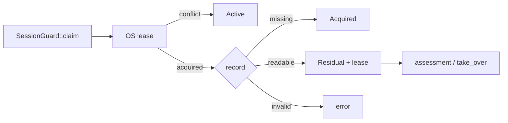

普通release错误发生时ownership尚在guard中；字段Drop在Windows CloseHandle、Unix解锁并关闭File。新版project-session409–425的RecoveryTakeover+Acquired分支release Err未保留guard，但507处activation effects尚未执行；715–732及file-recovery保留路径不同。Sol独立1105行确认它是条件性重试/准入差异，不能称永久租约泄漏或已证P2。assessment及quarantined disposition契约仍待追。

SessionGuard mutation把发表后目录同步不确定编码为Ok durability。ResourceIo atomic helper的Err则可能在发表后产生，observed wrapper保留MayHavePublished/rollback_required；两者不可合并解释。Unix目录sync与Windows WRITE_THROUGH/目标sync路径不同，未作断电或文件系统动态验收。

六个atomic文件1179行与guard280行早已在canonical且同pin，纠正S35下一组未读措辞。C本次独立复读5文件1107行，pathing72仅metadata；Root准备期guard280与store调用80行、Sol1105全部duplicate，不增加canonical。

ChunkReader按chunk长度/哈希读取，最终检查整个压缩内容；store在输出ImportedAsset前调用verify_complete，并核对raw大小与kind。缓存I/O在state锁外，resident预算、有限lazy eviction index和weak外部lease tracker均存在；溢出计数意味着payload诊断下界，不是RSS。同步I/O、重复并发miss和索引重建仅为成本位置，尚无实测热点或收益。

state809的shutdown共用deadline并保留部分重试状态，host输出有prepare/commit/rollback；tick_time后的失败与实际卸载/提交/消费者仍需最低owner证据，不能由本层全读验收Core/World时间权威或render backend。

A在13:19:35 UTC观察旧264为250匹配/14 drift，余6详情在13:22:00 UTC另取稳定metadata；76/45新版本全读准入后，同一旧窗口仅算术剩12，绝非重采。Root登记窗口2026-10-16T13:35:24.105880+00:00至2026-10-16T13:35:24.821404+00:00实际273路径为261匹配/12 drift/0 unstable；未读当前版本清单保留。76条历史缺mtime不补造，metadata计正文0，不是compiler seal。

Sol旧870版读取be14b3/session96921→adae98 exit1在PRE拒绝，BODY0；新版成功不抹除旧失败。Root48c913输出缺口与所有旧unknown保留。本轮Rust/测试零写入、build/test/native/query/性能采样零执行，无补丁或性能收益结论。

S35有限静态归档已通过；S36文档delta待独立归档复核。原A1 attempt/native终态与当前compiler输入封存、MVP00/M1、R12/R13/R14、模块/产品/性能仍开放。Jenkins ordinary intake ready不是原A1验收；本地增量消息按既有身份追加，不重放请求。Root释放0B，共享/未知产物保留，生命周期未关闭。

## 37. S37：当前版本、恢复评估与 WGPU 捕获续读

- 本节为有限静态阅读归档；未运行编译、测试、产品回归或性能采样，未修改生产源码。
- 完整重读 12 个变化版本共 4726 行；对应旧版本 4545 行，版本行数净增 181（生产 127／测试 54），不是源码 diff。
- 新增 8 个完整文件／1568 行（生产 6／1232，测试 2／336）；主阅读实收 6294 行。另有 Root 重复 100 行、Sol 独立重复 729 行，均不增加覆盖。
- 规范覆盖为 281 个完整文件／69523 行、部分文件 0；生产 255／62143，测试 26／7380。保留 76 个历史行缺失的 mtime，不补造历史指纹。
- 恢复 12 个 prior_rows 并移除 8 个新行可还原 S36 的 273／67774；新旧版本的阅读范围不合并。
- 元数据复核窗口 2026-10-16T15:19:02.229496+00:00 至 2026-10-16T15:19:12.015221+00:00：选中 281 项，匹配 280、漂移 1；该观察不构成编译输入封闭或全引擎阅读完成。
- 恢复路径：project_recovery_assessment → project_session 入场 → SessionGuard／activation effects。Missing、Incomplete、RecoveryRequired 要求人工对账，只有 Terminal 可接管；入场在持有租约后重查并匹配残留身份。
- Sol 独立复核确认：早期 ordinary release Err 阻止激活；局部 guard Drop 释放 OS 租约，不能据此判定永久泄漏。PublishedWithDurabilityUncertainty 属于 Ok 分支，与释放错误分开。
- 激活失败与隔离 guard 的保留分支已读；外层 close／commit 收敛调用方尚未读完。故障注入回归仅设计，未运行，不承诺自动重试或已验证持久化恢复。
- owner 更正：editor_document_transaction 是 Scene／workspace 磁盘发布 owner；该文件没有 prepared World／config fence 的组合调用。上层组合提交及磁盘 substrate 仍分别开放。
- World 记录 producer、registry generation 的实际消费者及 project 持久化校验边界仍需沿调用链核实；本轮未确认新的 P2，不据静态条件风险直接修复。
- config fence 的 cancel 仅置位并更新诊断，不等待已入场同步闭包结束；忽略测试中的 HashMap 模型并未调用生产实现，不能充当生产性能收益。
- retained_memory 测试覆盖容量与深度等边界，未提供 generation／project switch fixture；相关测试未运行。
- 实际捕获路径为 RenderFramework → WgpuRenderFramework → GraphicsRuntime。WGPU 覆写已读；不能把 trait 默认 no-op 当作产品行为。
- 同步 capture_frame 在 generation 检查前可能等待 readback；poll 路径通过 try_lock 与 generation 检查选择已完成结果。这是静态成本位置，尚无耗时或产品热点证据。
- request_graphics_debugger_capture 校验 viewport 后调用 graphics_debugger.request_capture 并返回 Ok；返回值不证明 debugger 可用、begin／end 成功或捕获文件完成。status／debugger 内部实现、Renderer 配对与动态输出仍开放。
- 本地 S36 消息已被监控会话读取，证据为 engine-audit-20261009-01a12097-s36.monitor-140323.reply.json（SHA-256 6b96b6441261c76d37c1d82b9cf22c91991e03c38d195fe069197b6a416f7e2a）。原 Jenkins owner 收到与否尚无证明。
- 回执仍明确 original A1 attempt／PID birth／exit／stdout-stderr EOF／checkpoint 映射未对齐；新提交 0、旧输入重绑 0、原请求重放 0。回执中的 273／261／12 属于发送方 S36 历史窗口。
- 三方归档复核单独登记；本节不代表 M0 全引擎、M1/native、模块、产品或性能验收。Tracy／RenderDoc 可调用连接、GPU timestamp 与 WPR 的实际采样能力仍待验证。
- 本轮释放 0 B；保留共享、未知归属及必要失败证据，产物生命周期未关闭。

## 38. S38：World 发布语义、Editor 关闭收尾与捕获状态边界

本轮完成三路 Luna/max 并行续读及 Sol/max 的 M1 入口复核。新增14个全文文件/709行，并全文刷新 dynamic_api/session/state.rs 当前809行（版本行数净差0）；当前所选版本累计295全文/70232行、partial0，其中生产268/62789、测试27/7443。主读实际2804行＝新709＋刷新809＋同版本重复1286；这些数字均不是代码diff或模块验收。当前元数据观察：291/295匹配，4项漂移，窗口 2026-10-16T16:41:56.275142+00:00–2026-10-16T16:41:56.608965+00:00；原有76行缺mtime记录保持缺失，未补造历史事实。

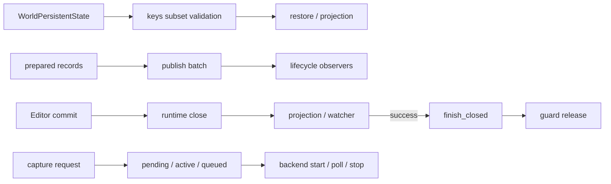

图仅覆盖本轮已读局部；实际UI调用方、恢复重入及捕获submit/Drop配对仍开放。World的kinds同数异键假设由subset invariant排除，只撤回该假设，EA46-WORLD-001原范围保留；bulk发布后LifecycleTargetReplaced Err归入现有EA46-WORLD-002，需查实际消费者是否误作未发布并重试。Name缺失的合法World可达性尚未证实，不能据filter_map直接判资源丢失。

Editor协调器保存phase及root/operation配对，receipt不拥有guard。runtime关闭后的watcher错误进入恢复；finalize先finish_closed再release，只有release成功才take slot，随后忽略cleanup结果。普通release Err保留slot；既有uncertainty Ok不能提供额外crash-durable证明。尚未定位真正UI生产调用方或quarantine外层消费者，不据此判deadcode或cancel-as-join。

捕获请求为pending/queued两个latest-wins槽；query返回本地状态，available常量与last_capture_frame均不证明连接或文件完成。backend poll错误会在stop调用前返回，runtime随后可能清active，保留未分级条件候选S38-CAPTURE-PAIRING；实际submit/Drop配对及后果待核实。63行纯状态测试只读未运行，等待也尚无实测热点证据。

M1最低阻塞已定位到Jenkins原身份观察合同：entry先以当前driver/runtime校验旧A1，再查询原marker；deployed runner也有同类限制。当前不存在已证可用的跨driver原A1公开对账入口。已准备具体[本地owner交接](../../../.jenkins/records/engine-audit-20261009-01a12097-s38-original-a1-observer-contract-to-jenkins-01a0f6e1.md)，要求分离观察与执行校验，恢复完整原payload和全部attempt/native/EOF证据；文件发布与owner ACK分别记录。当前marker缺失和新M1结果均不能关闭旧unknown。

本轮未修改引擎源码，构建、测试、native请求、捕获和清理均0，释放0B；历史失败、unknown及共享产物保留。S38仅作有限静态审查归档，原A1、R12/R13/R14、M0全引擎、M1、模块、产品和性能验收继续开放。范围、指纹、回执、截断补读和未读owner记录于同任务artifacts.json的s38_*字段。

## 39. S39：Scene 共享执行器、实际 UI 关闭消费者与捕获提交配对

三路 Luna/max 并行续读及 Sol/max 核心复核已完成。新增7个全文文件/2750行，刷新4个既有Scene文件：旧512行替换为所选版本576行，版本行数净差64，不是源码diff。累计所选302全文/73046行、partial0，其中生产275/65603、测试27/7443；有效主读3584＝新2750＋刷新576＋同版本重复258。另有571行历史可见partial因截断或中止不计selected覆盖，实际可见正文合计4155行；未跨版本拼接。两个原缺mtime的leaf经本轮全文阅读取得当前值，历史缺失行保留，尚有74个旧row缺mtime。

SceneModule以CoreWeak创建WorldDriver和DefaultLevelManager；with_core共享Core worker pool，默认构造无pool时artifact I/O明确RuntimeUnavailable。prepare的admission guard在返回PreparedLevel前结束；publish/closing及I/O排空须继续由实际lifecycle/IO owner证明，描述符本身不构成生命周期验收。

已从正文确认RetainedApp.commit_project_close→manager.begin→coordinator.begin_committing→manager.commit→manager.finalize→finish_closed。commit/finalize错误立即经project_close_failure返回；不能据UI错误宣称runtime回滚。recovery host委托controller的begin/pump/is_active，未解决恢复决策或运行中任务拒绝close；completion保留、settle、通知失败后重入与join仍由未读controller负责。

三个submit入口的begin后普通Result错误与成功路径均显式finish；construct的available仅由backend_name和环境帧数初始化。Root全文核对WgpuRenderFramework：dispatcher持submission_scheduler锁再委托submit；Core的operation_lock是另一把锁。实际scheduler executor、camera-loop锁覆盖和Drop仍待阅读。backend wait Err先于stop返回的后果未实证，S38-CAPTURE-PAIRING保持未分级条件候选；没有新增已证P2或实测性能收益。

Jenkins工作区已出现historical_query先于input_payload的只读修复，Sol确认其按旧身份读取原journal，未走投递路径；这项foreign源码变化未归属于本任务。所观察安装capsule仍pin旧entry，六client一致性校验在query之前拒绝；应正常部署后检查全部client pin，再单次capability和原身份query-only。两份候选从已pin的S38 monitor reply原样生成，均缺最终expectedSourceDigest，不能称authoritative原payload。原A1的queue/attempt/PID+birth/exit/双EOF/checkpoint及目标owner ACK未证，monitor回读不替代它们。见[本地部署与查询交接](../../../.jenkins/records/engine-audit-20261009-01a12097-s39-observer-deployment-preflight-to-jenkins-01a0f6e1.md)。

范围、源码指纹、回执及失败保存在同任务reports的s39-source-review.json与s39-m1-query-readiness.json，artifacts.json登记实际归属。引擎源码修改、构建、执行测试、native请求与捕获均0；清理释放0B，保留其他任务、共享与未知产物。原A1、R12/R13/R14、M0全引擎、M1、模块、产品和性能验收继续开放。

## 40. S40：场景 I/O 关闭、恢复服务与实际渲染队列

三路 Luna/max 并行审查、Sol/max 核心续读和 Root 消费者复核完成。新增14个生产全文文件/3052行；累计所选316全文/76098行、partial0，生产289/68655、测试27/7443。主读实际可见3454行，其中新覆盖3052、同版本重复399、Root区间重叠3；额外消费者复核重复225行，全部实际可见3679。未刷新旧版本，74个历史缺mtime的row不回填，定位命中不计全文覆盖。

SceneArtifactIo复用Core pool。Core shutdown guard的Drop会等待；关闭时未pin的排队任务按契约取消，因此撤回“不等待/泄漏”假设。新lane无既有fence且1运行+7个不同key排队全部保留charge时，8×64MiB占满512MiB；fence另需依赖费用，在pin前可被预算拒绝。S40-SCENE-FENCE-BUDGET仅为未分级静态风险：真实保存消费者的准入承诺、关闭义务和取消反馈待验证，尚未证明保存数据丢失。

恢复决策实际owner为ProjectRecoveryDecisionService与Host，§39的controller用语在此更正，没有独立Controller类型存在的证据。operation gate串行begin/pump/is_active；失败文档保留并阻止关闭，Completed仅表示决策完成。通知失败、重入及实际RestoreExecutor仍需产品验证。

实际render worker串行执行，Core operation guard覆盖camera loop和回调；异步返回started不表示完成。framework设置器先持scheduler再取得operation，原锁顺序环假设撤回。worker panic恢复契约与backend wait错误可达性未证，S38-CAPTURE-PAIRING继续未分级。

Jenkins正常部署已恢复，所观察capsule的六client源全部匹配。监控按原身份查询两个A1，客户端exit2且双EOF，均返回original_operation_missing/pending；原A1的native退出、双EOF及完整原payload仍未知，monitorSession不是目标owner ACK。当前源码新M1首批仅编译zircon_app --lib测试产物；受管pool/cache/资源隔离和当前source/deps/MSVC封印证明后才可准入，不能仅改requestedTargetDir。具体请求见本地records的S40交接。

本轮证据登记在s40-source-review.json、s40-core-io-contract.json及artifacts.json；已有21项问题保留原范围。引擎源码修改、Root构建、测试执行、native请求、捕获与清理均0，释放0B；共享、未知及历史失败产物保留。静态归档不关闭原A1、M0/M1、模块、产品或性能验收。

## 41. S41：保存与关闭契约、工具状态和 M1 准入缺项

三路 Luna/max 与 Sol/max 核心判断完成。新增12个所选文件（8全文、4部分）/1004行，default_level_manager当前版本90→91行增加净1行；累计所选328文件（324全文、4部分）/77103行。生产296文件/69177行，测试32文件/7926行。实际正文2919行=新增1004+刷新91+同版重复1824；定位片段不计覆盖，旧74项缺mtime记录不回填。

Scene的Ok(ticket)仅表示接受提交；序列化、路径解析和atomic_write在异步闭包内，异步失败由ticket保留。PreparedLevel的publication/rollback drain不等于保存队列drain，所读关闭接口未建立保存完成承诺。Core正常关闭允许未pin排队任务返回Shutdown；ObserverTimedOut只停止观察，guard Drop仍等待所有运行、观察、pump及worker义务。维持现有fence费用、512MiB预算和取消策略。

Editor当前保存链为Manager→workspace→DocumentLifecycleAuthority→Host→EditorProjectDocument→ProjectManager scoped commit。Host区分RecoveryDeferred、持久化后投影失败和Persisted；关闭在保存busy/queued SaveAll时拒绝，Save+Close在保存错误时返回，manager关闭失败进入恢复。menu到Manager桥、scoped commit/receipt.is_durable内部和Saved/clean发布条件仍未读完，不能据此断言产品保存已drain或丢失数据。

现有Scene测试显式等待成功后再销毁；Core测试保护fence记账、失败传播以及active/hook/observer/pump等待。cases.rs只读170/813行。未发现需要新增行为测试的已证契约缺口；S40-SCENE-FENCE-BUDGET仍为未分级静态风险，已有21项问题范围不变，新增已证P2为0。

M1本地回复来自monitor 01a12fdb，状态not-admitted-resource-isolation-unproven，未准入/未启动，非目标Jenkins owner ACK或Jenkins正式拒绝回执。磁盘下限已满足，实际pool/writer/cache与未知旧A1资源关系、完整engine/external/MSVC seal、read guard、receiver输出映射和峰值预算仍缺。后续优先追查管理池准入owner；不重复查询或重投旧A1。

WPR实际-profiles和-status只读查询均exit0，列有CPU、DiskIO、FileIO、GPU，观察时未录制；未产生ETL。当前项目RenderDoc MCP配置为disabled且无可调用工具，默认路径探测不否定其他位置安装；Tracy连接、产品GPU timestamp及实际捕获仍待验证。

证据见s41-source-contract-review.json；没有引擎源码修改、构建、测试执行、产品运行、native提交、捕获或清理，释放0B。共享、未知及历史失败产物保留；本次静态归档不关闭M0/M1、原A1、模块、产品或性能验收。

## 42. S42 当前受管入口与完整输入捕获

gpt-6.1-sol 复核当前 ordinary validate 路线：完整 engine/external 捕获、可信编译器与 read guard 在 native 前检查；receiver 决定兼容 pool 并执行资源准入。新 requestId 或 target 目录不是隔离证据，旧 A1 unknown 也不单独禁止新请求接受实际准入检查。调用者 JSON 是请求上下文，不是另需签发的凭据。

Root 使用同一 S42 身份运行两次受支持 public entry。第一次返回 Source changed during pre-submit capture；第二次返回 HEAD, full index or complete source membership changed during capture。独立复核确认两次都在 management build POST 前退出，未进入本次资源准入或 native 编译。第二次 engine 数量和 bytes 相同仍不满足完整 metadata/name 校验；具体变更项和 writer owner 未知。没有取得稳定完整封存，也没有当前源码编译结果。

实际请求、两次 stdout/stderr、部署切换及控制流证据见 E:/cargo-targets/zircon-local/reports/engine-audit-20261009-01a12097/s42-managed-compile-evidence.json。早先 Windows PowerShell wrapper 的加载失败保留为独立启动证据；它没有运行入口。后续直接使用该 wrapper 实际委托的 public Python entry，未绕过准入。

已通过用户指定的 .jenkins/records 向 Jenkins 会话 01a0f6e1-e9a8-7b92-aed8-5220c71a9c43 留下两次结果及稳定写入窗口请求。未取得 owner ACK；不无窗口循环重试。旧 A1 的未知状态、共享缓存和历史失败证据保持保留。

## 43. S43 JobHandle、持久化凭据与 Saved/clean 归属

三名 gpt-6-luna/max 并行只读审查，gpt-6.1-sol/max 独立裁决。去重新增 22 个所选文件和 3418 行正文，其中生产 2554 行、测试 864 行；累计所选 350 文件（336 全文、14 部分）/80521 行。既有适配器和 resource transaction 的同 hash 复读不重复计数，74 项历史缺失 mtime 不补填。所有本轮实际正文 PRE/POST 稳定，Root 对 34 个所选输入复核指纹一致；这不构成全仓封存。

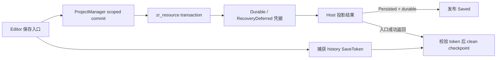

JobHandle 持有 Arc<TaskNode>，首个终态在锁内生效；pending work 由同一个 Mutex.take 唯一消费。wait 等终态，Failed 重新 panic，Cancelled 正常返回；observer、post-terminal hook 和 submission 释放有各自边界。combine 等全部依赖终态，失败优先于取消。未把节点终态推广为结果 registry 或 shutdown fence 已完成。

磁盘 owner 是 zr_resource transaction。完整 AllCommitted frame 写出后的同步失败为 CommitRecoveryDeferred，保留恢复证据；commit point 已同步后的 cleanup 失败为 CleanupDeferred，项目层仍映射 Durable。publication receipt 只把 Durable 视为持久化完成；项目重开先恢复 journal 再加载 registry。Err 本身不证明回滚已完成。

workspace 在发布 Saved 后，菜单入口才推进 clean checkpoint；Saved 表示已持久化事实，历史 clean 另经 SaveToken 校验。保存令牌比较 engine/history、generation 和当前事务，保存期间完成的新编辑会阻止旧令牌 clean。插件桥接将 Saved 转为 SceneChanged；toolkit clean 使用 DirtyRegistry 令牌与 external generation。事件总线实际 publish/drain 和 dispatcher 重入时机仍未读，不推断异步或并发顺序。

现有测试源码包含投影失败不发 Saved、磁盘基线前进但 history 保留，以及 RecoveryDeferred 不推进身份、不发 Saved、不 clean；本轮均未执行。task_graph 的结果与 TaskHandle 生命周期、pool shutdown、消息总线、DirtyRegistry 和独立 menubridge 继续开放；resource rollback 内部本轮未重新展开，既有同 hash 阅读证据保留。

S43-EDITOR-FAILED-COMMIT-REPORT 保留为未评级的条件性诊断漏报：editor adapter 的 Err 早退跳过 report 发布，可能漏掉 profiling/capture 活跃时已有的 rollback 计数；未证持久化损坏或 MVP 阻塞。本轮不实施该低优先级改动，不新增确认 P2，既有 21 项问题范围不变。

完整 pins、行段、真实 receipts、重复阅读和 locator 截断范围见 E:/cargo-targets/zircon-local/reports/engine-audit-20261009-01a12097/s43-persistence-and-job-owner-read.json。结构检查不能替代运行验收。本轮无引擎代码修改、构建、测试执行、产品运行或性能捕获，释放 0 B；自有临时文件未创建，所列证据保留。M0/M1、原 A1、模块、产品和性能验收均保持开放。

## S44：任务退出、消息交付与脏状态 owner

三名 Luna（max、fork none）并行阅读，Sol（max、fork none）复核核心调用链并修复一处测试，另一名 Luna 完整复核修改后的测试。选定源码账本为 388 个文件指纹、359 个全文／29 个部分范围、88,408 行去重正文；较 S43 净增 7,887 行（生产 5,663，测试 2,224）。新增 38 个文件；事件控制器换版后仅计新版本实际读取的 120–140 行，旧 283 行留作历史。旧缺失 mtime 的记录不补填；其中一条因真实换版从当前集合移入版本历史。本轮只重观测 47 个涉及文件的完整指纹，覆盖量不代表全引擎当前源码闭合。

- 任务权威：TaskScope 持有 admission、活动 lease 与取消；scope 静止蕴含终态，终态 wait 本身不证明 observer 或 lease 已退出。Graph 先关闭准入、等待 scope，再处理 timer／pool；pool 活动 lease 与原生线程 join 分开计数，超时可重试。
- 回调权威：EngineTaskGraph 使用 AsyncCompute dispatcher；TaskHandle→JobHandle 的 terminal observer 沿该 dispatcher 执行。S44-TEST-OBSERVER-DOMAIN 修正 tests/cases.rs:452、464 的池查询及两条提示文字，业务 descriptor 仍为 Compute。阻塞 observer、零期限关闭、释放、重试、活动数 1→0 与 all_joined 断言保留。
- 测试补丁 POST 为 06c76f92c54cb963cfeeeba704d67ef7e67122abfcc0e2c1f7b3e1b6f5d08442（502 行）；逆变换四行恢复 PRE c60b8a2c380f8c5856f5c161c35d3f02ba623ba5797c9c482010bbcb10cf3696。change guard、差异空白检查、独立全文静态复核通过；原生测试未执行。
- 消息权威：Shared bus 在有序目标 inbox 上执行 Lossless 全体准入；拒绝时不保存重试项。Opened／Closed／Saved 准入后不合并、不淘汰；publish 报告要求生产者处理背压。生产 bridge 经 pump 同步调用 manager/plugin，将文档事实投影为 SceneChanged。
- S44-LIFECYCLE-BACKPRESSURE：publish_document_messages:626–637 忽略逐条报告且不保留重试，是已确认的静态生产者契约违例，等级为 P2 候选。容量或字节预算拒绝时可能缺失通知；通用 inbox 背压计数仍可观察。默认容量触发、特定插件故障、错误 clean 或磁盘损坏均未实证。
- 生产修复待明确有限 pending/journal 的 owner、提交前容量与提交后责任、事实顺序、session 退出、pump 后重试和永久拒绝；随后统一迁移 helper 消费者。验收须走真实 helper＋bridge＋第二订阅者，容量 1 拒绝后 drain/pump 恢复且恰好一次通知，并覆盖过大消息及无订阅者；不引入无界队列或同线程同步重试。
- 脏状态／关闭权威：DirtyRegistry 的 generation 与 snapshot 防止旧保存清除后续编辑；close lease 在 layout 前预留，成功 commit 匹配实例后删除，Drop 仅回滚匹配 reservation。layout 后计数耗尽与跨 registry snapshot 仅保留条件观察，未证明正常产品可达故障；实际帧线程、重入、其他文档消费者仍有未读边界。

原 21 条问题保留，追加上述测试待原生验证项与发布者候选。M0、M1、模块、原生、产品与性能验收继续开放。证据：E:/cargo-targets/zircon-local/reports/engine-audit-20261009-01a12097/s44-task-message-dirty-owner-read.json。

### S45：事件循环、文档生产者与插件回调归属（静态阅读完成，动态门槛开放）

三名 Luna/max 并行读取 12/14/12 个文件，实际输出正文为 1673/2290/1187 行；Sol/max 独立决策读取 759 行，其中引擎正文 302 行。S45 引擎正文合计 5452 行（含跨 reader 与历史覆盖重复），当前选择集净增 2664 行、17 个文件，无源码版本替换：405 pins / 370 full / 35 partial / 91072 unique body lines；生产 359/334/25/80058，测试 46/36/10/11014。证据：`E:/cargo-targets/zircon-local/reports/engine-audit-20261009-01a12097/s45-event-pump-document-delivery-m1.json`。本轮生产/测试源码写入均为 0，既有 S44 四行测试修复仍待原生测试。

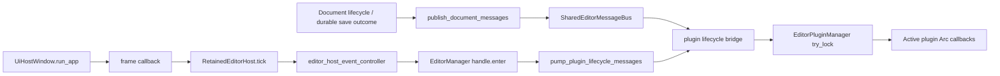

窗口路径同步运行在 run_app 事件循环线程，controller 先释放 shell guard 再进入 manager handle；该 handle 与插件 Arc handle 不同。尚未追二进制 main，因此不声明 OS 主线程身份或公共 API 的统一 UI affinity。interactive 分支不在此入口 tick；watch/heartbeat admission 错误可跳过本轮泵；没有证明持续饥饿、合法产品回流导致的 RefCell 重入或死锁。plugin manager 的 try_lock 竞争返回 MutationInProgress；默认描述符生命周期为 Ok，已读第一方入口没有给出具体 SceneChanged 产品处理损坏证据。

S44-LIFECYCLE-BACKPRESSURE 继续为单一 P2 静态生产者候选。已穷尽 helper 的生产调用：open/route/session-close 在 lifecycle 提交后发布；save 仅在 durable 且 Persisted 时发 Saved，PersistedProjectionFailed 保留持久化 receipt。DocumentMessage 仅含 DocumentId，重做 mutation 无法恢复原事件序列；bridge pending 只能保留已准入 delivery。后续修复需有限交接容量、原序列与 session/generation 边界、拒绝分类及部分 callback 失败时的恰好一次行为；未证明默认预算耗尽、磁盘故障或错误 clean checkpoint。

M1 第三次公开 strict 尝试沿用原 request/operation 身份及输入 SHA 16a2ddcc…；PID 44304/creation 134366783213540121，客户端 exit 2（外层 exec exit 1），在 POST 前因“HEAD, full index or complete source membership changed during capture”拒绝，编译次数 0。前后原身份 query-only 均返回 original_operation_missing。stderr 收窄到第二轮 external root 捕获结束附近，尚未输出具体差异字段，不能反推某个具体文件。此前两次 metadata 观测 names 确有变化；事后短观测一致不能替代本次捕获失败。E 盘实测 58.29 GiB，通过 35 GiB 门槛。无需额外人工 owner ACK；未知旧 A1 与 frozen native16 不变，未进行第四次捕获。

当前可用工具清单没有 RenderDoc/Tracy/WPR/GPU timestamp MCP 能力；这只说明此聊天的连接能力，不能替代已安装程序、实际产品帧或性能采样验收。M0/M1、模块、原生、产品及性能门槛均开放；原始日志和既有受管捕获缓存按归属保留，本轮释放 0 B。

### S46 启动 owner 与测试消费者（2026-10-17T04:00:18.034966+00:00）

本轮按 MVP00 恢复验证基线：仅修改 host_lifecycle/tests/tick.rs 第 14、65、68、88 行的旧 receiver 文本，保留单次 job-pump 计数与原 19 条顺序断言。最终 SHA256 d22dbd6de96321ed51c96ba5e8561b7cf7f677a6ba5c9c6383fd57f8eb946689；Sol78 实施、Luna105 独立静态 PASS，change guard 0 errors/0 warnings，patch digest 9cff55a2ab84da85329b1829425e68478bc163e1128b9f3819f247f2cfcfd00c。Rust 测试尚未执行。

补读启动构造、CoreHandle/Weak、任务图、关闭及插件 manager/catalog。选定 source union 为 424 pins（388 full / 36 partial），94720 unique body lines；本轮净增 3648 行。历史版本和搜索定位不替代当前正文，全部引擎与模块验收仍 open。

CoreHandle/retained lease 共享 Arc owner；任务图 Drop 关闭准入，完整 join 必须消费显式 shutdown receipt。当前未证实启动早退泄漏；controller::new rollback、bridge/resource 内部 owner 和实际 join 仍待追踪。

新增 S46-PLUGIN-RETIREMENT 静态 P2：Loaded 成功后 Enabled 失败、或成功 Disabled 的旧实例，替换时可能遗漏 Unloaded；未证实具体 builtin/native 资源泄漏。保留 cleanup progress/Disabled 重试语义与 HotReloaded 限制的最小方案，按 MVP 顺序待实施。

当前 strict 请求再次 query-only 返回 original_operation_missing/resubmitted:false；现有胶囊更新未改变 full-index 捕获 guard。已向 .jenkins/records 写入 S46 诊断交接。原身份下一次严格捕获的 stdout/stderr 已预登记，尚未提交。M0/M1、产品和性能均未验收；App no-run 不能代替 Editor/Runtime 聚焦测试。证据：E:\cargo-targets\zircon-local\reports\engine-audit-20261009-01a12097\s46-startup-tick-plugin-retirement.json。

S46 当前受管尝试补记（2026-10-17T04:28:34.147540+00:00）：原 strict request 的第4次客户端在 2026-10-17 04:03:35–04:09:21 UTC 完成两轮捕获后，被 entry.source_digest:369 的前后不一致检查拒绝（exit2；ordinary_entry_unproven）。本次 management POST0、编译0；失败后原身份 query 仍是 original_operation_missing/resubmitted:false。主仓库外层 HEAD/成员/索引摘要相同，但两轮捕获总字节相差98，不能据此宣称源码稳定；外部 zr_vm HEAD 从030d8d3变为2e2c95d。具体内部差异和写者尚未归属；已补入 Jenkins 本地交接，先协调实际写者窗口并完善差异诊断，再继续原请求。没有第5次提交，M0/M1/native/product/performance 门槛全部保持开放。

### S47 漂移诊断与 owner 补读（2026-10-17T05:38:17.808383+00:00）

当前 ordinary-entry 的两次 full-file-index-v2 捕获不一致时，新增有界 stderr 诊断：根/HEAD、成员集合、文件与 index/cache 摘要；不增加第三次捕获，原 require、pending JSON、reasonCode、exit 2 和失败前无 HTTP 合同保留。entry.py SHA d8ebcfacad2fc9c540db3e78ced813703fadb8f36e57f32ab8e5e2937b1be75b；三个回归覆盖等长内容变化、外部根/Unicode/脱敏边界和诊断失败。Sol80 设计、Root 落盘、Luna105 实际静态 PASS；反向/正向 patch 精确证明保留已有字节，AST/diff/guard 通过，测试尚未执行。

启动构造失败、ProductOwnership 保留与重试、任务 shutdown/join、native ABI/library lifetime 的有界补读已归档；未新增已复现严重错误，未将 None entry 诊断语义误记为新缺陷。当前选定 source union 462 pins / 100604 unique body lines（403 full / 59 partial），不代表模块或全引擎读完。

当前 App 的 Tracy/RenderDoc/GPU timestamp/WPR 能力仍待动态验证；历史工具、路径可解析和 manifest pin 均不能替代当前产品捕获。下一步为受管安装更新 clientSources pin，运行当前版本 ordinary-flow suite，再协调 main/external 源码与 Git 元数据静默窗口、沿原身份重试 strict M1。证据 E:\cargo-targets\zircon-local\reports\engine-audit-20261009-01a12097\s47-m1-diagnostics-startup-native-loader.json；M0/M1/native/product/performance 全部保持 open。

### S48 诊断回归与原生收据复核（2026-10-17T06:53:27.872599+00:00）

S47 三项诊断行为回归已通过：独立复核 foreign Jenkins #54 / queue3518 / prepared-worktree-flow-operation-proof-live-20261017-r4 的原始 stderr，ordinaryflow 50 项实际执行均 ok、0 skip，三个新增用例逐项在 38–40 行通过。entry/test 前后 SHA 精确匹配 d8ebcfacad2fc9c540db3e78ced813703fadb8f36e57f32ab8e5e2937b1be75b / e8177d2f55fbb5f4328db56282adf850fe3975fb734b44af33614d29ce0ccd5a。保留 foreign 身份；Root 的专用 RUN_ID 提案不再作为重复运行门槛。实际 unittest 路径未生成 JUnit，未将其记为通过。运行后配置变更为 f5491384；Sol 核明三个用例注入空 config、Mock context/capture，变化不参与断言，不能据此宣称完整环境或权限执行等价。

R13 原 request/started/terminal/receipt 与 stdout 独立核对完成：8 passed、0 failed、1 ignored，当前 5 个声明源码 SHA 匹配 producer lineage。原 #72 / queue3329、session w4f93a3b231、原生 PID45276/出生134366809869808711、exit0/双 EOF/waiter/job active0 均保留；inputsUnchanged=false、cleanupComplete=false 与当前 exe fingerprint 的读回性质原样记录。仅该 fence 片段通过，不替代当前 App 编译或 native16。

三路 Luna 完成资产扫描、管线 handle/cache 与 World detached batch 的限定补读；没有新增确认 P1/P2。compound sidecar 错误降级为单源的因果链待合同和 registry 消费者证明；World 恢复取消合并到已有问题。当前已选读 pin 并集 486 pins / 104605 unique lines（422 full / 64 partial），旧版本范围不转移，不代表当前全树闭包。证据 E:\cargo-targets\zircon-local\reports\engine-audit-20261009-01a12097\s48-project-import-asset-handle-detached-batch.json。当前 entry 客户端 seal 已匹配，无需重复安装；MVP00/M1 原 App strict 编译、产品与性能仍 open。

## S49 原生准备冲突与默认包验证范围

S49 完成三路 Luna/max 只读范围及后续生命周期/schema/测量能力核查，由 Sol/max 复核 feature 与MVP00次序。原App strict捕获两次一致并提交queue3662/#82，实际终态preparation-conflict，compileStarted=false；原marker与receipt逐项比较仅external E:/Git/zr_vm 的filesDigest及派生digest变化，engine/cache/HEAD/index/gitlinks相等。具体文件和actor未证明，后续commit/lock漂移不追溯归因。原身份、摘要和native16/未知A1保留。

本轮当前源码阅读并集 497 pins（429 full / 68 partial），107027 行；相对S48净增2422行。只按实际同pin正文ranges合并，locator保留partial；没有模块、全引擎、MVP00、产品或性能验收。统一代码问题24项未新增。

原App dynamic-api,platform-winit不启用App/native-host；后续close_owner行为需追加该App feature、prefix entry::tests::product_composition::close_owner::、testThreads=1（3普通+1ignored，不include-ignored）。Runtime同名feature不反向启用App。受管checkout普通batch的首失败停止未获证明，因此下一合同先单Runtime默认check，成功后再Editor/App；最终argv/TEMP/物理产物路径由原生收据核验。具体 [MVP00合同](2026-10-17-engine-audit-mvp00-default-validation.md) 与独立新request留存；新请求尚未提交。

当前WPR可定位且版本10.0.26100.9711，未启动；当前实际12个tools没有RenderDoc MCP。工具安装/历史查询不代表当前产品附着、捕获、GPU timestamp或ETL有效性。优化前后各5独立run、预热后30秒仍待产品就绪。原始性能证据目录E:/zircon-profiles尚无本轮采样。

实际证据 E:\cargo-targets\zircon-local\reports\engine-audit-20261009-01a12097\s49-native-source-conflict-app-feature-validation.json；原生操作和external组件差异已通过用户指定 .jenkins/records 交接，peer monitor独立确认，完整稳定窗口尚未证明。Root本轮未改Rust/Python、未本地Cargo、未复制源码、未清缓存；删除0文件/释放0B。

## S51–S52：入口、仪表化、迁移与原生捕获

三路 Luna/max 完成同 pin 入口与参数、DLL/session owner、CPU/Tracy/GPU 能力及资产 indexed resolver/迁移行为回归的分段阅读；Sol/max 独立核实默认 check 路线和实际 sealed 捕获失败位置。当前源码选读并集 528 pins（457 full / 71 partial），116024 unique lines；S51 净增5312行，本轮净变动3685行。旧版本正文范围不转移，安装副本只作执行归属。代码问题队列24项未新增；此计数不代表全树当前闭包或模块验收。

App loader 仅请求 V8 API table（Host ABI V1/session config V3 各自独立），明确拒绝错误版本、冻结布局或缺失必需函数；没有旧 ABI 降级。session destroy 失败保留 DLL/handle/wake，成功后才失效及释放；终态 Drop 失败 abort。项目路径进入 FFI 与 UTF-8 合格不等于 default scene 已加载。真实窗口呈现、退出和插件卸载仍待当前产物验收。

CPU recorder/Tracy 受 profiling features 控制，当前两份 owner manifest 闭包不启用它们，完整 feature unification/实际 cfg 未执行。日志使用独立队列/worker，没有抢占 tracing subscriber 的证据，相关怀疑已排除。GPU timer 要求实际 device 同时启用两种 timestamp features、成功 readback 和同代际结果；helper 存在不能代替产品接线/有效样本。当前采样仍为0。

Runtime04 当前普通测试已读真实 root 去重/分类计数、recovery 后 inventory 计数、DryRun 原字节保持、forward convergence/幂等和 metadata/CAS 锁合同；include_str 与 ignored bench 单列。未声称任意 commit 失败都回滚整个项目。测试必须先闭合共享 fixture_root 与实际 TEMP/CARGO_TARGET_DIR 的物理输出根，再受管执行；目前 focused/upward 均 pending。

S50 保持既有已复核单 Runtime 默认 check 身份及请求。旧 public client seal 拒绝后，当次调用前6 client/5 capsule绑定匹配（当时正式 installer/CheckOnly receipt 未定位；后续安装证据见下段）；恢复 QueryOnly 实际 original_operation_missing。09:12:48Z–09:16:56Z 首次初始调用在 engine 单次捕获收尾 exit2，未到两次完整捕获、POST 或编译；随后同身份 QueryOnly 再次 missing/resubmitted=false，没有重试。

实际 sealed finish_full_file_index 同时比较 HEAD、完整成员、logical index entries 和 ls-files --stage --debug metadata digest；index flags/stat cache 单独变化也可能拒绝。此次复合错误不能证明源码正文或 HEAD 变更，不能归因文件/写入者。Jenkins 需提供覆盖 source/index/生成/依赖至最后输入 guard 的全窗口安静屏障，或实际可用且等价 current-source 的注册 candidate 合同；不更换身份/摘要/策略，不造空 patch/源码副本，不把历史 native16 或原App#82替换为通过。

证据：E:\cargo-targets\zircon-local\reports\engine-audit-20261009-01a12097\s51-product-entry-instrumentation-resolver-audit.json 与 E:\cargo-targets\zircon-local\reports\engine-audit-20261009-01a12097\s52-loader-session-logging-migration-contracts.json。具体 [MVP00合同](2026-10-17-engine-audit-mvp00-default-validation.md) 保持原 pin；Runtime 默认 check→Editor→App，之后产品与性能。无里程碑/模块晋级；删除0文件、释放0B，其他任务与未知产物保留。

S53 补核：首帧完成/Drop、GPU query 交付与迁移事务测试的选读并集现为 540 pins / 119991 行；复用既有 CR-APP-ENTRY-0017 标记纳入统一队列（原24项保留，当前25项）。Sol 独立确认 project_root 会对普通项目启用 F2 lit-mesh/resource 检查，但尚无合法空/UI/无方向光项目加载并原生触发的证据，问题等级保持待定。修复先闭合显式 proof 参数及全部消费者，不以输入 probe、截图或帧限推断 F2。GPU 有效样本、事务原生故障回归和全部产品验收仍开放。

Jenkins S51 回执已定位并核 pin：当前安装95c1eef2、6 client/5 capsule匹配，正式 CheckOnly/Apply 记录已找到且记录 exit0/wait/EOF；记录未含进程 birth，不冒称 Root 独立观测。此更新不改写 S50 当次908a79执行绑定、不补成编译，也不提供全输入安静屏障或注册candidate。证据：E:\cargo-targets\zircon-local\reports\engine-audit-20261009-01a12097\s53-product-present-gpu-delivery-migration-transactions.json；清理0文件/0B。

### S56（2026-10-17）：显式产品 proof 已实现，原生验收待执行

CR-APP-ENTRY-0017 的 App 入口策略已改为 `Disabled / GeneralProject / F2LitMesh`：普通项目保留真实 backend/device/limits 与独立输入检查，F2 通过 `--runtime-product-proof f2-lit-mesh` 显式选择并保留原有严格内容、资源、graph、错误和 fallback 门槛。Stage 的 `-RuntimeProductProof f2-lit-mesh`、Acceptance 的实际 `proof_policy` echo、F5 workflow、F2/F5 文档和相关行为回归已同步。生产 present 完成路径先校验、再提交计数/退出；失败不提交完成状态。

独立复核补出非窗口 feature 缺口后，策略类型移至纯共享 `entry/runtime_product_proof.rs`，与 parser 同为 `platform-winit OR diagnostic-log`；typed App 重导出保持单一类型 owner。最终 24 文件 [审阅补丁](E:/cargo-targets/zircon-local/reports/engine-audit-20261009-01a12097/s56-cr0017-explicit-product-proof-cfg-complete.patch) SHA-256 `71b0c5ab5c4e0127b5ec368db5d57b45bcbe3286d86f08e27cf6282fac306e4e` 绑定实际 `9568f1a95453abacdef00ef409ae7ec8eff8045d` 基线；两份既有 gamepad 修改各两行保留独立归属。静态 guard 与 diff 检查通过；CI 范围提醒保留并在 M162 记录本任务消费者迁移依据。未执行 Cargo、Rust 格式化、PowerShell/Pester 或产品验证。

[S56 实现与复核报告](E:/cargo-targets/zircon-local/reports/engine-audit-20261009-01a12097/s56-cr0017-explicit-product-proof-implementation.json) SHA-256 `0e96d54f3d54286aeda327e39b539a32928ff26b313f2a64eafc8f0d22f04b31` 记录当前选择的 572 pins / 478 full / 94 partial / 125129 unique body lines；生产 499/427/72/108528，测试 73/51/22/16601。相对 S54 新增23 pins、净增2700行，14项源码版本刷新不继承旧范围；未配对前后指纹的 API 阅读、旧版 reader 和 locator 均未冒充当前完整覆盖。旧 union 未作全树当前重验，模块验收仍开放。

新增同一问题 `S56-MVP-FIXTURE-RETIRED-DEPENDENCY`：MVP helper 强制导入已缺失的 common resolver，并依赖已缺失的 `zircon-session.ps1`；测试没有前置 mock 绕过该 helper。实际首个运行报错尚未执行核实。maintenance resolver 接口只是已读候选；公开 noncommit functional route 不证明目录 fixture lifecycle API。后续保留统一 New/Remove 调用合同，先确认 Jenkins 权威 owner、获授权物理根、登记与清理回执，再迁移 namespace 和旧字符串契约测试。队列26项；旧24项前缀保留，CR0017 未因静态修复关闭。

M0 / MVP00 / module / native / product / performance 均未验收。原 S50 一次源码准备因输入漂移拒绝、后续 original operation missing 的证据保留；当前95c安装证据不替代历史908调用。Jenkins 交接使用用户指定的 `.jenkins/records`，不清除原消息或推定 owner ACK，不调用会继续提交的 delivery 入口；需先完成原身份核对与完整输入静默屏障。保留补丁、报告和原失败证据；本轮释放0B。
