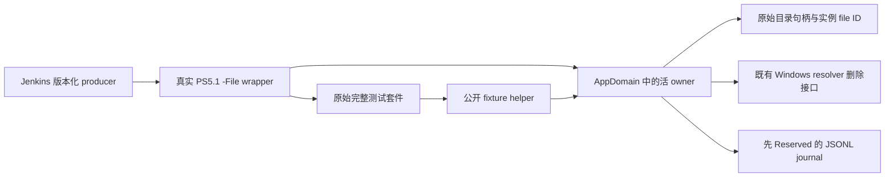

# S78：MVP 测试夹具的进程 owner 与实例清理

状态：六文件源码窗口已关闭，三名 Luna 的修正后独立静态复核通过；原生回归待 Jenkins。此记录不验收 Rust 模块、MVP、产品或性能。基线与优先级继续遵守 [MVP00](../mvp/00-current-source-baseline-recovery.md) 和 [性能计划](index.md)。

## 归属与调用链

旧 helper 的 fixture-acquire/release 依赖已退役的本地 coordinator，独立脚本也以路径作为清理依据。新的 wrapper 在真实 Windows PowerShell 5.1 进程内创建活的 owner；公开 helper 保持 New/Remove 接口，由 owner 持有原始目录句柄与 file ID，JSON journal 记录过程和失败。

Jenkins 独占 producer、部署、产物生成和原生执行；Sol95 独占本轮六文件源码窗口；Root 集成接口、补丁、账本和验收。旧本地 coordinator 不参与，不改其历史数据。

## 行为合同

- 实际 PID 与进程 birth、AppDomain 对象和活句柄共同约束 owner；helper 的 Force reimport 保留对象，缺失或关闭的 owner 被拒绝。
- 创建前先持久化 Reserved；原生 FILE_CREATE 独占创建 parent/fixture，不接管已经存在的同名目录。
- 清理只处理该 owner 记录的同一实例；使用 handle-relative、no-follow 遍历及 file ID 校验。已 Released 路径出现的新实例必须保留。
- 只读兼容处理沿句柄遍历；新建名称约束与合法既存子项校验分开，保留长文件名和前导空格子项。
- 只有删除、句柄 Dispose 和物理缺失检查均成功后才记 Released。失败保持 CleanupFailed 与证据；关闭阶段尝试其余清理，附加次级错误并保留原始错误。
- KEEP 是单独的真实保留路径；保留原实例和 journal，不通过翻转环境变量删除它。

公开 helper 从281行缩到33行。owner、原生能力和 wrapper 是新增实现，本轮六文件变更新增1059行、删除376行，净增683行；局部精简不等于总代码减少，也没有性能收益声明。

## 独立复核与待验收

三名 Luna 同时复核原生实现、wrapper/生命周期及消费者；Sol 处理核心实现。首轮复核发现且已完成源码修复与再次静态复核：既存子项被错误套用创建名称限制、Dispose 异常可能覆盖主错误，以及缺少真实 closed-owner 拒绝回归。它们均按静态证据处置，原生回归仍未执行。PS5.1 ParseFile 六文件0错误；change guard errors0。

Jenkins 必须从新的 wrapper 执行原三组 Pester 和五个独立脚本，不过滤用例、不用 Get-Content→ScriptBlock。正常八组运行之外，独立 KEEP invocation 验证真实保留。前后源码 pins、实际 argv/cwd、Pester XML/count、JSONL、raw输出、PID+birth、wait/readers/双EOF/Job0 和物理清理均需对账。进程自然退出或 Job0 不能代替 fixture 缺失证明，强制结束后非终态实例继续保留待处置。

## 其他仍开放的基础门槛

S78 Runtime/default 的 build203 在 context 冲突前拒绝；build204 已推进到 external_control_forbidden，Cargo 尚未启动。Jenkins 需定位精确控制文件 membership 并修复受支持的输入闭包，再续接同一请求。Editor/App 尚未提交。S50 历史身份与失败记录保留。

S77 的真实解析器测试仍在入口失败，原六用例未运行。S79 目标帧诊断此前因 Root 附加路由限制而未执行；该限制已通过本地交接修订为允许最小精确路由、CAS 保留 foreign 修改和自有路由退役。诊断运行不能直接验收无断点回归。

当前没有新的引擎性能采样；Tracy、RenderDoc MCP 捕获、GPU timestamp 与 WPR 的实际测量闭环仍待产品基线恢复。

## 证据与产物

机器可核对的修复、pins、检查、问题队列和请求状态见 E:/cargo-targets/zircon-local/reports/engine-audit-20261009-01a12097/s78-current-runtime-fixture-owner.json。exact patch 与 guard 放在同一任务目录。源码交接和路由修订位于 .jenkins/records，保存状态与实际 ACK/执行分开记录。

本轮 Root 未运行 Cargo、测试、目标脚本或 Add-Type；没有源码树副本、临时 helper 或清理操作。实际释放0 B；补丁、检查证据、请求和必要失败证据保留，未知/共享缓存与其他会话产物保留，cleanup 继续开放。

## S80 后到回执（2026-10-18）

上节 S79“未执行”是 S78 交付时的历史状态。新 build206/queue2729 已采集目标帧，但原六用例仍0/6，仅1个loader错误。第2行前的自动变量非空，不能据此猜测换变量或改 cwd。Pester 保存原 ErrorRecord，旧诊断未展开内层异常；新 S80 已交接无断点的有限对象图采集（12节点/深度6/64KiB），待实际执行与Root判断。

S78 输入闭包修复的 build205 聚焦回归仍失败于 Cargo 文件名大小写集合；实际执行体与当前 canonical 对应关系待 Jenkins 核对，Cargo未启动。六文件 fixture 实现与已通过的静态复核保持不变，八组正常套件和独立KEEP仍待原生验收。没有新增模块、MVP、产品或性能验收；释放0 B，cleanup开放。
