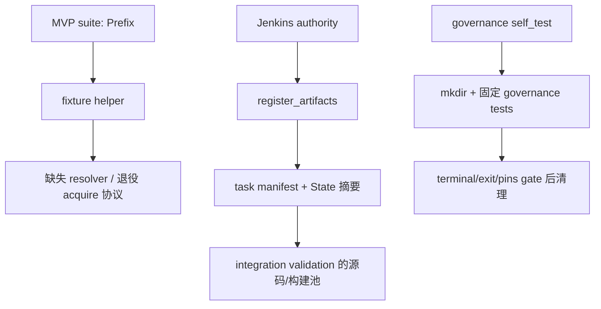

# MVP 夹具迁移任务包（S67，2026-10-18）

现有 `S56-MVP-FIXTURE-RETIRED-DEPENDENCY` 继续开放，分类为 **验证基础设施阻塞，产品等级未定**。本轮三 Luna 并行审查、Sol 独立复核403行后确认：当前证据不足以实施完整生命周期迁移；只更换 resolver 路径不能解除阻塞。问题队列保持27项，不新增重复发现。

当前基线是 `main/a80b4c1e23d7d4910782112c2cdfc8025851262b`，实际 checkout 为 `E:/Git/ZirconEngine`。源码区间、24个文件四字段及分级证据见 [S67报告](E:/cargo-targets/zircon-local/reports/engine-audit-20261009-01a12097/s67-mvp-fixture-migration-current-review.json)。MVP00、原生、产品、模块和性能验收均未完成。归档前发现退休说明发生外来文档变更，Root重读当前107行并保留两版本指纹；生产工具阅读版本未漂移。

## 已有机制与缺口

- [worker.py:50](../../../tools/jenkins/governance/worker.py#L50) 的内部登记确实写入 owner、request/attempt/driver 依赖并更新 State。真实 caller 是 [validation.py:56](../../../tools/jenkins/governance/validation.py#L56) 的 integration validation；它不签发 MVP root、实例或生命周期凭据。
- governance self_test 直接建立自己的 fixtures 并运行固定 governance tests，未调用该登记函数，也未执行七个 MVP suites。只证明已读 gate 的调用顺序，未独立证明完整 terminal/EOF 谓词。
- `capture/remove` 是已有目录盘点和 guarded deletion；`physical` 只检查绝对字面路径及 alias。这些分别不等于夹具分配、授权 root 或 owner。
- storage 的 capability probe 会实际创建、写入、移动和删除文件；不能把它作为无副作用的授权检查。
- 精确缺失路径为 `tools/common/WindowsPathResolver.psm1` 与 helper 所指的 `tools/zircon-session.ps1`。`tools/maintenance/WindowsPathResolver.psm1` 存在；`tools/dev/zircon-session.ps1` 也存在，不能外推所有同名入口都缺失。旧协调器保持退役。

## 已知协调范围

| 文件（相对仓库） | 已确认的迁移或回归要求 |
|---|---|
| `tools/mvp/MvpTestFixturePaths.psm1` | resolver、旧协议、PID/root布局、真实owner和清理 |
| `tools/tests/mvp-test-fixture-paths.Tests.ps1` | 旧协议/audit/目录断言，真实登记顺序和故障回归 |
| `tools/tests/build-editor.Tests.ps1` | 保留字符串接口，真实迁移回归；不强制无效修改 |
| `tools/tests/mvp-acceptance.Tests.ps1` | 340另有旧resolver导入，保留KEEP行为 |
| `tools/tests/mvp-acceptance-staging-snapshot.Tests.ps1` | try前写入及串联cleanup失败边界 |
| `tools/tests/mvp-staging-terminal-receipt.Tests.ps1` | 保留接口并真实回归；不强制无效修改 |
| `tools/tests/mvp-staging-release.Tests.ps1` | 552–556的旧ZirconBuilds根guard |
| `tools/tests/mvp-staging.Tests.ps1` | fixture创建失败、BuildSet与根清理异常边界 |
| `tools/mvp/Invoke-MvpAcceptance.ps1` | 55 required resolver导入 |
| `tools/mvp/MvpBuildSummaryEvidence.psm1` | 10 required resolver导入 |
| `tools/mvp/RenderExtractBaselineEvidence.psm1` | 4 required resolver导入 |
| `tools/mvp/RenderExtractMachineEvidence.psm1` | 4 required resolver导入 |
| `tools/mvp/ResourceManagementJsonEvidence.psm1` | 4 required resolver导入 |

这是有界审查得到的13文件集合，其中至少11文件有具体修改理由；不代表全仓消费者已穷尽。runner侧写集需由真实 owner 接口确定，当前没有分配实现写权限或生成新请求。

## Jenkins owner 必须补齐的真实合同

1. MVP suites 的受支持执行入口，以及 task/request/attempt、driver 与子 PowerShell、物理 root/namespace/实例的可核验绑定。
2. 登记成功先于首个 fixture 写入；发放拒绝、无效身份或非法 root 在 mkdir 前失败。
3. 同一实例的删除授权；物理删除后再释放登记。创建补偿、删除/释放失败、KEEP与未知归属必须保留可核对状态和诊断。
4. 七个真实 suites 的有界执行 recipe、源码/产物 pins、进程终结、退出码、EOF及清理回执。

字段名和handler由真实接口确定。本任务包不预设新 endpoint、token DTO或通过普通 task `artifacts.json` 签发权限。保留 `New -Prefix → DisplayPath string`、`Remove -Path` 合理；身份及生命周期放在 runner 内部上下文，不扩散到六个消费者。

## 实施与验收窗口

接口证据成立后，在同一窗口迁移 helper、确有修改理由的消费者和旧路径断言；保留物理路径/OperationalPath、兄弟夹具、foreign-owner与junction目标保护。验证登记先于写入、身份拒绝无输出、批准布局、并发兄弟隔离、越界/alias拒绝、junction sentinel、创建失败补偿、清理/释放失败保留以及KEEP。

snapshot 的前置写入与串联清理、stagingfixture 的创建和BuildSet清理异常应进入故障回归。后者会 Add-Type、git init/commit及worktree清理，suite不是无产物静态测试，须由 Jenkins 执行。不能用代码字符串匹配或历史产物替代当前行为回执。

原 S50 身份、[Runtime→Editor→App验证合同](2026-10-17-engine-audit-mvp00-default-validation.md)和[待验收账本](pending.md)保持开放。本轮没有重查或重提相同请求，未改生产实现、运行测试/编译或创建夹具。

[S67本地交接](../../../.jenkins/records/engine-audit-20261009-01a12097-s67-mvp-fixture-interface-handoff.md)仅证明保存；指定收件人已读与ACK未知。本轮释放0 B，既有历史和未知产物保留。
