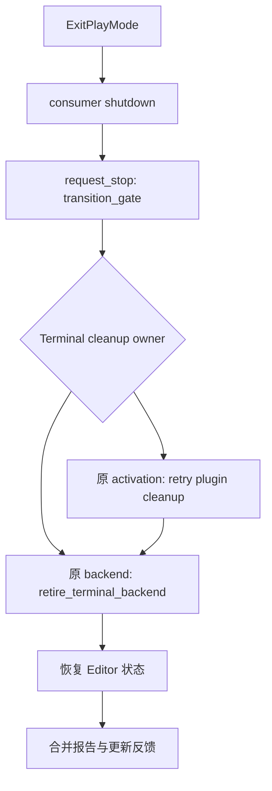

# S66：停止重试与原始验证请求核对（2026-10-18）

当前 `main` 的有限源码审查确认一项 Editor 停止反馈错误，已独立复核并归队。MVP00 仍未取得当前源码的原生编译回执；本记录不增加已验收模块或里程碑。

基线为 `a80b4c1e23d7d4910782112c2cdfc8025851262b`，实际 checkout 为 `E:/Git/ZirconEngine`。逐文件 SHA-256、字节数、行数、mtime、阅读区间与查询输出见 [S66 证据](E:/cargo-targets/zircon-local/reports/engine-audit-20261009-01a12097/s66-shutdown-retry-query-review.json)。现有未完成项继续遵守 [MVP 顺序](../mvp/index.md) 和 [验证合同](2026-10-17-engine-audit-mvp00-default-validation.md)。

## 生命周期与数据归属

Core 的 `cleanup_completed` 保留已完成的回调结果；退休或截止失败后，Stopping 重试会跳过该回调。最终退休成功才进入 Unloaded、清除标记并移除活动模块顺序。当前切片未证明“重试依赖已关闭 graph”的具体故障。

Editor 通过 `transition_gate` 串行停止。插件清理重试使用 Terminal 中保留的原 activation，不再次调用 `backend.stop()`。backend 退休成功会清除原 backend；若插件仍失败，继续保留对应失败。Edit 可以出现在 backend 尚待退休的阶段，本轮未据此判为 owner 丢失。

## 新增问题：S66-EDITOR-STOP-STALE-REPORT

| 项目 | 证据与结论 |
|---|---|
| 等级与状态 | P2；静态可证的反馈一致性错误，未动态复现，待 MVP00 依赖满足后修复 |
| Owner | Editor 01 / host 菜单 ExitPlayMode 结果归并 |
| 位置 | [menu_action.rs:563](../../../zircon_editor/src/ui/host/editor_event_execution/menu_action.rs#L563)、同文件 570–573、588–591；[controller.rs:630](../../../zircon_editor/src/core/play/controller.rs#L630)；[runtime_ownership.rs:141](../../../zircon_editor/src/core/play/controller/runtime_ownership.rs#L141) |
| 触发 | 已有 BackendRetirement 且 plugin_deactivation=None；再次正常停止取得旧 CleanupFailed，本次 backend 退休成功，其他 consumer/gateway/shell/协调成功，且无 preview 恢复错误覆盖提示 |
| 根因 | 菜单只在新退休报告再次失败时使用新报告；新报告成功时沿用旧失败报告，后续反馈又读取旧 transition |
| 影响 | mode 已为 Edit、backend owner 已清除，菜单仍可显示 cleanup pending；本轮未证明 owner 丢失、清理跳过或退出受阻 |
| 修复方向 | 让本次明确完成的退休结果驱动成功反馈；同时保留仍未恢复的插件或远程失败，不能只修改 563–568 的局部选择 |
| 验收 | 正常 ExitPlayMode 中注入退休首次失败、重试成功，断言 Edit、owner 清空、旧 pending 提示消失、stop/deactivate 不重复；持续失败控制例仍保留 owner 和 pending |

三个 Luna 使用 `gpt-6-luna / max / fork none` 并行读取；`gpt-6.1-sol / max / fork none` 独立实读相关 449 行后确认上述根因与 P2 等级。它不直接阻塞 MVP00，不提前实施。

关闭 receipt 中保留 `StoppedWithCleanupFailure` 的现象仍属静态风险；`is_locally_terminal()` 与关闭上层约束未读，不另计确定缺陷。

## 阅读范围与队列

Core 正文 368 行、Editor 正文 753 行；工具 client 正文 240 行，Root 另重读 client 240 行。独立 Sol 的 449 行计为重读。Core 的 368 行中，104 行与 S60 主读重叠，264 行在该主读范围之外；这些数字均不代表 canonical 阅读覆盖净增。精确区间见证据文件。

原问题队列 26 项逐项保留，新队列为 **27 项**，当前权威副本是 S66 证据的 `currentOpenFindings`；历史 manifest/outbox 中的旧队列保持原样。原 26 项未在本轮全部重新验收。完整模块阅读、动态回归及模块验收仍未完成。

S60 已落盘报告的归档完整性经 Sol 独立复核通过：逆变换精确重建 M170，旧 top 551 项、retained 110 项及 native16 容器均匹配。阅读计数更正为“独立 reader 355 行，其中与主读重合 257 行、主读之外 98 行”；历史报告和消息字节保持不变。归档复核不提升 native、产品或性能验收。

## 原始 S50 请求与当前查询

保留 session `engine-audit-20261009-01a12097`、request/operation `engine-audit-20261017-mvp00-runtime-default-s50-r1`、原 runtime `start-1792141433756007100`。当前安装 runtime 不替换原身份。

| 实际查询 | 结果与边界 |
|---|---|
| 受支持 immutable HTTP client，`--query-only` | 进程已结束，工具报告 exit 1；`original_delivery_missing / pending / resubmitted=false`。仅查当前 queue 和最近 128 个管理 builds，原 durable marker 不存在；不是原请求正式未提交或终态证明。client 原生退出码未另捕获 |
| 原 `submit-jenkins-management.ps1 -QueryOnly` | 进程已结束，工具报告 exit 1；`process_identity_inconclusive`，无法读取 PID 20236 birth time。Full Access 下仍未通过该核验 |

本轮没有新 request/alias、重提、capture、编译、测试或性能采样，没有修改 Rust 代码。需由指定 Jenkins owner 核对原历史并返回正式状态或已验证的重连 lineage，再准入当前源码的 Runtime 默认检查；通过后才推进 Editor、App。保留 [原验证合同](2026-10-17-engine-audit-mvp00-default-validation.md)。

本地交接写入 [S66 消息](../../../.jenkins/records/engine-audit-20261009-01a12097-s66-original-query-and-review-followup.md)。文件落盘仅证明保存，收件人已读与 ACK 仍未取得。

本轮清理释放 **0 B**；既有共享缓存、未知和其他会话产物保留。原生编译、产品回归、五次独立性能采样、M0 和 MVP00 继续开放。
