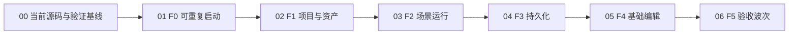

# MVP 产品验收合同与状态索引

本页合并原 MVP 索引与 00、F0—F5 七份子计划。产品闭环、23 个阶段、393 个来源勾选项和各原始状态全部保留；迁入不代表任何未验收项已通过。状态是来源文档在迁入时的记录，当前组件结果还须核对其实际源码身份和验证回执。

<a id="current-execution"></a>
## 当前执行入口

所有迁入章节均按当前 [AGENTS](../../AGENTS.md)、[验证政策](milestone-validation-policy.md)、[基础门槛](minimum-viable-engine-foundation.md)、[协调器退役规则](../tooling/coordinator-retirement.md)及 [Jenkins 协调技能](../../.codex/skills/jenkins-coordination/SKILL.md)执行。它们约束的是执行方式，不降低后文的产品、持久化、干净环境、连续两次运行、性能或证据完整性要求。

旧本地 coordinator 的服务、注册、心跳、lease、validation copy、ticket、queue 和 commit/closeout 命令均已退役，不恢复或重放。来源中的这些用语、已勾选的历史步骤、旧技能名称及回执仅为迁入记录；每节开头都再次标明。它们不构成当前操作步骤，也不要求创建源码副本。源码身份、共享修改保护、真实命令退出、进程终止与证据归属继续由当前 Jenkins 路径负责；有明确用户例外时，独立本地结果仍只属于其实际覆盖范围。

干净环境、source fingerprint、固定产品项目、build/stage/run 的同源性、真实窗口/PNG、进程资源释放及 F0—F5 验收继续是独立门槛。迁入的旧服务登记或 lease 复选框按原状态保留为历史字段；当前协作按现行 checkout 规则，不以退役接口为前置条件。待验、source-ready、静态通过或本地组件通过均不能替代里程碑或 Jenkins 接受。

历史计划、过程日志与大体积数据通过 [历史数据索引](historical-data-index.md#archive-readback)按原路径读取。E 盘归档已有本机证据，共享 CI 读回尚无证明；原 plans/_data 此阶段仍保留。

## 阶段导航

| 来源 | 本页入口 | 依赖 |
| --- | --- | --- |
| 原索引 | [总体合同与状态](#mvp-index) | 当前执行入口 |
| 00 | [M0 基线恢复](#m0) | 当前源码与最低共享 owner |
| F0 | [可重复启动](#f0) | M0 |
| F1 | [项目与资产](#f1) | F0 |
| F2 | [场景运行](#f2) | F1 |
| F3 | [持久化](#f3) | F2 |
| F4 | [基础编辑](#f4) | F3 |
| F5 | [验收波次](#f5) | F0—F4 全部真实通过 |


<a id="mvp-index"></a>
## ZirconEngine MVP 引擎编辑器执行计划索引

来源：`docs/plans/mvp/index.md`；SHA-256 `989bf19483fa87a75169f4c76ba63a8b4caddcca96992f4148156f111fcc0ca5`。

> 迁入说明：本节旧协调器命令、登记/lease/validation copy 及旧技能指令仅作历史记录；按[当前执行入口](#current-execution)执行。原产品门槛、证据、测试、退出条件和勾选状态保留。

<details><summary>来源元数据与迁入时状态</summary>

```yaml
plan_sources:
  - docs/plans/minimum-viable-engine-foundation.md
  - docs/plans/milestone-validation-policy.md
  - docs/plans/zircon_runtime/runtime/02-core-spine-and-root-surface.md
  - docs/plans/zircon_runtime/runtime/04-asset-pipeline-alignment.md
  - docs/plans/zircon_editor/editor/01-editor-kernel-and-runtime-interaction.md
  - docs/plans/zircon_editor/editor/05-scene-editing-hierarchy-and-gizmos.md
  - docs/plans/zircon_editor/editor/11-serialization-and-versioning.md
status: in_progress
last_refined: 2026-07-24
```

</details>

> **For agentic workers:** 按编号子计划执行。每个 Session 开始前使用 `cross-session-coordination`，实现时使用 `executing-plans`，进入测试阶段前使用 `zircon-dev-validation` 与 `prefer-windows-validation`。不得跳过更低编号门槛宣称上层完成。

**Goal:** 交付一个可以创建或打开项目、渲染基础场景、保存并重开、选择实体并通过命令路径修改属性的最小可用 ZirconEngine 编辑器，并用当前 Windows 产品可执行文件完成两次连续验收运行。

**Architecture:** 本目录是跨 Runtime、Editor、App owner 的产品验收编排层，不取代现有编号计划。`00` 恢复当前源码基线，`01` 至 `06` 依次关闭 F0-F5；代码、接口和 failure 的权威所有权仍留在原 Runtime/Editor 编号计划中。

**Tech Stack:** Rust、Cargo、WGPU、Windows PowerShell、Zircon Session Coordinator、retained editor host、TOML/JSON 项目与场景格式、GitHub Actions。

---


<a id="mvp-index-01"></a>
### 1. 权威与适用范围

- 产品门槛定义以 [`../minimum-viable-engine-foundation.md`](minimum-viable-engine-foundation.md) 为准。
- 验证调度以 [`../milestone-validation-policy.md`](milestone-validation-policy.md) 为准。
- 本目录只决定 MVP 的依赖顺序、跨计划交付物和产品验收，不复制原 owner 计划的完整设计。
- 若本目录与现有 owner 计划发生冲突，行为和接口由当前源码、聚焦测试和 owner 计划共同裁决；MVP 子计划只收紧产品退出条件。
- 所有 Cargo 输出必须由 Windows coordinator 分配到 `D:`、`E:` 或 `F:` 的批准目标根目录。不得创建仓库内 `target/`，不得用 WSL 做普通验证。


<a id="mvp-index-02"></a>
### 2. 固定产品闭环

MVP 必须用同一个持久化项目完成以下闭环：

1. 从支持的产品入口创建 `RenderableEmpty` 项目，或打开已经创建的该项目。
2. 项目资产注册表和项目设置从磁盘权威加载，不处于 fallback-only 状态。
3. 默认场景包含一台 camera、一个引用持久资产的可见 primitive 和一盏 directional light。
4. runtime 接收 keyboard/mouse 输入，产生非空 WGPU 帧，并可确定性退出。
5. editor 从 Hierarchy 选择 primitive，通过 Inspector 或等价正常 UI binding 进入 command/transaction 路径修改 transform。
6. editor 保存项目，销毁当前 host/session，重新打开同一项目。
7. 重开后从持久数据观察到相同实体、资产引用和修改后的 transform。
8. 当前产品二进制在同一验证副本上连续运行两次，均产生可归因诊断并干净退出。

禁止用直接改 TOML、直接改 `World`、测试专用旁路、静态源码扫描或单个单元测试代替步骤 1-8。


<a id="mvp-index-03"></a>
### 3. 依赖顺序



上层 Session 可以提前实现不依赖未闭合行为的测试夹具或局部 owner 切片，但不得提前进入产品验收、填写完成记录或解除下层 failure。


<a id="mvp-index-04"></a>
### 4. 子计划路由

| 顺序 | 子计划 | 产品结果 | 主要 owner |
|---|---|---|---|
| 00 | [`00-current-source-baseline-recovery.md`](mvp-acceptance-index.md#m0) | validator 恢复机器可读输出；Runtime/Editor/App 当前源码重新可检查 | Tooling、Runtime 04、受影响的最低共享 owner |
| F0 | [`01-f0-reproducible-bootstrap.md`](mvp-acceptance-index.md#f0) | runtime/editor 支持 profile 可构建、启动、报错、退出 | Runtime 02/14、Editor 01、App entry |
| F1 | [`02-f1-project-and-assets.md`](mvp-acceptance-index.md#f1) | 一条产品路径创建并重开项目，registry/settings 权威加载 | Runtime 04、Editor 01/02 |
| F2 | [`03-f2-scene-runtime.md`](mvp-acceptance-index.md#f2) | 持久场景实际渲染 camera/primitive/light 并接收输入 | Runtime 08/09/12、Render foundations |
| F3 | [`04-f3-persistence.md`](mvp-acceptance-index.md#f3) | 保存、销毁、重开后精确保留实体/transform/asset ref | Runtime 04/08、Editor 11 |
| F4 | [`05-f4-basic-authoring.md`](mvp-acceptance-index.md#f4) | editor 正常 UI/command 路径选择、修改、保存、重开观察 | Editor 01/02/05/08/11 |
| F5 | [`06-f5-acceptance-wave.md`](mvp-acceptance-index.md#f5) | clean validation copy、聚焦套件、连续两次产品运行 | Dedicated validation lane、CI |


<a id="mvp-index-05"></a>
### 5. 多 Session 执行协议


<a id="mvp-index-06"></a>
#### 5.1 领取规则

1. 一个 Session 一次只领取一个子计划中的一个未完成里程碑。
2. 开始前查询 coordinator 状态、最近四小时 Session 和该里程碑所有 owner 目录中的 open `failure-*.md`。
3. 使用当前子计划路径注册 Session，并把 `write_scope` 限定到实际要修改的 owner 源码、测试和该子计划文件。
4. 对共享文件先领取 coordinator lease；被占用时等待或提交 delayed patch，不创建文件锁、不覆盖其他 Session 修改。
5. fixing owner 若命中适用 open failure，先进入 `resolving_failure`；origin owner 继续不依赖该 failure 的切片。
6. 每个里程碑只在测试阶段完整通过后写一条状态记录。普通实现切片、失败的测试尝试和静态检查不写产出记录。


<a id="mvp-index-07"></a>
#### 5.2 并行边界

- `00` 未完成前，只允许其他 Session 做只读审计或不依赖编译的测试设计。
- F0 完成后，F1 的项目入口和 F2 的场景夹具可以并行实现；F2 产品晋级必须等待 F1。
- F2 完成后，F3 持久化与 F4 的 Selection/SceneMode/inspection owner 切片可以并行；F4 产品晋级必须等待 F3。
- F5 不与任何未完成门槛并行。它必须消费冻结的 F0-F4 validation copy。


<a id="mvp-index-08"></a>
#### 5.3 建议排程与工作量

以下是 2026-07-24 基于当前源码的工程量区间，不是完成承诺。`00` 完成并暴露全部 current-source 编译错误后必须重新估算一次。

| 阶段 | 建议同时活跃 Session | 工程量 | 关键不确定性 |
|---|---:|---:|---|
| 00 | 1 个 primary + 最低 owner repair Session | 2-5 人日 | resolver 后续编译错误数量；validator/coordinator 协议修复范围 |
| F0 | 2 个：profile/staging、startup diagnostics | 2-4 人日 | staged DLL/plugin/asset 清单和 Windows host teardown |
| F1 | 2 个：project authority、asset generation | 2-4 人日 | registry/cache 当前 generation 一致性 |
| F2 | 2 个：template/asset、runtime/render/input | 3-6 人日 | product shader/material 与真实 adapter 的可见输出 |
| F3 | 2 个：persistence、product reopen | 2-4 人日 | schema/migration/atomic write 的现有回归范围 |
| F4 | 最多 3 个：inspection、state/commands、host integration | 5-10 人日 | production `cfg(test)` hard cut、generation/delta、产品交互 trace |
| F5 | 1 个独占 validation Session；CI 可独立准备 | 2-4 人日 | clean wave 时长、Windows hosted runner 的 GPU/display 能力 |

总量约 18-37 工程日。由于门槛晋级严格串行，即使使用多个 Session，现实日历周期仍建议按 4-6 周规划；若 `00` 暴露大量级联编译失败，重新评估为 6-10 周并优先缩小 current-source integration scope。


<a id="mvp-index-09"></a>
#### 5.4 Failure 路由

- 跨 owner 最低原因写入 fixing owner 的既有编号子目录，例如 `docs/plans/zircon_runtime/runtime/04/failure-*.md`。
- MVP 子计划只链接 failure 并标记被阻断的里程碑，不保留第二份 failure 正文。
- 修复并向上验证后，按仓库 failure/fixed 规则移动同一 artifact；不得复制一份 `fixed-*`。
- 性能或高级能力 failure 只有直接阻断当前 F0-F5 退出条件时才进入 MVP 关键路径。


<a id="mvp-index-10"></a>
### 6. 当前基线与风险

| 风险 | 2026-08-01 当前事实 | 处理位置 |
|---|---|---|
| 当前源码编译基线未闭合 | resolver module registration 与 coordinator JSON 污染均已修复；`00` 最新受管证据仍在 Runtime lib-test harness 暴露 owner-bound 编译错误，需按最低 owner 继续收敛 | `00` M0.3 |
| resolver 单一 generation 尚待上层验收 | `MigrationResolver` 已只消费 registry/resolver index；剩余风险是 run/scan/sidecar 的 current-source 上层验证，不是缺少 `mod resolver_index` | `00` M0.2 / Runtime04 |
| validator 当前可提交作业 | `zircon-session.ps1 -Json` 的 readiness 输出已受门控，validator 能创建/释放 managed job；后续失败应按具体 owner 或 CPU reservation 归因 | `00` M0.1（已修，保留回归） |
| 大量并行输入 | `git status --porcelain=v1 -uall` 曾报告 4,399 个路径级变化 | 每个 Session 重新盘点并严格 lease；不得据此删除用户文件 |
| F2 产品证据仍待晋级 | `RenderableEmpty` 模板已含 Camera/Cube/Sun 和持久 mesh/material refs，runtime test 也消费同一模板；仍须等待 F0/F1 后执行产品门 | `03` M2.1 |
| F4 产品交互证据仍待晋级 | scene-mode/selection 与 inspection publication 已是生产模块；仍须用正常 UI/command 路径完成 F4 端到端证据 | `05` M4.1/M4.2 |
| Windows workflow 已有但 F5 证据未闭合 | `.github/workflows/mvp-editor-windows.yml` 已存在，本轮修正为精确测试 ID 并逐项断言 `1 passed`；clean validation copy 与真实上传 artifact 仍未验收 | `06` M5.3 |


<a id="mvp-index-11"></a>
### 7. 晋级与回退规则

- 每个子计划的入口条件、风险清单、测试阶段和退出证据全部满足后才能晋级。
- 上层失败时先回查最低共享支持层；不得在 App/UI 层增加特殊旁路掩盖 Runtime/asset/serialization 问题。
- current-source 验证取代历史通过记录。源指纹变化后，旧 job/run 只能说明能力曾经存在。
- 测试阶段出现失败时，先缩小到最低 owner 的 focused batch，修复后向上重跑；不从头反复启动全工作区测试。
- 所有 changed contract 和高风险边界必须有直接证据；未覆盖项保持计划 open。


<a id="mvp-index-12"></a>
### 8. 明确延期

以下工作不阻断 MVP，除非执行证据证明它直接破坏当前产品闭环：

- temporal reconstruction、volumetrics、advanced GI、RenderDoc 优化和 shader permutation 扩展；
- 完整 BIDI/vertical text、富文本扩展和字体精修；
- AI、网络、多玩家复制和非必需第一方插件；
- 新 editor panels、复杂领域编辑器、额外 export targets；
- 不影响 1 个 MVP 项目和基础交互的 100k/1M 规模优化。

若某个 production gate 明确要求规模证据才能解除 `cfg(test)` 或发布共享 generation，该最小规模证据仍属于 MVP；其余性能扩展继续延期。


<a id="mvp-index-13"></a>
### 9. 总体完成定义

- [ ] `00` 至 `06` 的所有退出清单均完成。
- [ ] 所有直接阻断 MVP 的 open failure 已修复并完成 upward validation；无关 failure 保持原 owner 路由。
- [ ] 同一个项目贯穿 F1-F5，未在门槛间替换为更简单的测试夹具。
- [ ] F5 使用 coordinator 管理的干净 validation copy，而不是当前脏 checkout 直接宣称 clean。
- [ ] Windows runtime/editor 产品二进制连续两次运行成功，诊断、帧/窗口证据和持久化比较均可追溯到同一 validation run。
- [ ] 新增 Windows CI smoke 能在后续提交中保护最小产品路径。


<a id="mvp-index-14"></a>
### 10. 状态总览

> 请将产出记录放置在子计划中，此处仅展示当前现状的概述

| 阶段 | 当前状态 | 权威记录 |
|---|---|---|
| 00 | `in_progress` | [`00-current-source-baseline-recovery.md`](mvp-acceptance-index.md#m0) |
| F0 | `blocked_by_00` | [`01-f0-reproducible-bootstrap.md`](mvp-acceptance-index.md#f0) |
| F1 | `blocked_by_f0` | [`02-f1-project-and-assets.md`](mvp-acceptance-index.md#f1) |
| F2 | `blocked_by_f1` | [`03-f2-scene-runtime.md`](mvp-acceptance-index.md#f2) |
| F3 | `blocked_by_f2` | [`04-f3-persistence.md`](mvp-acceptance-index.md#f3) |
| F4 | `blocked_by_f3` | [`05-f4-basic-authoring.md`](mvp-acceptance-index.md#f4) |
| F5 | `blocked_by_f4` | [`06-f5-acceptance-wave.md`](mvp-acceptance-index.md#f5) |


<a id="mvp-index-15"></a>
### Code Review 处理结果 (2026-08-01)


<a id="mvp-index-16"></a>
#### 已处理

- §6 已按 2026-08-01 当前源码刷新：resolver registration、validator JSON、RenderableEmpty primitive、生产 selection/inspection 投影和 Windows workflow 均不再列为“缺失实现”，而是分别保留其 current-source 或产品验收缺口。
- 总计划与 `00` 已更新为 `in_progress`。F0-F5 的 `blocked_by_*` 继续保留，因为它表达严格产品晋级顺序；它不否认上层源码切片已经存在，也不授权重复实现已有 owner。


<a id="mvp-index-17"></a>
#### 验证缺口

- `00` 当前仍有 owner-bound Runtime lib-test 编译错误，F0-F5 也尚未按依赖顺序取得产品 gate；状态不得仅凭源码存在上调。
- §5.3 的 18-37 工程日 / 4-6 周只保留为 2026-07-24 历史估算。下一次 clean re-baseline 后必须重估，不用于当前 Session 数量或交付日期承诺。


<a id="m0"></a>
## 当前源码与验证基线恢复 Implementation Plan

来源：`docs/plans/mvp/00-current-source-baseline-recovery.md`；SHA-256 `2b292dee4df6fb56d7770898009972efd5455b8fb10b33b899ea6ed639b9d143`。

> 迁入说明：本节旧协调器命令、登记/lease/validation copy 及旧技能指令仅作历史记录；按[当前执行入口](#current-execution)执行。原产品门槛、证据、测试、退出条件和勾选状态保留。

<details><summary>来源元数据与迁入时状态</summary>

```yaml
related_code:
  - tools/dev/local-cargo.ps1
  - tools/dev/local_cargo.py
  - tools/dev/zircon-session.ps1
  - .codex/skills/zircon-dev/scripts/validate-matrix.ps1
  - zircon_runtime/src/asset/migration
  - zircon_runtime/src/asset/reference_resolver.rs
related_tests:
  - tools/tests/test_local_cargo.py
  - tools/tests/session-coordinator-smoke.Tests.ps1
  - tools/session_coordinator/tests
  - zircon_runtime/src/asset/tests/migration/project_commandlet/resolver_index.rs
  - zircon_runtime/src/asset/tests/migration/project_commandlet/source_boundary.rs
plan_sources:
  - docs/tooling/coordinator-retirement.md
  - docs/plans/milestone-validation-policy.md
  - docs/plans/mvp/index.md
  - docs/plans/zircon_runtime/runtime/04-asset-pipeline-alignment.md
  - docs/plans/zircon_runtime/runtime/04/failure-2026-07-23-asset-migration-indexed-resolver-generation.md
status: in_progress
gate: baseline
last_refined: 2026-10-03
```

</details>

- fixed 已修复：[validation ticket deletion manifest](historical-data-index.md#archive-readback)（归档原路径：`docs/plans/mvp/00/fixed-2026-08-05-validation-ticket-deletion-manifest.md`）；删除墓碑协议、目录/悬空链接重现拒绝与最终复审均已收敛，source-bound managed batch `30/30` GREEN；Runtime15 可恢复硬删除 manifest 票据。

> **For agentic workers:** REQUIRED SUB-SKILL: 使用 `subagent-driven-development`（推荐）或 `executing-plans` 按里程碑执行；开始前使用 `cross-session-coordination`，测试阶段使用 `zircon-dev-validation` 和 `support-first-regression-testing`。

**Goal:** 恢复机器可读的受管验证入口，完成 Runtime 04 migration resolver index 的单一 generation 接线，并使 `zircon_runtime`、`zircon_editor`、`zircon_app` 当前源码重新通过包级编译检查。

**Architecture:** 先核验当前独立验证入口，再修最早的 Runtime 04 公共编译原因，最后从 Runtime 向 Editor/App 逐层收敛编译。禁止在上层 call site 增加临时 fallback，也不把声明 `mod resolver_index` 当成 migration 架构已完成。

**Tech Stack:** PowerShell、Python、Rust、独立本地 Cargo 与 Jenkins、Windows 原生验证。


<a id="m0-01"></a>
### 当前控制面（2026-10-03）

旧本地协调器及其 matrix、登记、心跳、租约、票据和关闭流程已退役。本页保留旧源码、命令、job ID 与回执作为历史证据；这些记录不要求恢复服务，也不授权重放旧请求。执行以[退役规则](../tooling/coordinator-retirement.md)和[验证策略](milestone-validation-policy.md)为准。

当前本地证据使用 `tools/dev/local-cargo.ps1` 或 `python -B -m tools.dev.local_cargo`，物理输出与缓存只放在盘根 `D:\cargo-targets`、`E:\cargo-targets` 或 `F:\cargo-targets` 下，并通过 35 GiB 启动预检。独立 Jenkins 的功能测试和有边界提交还须核验当前 `active.json`、source/driver/tray、storage owner/keeper 与实际进程身份，遵循 [jenkins-coordination](../../.codex/skills/jenkins-coordination/SKILL.md)。M8 唯一入口规则按实际激活证据执行，不改写其状态来绕过门槛。

本地命令通过、静态审阅和历史票据均不自动授予 Jenkins、里程碑、生产迁移或 F0-F5 接受。本计划的 M0.1、M0.2、M0.3 仍需各自适用的当前证据；未完成项保持开放。

---


<a id="m0-02"></a>
### 1. 当前证据

- 2026-07-24 的 `super::resolver_index` unresolved import 已过时：`migration/mod.rs` 当前声明并 re-export `resolver_index`，`MigrationResolver` 只持有 `AssetRegistryIndex` 与 `MigrationResolverIndex`，resolver 内无 root walk、`PathBuf`/`fs` probe 或 `persisted_source_path_for_locator` fallback。
- 历史 coordinator JSON stdout 污染已修复：`tools/dev/zircon-session.ps1` 的两处 `Coordinator ready.` 都受 `if (-not $Json)` 门控；旧 smoke test 覆盖 cold register、daemon reuse、JSON `ConvertFrom-Json` 与 human readiness。这些服务启动和旧队列提交步骤已退役，不再执行。
- 当前最低编译基线已变化：2026-08-01 managed `zircon_runtime --no-default-features --lib` focused job `c630da233fc440559b1788eafebddf9a` 在 lib-test harness 有 16 个 owner-bound 编译错误；default-feature job `367cc00c08394ae4b4705d2fe3c6f44f` 有 53 个。M0.3 因此仍未完成，但不再由 JSON 协议或 resolver module registration 阻断。
- 当前 checkout 包含大量用户和其他任务变化。本计划不清理、不还原、不重排这些变化，通过明确路径归属、source fingerprint、原生进程/锁和逐层验证建立可复现基线。


<a id="m0-03"></a>
### 2. 入口条件

- [ ] 已核对当前任务、可见活跃 chats 与相关交接；重叠范围具有明确 source owner。
- [ ] 已阅读 Runtime 04、Tooling 和受影响上层 plan 的现有 open failure 与回执；保留原请求身份，不重放未知结果。
- [ ] 已记录 scoped diff、修改前字节与索引归属；其他任务及用户变化保持原样，不使用退役租约接口。
- [ ] 已记录当前 commit、`Cargo.lock` 指纹、工作区路径级状态计数和 validator 脚本指纹，作为本里程碑 source-bound evidence。


<a id="m0-04"></a>
### 3. 非目标

- 不关闭 Runtime 04 下与 MVP 无直接关系的 importer、watcher、virtual geometry 或大规模性能 failure。
- 不在本阶段构建或运行最终产品二进制；产品 build/start 属于 F0。
- 不强制当前共享 checkout 变为 clean，也不删除未跟踪文件。
- 不通过忽略 `ready` 后所有文本的宽松解析来掩盖 machine-readable 协议污染。


<a id="m0-05"></a>
### 4. Owner 边界

| 范围 | 权威 owner | 本计划职责 |
|---|---|---|
| 当前 CLI/stdout 与命令证据 | `tools/dev/local_cargo.py`、独立 Jenkins 入口 | 保留实际退出码、机器可读结果与输入身份；旧 coordinator 只保留历史资料 |
| validator 与 target policy | `.codex/skills/zircon-dev`、`tools/dev/local_cargo.py` | 验证物理盘根、容量及原生执行结果；不把 dry run 作为通过 |
| migration inventory/resolver | Runtime 04 | 完成 index 的生命周期接线和 focused contract |
| Editor/App 编译 follow-up | 对应最低 owner | 只修阻断当前编译的共享根因；跨 owner 走 failure handoff |


<a id="m0-06"></a>
### 5. M0.1 受管验证输出协议


<a id="m0-07"></a>
#### 目标

核验当前独立验证入口的输出、物理 target、输入身份与终止结果。旧 `zircon-session.ps1 ... -Json` 实现和历史测试保留为迁移依据，当前测试不启动旧 daemon、worker、tray 或队列。


<a id="m0-08"></a>
#### 历史实现切片与当前入口核验

- [x] `tools/tests/session-coordinator-smoke.Tests.ps1` 覆盖 cold register、daemon reuse，并直接 `ConvertFrom-Json` 解析 stdout。
- [x] 非 JSON 模式继续断言 `Coordinator ready.`，普通 CLI 反馈未被吞掉。
- [x] `tools/dev/zircon-session.ps1` 仅在 `-not $Json` 时输出 readiness；JSON starting/response 各保持单一 document 语义。
- [x] `validate-matrix.ps1` 继续严格 `ConvertFrom-Json`；不得恢复宽松截断或忽略前导文本。
- [x] validation ticket `source_manifest` 以 JSON `null` 封存归属删除路径；queue claim、copy overlay 与 materialized-copy 的路径重现统一判为 `snapshot_stale`。
- [ ] 运行当前本地入口的 focused 支持回归，检查错误退出码、物理输出拒绝、容量门与 dry-run 无编译语义。
- [ ] 若执行 Jenkins 功能测试，先核验激活/源码/进程证据，再使用固定模板与新的输入身份；精确 reconcile 已提交请求，不借新提交掩盖旧未知结果。


<a id="m0-09"></a>
#### 测试阶段：M0.1 Tooling Contract Gate

- [ ] 运行当前独立入口的 Python focused suites；历史 smoke 中会启动旧服务的测试不作为当前操作步骤。
- [ ] 从 Windows 原生环境核验当前入口的目标路径和机器可读结果；dry run 仅证明准备行为，不能关闭编译或接受门。
- [ ] Jenkins 适用时，按 `jenkins-coordination` 的 snapshot/driver/request/verify 契约运行固定模板并核对实际归档字节与 native termination。
- [ ] 失败时修复最低工具 owner 或返回具体阻塞；继续不依赖该失败的独立工作，不恢复旧控制面。


<a id="m0-10"></a>
#### 退出证据

- [ ] 当前入口的输出、实际退出码和错误边界有行为回归证据。
- [ ] 当前编译/测试请求具有明确输入与终止结果；dry run、queued/accepted 与历史 receipt 不算通过。
- [ ] 当前工具与 Jenkins 的适用接受门分别记录，没有将本地结果升级为迁移或里程碑接受。


<a id="m0-11"></a>
### 6. M0.2 Runtime 04 migration resolver generation


<a id="m0-12"></a>
#### 目标

一次安全 inventory scan 发布 immutable `MigrationResolverIndex`，migration resolver 只做 pure lookup；逻辑 locator、root-relative path、physical identity 和 compound sidecar binding 在同一 generation 内一致。


<a id="m0-13"></a>
#### 实现切片

- [x] 以 [`../zircon_runtime/runtime/04/failure-2026-07-23-asset-migration-indexed-resolver-generation.md`](historical-data-index.md#archive-readback)（归档原路径：`docs/plans/zircon_runtime/runtime/04/failure-2026-07-23-asset-migration-indexed-resolver-generation.md`） 为唯一 failure owner，重新盘点 `run.rs`、`scan.rs`、`sidecar.rs`、`resolver.rs` 和 `resolver_index.rs` 当前调用图。
- [x] `migration/mod.rs` 已注册并在 crate 内 re-export `resolver_index`；不存在孤立 `mod` 声明。
- [x] 让 scan owner 从已经 canonicalized、拒绝 symlink/reparse 的 regular-file inventory 构建 `MigrationSourceProjection`；禁止 index 自己再次访问文件系统。
- [x] 让 sidecar 解析发布经过验证的 compound binding；重复 registry identity、重复 locator、ambiguous root 和 missing source 返回现有 typed error/issue kind。
- [x] `MigrationResolver::new` 当前只接收 `AssetRegistryIndex` 与 `MigrationResolverIndex`；per-reference roots/FS fallback 已删除。
- [x] 扩充 `resolver_index.rs` 测试：唯一 source、compound zmeta hint、duplicate registry 优先级、ambiguous source、missing source、跨 root 相同相对路径、link/reparse 拒绝和 index generation 一致性。
- [x] 添加源码 guard，阻止 migration resolver 恢复 filesystem fallback 或第二次 root scan。

M0.2 current-source handoffs:

- fixed 已修复：[deferred-lighting-cache-test-hard-cut](historical-data-index.md#archive-readback)（归档原路径：`docs/plans/mvp/00/fixed-2026-07-28-deferred-lighting-cache-test-hard-cut.md`）
- Runtime 04: [`asset migration streaming transaction journal`](historical-data-index.md#archive-readback)（归档原路径：`docs/plans/zircon_runtime/runtime/04/failure-2026-07-22-asset-migration-streaming-transaction-journal.md`）.

M0.2 continues from the lowest passing test target while these owners complete their declared upward validation.


<a id="m0-14"></a>
#### 测试阶段：M0.2 Runtime 04 Resolver Gate

- [ ] 在 Windows 原生验证 lane 中先运行 `zircon_runtime` package check；按当前独立入口及适用 Jenkins 门保留实际结果。
- [ ] 运行 migration resolver/index/source-boundary focused tests，并包含所有新增 typed failure 分支。
- [ ] 运行 Runtime 04 asset migration parent batch，确认 scan、sidecar、transaction 和 idempotent migration 未回归。
- [ ] 若上层失败，先回到 index/inventory generation；不得修改 Editor/App 适配失败的 resolver 语义。


<a id="m0-15"></a>
#### 退出证据

- [ ] `zircon_runtime` 当前源码编译通过。
- [x] migration resolver 不包含 filesystem lookup/fallback，所有查询来自单一 index generation。
- [ ] open failure 已完成 upward validation 并按 canonical failure/fixed 流程返回。


<a id="m0-16"></a>
### 7. M0.3 Runtime → Editor → App 编译收敛


<a id="m0-17"></a>
#### 目标

在同一 source fingerprint 上逐层证明三个根包可检查，为 F0 产品构建提供稳定输入。


<a id="m0-18"></a>
#### 实现切片

- [x] 生成 validation manifest，按 `zircon_runtime`、`zircon_editor`、`zircon_app` 顺序列出 feature/profile、受影响 contract 和已知 open failure。
- [ ] 每次只处理当前最早编译错误；先判断是否属于本计划已修改边界、现有 owner 变化或新的跨计划 failure。
- [ ] 属于其他 owner 的最低原因写入该 owner 的 numbered failure 目录，并继续不依赖该失败的检查；不得在上层添加兼容 alias 或 feature bypass。
- [ ] 每次根因修复后重新运行最低包 focused check，再向上运行依赖包。
- [ ] 完成 `git diff --check`、触及 Rust 文件的 formatter check 和 source guards。


<a id="m0-19"></a>
#### M0.3 Validation Manifest

| 顺序 | 包 / profile | 受管 compile gate | 受影响 contract | 已知 open failure |
|---|---|---|---|---|
| 1 | `zircon_runtime` / default | 当前独立入口 `check -p zircon_runtime --locked` | Runtime04 single-inventory indexed resolver；Runtime15 receipt-test hard cut | [Runtime04 indexed resolver generation](historical-data-index.md#archive-readback)（归档原路径：`docs/plans/zircon_runtime/runtime/04/failure-2026-07-23-asset-migration-indexed-resolver-generation.md`）；[Runtime15 plan-status receipt compile debt](historical-data-index.md#archive-readback)（归档原路径：`docs/plans/zircon_runtime/runtime/15/failure-2026-08-02-plan-status-receipt-test-compile-debt.md`） |
| 2 | `zircon_editor` / default | 当前独立入口 `check -p zircon_editor --locked` | Runtime facade、RHI neutral presenter、Editor host compile boundary | [Frameworks01 RHI WGPU presenter/backend contract test owner](historical-data-index.md#archive-readback)（归档原路径：`docs/plans/zircon_runtime/frameworks/01/failure-2026-08-02-rhi-wgpu-presenter-and-backend-contract-test-owner.md`） |
| 3 | `zircon_app` / default | 当前独立入口 `check -p zircon_app --locked` | Runtime/Editor entry composition 与 app startup compile boundary | fresh gate 前没有可复用的 current-source lowest failure；实际诊断按最低 owner 处理并保留归属 |

三个包按同一 current-source manifest 顺序验证；任一相关 compile input 变化都须重新判定受影响证据，不允许用旧 ticket、feature bypass 或上层 alias 继续。本地结果只形成独立命令证据；Jenkins 接受使用核验通过的当前入口、固定 `managed-cargo-check-v2` 模板与精确请求身份，里程碑接受另按验证策略审查完整范围。


<a id="m0-20"></a>
#### 测试阶段：M0.3 Current-Source Compile Gate

- [ ] 使用当前独立入口完成 Runtime package check 和适用 focused batch。
- [ ] 使用当前独立入口完成 Editor package check 和适用 focused batch。
- [ ] 使用当前独立入口完成 App package check 和适用 focused batch。
- [ ] 三个批次使用兼容 Windows toolchain/profile 与相同输入身份；相关源码变化后更新 manifest 并重跑受影响检查。
- [ ] 核对本任务的 Cargo/rustc 终止与实际回执；foreign jobs/锁和旧队列保持原状，不手工清理。


<a id="m0-21"></a>
#### 退出证据

- [ ] Tooling、Runtime、Editor、App 在 current source 上通过各自声明的检查与适用接受门。
- [ ] 所有未解决问题已有明确 fixing owner 和 failure 链接，不存在“临时忽略后继续”的未知阻断。
- [ ] F0 可以从相同源码指纹开始产品 profile build。


<a id="m0-22"></a>
### 8. 阶段退出清单

- [ ] M0.1、M0.2、M0.3 全部通过各自测试阶段。
- [ ] validator 的 JSON 协议有行为测试，而不只是手工确认。
- [ ] Runtime 04 resolver index open failure 完成架构接线和 upward validation。
- [ ] `zircon_runtime`、`zircon_editor`、`zircon_app` 当前源码包级编译均为绿色。
- [ ] 没有删除、回退或覆盖进入本 Session 前的用户变化。
- [ ] 只写一条本阶段 accepted outcome，不记录每次编译尝试。


<a id="m0-23"></a>
### 状态与产出记录

每个里程碑测试通过后记录一次；实现切片不单独写入产出记录。

| 里程碑 | 范围 | 状态 | 完成日期 | 验证批次 / 残余风险 |
|---|---|---|---|---|


<a id="m0-24"></a>
### Current-source M0.1 recheck (2026-09-19)

本次只刷新 M0.1 的 tooling/protocol 证据，仍不改变本计划的
`in_progress` 状态，也不提前解除 M0.2、M0.3 或 MVP 00 的 gate。

- coordinator smoke 的 `-KernelOnly`、`-JsonClient`、`-StrictJsonParser`、
  `-ValidatorDryRun` 四个 slice 均输出 `PASS`；JSON client 覆盖 cold/warm
  daemon、real launcher、strict JSON 和 clean stop。
- focused Python validation batch 为 `126/126`，`0` failure、`0` error、`0`
  skip，耗时 `364.910s`。
- `validate-matrix.ps1 -DryRun -SkipBuild -SkipTest
  -RunExportPlatformContract -ExportContractPlatform headless` 实际执行到
  headless export contract，输出 `[OK]` 并以 exit code `0` 返回；该批次不启动
  Cargo，也不做 artifact admission。

详细收据见
[`2026-09-19-m0-1-tooling-contract-recheck.md`](historical-data-index.md#archive-readback)（归档原路径：`docs/plans/mvp/00/2026-09-19-m0-1-tooling-contract-recheck.md`）。
M0.1 的 current-source acceptance、M0.2 resolver upward validation 和
M0.3 Runtime→Editor→App 受管编译仍待同一 source fingerprint 下完成；当前
unmanaged target artifact 与脏的外部 `E:\Git\zr_vm` 仍是 compile gate 风险。


<a id="m0-25"></a>
### Code Review 同步结论 (2026-07-30，2026-08-01 落实)

- JSON readiness 污染、resolver module registration 与 resolver FS fallback 三条旧 blocker 已同步到正文和 checklist，不再作为待实施工作。
- 2026-08-03 Runtime04 review repair 已将 linked current/retired sidecar 决策收回单一 inventory generation，并把 source-presence lookup 收敛为排序后的 O(logN) 查询；1/1k/100k references、1/4 roots 的双向顺序回归已落地，独立复审为 Critical/Important/Minor=`0/0/0`。
- 2026-08-03 M0.1 validation-ticket 删除墓碑协议已落地；focused Python batch 16/16 通过，首轮独立复审 `C0/I2/M1` 的 copy-race 分类、真实 baseline deletion 覆盖与 manifest 输入覆盖均已修复，最终独立复审 `C0/I0/M0`。manifest `d7e44074...` / ticket `00dfbdb27a9e4e85935a5f85a7c4f462` 已受理但无 terminal receipt。
- 计划状态保持 `in_progress`：M0.2 implementation 已完成，manifest `a587940b...` 的 package-check 与 focused tickets 已受理但尚无 terminal receipt；M0.3 的 Runtime→Editor→App current-source compile gate 尚未 GREEN。
- 下游不得继续引用 2026-07-24 的旧 blocker，但也不得仅凭静态修正解除 `blocked_by_00`；解除条件仍是 M0.1 focused、M0.2 resolver batch 与 M0.3 三包受管编译在同一 source fingerprint 下通过并写入 accepted outcome。


<a id="f0"></a>
## F0 可重复启动 Implementation Plan

来源：`docs/plans/mvp/01-f0-reproducible-bootstrap.md`；SHA-256 `0f058bce0d137c0c066ec8ecb540cfad308045dec319b5b8a311468191943934`。

> 迁入说明：本节旧协调器命令、登记/lease/validation copy 及旧技能指令仅作历史记录；按[当前执行入口](#current-execution)执行。原产品门槛、证据、测试、退出条件和勾选状态保留。

<details><summary>来源元数据与迁入时状态</summary>

```yaml
related_code:
  - zircon_app/Cargo.toml
  - zircon_app/src/bin/editor.rs
  - zircon_app/src/bin/runtime_preview.rs
  - zircon_app/src/entry/entry_runner/editor.rs
  - zircon_app/src/entry/entry_runner/runtime.rs
  - zircon_app/src/entry/runtime_entry_app
  - zircon_runtime/src/dynamic_api/session
related_tests:
  - zircon_app/src/entry/entry_runner/editor/tests/gui_startup.rs
  - zircon_app/src/entry/entry_runner/editor/tests/host_config.rs
  - zircon_app/src/entry/entry_runner/runtime.rs
  - zircon_app/src/entry/runtime_entry_app/config/app_config.rs
  - .github/workflows/profile-feature-contract.yml
plan_sources:
  - docs/plans/mvp/index.md
  - docs/plans/mvp/00-current-source-baseline-recovery.md
  - docs/plans/zircon_runtime/runtime/02-core-spine-and-root-surface.md
  - docs/plans/zircon_editor/editor/01-editor-kernel-and-runtime-interaction.md
status: blocked_by_00
gate: F0
last_refined: 2026-07-24
```

</details>

> **For agentic workers:** REQUIRED SUB-SKILL: 使用 `subagent-driven-development`（推荐）或 `executing-plans`。测试阶段必须使用 `zircon-dev-validation`、`prefer-windows-validation` 和当前 coordinator validation copy。

**Goal:** 从受支持的干净产品配置构建并启动 runtime/editor，输出可操作的启动诊断，并在呈现首帧后确定性干净退出。

**Architecture:** 先固定 profile feature contract，再构建并 stage 两个产品二进制，最后分别验证成功启动、预期失败和资源释放。F0 只证明产品壳可重复运行，不使用项目内容或编辑功能代替后续门槛。

**Tech Stack:** `zircon_app` binaries、target profile features、Windows Winit/WGPU host、runtime dynamic library、PowerShell process harness。

---


<a id="f0-01"></a>
### 1. 入口条件

- [ ] [`00-current-source-baseline-recovery.md`](mvp-acceptance-index.md#m0) 阶段退出清单全部完成。
- [ ] 本 Session 已注册到 F0，已领取 App entry、staging/test harness 和本子计划 lease。
- [ ] 当前 validation manifest 绑定 `Cargo.lock`、Rust toolchain、Windows target architecture 和 source fingerprint。
- [ ] Runtime 02、Runtime 14、Editor 01 中直接影响启动的 open failure 已重新分类为 blocking 或 deferred。


<a id="f0-02"></a>
### 2. 固定支持矩阵

F0 必须覆盖以下产品输入：

| 产品 | package/bin | feature 配置 | 启动模式 |
|---|---|---|---|
| Runtime | `zircon_app` / `zircon_runtime` | `target-client,platform-winit,input-gamepad,gamepad-gilrs` | 无项目基础启动；首帧退出 |
| Editor | `zircon_app` / `zircon_editor` | `target-editor-host` | Welcome/默认启动；首帧退出 |
| Runtime library contract | `zircon_runtime` | `target-client`、`target-editor-host` | profile feature check |

`target-server` 继续由全局 profile contract 保护，但不要求它产生桌面窗口；不得用 server/headless 成功代替两个桌面产品。

`zircon_shader_pbr_viewer` 与 runtime binary 一样由 `target-client` 启用，但它不是 F0 的 runtime/editor 产品启动验收对象；profile contract 仍必须覆盖该 binary，防止它经 default feature 或额外 authoring 依赖泄漏。


<a id="f0-03"></a>
### 3. 非目标

- 不验收项目创建、资产扫描、场景渲染或编辑器 authoring。
- 不要求高级插件、export wizard 或非默认 editor panels 加载。
- 不接受只构建 `zircon_editor` library crate 而未构建 `zircon_app --bin zircon_editor`。
- 不从 Cargo target 目录直接把零散 EXE 当作完整 staged product。
- 不用 `zircon_shader_pbr_viewer` 的构建或启动结果替代 runtime/editor 产品门禁。


<a id="f0-04"></a>
### 4. M1.1 Profile 与二进制构建合同


<a id="f0-05"></a>
#### 目标

支持矩阵在当前源码下无隐式 default feature 泄漏，两个桌面 binary 都能从 coordinator validation copy 构建。


<a id="f0-06"></a>
#### 实现切片

- [ ] 验证 `zircon_app/Cargo.toml` 的现有 binary `required-features` 合同：editor 为 `target-editor-host`，runtime 与 `zircon_shader_pbr_viewer` 为 `target-client`；profile matrix 必须覆盖三者且不得引入隐式 default feature。
- [ ] 扩充 profile contract：禁止 `target-editor-host` 依赖 server-only surface，禁止 runtime desktop profile 静默依赖 editor crate 的 authoring owner。
- [ ] 确认 runtime dynamic library、first-party plugin registration 和 editor gateway 所需 DLL/asset 清单可以由 staging owner枚举，而不是运行时猜测 Cargo target 布局。
- [ ] 对 profile 不兼容、缺少 required feature 和 ABI/version mismatch 保留 typed/actionable build or startup error。


<a id="f0-07"></a>
#### 测试阶段：F0 Profile Build Gate

- [ ] 通过 validator 运行完整 `-RunProfileFeatureContract`，覆盖现有七个 profile case。
- [ ] 由 coordinator validation action 构建 `zircon_app --bin zircon_runtime` 的固定 runtime feature 配置。
- [ ] 由 coordinator validation action 构建 `zircon_app --bin zircon_editor --no-default-features --features target-editor-host --locked`。
- [ ] 构建输出必须来自同一 Windows validation copy；不得使用历史 target artifact。
- [ ] 出现失败时回到最低 package/profile owner，修复后先重跑该 profile，再重跑两个产品 binary。


<a id="f0-08"></a>
#### 退出证据

- [ ] 七项 profile contract 通过。
- [ ] runtime/editor product binaries 均在 current source 上成功构建。
- [ ] validation manifest 记录 feature、toolchain、target、source fingerprint 和产物位置。


<a id="f0-09"></a>
### 5. M1.2 Staged product 与成功启动


<a id="f0-10"></a>
#### 目标

产品从独立 staging 根目录启动，不依赖当前工作目录碰巧存在的 DLL、template 或 asset；呈现首帧后 exit code 为 0。


<a id="f0-11"></a>
#### 实现切片

- [ ] 在批准的 `D:\ZirconBuilds`、`E:\ZirconBuilds` 或 `F:\ZirconBuilds` 根下定义 source-bound F0 staging 目录；不得覆盖其他 validation run。
- [ ] stage runtime/editor EXE、runtime library、必需 first-party plugin、editor/runtime UI asset、项目 template 和启动所需配置。
- [ ] 增加 staging manifest，列出逻辑产物、源 build artifact、目标相对路径和内容 hash；运行时不解析该 manifest 作为 fallback。
- [ ] 使用现有 `ZIRCON_RUNTIME_EXIT_AFTER_FIRST_FRAME=1` 与 `ZIRCON_EDITOR_EXIT_AFTER_FIRST_FRAME=1` 入口，验证两者只在实际 presented-frame 路径之后退出；环境变量存在或配置值为 true 本身不构成首帧证据。
- [ ] process harness 捕获 stdout、stderr、exit code、启动耗时、窗口创建/首帧诊断和 teardown 完成标记。
- [ ] 运行结束后确认无残留子进程，staging 目录可重命名并删除验证副本，证明没有持久文件句柄。


<a id="f0-12"></a>
#### 测试阶段：F0 Product Startup Gate

- [ ] 从 staging 根而不是 repo root 启动 runtime，等待首帧退出并断言 exit code 0。
- [ ] 从 staging 根启动 editor Welcome/默认路径，等待首帧退出并断言 exit code 0。
- [ ] 重复一次相同启动，确认没有依赖第一次生成的临时文件才能成功。
- [ ] 运行后检查 process tree、窗口 host、runtime session、plugin host 和日志 writer 均完成 Drop/close。


<a id="f0-13"></a>
#### 退出证据

- [ ] 两个产品均产生窗口/首帧已呈现诊断，而不是在初始化前提前退出。
- [ ] 两个产品两次运行 exit code 均为 0，无 lingering process/file handle。
- [ ] staging manifest 与日志属于同一 validation run。


<a id="f0-14"></a>
### 6. M1.3 可操作失败与干净退出


<a id="f0-15"></a>
#### 目标

常见启动失败返回非零 exit code 和稳定、可定位的诊断，不 panic、不无限等待、不留下半初始化进程。


<a id="f0-16"></a>
#### 实现切片

- [ ] 为 editor 缺失 runtime library、无效 builtin view/互斥 startup args、不可读 staging asset 建立产品级错误断言。
- [ ] 为 runtime 无法初始化 surface/device、无效 project 参数和 ABI/version mismatch 建立 typed startup diagnostic。
- [ ] 确保错误包含 component、requested path/profile、根因和恢复建议；不得只输出 `failed` 或 debug dump。
- [ ] teardown 对 initialization partial state 幂等：window、gateway、plugin host、runtime session 和日志 writer 只释放一次。
- [ ] process harness 对超时执行受控终止并把超时视为失败；不得把强杀后的 exit 当作 clean exit。


<a id="f0-17"></a>
#### 测试阶段：F0 Startup Failure Gate

- [ ] 在 staging 副本中逐个制造声明的可恢复失败，不修改权威 build 产物。
- [ ] 断言每个失败非零退出、诊断字段完整、没有 panic/backtrace-only 用户消息。
- [ ] 恢复被移走的 staging 输入后重新运行成功路径，确认失败没有污染持久状态。
- [ ] 检查所有失败路径无残留进程和文件锁。


<a id="f0-18"></a>
#### 退出证据

- [ ] 成功与失败路径均确定性结束。
- [ ] 失败诊断可由 operator 直接定位到缺失输入、无效参数或不兼容 profile。
- [ ] F1 可以复用同一 staged editor 开始项目创建/打开。


<a id="f0-19"></a>
### 7. F0 阶段退出清单

- [ ] M1.1、M1.2、M1.3 全部通过。
- [ ] runtime/editor 均由 `zircon_app` product binary 证明，不是 library-only smoke。
- [ ] build、stage、run 和 diagnostics 绑定同一 current-source validation copy。
- [ ] 成功路径至少两次运行，失败路径恢复后还能再次成功。
- [ ] 无遗留进程、文件锁或依赖 repo working directory 的隐藏输入。
- [ ] 只在本表写一条 accepted F0 outcome。


<a id="f0-20"></a>
### 状态与产出记录

每个里程碑测试通过后记录一次；实现切片不单独写入产出记录。

| 里程碑 | 范围 | 状态 | 完成日期 | 验证批次 / 残余风险 |
|---|---|---|---|---|


<a id="f0-21"></a>
### Code Review 收敛结果（2026-08-01）

- 已按当前 `zircon_app/Cargo.toml` 固定三项 binary feature 合同，并明确 `zircon_shader_pbr_viewer` 只进入 profile 泄漏检查、不替代 runtime/editor 产品启动门禁。
- 已把 M1.2 收敛为验证现有环境变量入口确实在 presented-frame 后退出；source guard 或配置布尔值不能替代窗口呈现证据。
- 当前 source 只证明机制和声明存在，尚无同一 current-source validation copy 的 build/stage/run 证据，因此 F0 继续保持 `blocked_by_00`，所有验收复选框保持未完成。


<a id="f1"></a>
## F1 项目与资产 Implementation Plan

来源：`docs/plans/mvp/02-f1-project-and-assets.md`；SHA-256 `4304d901d08ffc1bac9b2cc9ab291750bece222f0b29cee5f272422cc15014d9`。

> 迁入说明：本节旧协调器命令、登记/lease/validation copy 及旧技能指令仅作历史记录；按[当前执行入口](#current-execution)执行。原产品门槛、证据、测试、退出条件和勾选状态保留。

<details><summary>来源元数据与迁入时状态</summary>

```yaml
related_code:
  - zircon_app/src/entry/entry_runner/editor.rs
  - zircon_editor/src/core/project
  - zircon_editor/src/ui/host/startup
  - zircon_runtime/src/asset/project
  - zircon_runtime/src/asset/registry/asset_registry_index.rs
  - templates/projects/renderable-empty
related_tests:
  - zircon_app/src/entry/entry_runner/editor/tests/gui_startup.rs
  - zircon_editor/src/core/project/tests/template_creation.rs
  - zircon_runtime/src/asset/tests/pipeline/manager/project_open.rs
  - zircon_runtime/src/asset/tests/project/manager/artifact_cache_imports.rs
  - zircon_runtime/src/asset/tests/registry_index
plan_sources:
  - docs/plans/mvp/index.md
  - docs/plans/mvp/01-f0-reproducible-bootstrap.md
  - docs/plans/zircon_runtime/runtime/04-asset-pipeline-alignment.md
  - docs/plans/zircon_editor/editor/01-editor-kernel-and-runtime-interaction.md
  - docs/plans/zircon_editor/editor/02-data-sync-and-messaging.md
status: blocked_by_f0
gate: F1
last_refined: 2026-07-24
```

</details>

> **For agentic workers:** REQUIRED SUB-SKILL: 使用 `subagent-driven-development`（推荐）或 `executing-plans`。项目格式或 migration 变化使用 Runtime 04/Editor 11 owner；测试阶段使用 Windows coordinator validation。

**Goal:** 通过一个受支持的 editor 产品入口创建 `RenderableEmpty` 项目，关闭 editor 后从同一路径重新打开，并证明 manifest、project settings、asset registry 和必需资产来自持久权威而非 fallback-only state。

**Architecture:** `ProjectAuthority` 是创建/打开权威，Runtime 04 manager 负责 scan/import/registry generation，App entry 只解析请求并调用同一 owner。测试和产品运行共享一个新建项目目录，F2-F5 继续使用该目录。

**Tech Stack:** Editor GUI startup args、project manifest TOML、asset registry/index、template pack、staged Windows editor。

---


<a id="f1-01"></a>
### 1. 入口条件

- [ ] F0 阶段退出清单完成，staged editor 可从独立目录启动并首帧退出。
- [ ] F1 Session 已领取 project authority、startup、template contract 和本子计划所需 lease。
- [ ] Runtime 04 中直接影响 project open/registry generation 的 failure 已分类；非阻断性能 failure 不进入本门槛。
- [ ] validation lane 为 F1 分配全新项目根；目录在测试前不存在，避免复用旧 registry/cache。


<a id="f1-02"></a>
### 2. 唯一支持路径

F1 固定以下产品路径，其他 Welcome/recent/Hub 路径不作为首个 MVP gate：

1. validation driver 先设置 `$freshRunRoot = Join-Path $evidenceRoot 'project'` 并创建该空目录；staged `zircon_editor` 使用 `--create-project --project-name ZirconMvpFixture --location $freshRunRoot --template renderable-empty`。
2. 创建成功后正常关闭 editor。
3. validation driver 设置 `$mvpProjectRoot = Join-Path $freshRunRoot 'ZirconMvpFixture'`；staged `zircon_editor` 使用 `--project $mvpProjectRoot` 重新打开。
4. 后续 F2-F5 使用同一绝对项目根和同一 manifest identity。

`$evidenceRoot` 是 coordinator validation run 分配并写入 manifest 的绝对证据目录；`$freshRunRoot` 和 `$mvpProjectRoot` 都由上面的固定表达式派生，不接受调用者另传第二个项目路径。


<a id="f1-03"></a>
### 3. F1 必需持久输入

- `zircon-project.toml`：项目名、format/version、default scene、asset roots 和启用插件/profile 均可解析。
- `assets/scenes/main.scene.toml`：作为 default scene 存在并可进入 registry。
- `assets/models/cube.obj`：作为模型 source 被扫描/import。
- `assets/materials/default.zmaterial`：作为 material asset 被扫描/import。
- `assets/shaders/pbr_shader`：compound shader package 及其 `.zmeta`/source 可解析。
- `.zircon` 派生目录：由 project owner 创建，不能作为缺失 source 的替代品。
- project/editor settings：加载结果必须标记真实 source/version；默认值只可填充未配置字段，不能把整份缺失/解析失败伪装为成功。


<a id="f1-04"></a>
### 4. 非目标

- 不要求 default scene 已渲染 primitive；场景内容归 F2。
- 不验收 Recent Projects、Hub、模板选择 UI 或多个 project roots。
- 不要求 watcher/hot reload、远程资产或 package registry。
- 不把 cache/registry 文件存在等同于其 generation 与当前 manifest/source 一致。


<a id="f1-05"></a>
### 5. M2.1 Template 与创建事务


<a id="f1-06"></a>
#### 目标

`ProjectAuthority::create_project` 以 staging + atomic publish 创建完整项目；任何失败不留下可被误打开的半项目。


<a id="f1-07"></a>
#### 实现切片

- [ ] 扩充 `template_creation.rs`，断言 template pack 复制所有 F1 必需输入、manifest project name 重写、default scene URI 保持 canonical。
- [ ] 断言创建目录必须原先不存在或为空；非空目标、unsafe project name、只读位置和目标冲突都在 publish 前失败。
- [ ] 让 rollback 删除本次 staging 产物但不删除调用者原有目录/文件。
- [ ] 创建成功立即通过 `ProjectManager::open` 建立第一代 project generation；禁止再从 disk 重开第二份 manifest authority。
- [ ] 记录 settings load result 的 source/version/diagnostics，使产品测试可以区分真实加载和 fallback-only。


<a id="f1-08"></a>
#### 测试阶段：F1 Template Transaction Gate

- [ ] 运行 Editor project template focused tests，包括复制、manifest rewrite、unsafe path、read-only probe、冲突 rollback。
- [ ] 运行 Runtime manifest/ProjectManager open focused tests，覆盖 future version、unsafe roots 和 default scene URI。
- [ ] 在 Windows 普通路径和包含空格/非 ASCII 的项目父目录各创建一次项目；两者都不得改变 URI canonicalization。
- [ ] 失败时从 project authority/manifest 最低层修复，不在 App parser 添加路径特例。


<a id="f1-09"></a>
#### 退出证据

- [ ] 成功创建产生完整 F1 输入；失败创建没有半项目。
- [ ] 第一代 project generation 的 manifest identity 与磁盘一致。
- [ ] settings load result 能区分 persisted source 与 fallback。


<a id="f1-10"></a>
### 6. M2.2 Registry/import generation


<a id="f1-11"></a>
#### 目标

项目打开后完成一次有界 scan/import，发布与当前 project generation 对应的 registry；所有 F1 必需资产处于明确 Ready 或 typed Failed 状态，不允许静默缺失。


<a id="f1-12"></a>
#### 实现切片

- [ ] 让 project open 只注册 manifest 声明的 asset roots，并在同一 generation 中完成 source scan、import result 和 registry publish。
- [ ] 为 scene、OBJ、material、compound shader 建立精确 URI/kind/assertion；duplicate URI、unsafe root、corrupt sidecar 返回 typed diagnostic。
- [ ] cache restore 必须验证 source/artifact revision；stale cache 触发 reimport，不得把历史 Ready 当作当前 Ready。
- [ ] product diagnostics 暴露 project generation、scanned asset count、ready/failed count、settings source 和 default scene resolution。
- [ ] 添加回归测试：删除派生 registry/cache 后重开仍可从 source 重建；损坏 persisted index 后可诊断并重建。


<a id="f1-13"></a>
#### 测试阶段：F1 Asset Registry Gate

- [ ] 运行 Runtime project open、artifact cache import、registry persistence/query 和 compound shader focused suites。
- [ ] 从刚创建且无派生 cache 的 F1 项目完成首次 scan/import。
- [ ] 关闭 manager，删除验证副本中的派生 registry/cache，再次打开并比较 logical asset identity。
- [ ] 断言 scene/model/material/shader 均有唯一 canonical URI 和非 fallback load state。


<a id="f1-14"></a>
#### 退出证据

- [ ] 首次打开和无 cache 重开产生等价 registry identity。
- [ ] 所有必需资产均有明确状态，failed asset 具有可操作诊断。
- [ ] default scene reference 在 registry 中唯一解析。


<a id="f1-15"></a>
### 7. M2.3 Editor 产品创建与重开


<a id="f1-16"></a>
#### 目标

staged editor 通过固定 CLI 路径创建项目，关闭后通过 `--project` 打开同一目录并显示 project-open 状态。


<a id="f1-17"></a>
#### 实现切片

- [ ] 保持 GUI startup parser 的 create/open 参数互斥、必填字段和 template 枚举测试。
- [ ] App entry 把 create/open request 交给同一 `ProjectAuthority`，不在 entry 层复制 template 或 manifest logic。
- [ ] editor startup snapshot/diagnostics 包含 canonical project root、manifest identity、project generation、registry counts 和 settings source。
- [ ] 首帧退出仅在 project open、registry/settings 初始投影和 window present 完成后触发。
- [ ] 对不存在项目、future manifest、缺失 default scene、registry import failure 提供非零退出或明确 degraded state；fallback-only 不得返回成功 F1。


<a id="f1-18"></a>
#### 测试阶段：F1 Product Create/Open Gate

- [ ] 从 F0 staging 执行固定 create-project 命令，等待首帧后干净退出。
- [ ] 检查持久目录和诊断，再用固定 `--project` 命令重开同一项目。
- [ ] 对比两次运行的 canonical root、manifest identity、default scene URI 和 registry logical entries。
- [ ] 将派生 cache 清空后第三次重开，确认成功来自 source 而非 fallback-only cache。
- [ ] 运行结束确认项目目录可重命名，证明 editor/runtime 没有残留句柄。


<a id="f1-19"></a>
#### 退出证据

- [ ] 创建、首次打开、无 cache 重开均由 current staged editor 完成。
- [ ] registry/settings 诊断明确来自 persisted project source。
- [ ] 同一项目根已冻结为 F2-F5 的 canonical fixture。


<a id="f1-20"></a>
### 8. F1 阶段退出清单

- [ ] M2.1、M2.2、M2.3 全部通过。
- [ ] 项目由产品入口创建，未由测试 helper 预造后冒充产品创建。
- [ ] source rebuild 和 persisted reopen 都能解析相同 logical identity。
- [ ] 不存在 fallback-only 成功、静默丢失资产或半项目。
- [ ] canonical F1 项目根、manifest hash 和 registry summary 已交给 F2 validation lane。


<a id="f1-21"></a>
### 状态与产出记录

每个里程碑测试通过后记录一次；实现切片不单独写入产出记录。

| 里程碑 | 范围 | 状态 | 完成日期 | 验证批次 / 残余风险 |
|---|---|---|---|---|


<a id="f2"></a>
## F2 场景运行 Implementation Plan

来源：`docs/plans/mvp/03-f2-scene-runtime.md`；SHA-256 `ac93b5c29fdb3796fe37301d829e46feba19648caedef6c925653537082643e1`。

> 迁入说明：本节旧协调器命令、登记/lease/validation copy 及旧技能指令仅作历史记录；按[当前执行入口](#current-execution)执行。原产品门槛、证据、测试、退出条件和勾选状态保留。

<details><summary>来源元数据与迁入时状态</summary>

```yaml
related_code:
  - templates/projects/renderable-empty/assets/scenes/main.scene.toml
  - templates/projects/renderable-empty/assets/models/cube.obj
  - templates/projects/renderable-empty/assets/materials/default.zmaterial
  - zircon_runtime/src/asset/tests/support.rs
  - zircon_runtime/src/dynamic_api/session
  - zircon_runtime/src/core/framework/input
  - zircon_runtime/src/core/framework/render
  - zircon_app/src/entry/entry_runner/runtime.rs
related_tests:
  - zircon_runtime/src/dynamic_api/session/tests/foundation_render.rs
  - zircon_runtime/src/asset/tests/project/asset_flow_sample/end_to_end.rs
  - zircon_runtime/src/scene/tests/inspection.rs
  - zircon_app/src/entry/entry_runner/runtime.rs
plan_sources:
  - docs/plans/mvp/index.md
  - docs/plans/mvp/02-f1-project-and-assets.md
  - docs/plans/zircon_runtime/runtime/08-ecs-kernel-data-alignment.md
  - docs/plans/zircon_runtime/runtime/09-ui-subsystem-architecture.md
  - docs/plans/zircon_runtime/runtime/12-input-stack-and-action-mapping.md
status: blocked_by_f1
gate: F2
last_refined: 2026-07-24
```

</details>

> **For agentic workers:** REQUIRED SUB-SKILL: 使用 `subagent-driven-development`（推荐）或 `executing-plans`。遇到渲染/输入失败先使用 `systematic-debugging` 和 `support-first-regression-testing`；产品图像必须保存真实 PNG 并检查非空像素。

**Goal:** F1 创建的持久项目包含 camera、可见 primitive 和 directional light；runtime 从磁盘加载它、接收 keyboard/mouse、输出可验证 WGPU 帧，并在两次 session 生命周期中确定性启动和退出。

**Architecture:** 以 product template 为唯一 F2 fixture，复用现有 `foundation_render` 的真实 WGPU capture 和诊断断言，删除测试 helper 与产品模板之间的场景分裂。Runtime session 负责加载和渲染，App runtime entry 只负责正常产品循环。

F2 产品证明由参数显式选择：Runtime 使用 `--project <path> --runtime-product-proof f2-lit-mesh`；`Stage-MvpProducts.ps1` 使用 `-RuntimeProductProof f2-lit-mesh`，同时指定 `-ProjectRoot` 或 `-CreateProject`。staging 会把参数传给每次 Runtime 产品运行；`-NoLaunch` 不能产生该证明。Minimal/Headless profile 会在加载 Runtime DLL 前拒绝 F2 请求。

普通项目保留实际成功帧、backend/device 和设备 limits 诊断，不因缺少 mesh、方向光或选定模型/材质而自动进入固定 F2 场景断言。截图、帧限、项目路径和 input probe 都不隐含 F2；input probe 仍独立执行。显式 F2 保留本节全部资源、pass/draw/light、零 fallback/error 和输入阈值，成功诊断必须包含实际产品输出的 `proof_policy=f2-lit-mesh`。staging 与 `Invoke-MvpAcceptance.ps1 -RequireProductEvidence` 均拒绝缺失或错误的 policy；旧产品和旧日志须重新构建/运行，不得补写字段作为验收证据。原生产品验收仍按下列开放门槛执行。

**Tech Stack:** SceneAsset TOML、AssetRef、WGPU frame capture、RuntimeDynamicSession、Winit input events、PNG evidence。

---


<a id="f2-01"></a>
### 1. 入口条件

- [ ] F1 canonical 项目已由 staged editor 创建，并冻结 project root、manifest hash 和 registry summary。
- [ ] F2 Session 已领取 template scene、F2 test、runtime session/input/render 相关文件 lease。
- [ ] 当前 validation machine 有可用 WGPU adapter；adapter/backend/device limits 会进入证据。
- [ ] Runtime 08/09/12 和 render foundation 中直接影响单 camera/mesh/light/input 的 failure 已分类。


<a id="f2-02"></a>
### 2. 固定 F2 场景合同

| Entity | 必需状态 |
|---|---|
| Camera | active；有效 projection；能看到 primitive；near/far 有效 |
| Primitive | active/static；非零 transform scale；场景持久化 `kind = "project"` + guid + `path_hint`，registry 解析后得到 `res://models/cube.obj` 和 `res://materials/default.zmaterial` |
| Sun | active directional light；非零 intensity；方向归一化或由 loader 合法归一 |

附加合同：

- 场景只通过 persisted AssetRef 连接 mesh/material，不使用运行时临时 handle 或测试注入 primitive。
- 至少 100 个像素与背景不同，且 render diagnostics 报告 mesh draw > 0、directional light > 0、material validation error = 0。
- 输入至少覆盖 viewport resize、pointer move、left-button press/release、`W` press/release。
- unchanged 第二帧不得重新编译 RenderGraph，也不得重新上传静态 GPU scene 数据。


<a id="f2-03"></a>
### 3. 非目标

- 不要求 PBR 完整材质模型、阴影质量、volumetrics、GI 或多 camera。
- 不要求 viewport gizmo、selection overlay 或 Editor authoring。
- 不以 offscreen synthetic triangle 替代 template 中的 cube asset。
- 不因性能扩展 failure 阻塞单场景，除非 stable second-frame 合同被破坏。


<a id="f2-04"></a>
### 4. M3.1 Product template 场景收敛


<a id="f2-05"></a>
#### 目标

`RenderableEmpty` 的 default scene 成为 F2 canonical scene，不再只有 Camera/Sun，也不再由 `foundation_render` 单独生成另一份场景语义。


<a id="f2-06"></a>
#### 实现切片

- [x] `templates/projects/renderable-empty/assets/scenes/main.scene.toml` 已包含唯一 Cube entity，以及 canonical project-kind mesh/material persisted refs；后续 gate 继续验证解析与可见性。
- [x] 根据实际 camera convention 调整 camera/cube transform，保证 primitive 位于 view frustum，避免靠测试 shader 绕过 camera。
- [x] 让 template contract 测试解析场景并断言实体数量、kind、active state、transform 和 refs；禁止用文本 substring 代替 schema parser。
- [x] 把 `write_static_lit_default_scene` 与 product template 的共享语义收敛到一个 fixture builder/parsed contract；测试 helper 不复制另一套 entity constants。
- [x] 保持 template 内已有 cube/material/shader 文件和 scene refs 一致；缺失、错误 kind 或 unresolved ref 必须让创建/open test 失败。


<a id="f2-07"></a>
#### 测试阶段：F2 Template Scene Gate

- [ ] 运行 Editor template creation 与 Runtime SceneAsset parse/roundtrip focused suites。
- [ ] 从全新 template 创建项目，解析 default scene 并验证三类实体和两个 asset refs。
- [ ] 让 ProjectManager scan/import 后解析相同 scene，确认 refs 解析到 F1 registry identity。
- [ ] 运行 missing mesh/material 和 invalid transform 负例，确认 typed diagnostic。


<a id="f2-08"></a>
#### 退出证据

- [ ] 产品模板本身满足 camera/primitive/light 合同。
- [ ] 测试 helper 与产品 template 不再维护两套不同基础场景。
- [ ] F1 canonical 项目重新生成后 registry summary 包含可解析 mesh/material refs。


<a id="f2-09"></a>
### 5. M3.2 Runtime WGPU 帧与输入


<a id="f2-10"></a>
#### 目标

现有 `foundation_render` 从 canonical template 项目加载真实资产，验证输入、渲染、steady state 和 session restart。


<a id="f2-11"></a>
#### 实现切片

- [x] `foundation_render.rs` 已通过 `render_project_template(ProjectTemplateId::RenderableEmpty, ...)` 创建 canonical template 项目，不再手写独立 triangle/project manifest/scene。
- [x] 保留真实 `capture_frame`、RGBA ownership/free callback 和 render diagnostics 断言。
- [x] 使像素断言基于可见 primitive 与背景差异，不绑定只存在于测试 shader 的绿色常量；同时保留 draw/light/material error 等结构诊断。
- [x] 输入测试在 session event ingress 注入 resize、pointer、mouse、keyboard press/release，并验证 InputManager 实际消费。
- [x] 第二帧断言 compiled graph cache hit 增长、miss 不增长、static GPU scene dirty/upload 为 0。
- [x] Drop 第一 session 后重新打开同一 persisted project，比较 mesh draw、light count、frame dimensions 和非背景像素。
- [x] 保留可选 `ZR_F2_BASIC_SCENE_CAPTURE_PNG` 输出，用于 F5 保存真实 PNG evidence。


<a id="f2-12"></a>
#### 测试阶段：F2 Runtime Session Gate

- [ ] 在 Windows WGPU adapter 上运行 `render_product_f2_persisted_basic_scene_renders_accepts_input_and_shuts_down`。
- [ ] 保存 PNG，检查尺寸、alpha、非背景像素和 primitive 覆盖；空白/全背景图直接失败。
- [ ] 在相同项目连续建立两次 RuntimeDynamicSession，确认第一次 Drop 后项目目录无被占用文件。
- [ ] 记录 adapter/backend/device limit 和 render stats；software adapter 只有在明确记录且满足产品 policy 时可接受。


<a id="f2-13"></a>
#### 退出证据

- [ ] canonical template 产生真实非空 WGPU 帧。
- [ ] keyboard/mouse press/release 被 runtime input owner 接收和消费。
- [ ] stable second frame 不重复编译 graph 或上传静态 scene。
- [ ] session restart 重现相同持久场景。


<a id="f2-14"></a>
### 6. M3.3 Runtime 产品循环


<a id="f2-15"></a>
#### 目标

staged `zircon_runtime` 通过正常 App entry 打开 F1 项目，进入窗口循环、呈现 F2 场景并在首帧后干净退出。


<a id="f2-16"></a>
#### 实现切片

- [x] 确认 runtime startup args 把 canonical project root 投影到 `RuntimeProjectConfig`，不在 App 层重新创建 fixture。
- [x] `ZIRCON_RUNTIME_CAPTURE_FRAME_PNG` 在项目已打开时接受相对项目根的路径，或接受绝对路径；无项目运行时才按进程工作目录解析。runtime startup 通过
  `ProjectPaths` 保留唯一物理操作路径，产品诊断只发布显示路径。
- [x] 首帧退出只在 scene load、input manager、render graph 和 presented surface 成功后生效。
- [x] 产品诊断输出 project identity、scene URI、adapter/backend、frame dimensions、draw/light/pass counts 和 teardown result。
- [x] 对 missing scene、unresolved mesh/material、device/surface failure 返回非零退出和 typed diagnostic。
- [x] process harness 支持把运行时截图/帧 capture 与 stdout/stderr 归档到同一 validation run。


<a id="f2-17"></a>
#### 测试阶段：F2 Product Runtime Gate

- [ ] 从 F0 staging 启动 runtime product 并传入 F1 canonical project root。
- [ ] 发送或通过 host 产生至少一次 keyboard/mouse 输入，再等待首个成功 presented frame。
- [ ] 捕获产品帧/窗口和 runtime diagnostics，断言与 session-level F2 数据一致。
- [ ] 退出后立即第二次启动同一项目，重复帧/诊断断言并检查无文件锁。


<a id="f2-18"></a>
#### 退出证据

- [ ] `zircon_runtime` executable 而非仅测试 harness 完成 persisted scene loop。
- [ ] 两次产品运行都呈现可见 primitive、接受输入并干净退出。
- [ ] F3 接收相同项目，未替换 fixture。


<a id="f2-19"></a>
### 7. F2 阶段退出清单

- [ ] M3.1、M3.2、M3.3 全部通过。
- [ ] product template、session integration test 和 runtime executable 使用同一场景/资产语义。
- [ ] PNG/窗口证据非空且诊断 mesh draw/light/pass 均大于 0。
- [ ] 输入包含 pointer、mouse button 和 keyboard 的 press/release。
- [ ] 两次 session/product 生命周期都确定性退出并释放文件。
- [ ] 高级 render/performance failure 未被错误纳入 MVP。


<a id="f2-20"></a>
### 状态与产出记录

每个里程碑测试通过后记录一次；实现切片不单独写入产出记录。

| 里程碑 | 范围 | 状态 | 完成日期 | 验证批次 / 残余风险 |
|---|---|---|---|---|


<a id="f2-21"></a>
### Code Review 处理结果 (2026-08-01)


<a id="f2-22"></a>
#### 已处理

- M3.1 的 canonical Cube/project refs 与 M3.2 的 template-driven `foundation_render` 创建路径已在实现 checklist 中标记为当前源码已落地。
- 固定场景合同已区分持久 `kind = "project"` + guid/path_hint 与 registry 解析后的 `res://` 逻辑 URI。
- 2026-08-10 静态复核同步了已存在但未勾选的实现项：schema parser 场景合同、camera frustum 断言、真实 RGBA/输入/steady-frame/session-restart 测试，以及 App/Stage 的 `ProjectPaths` + `--project .` 产品路径。测试阶段和退出证据仍保持未完成，不能由静态复核替代。
- 2026-08-10 产品错误路径复核确认 missing scene 与 unresolved mesh/material 由 Runtime typed scene/project error 进入 App session-create failure，binary 统一返回非零；显式 native surface bind/rebind/present 错误已改为 fail-closed，不再降级为 softbuffer 成功。首次能力探测的 unavailable 结果仍可使用既有 fallback。对应 source guard 已更新，受管 Rust 与真实产品负向验证仍留在 F2 测试阶段。


<a id="f2-23"></a>
#### 实现风险 / 技术债

- `failure-2026-07-30-runtime-frame-capture-sibling-module-projection.md` 的源码路径已改为 `super::super::frame_capture`，但 canonical failure 在精确受管 Rust 测试通过前继续保持 open；不得用静态路径核对替代 failure return。


<a id="f3"></a>
## F3 持久化 Implementation Plan

来源：`docs/plans/mvp/04-f3-persistence.md`；SHA-256 `5ea6d0ac95701c1498e7e8377ce1f0ed372b214a8ab644b36d55398a76bd54ef`。

> 迁入说明：本节旧协调器命令、登记/lease/validation copy 及旧技能指令仅作历史记录；按[当前执行入口](#current-execution)执行。原产品门槛、证据、测试、退出条件和勾选状态保留。

<details><summary>来源元数据与迁入时状态</summary>

```yaml
related_code:
  - zircon_editor/src/ui/workbench/project
  - zircon_editor/src/ui/host/project_access.rs
  - zircon_editor/src/core/editing
  - zircon_runtime/src/asset/project
  - zircon_runtime_interface/src/serialization
related_tests:
  - zircon_editor/src/tests/workbench/project/document_roundtrip.rs
  - zircon_editor/src/tests/editing/inspector.rs
  - zircon_editor/src/tests/editing/transaction_engine
  - zircon_runtime/src/scene/tests
  - zircon_runtime_interface/src/serialization
plan_sources:
  - docs/plans/mvp/index.md
  - docs/plans/mvp/03-f2-scene-runtime.md
  - docs/plans/zircon_runtime/runtime/04-asset-pipeline-alignment.md
  - docs/plans/zircon_runtime/runtime/08-ecs-kernel-data-alignment.md
  - docs/plans/zircon_editor/editor/11-serialization-and-versioning.md
status: blocked_by_f2
gate: F3
last_refined: 2026-07-24
```

</details>

> **For agentic workers:** REQUIRED SUB-SKILL: 使用 `subagent-driven-development`（推荐）或 `executing-plans`。涉及 schema、migration、atomic write 或 save token 时使用相应 Runtime 04/Editor 11 owner，并在测试阶段运行 persistence boundary coverage。

**Goal:** 对 F2 的同一个项目修改一个已命名实体的 transform，保存 project/scene，销毁所有 owner 后从磁盘重新打开，并精确保留实体 identity、transform 和 mesh/material asset refs。

**Architecture:** `EditorProjectDocument` 负责 editor project save/load 编排，scene serializer 负责 canonical persisted form，ProjectManager/registry 负责重开后的 reference resolution。F3 通过真实磁盘和新 owner generation 比较，不允许复用内存 world 或 active manager。

**Tech Stack:** Editor transaction/save token、SceneAsset/DynamicScene serialization、ProjectManager、canonical TOML/JSON envelope、atomic file replace。

---


<a id="f3-01"></a>
### 1. 入口条件

- [ ] F2 canonical 项目已通过 runtime product gate，包含稳定 primitive entity 和可解析 mesh/material refs。
- [ ] F3 Session 已领取 project document、scene serialization、save/dirty contract 和测试文件 lease。
- [ ] 原始 project root、manifest hash、scene hash、primitive identity 和 registry summary 已记录。
- [ ] Editor 11/Runtime 04 中直接影响当前 scene/project writer 或 ref migration 的 failure 已分类。


<a id="f3-02"></a>
### 2. 固定 F3 修改

F3 使用唯一、可精确比较的 authoring delta：

- 目标：F2 cube primitive 的 persisted entity identity。
- 修改：translation X 增加一个非零固定值，同时保持 rotation、scale、parent、mesh ref、material ref 不变。
- 保存：使用正常 editor save orchestration 和 transaction save token；不直接写场景文件。
- 重开：Drop editor document、project manager、runtime session 和 registry owner，再从 project root 创建全新 generation。
- 比较：entity identity/name、完整 transform、parent、mesh ref、material ref、default scene URI 和 registry resolution。

测试可使用常量表达固定 delta，但产品验收必须从命令/transaction 结果保存；F4 再把同一 delta 接到 UI command path。


<a id="f3-03"></a>
### 3. 非目标

- 不验收 UI selection/Inspector 输入；它属于 F4。
- 不扩展所有场景组件 schema，也不引入 binary scene format。
- 不以 workspace layout roundtrip 代替 scene authoring state。
- 不接受只比较 node count、文件存在或序列化文本不为空。


<a id="f3-04"></a>
### 4. M4.1 精确 project document roundtrip


<a id="f3-05"></a>
#### 目标

现有 `editor_project_document_roundtrips_world_and_workspace` 从“节点数量相同”提升为精确 F3 状态合同。


<a id="f3-06"></a>
#### 实现切片

- [x] 在 `document_roundtrip.rs` 使用 product template 创建项目并通过 ProjectManager 完成 scan/import。
- [x] 从 default scene 找到 persisted cube identity，使用 Editor transaction engine 应用固定 transform delta。
- [x] 捕获 save token，调用 `EditorProjectDocument::save_to_project`，成功后才把对应 history baseline 标记 clean。
- [x] Drop 当前 document/world/manager，重新 `ProjectManager::open`、scan/restore registry 并 `load_from_project`。
- [x] 精确断言 entity identity/name、完整 transform、parent、mesh/material refs、default scene 和 workspace；asset refs 必须重新解析到重开 generation。
- [x] 保存前后比较不应变化的 camera/light/cube ref，防止 writer 丢字段但 node count 仍相同。
- [x] 增加失败断言：save 失败或 token 失效时 dirty baseline 不移动，磁盘保持上次有效 document。


<a id="f3-07"></a>
#### 测试阶段：F3 Document Roundtrip Gate

- [ ] 运行 editor project document、editing history/save token 和 inspector transaction focused suites。
- [ ] 运行 runtime scene/project serialization roundtrip 和 reference resolution focused suites。
- [ ] 对保存后重开结果执行结构比较，而非 raw text substring。
- [ ] 对 invalid save token、write failure 和 unresolved ref 运行负例并确认 typed error。


<a id="f3-08"></a>
#### 退出证据

- [ ] 新 manager/generation 精确保留 F3 修改和未修改字段。
- [ ] dirty/save baseline 与磁盘 commit 成败一致。
- [ ] asset refs 在重开 registry 中重新解析，不引用旧内存 handle。


<a id="f3-09"></a>
### 5. M4.2 Canonical writer 与 migration 边界


<a id="f3-10"></a>
#### 目标

同一 current-version project 重复保存稳定，不触发隐式 migration、字段漂移或无意义 diff；future/corrupt input fail closed。


<a id="f3-11"></a>
#### 实现切片

- [x] 确认 scene/project writer 只输出当前 schema/version envelope，不双写 retired version 字段。
- [x] current document 保存两次后 canonical scene bytes 相同，第二次没有 dirty transition。
- [x] v0/v1 migration 只在读取历史 fixture 时执行；当前 F3 project 的 `migrated_from` 必须为空。
- [x] future schema/version、invalid transform shape、invalid AssetRef 和 interrupted atomic write 保留上次有效文件并返回 typed error。
- [x] 不为 F3 引入 serializer payload clone 或第二套 Value DOM；若现有 Editor 11 performance failure直接阻断大文件，本门只修相同 owner 根因。
- [x] 文档 owner 若描述旧 schema/双写行为，按 `code-module-docs-maintenance` 做最小同步；无公共合同变化不新增说明文档。


<a id="f3-12"></a>
#### 测试阶段：F3 Serialization Boundary Gate

- [ ] 运行 runtime_interface serialization envelope/migration focused suites。
- [ ] 运行 current scene save→reload→save byte-stability 和 project reference roundtrip。
- [ ] 运行 future version、invalid ref、write interruption/atomic replace 负例。
- [ ] 再运行 M4.1 完整 project document roundtrip，证明边界修复未破坏 editor orchestration。


<a id="f3-13"></a>
#### 退出证据

- [ ] current F3 project 重复保存幂等。
- [ ] 无隐式 migration、retired field 或 ref identity 漂移。
- [ ] 失败保存不破坏最后一个有效 persisted document。


<a id="f3-14"></a>
### 6. M4.3 产品保存与进程级重开


<a id="f3-15"></a>
#### 目标

使用 staged editor host 完成 project save，进程退出后由第二个 editor/runtime 进程从磁盘观察 F3 delta。


<a id="f3-16"></a>
#### 实现切片

- [ ] 为产品 integration harness 暴露正常 SaveProject operation 的完成/失败结果和 persisted generation；不得增加直接 filesystem save shortcut。
- [ ] 把 F3 fixed delta 通过 editor transaction owner 应用，随后从相同 host 执行 SaveProject。
- [ ] 退出第一个 editor process，确认 project directory 可重命名后恢复原名。
- [ ] 第二个 process 打开项目，从 editor snapshot/runtime inspection 读取 cube identity/transform/refs。
- [ ] product diagnostics 记录 pre-save dirty generation、save token、persisted generation 和 reopened generation，不记录完整文档内容。


<a id="f3-17"></a>
#### 测试阶段：F3 Product Persistence Gate

- [ ] 在 F1-F2 canonical 项目副本上启动 staged editor，应用 transaction delta 并保存。
- [ ] 等待明确 save completion，再干净退出；仅收到 UI click 不算保存完成。
- [ ] 用新进程重开同一项目并输出结构化 state summary。
- [ ] 比较 state summary 与磁盘 parsed document，断言 transform/refs 完全一致。
- [ ] 再启动 staged runtime，确认保存后的场景仍可渲染可见 primitive。


<a id="f3-18"></a>
#### 退出证据

- [ ] 保存前 dirty、保存成功后 clean、重开后 clean 的状态转换完整。
- [ ] 第二进程和 runtime 都消费已修改的 persisted scene。
- [ ] 项目未依赖第一个进程的内存 world/registry。


<a id="f3-19"></a>
### 7. F3 阶段退出清单

- [ ] M4.1、M4.2、M4.3 全部通过。
- [ ] 比较包含 entity identity、完整 transform、parent、mesh ref、material ref 和 default scene URI。
- [ ] save token/dirty baseline 与 atomic disk commit 一致。
- [ ] 两次 current save 幂等，失败 save 保留上次有效文件。
- [ ] editor 进程退出后新进程和 runtime 均观察相同结果。
- [ ] F4 复用同一 delta 和项目，不创建新的简化 persistence fixture。


<a id="f3-20"></a>
### 状态与产出记录

每个里程碑测试通过后记录一次；实现切片不单独写入产出记录。

| 里程碑 | 范围 | 状态 | 完成日期 | 验证批次 / 残余风险 |
|---|---|---|---|---|


<a id="f3-21"></a>
### Current-Source Review (2026-08-02)

- `document_roundtrip.rs` now creates the RenderableEmpty product template through
  `ProjectAuthority`, applies the fixed Cube transform through `EditorTransactionEngine`, captures
  a save token, drops the initial document/level/project generation, and compares the reopened
  Cube identity, full transform, parent, mesh/material references, default scene, and workspace
  against the persisted project.
- `EditorProjectDocument::save_to_project` keeps the scene as the authoring authority: it captures
  the prior workspace, atomically persists the requested workspace before the scene, and restores
  the exact workspace bytes if the scene save fails. Current focused source tests cover byte-stable
  repeat saves, failed scene/workspace writes, dirty-baseline behavior, and persisted settings
  provenance.
- The production `SaveProject` event records dirty/save-token/persisted-generation diagnostics and
  does not mark history clean until persistence completes. These are current-source contracts only;
  the declared staged editor/runtime process evidence remains required before F3 can be accepted.
- The project-document reader now rejects any non-current `format_version` with a typed
  `UnsupportedProjectFormatVersion` before validating or normalizing `World`. The negative transform
  fixture is also built through the real project writer, so it reaches transform validation rather
  than failing early on a missing envelope. The reader borrows its raw `world` payload until the
  version gate passes and does not add another `Value` DOM; the pre-existing typed TOML codec remains
  under its existing owner. Managed Rust validation remains pending.


<a id="f4"></a>
## F4 基础编辑 Implementation Plan

来源：`docs/plans/mvp/05-f4-basic-authoring.md`；SHA-256 `04f8ad5715f487aadb356449934eb853400235a3f839089fa50ba5053391dbe2`。

> 迁入说明：本节旧协调器命令、登记/lease/validation copy 及旧技能指令仅作历史记录；按[当前执行入口](#current-execution)执行。原产品门槛、证据、测试、退出条件和勾选状态保留。

<details><summary>来源元数据与迁入时状态</summary>

```yaml
related_code:
  - zircon_editor/src/scene/selection
  - zircon_editor/src/scene/modes
  - zircon_editor/src/scene/viewport
  - zircon_runtime/src/scene/inspection
  - zircon_editor/src/ui/host/command_eval_projection.rs
  - zircon_editor/src/ui/host/project_access.rs
  - zircon_editor/src/core/commands
  - zircon_editor/src/core/editing
related_tests:
  - zircon_editor/src/tests/commands/when.rs
  - zircon_editor/src/tests/editing/editor_projection.rs
  - zircon_editor/src/tests/editing/viewport.rs
  - zircon_editor/src/tests/host/retained_callback_dispatch/hierarchy.rs
  - zircon_editor/src/tests/host/retained_callback_dispatch/template_bridge/workbench_inspector_property_edit.rs
  - zircon_runtime/src/scene/tests/inspection.rs
plan_sources:
  - docs/plans/mvp/index.md
  - docs/plans/mvp/04-f3-persistence.md
  - docs/plans/zircon_editor/editor/01-editor-kernel-and-runtime-interaction.md
  - docs/plans/zircon_editor/editor/02-data-sync-and-messaging.md
  - docs/plans/zircon_editor/editor/05-scene-editing-hierarchy-and-gizmos.md
  - docs/plans/zircon_editor/editor/08-tool-orchestration-and-commands.md
  - docs/plans/zircon_editor/editor/11-serialization-and-versioning.md
  - docs/plans/zircon_editor/editor/08/fixed-2026-07-26-command-eval-scene-mode-selection-projection.md
  - docs/plans/zircon_editor/editor/05/failure-2026-07-22-world-inspection-generation-projection.md
status: blocked_by_f3
gate: F4
last_refined: 2026-07-24
```

</details>

> **For agentic workers:** REQUIRED SUB-SKILL: 使用 `subagent-driven-development`（推荐）或 `executing-plans`。这是跨 Runtime inspection、Editor state、UI binding、command/transaction 和 persistence 的 C3 边界；必须使用 `zr-architecture-first-engineering`、`support-first-regression-testing` 和相应 failure owner。

**Goal:** staged `zircon_editor` 打开 F3 项目，从生产 Hierarchy 选择 cube，通过正常 Inspector UI binding 和 command/transaction 路径修改 transform，保存，销毁并重开后观察修改。

**Architecture:** Runtime 发布 editor-neutral、generation-owned world inspection；Editor 的 `SelectionModel` 和 `SceneModeStack` 是 authoring 权威；UI 只投影 snapshot 并发出 typed binding；command/transaction 修改 editor world，SaveProject 复用 F3 persistence。禁止 Hierarchy、Inspector、menu/command palette 各保留一份选择或模式真相。

**Tech Stack:** WorldInspection、SelectionModel、SceneModeStack、CommandEvalCtx、retained UI bindings、EditorTransactionEngine、EditorProjectDocument。

---


<a id="f4-01"></a>
### 1. 入口条件

- [ ] F3 完成，canonical project 能在新进程中精确保留 fixed transform delta 和 asset refs。
- [ ] F4 Session 已按 owner 拆分 lease；Runtime inspection 与 Editor UI/command 不由同一未协调 Session 同时改共享 contract。
- [ ] command eval projection 的 canonical fixed return 已核对；world inspection generation projection 继续按 open failure 进入 fixing priority。
- [ ] F4 validation manifest 列出 Edit/Play 双域、selection generation、inspection generation、command enablement、transaction/save/reopen 风险。


<a id="f4-02"></a>
### 2. 固定生产交互链

F4 只接受以下链路：

```text
Project open
  -> Runtime WorldInspection generation
  -> Hierarchy row projection
  -> Hierarchy selection UI binding
  -> SelectionModel(Edit domain)
  -> Inspector projection for primary selection
  -> Transform axis edit/commit UI binding
  -> typed editor operation/command
  -> EditorTransactionEngine
  -> editor world mutation + dirty generation
  -> SaveProject
  -> process teardown
  -> reopen + persisted comparison
```

任何直接调用 `World::set_*`、直接改 `main.scene.toml`、只更新 control preview、只更新 inspector snapshot 或绕过 command descriptor/transaction 的实现均不满足 F4。


<a id="f4-03"></a>
### 3. 非目标

- 不要求 viewport gizmo drag；Inspector 单轴 transform 编辑足以关闭 MVP。
- 不要求 plugin overlay provider、框选、复杂多选 UI、undo history panel 或 domain editor。
- 不要求所有 100k 性能目标；但既有 production projection 的 shared generation、稳定帧零全量重建和声明的规模正确性必须验证。
- 不把 OS 鼠标坐标自动化作为唯一证据；产品 integration harness 可以注入正常 UI binding，但不得跳过 binding/command/transaction。


<a id="f4-04"></a>
### 4. M5.1 World inspection production generation


<a id="f4-05"></a>
#### 目标

Runtime 已向 production Editor 发布 immutable world inspection generation；本切片验证 Hierarchy/Inspector 对稳定 generation 不重建全量 DTO，并关闭规模、Cargo 和 F4 trace 缺口。


<a id="f4-06"></a>
#### 实现切片

- [ ] 以 world inspection open failure 为权威，定义 generation identity、hierarchy rows、focused fields、changed rows/fields 和 removal 的 neutral contract。
- [ ] Runtime world/scene 变更只推进一次 inspection generation；stable frame 复用同一 `Arc` artifact。
- [ ] hierarchy 构建避免 focus 第二遍、重复 parent map、重复全表 sort 和 field-name clone；focused Inspector 只投影 primary selection 所需 fields。
- [ ] Editor 直接借用/共享 runtime artifact，删除第二套完整 DTO copy；Editor 可以保留 UI view model，但其 identity 必须引用 runtime entity/property path。
- [ ] Editor 02 event/message 只发送 generation/delta 通知，不在高频消息中深拷贝整份 inspection。
- [ ] 核对 `zircon_editor/src/scene/viewport/edit_mode_projection` 与 `ui/host/scene_inspection_publication.rs` 的既有 production owner，验证其 generation/delta/规模 contract；不得重复迁移或建立 test-only duplicate。
- [ ] 添加 1、1,000、100,000 entity 的结构/计数测试：stable generation full build/scan/clone = 0；单实体 transform 变化只失效对应 row/fields；删除 entity 清理 selection/inspection。


<a id="f4-07"></a>
#### 测试阶段：F4 Inspection Generation Gate

- [ ] 运行 Runtime world inspection unit/serialization/structure tests。
- [ ] 运行 Editor editing projection、Hierarchy/Inspector projection 和 generation invalidation tests。
- [ ] 运行 1/1,000/100,000 entity correctness/counter batch；时间 p95 只在已有 owner budget 中判定，不为 MVP新增随机器阈值。
- [ ] 运行 package-level Runtime→Editor boundary compile，确认 production build 实际包含 projection module。
- [ ] 失败时先修 Runtime artifact/generation，再修 Editor projection；不得恢复 test-only duplicate。


<a id="f4-08"></a>
#### 退出证据

- [ ] production editor 的既有 WorldInspection 消费路径通过 current-source package boundary 与规模验证。
- [ ] stable generation 不发生 full inspection rebuild/clone。
- [ ] focused selection 变化产生有界 delta，entity 删除不会留下 stale row/field。


<a id="f4-09"></a>
### 5. M5.2 SceneMode/Selection 权威命令投影


<a id="f4-10"></a>
#### 目标

`CommandEvalCtx` 从真实 `SceneModeStack` 和 active-domain `SelectionModel` 原子生成；menu、keymap、command palette 和 UI binding 看到同一快照。


<a id="f4-11"></a>
#### 实现切片

- [ ] 核对既有 `SceneModeStack::project_command_eval_ctx` 权威投影，确认 `command_eval_projection.rs` 不从 chrome/inspector presence 重建 selection truth。
- [ ] 验证 `scene_mode` 来自 `SceneModeStack` active id、`selection_count` 来自 `SelectionModel` 当前 active domain 集合长度，并覆盖 generation 一致性。
- [ ] Edit/Play 切换原子替换 command eval snapshot；Play domain selection 不污染 Edit domain，退出 Play 恢复 Edit selection。
- [ ] Hierarchy、viewport、Inspector 共享 SelectionModel；删除任何 inspector presence→0/1 的最终 selection authority。
- [ ] mode push/pop、selection add/remove/clear、primary selection change 都使 command eval generation 精确失效一次。
- [ ] 扩充 `commands/when.rs` 测试：无选择、单选、多选、Edit、Play、mode change、stale selection removal 和 snapshot consistency。
- [ ] 确保 `SceneModeActive`、`SelectionNonEmpty` 对 menu、palette、keymap 和 binding dispatcher 得出相同 enablement。


<a id="f4-12"></a>
#### 测试阶段：F4 Command Context Gate

- [ ] 运行 scene modes、selection、commands when、menu/palette/keymap focused suites。
- [ ] 运行 Edit→Play→Edit 双域切换与 selection restore tests。
- [ ] 运行 Hierarchy selection 后 command eval snapshot 更新的 host integration test。
- [ ] 扫描 production 调用，确认 `with_scene_mode` 和真实 selection count 只有权威 projection owner，不从 view visibility 推导。


<a id="f4-13"></a>
#### 退出证据

- [ ] command eval projection fixed return 的 upward validation 已复验；world inspection open failure 仍独立保持 open。
- [ ] 所有命令消费面共享同一 generation snapshot。
- [ ] 多选和双域状态正确，inspector presence 不再是 selection truth。


<a id="f4-14"></a>
### 6. M5.3 Hierarchy → Inspector → Transaction → Save


<a id="f4-15"></a>
#### 目标

真实 retained host binding 选择 cube 并提交 transform X，产生一条可 undo 的 transaction、dirty transition 和 F3 SaveProject commit。


<a id="f4-16"></a>
#### 实现切片

- [ ] Hierarchy rows 使用 Runtime inspection entity identity；点击/选择 binding 发出 `SelectionCommand::SelectSceneNode` 并更新 Edit-domain SelectionModel。
- [ ] primary selection 驱动 Inspector transform fields；字段值来自 current editor world，不是 template preview fixture。
- [ ] `TransformPositionXEdit` 只更新 draft/preview；`TransformPositionXCommit` 解析 typed scalar 并发出 editor operation/command。
- [ ] command 进入 `EditorTransactionEngine`，捕获 before/after transform、history context 和 selection snapshot；失败回滚 world/draft/selection。
- [ ] commit 后 world transform、Inspector row、viewport render packet 和 dirty generation 观察同一值。
- [ ] SaveProject 只有在 persistence completion 后清理 dirty；save failure 保持 dirty 和可重试 transaction history。
- [ ] 把现有 `componentized_workbench_transform_axis_edit_updates_field_and_row_preview` 扩展为真实 host/runtime harness，断言 world mutation 和 transaction record，而不只断言 control string。
- [ ] 增加 integration test 覆盖 Hierarchy 选中→Inspector commit→undo→redo→save completion。


<a id="f4-17"></a>
#### 测试阶段：F4 Authoring Integration Gate

- [ ] 运行 retained callback Hierarchy、workbench inspector property edit、binding dispatch、editing inspector/history/viewport suites。
- [ ] 断言完整链路中每个阶段使用同一 entity identity 和 transform delta。
- [ ] 运行 invalid numeric input、stale entity、read-only project、transaction failure 和 save failure 负例。
- [ ] 运行 undo/redo 后 Inspector/world/dirty 状态一致性。


<a id="f4-18"></a>
#### 退出证据

- [ ] Hierarchy selection 改变真实 SelectionModel。
- [ ] Inspector commit 改变真实 editor world 并产生一条 transaction。
- [ ] SaveProject completion 清理 dirty；失败不清理。


<a id="f4-19"></a>
### 7. M5.4 当前产品 authoring 闭环


<a id="f4-20"></a>
#### 目标

`zircon_app` 级 integration harness 和 staged editor 共同证明 F4：打开 F3 项目、正常绑定选择/修改/保存、退出、重开并观察持久值。


<a id="f4-21"></a>
#### 实现切片

- [ ] 复验既有 `zircon_app/tests/editor_mvp_authoring.rs`，确认它通过 App editor composition 创建完整 retained host/runtime gateway，且不直接构造简化 EditorState。
- [ ] harness 从 F3 canonical project 打开 editor，读取 production WorldInspection，按 Hierarchy control/binding 选择 cube。
- [ ] `--project` 与 `--automation` 在读取或创建 composition 前各自解析一次为现有物理路径；
  `--location` 通过 ProjectAuthority 的同一 resolver 在创建前解析，automation report 和启动诊断只发布显示路径。
- [ ] harness 向 `TransformPositionXCommit` 注入与用户提交等价的正常 UI event，等待 operation/transaction/save completion。
- [ ] Drop 完整 app/host/gateway/session，创建第二份 App composition 并重新打开同一 project。
- [ ] 第二份 composition 从 production snapshot 和 parsed persisted document 双重比较 entity/transform/refs。
- [ ] staged editor 实际打开修改前和修改后项目，分别捕获窗口截图；截图必须显示同一 selected entity 和不同的 X value。
- [ ] 产品 trace 记录 binding id、command/operation id、transaction id、save generation 和 reopened generation；不得记录直接 world/file mutation。


<a id="f4-22"></a>
#### 测试阶段：F4 Product Authoring Gate

- [ ] 运行 `zircon_app` editor MVP authoring integration test，确认使用 current App composition。
- [ ] 启动 staged editor 打开修改前项目，捕获 Hierarchy/Inspector 初始状态。
- [ ] 通过正常 host binding 执行 fixed delta 和 SaveProject，等待明确 completion 后退出。
- [ ] 第二次启动 staged editor 打开同一项目，捕获 selected entity/Inspector X value。
- [ ] 运行 staged runtime，确认修改后 primitive 仍可见且 asset refs 有效。
- [ ] 对比 persisted document、editor snapshot、runtime render diagnostics 三份证据。


<a id="f4-23"></a>
#### 退出证据

- [ ] current executable composition 完成 F4 全链，不是 isolated UI preview test。
- [ ] 修改前后截图、transaction/save trace 和 persisted comparison 归属同一 project identity。
- [ ] 重开后 editor/runtime 均观察已修改 scene。


<a id="f4-24"></a>
### 8. F4 阶段退出清单

- [ ] M5.1、M5.2、M5.3、M5.4 全部通过。
- [ ] production WorldInspection 已启用，stable generation 无 full rebuild/clone。
- [ ] SelectionModel/SceneModeStack 是 command eval 唯一权威。
- [ ] Hierarchy、Inspector、transaction、save/reopen 使用同一 entity identity。
- [ ] UI binding 修改真实 world，而非只修改 preview/control text。
- [ ] product integration、窗口证据和 persisted comparison 全部通过。
- [ ] plugin overlay、gizmo drag 和高级 authoring 继续延期。


<a id="f4-25"></a>
### 状态与产出记录

每个里程碑测试通过后记录一次；实现切片不单独写入产出记录。

| 里程碑 | 范围 | 状态 | 完成日期 | 验证批次 / 残余风险 |
|---|---|---|---|---|


<a id="f4-26"></a>
### Code Review 收敛结果（2026-08-01）

- 已把 M5.1 从“迁出 `cfg(test)`”改为验证既有 production WorldInspection projection 的 generation/delta/规模 contract。
- 已把 M5.2 从重新接线改为复验既有 `SceneModeStack::project_command_eval_ctx` 权威投影及 Edit/Play、多选、stale removal 覆盖；command eval failure 链接已更新为 canonical fixed return。
- 已把 M5.4 从新建 integration harness 改为复验既有 `editor_mvp_authoring.rs` 及其尚缺的截图、transaction/save trace 和双 composition 证据。
- 当前仍未运行 F4 批量门，因此 `status: blocked_by_f3` 和所有验收复选框保持不变；world inspection generation failure 继续 open。


<a id="f5"></a>
## F5 验收波次 Implementation Plan

来源：`docs/plans/mvp/06-f5-acceptance-wave.md`；SHA-256 `a9276c0c31221668766696f67098daa01331731a00670f6ebf8ccfaa30b36fa9`。

> 迁入说明：本节旧协调器命令、登记/lease/validation copy 及旧技能指令仅作历史记录；按[当前执行入口](#current-execution)执行。原产品门槛、证据、测试、退出条件和勾选状态保留。

<details><summary>来源元数据与迁入时状态</summary>

```yaml
related_code:
  - .codex/skills/zircon-dev/scripts/validate-matrix.ps1
  - tools/dev/zircon-session.ps1
  - .github/workflows/ci.yml
  - .github/workflows/profile-feature-contract.yml
  - zircon_app
  - zircon_runtime
  - zircon_editor
related_tests:
  - tools/tests
  - zircon_runtime/src/dynamic_api/session/tests/foundation_render.rs
  - zircon_editor/src/tests/workbench/project/document_roundtrip.rs
planned_code:
  - tools/mvp/Invoke-MvpAcceptance.ps1
  - .github/workflows/mvp-editor-windows.yml
planned_tests:
  - tools/tests/mvp-acceptance.Tests.ps1
  - zircon_app/tests/editor_mvp_authoring.rs
plan_sources:
  - docs/plans/mvp/index.md
  - docs/plans/mvp/01-f0-reproducible-bootstrap.md
  - docs/plans/mvp/02-f1-project-and-assets.md
  - docs/plans/mvp/03-f2-scene-runtime.md
  - docs/plans/mvp/04-f3-persistence.md
  - docs/plans/mvp/05-f4-basic-authoring.md
status: blocked_by_f4
gate: F5
last_refined: 2026-07-24
```

</details>

> **For agentic workers:** REQUIRED SUB-SKILL: 使用 `executing-plans` 关闭验收波次；进入测试前使用 `verification-before-completion`、`zircon-dev-validation`、`prefer-windows-validation` 和 `requesting-code-review`。F5 不允许与未完成的 F0-F4 并行。

**Goal:** 在 coordinator 管理的干净 validation copy 上完成一次批量 build/test、创建全新 MVP 项目、执行 F1-F4 产品闭环，并让 runtime/editor 对同一项目连续运行两次，保存结构化诊断和真实视觉证据。

**Architecture:** `Stage-MvpProducts.ps1` 是唯一产品执行器，负责 source-bound staging、项目创建、子进程次序与 timeout；`Invoke-MvpAcceptance.ps1` 是不可变证据验证/归档器，消费 staging 与 build/profile summaries，校验 identity/hash/schema 后发布 evidence root。两者都调用正常产品入口，不复制 engine/editor 行为。Windows CI 复用同一最小 smoke contract，防止后续回归。

F5 执行器必须显式传入 `Stage-MvpProducts.ps1 -RuntimeProductProof f2-lit-mesh`，并使用 `-CreateProject` 或已冻结的 `-ProjectRoot`。该参数覆盖初始两次 Runtime 及 authoring/reopen 后的 Runtime，Editor 不接收 Runtime proof 参数。Windows MVP 工作流使用同一选择方式。普通项目启动采用默认 `none`，不能据项目路径、截图或正数 draw/light 将它升级成 F2 证明。

`-RequireProductEvidence`（也由 `-RequireF5Evidence` 启用）要求 Runtime summary 与实际哈希绑定诊断日志都包含 `proof_policy=f2-lit-mesh`，并继续验证原有资源身份、渲染/输入阈值、journal、PNG、退出与重复运行一致性。旧 receipt 或缺 policy 的旧产品日志必须重新生成；本次消费者迁移不表示 F0–F5 产品门槛已通过。

**Tech Stack:** Windows coordinator validation copy、PowerShell acceptance driver、Cargo workspace/profile gates、staged runtime/editor、PNG/window capture、GitHub Actions Windows runner。

---


<a id="f5-01"></a>
### 1. 入口条件

- [ ] F0、F1、F2、F3、F4 子计划退出清单全部完成且各有 accepted milestone 记录。
- [ ] 所有直接阻断 MVP 的 failure 已按 canonical fixed lifecycle 完成 upward validation。
- [ ] F5 Session 已注册为独占 validation lane；其他 Session 不再修改 F0-F4 compile inputs。
- [ ] coordinator 已创建 source-bound validation copy；其 commit/patch/input fingerprint 与待验收源码一致。
- [ ] Windows machine 的 WGPU adapter、显示会话、磁盘空间和批准 target/build roots 满足产品运行要求。


<a id="f5-02"></a>
### 2. F5 证据包

每次 acceptance run 生成一个不提交到源码树的 evidence root，至少包含：

```text
manifest.json
build/
  profile-contract-summary.json
  workspace-summary.json
project/
  ZirconMvpFixture/
product/
  editor-create/
  runtime-before-edit-run-1/
  runtime-before-edit-run-2/
  editor-authoring/
  editor-reopen-run-1/
  editor-reopen-run-2/
  runtime-after-edit/
captures/
  runtime-before-edit.png
  editor-before-edit.png
  editor-after-reopen.png
  runtime-after-edit.png
comparison/
  persisted-state-before.json
  persisted-state-after.json
  reopened-state.json
```

`manifest.json` 记录 source fingerprint、toolchain、target、adapter/backend、staging manifest hash、project identity、每个 process exit code、开始/结束时间和 evidence 相对路径。不得把日志全文复制到计划状态表。


<a id="f5-03"></a>
### 3. 非目标

- 不在 F5 修新功能；发现行为缺口应退回最低未满足子计划。
- 不把当前共享脏 checkout 当作 clean environment。
- 不要求关闭所有 53 个相关 open failure，只关闭直接阻断 F0-F5 的部分。
- 不用缓存命中、历史 binary、单次成功运行或手工目测代替重复验收。


<a id="f5-04"></a>
### 4. M6.1 Acceptance driver 与证据完整性


<a id="f5-05"></a>
#### 目标

提供可重复运行、失败即停、保留最小证据的 Windows acceptance driver；所有步骤使用同一 source/project identity。


<a id="f5-06"></a>
#### 实现切片

- [ ] 复验既有 `Stage-MvpProducts.ps1` 执行器：开始前验证 source fingerprint、clean validation copy、磁盘/WGPU/display prerequisites，并为每个子进程设置独立 working directory、日志和 timeout。
- [ ] 当 staged product 打开 canonical project 时，Stage 只在外层保留已解析的物理 project identity；子进程工作目录切到该 root 并传 `--project .`。项目、cache 与 scene 均以既有相对路径规则解析，staging/capture 的物理操作路径不得作为项目 CLI 参数传递。
- [ ] Stage 的 staging root 与 Invoke 的 staging/evidence root 都经共享 Windows resolver 解析，并只允许实际物理路径落在 `D:\ZirconBuilds`、`E:\ZirconBuilds` 或 `F:\ZirconBuilds`；这项产物落盘约束不得新增项目虚拟路径前缀或改变产品 CLI 的相对路径规则。
- [ ] Stage 只创建一次 `ZirconMvpFixture`；任一子进程非零或 timeout 立即终止执行波次，后续 runtime/editor run 只引用该 canonical root。
- [ ] 复验既有 `Invoke-MvpAcceptance.ps1` 验证器：只消费 coordinator/build/profile/staging summaries，不启动产品或解析 Cargo target 目录猜产物。
- [ ] Invoke 对每个阶段验证 project/scene/entity identity、transform、refs、相对路径、hash、exit code、绝对开始/结束时间、截图尺寸与非空像素。
- [ ] 只有 profile/workspace build summaries 与每进程时间均进入最终 manifest 时，`RequireF5Evidence` 才能成功；current-source staging/acceptance/workflow PowerShell 门已绿，fixed return 仍等待 clean coordinator workflow 与真实上传 artifact 检查，见 [open failure](historical-data-index.md#archive-readback)（归档原路径：`docs/plans/mvp/06/failure-2026-08-01-f5-evidence-package-incomplete.md`）。
- [ ] `tools/tests/mvp-staging.Tests.ps1` 负责 fake child、非零、timeout 与 process ordering；`tools/tests/mvp-acceptance.Tests.ps1` 负责不可变 evidence schema、缺文件、hash mismatch、identity drift 和归档清理。


<a id="f5-07"></a>
#### 测试阶段：F5 Driver Contract Gate

- [ ] 运行 PowerShell driver focused tests，覆盖成功和全部 failure branches。
- [ ] 在不运行 Cargo 的 dry-run/fixture 模式验证 manifest schema 和 process ordering。
- [ ] 运行一次只到 prerequisite/staging 检查的 current validation copy smoke，确认不写 repo target。
- [ ] 失败时修 driver/tooling，不修改 engine behavior 让 driver 通过。


<a id="f5-08"></a>
#### 退出证据

- [ ] driver 对任何 child failure/timeout 返回非零并指出具体阶段。
- [ ] evidence manifest 能检测缺失、空白图、identity drift 和 stale artifact。
- [ ] driver 没有 engine/editor 行为旁路。


<a id="f5-09"></a>
### 5. M6.2 Clean batched build 与 focused suite


<a id="f5-10"></a>
#### 目标

在干净 validation copy 中完成 wave-level workspace/profile build 与 F0-F4 focused regression，且所有结果绑定同一 source fingerprint。


<a id="f5-11"></a>
#### 实现切片

- [ ] 生成 wave validation manifest：packages、feature profiles、test filters、shared interfaces、product evidence 和已接受 deferral。
- [ ] 使用 validator 完成 profile feature contract；保持 `--locked`。
- [ ] 在 execution-wave 级别运行 workspace build/test；这是允许使用 broad workspace gate 的时点。
- [ ] 运行 F0 tooling/startup、F1 project/asset、F2 foundation render/input、F3 persistence、F4 authoring focused suites。
- [ ] shared DTO/schema/manifest 有变化时增加 RuntimeInterface→Runtime→Editor→App boundary batch。
- [ ] failure 按最低共享层诊断；focused repair 绿色后才重跑 wave batch。
- [ ] 完成 formatter、`git diff --check`、plan output audit 和 source guard。


<a id="f5-12"></a>
#### 测试阶段：F5 Clean Validation Gate

- [ ] `validate-matrix.ps1 -SkipBuild -SkipTest -RunProfileFeatureContract` 全矩阵通过。
- [ ] `validate-matrix.ps1` 的 workspace build/test wave 通过；若工具将 build/test拆分，二者必须使用同一 managed pool/source copy。
- [ ] F0-F4 focused suites 全部通过，且测试名/数量与 manifest 匹配。
- [ ] validation 完成后 coordinator 中无 active job，Windows 无遗留 Cargo/rustc/product process。


<a id="f5-13"></a>
#### 退出证据

- [ ] clean validation copy 的 profile、workspace、focused suites 全绿。
- [ ] 没有使用当前 checkout 的历史 target artifact。
- [ ] repaired failures 和 accepted deferrals 均有 owner，不存在未知失败。


<a id="f5-14"></a>
### 6. M6.3 两次连续产品运行


<a id="f5-15"></a>
#### 目标

`Stage-MvpProducts.ps1` 从全新项目开始执行完整闭环；`Invoke-MvpAcceptance.ps1` 随后验证并归档不可变证据，二者共同证明连续运行不依赖第一次进程残留状态。


<a id="f5-16"></a>
#### 执行顺序

- [ ] staged editor 创建 `ZirconMvpFixture`，保存 F1 registry/settings summary 后退出。
- [ ] runtime run 1 打开项目，接受输入、呈现 F2 帧、保存 PNG/diagnostics 后退出。
- [ ] runtime run 2 打开同一未修改项目，重复 F2 断言；与 run 1 比较 project/scene identity 和 draw/light counts。
- [ ] editor authoring run 打开同一项目，走 F4 chain 选择 cube、提交 fixed transform delta、SaveProject、等待 completion 后退出。
- [ ] editor reopen run 1 打开修改后项目，保存 selected entity/Inspector transform/window screenshot 后退出。
- [ ] editor reopen run 2 再次打开同一项目，重复 persisted comparison，证明不依赖上一次 editor state。
- [ ] runtime-after-edit 打开修改后项目，确认 primitive 仍可见、refs 有效并保存最终 PNG。
- [ ] 每次进程结束后检查 process tree、项目目录 rename probe 和 file handle release。


<a id="f5-17"></a>
#### 测试阶段：F5 Product Acceptance Gate

- [ ] Stage 从头执行以上顺序，不跳过阶段；Invoke 不重跑产品，只验证同一 staging run 的完整 evidence。
- [ ] runtime 两次运行均有非空帧、draw/light/pass/input/teardown 诊断。
- [ ] editor 两次重开均观察相同 persisted entity/transform/refs，且不同于 authoring 前 transform。
- [ ] before/after runtime 帧保持可见 primitive；editor before/after 截图显示同一 entity 和修改后的 X value。
- [ ] evidence validator 检查 manifest、hash、identity、exit code、截图和比较结果。


<a id="f5-18"></a>
#### 退出证据

- [ ] 同一 canonical project 贯穿 create、render、edit、save、reopen、render-after-edit。
- [ ] runtime/editor 连续运行均不依赖 stale cache、未释放 owner 或历史 process。
- [ ] 结构化 diagnostics 与视觉 evidence 相互一致。


<a id="f5-19"></a>
### 7. M6.4 Windows CI 防回归


<a id="f5-20"></a>
#### 目标

CI 至少保护 editor/runtime profile build 和可自动化的 MVP integration path；本地真实窗口/设备证据仍由 release validation lane 承担。


<a id="f5-21"></a>
#### 实现切片

- [ ] 复验既有 `.github/workflows/mvp-editor-windows.yml`，确认使用 `windows-latest`、stable toolchain 和 locked dependencies。
- [ ] CI 构建 `zircon_app --bin zircon_editor --no-default-features --features target-editor-host` 与固定 runtime desktop binary。
- [ ] 运行 project template/registry、F2 foundation render（adapter 可用时）、F3 roundtrip 和 `editor_mvp_authoring` integration tests。
- [ ] 对 Windows runner 无可用 GPU/interactive desktop 的情况使用明确 skip/fail policy；不得把空白 capture 当作通过。
- [ ] 上传 test summary、diagnostics 和允许生成的 capture artifact；不上传完整 Cargo target。
- [ ] 保持现有 Linux CI/profile matrix，Windows lane 是补充而不是替代。


<a id="f5-22"></a>
#### 测试阶段：F5 CI Gate

- [ ] 本地 lint/解析 workflow YAML，确认 package/features/test filters 与 F5 manifest 一致。
- [ ] 在 PR/branch 上运行 Windows workflow，所有 mandatory jobs 通过。
- [ ] 人为破坏一个 template ref 或 F4 persisted assertion，确认对应 CI test 会失败后恢复。
- [ ] 检查 artifact retention 不包含 secret、绝对用户路径或超大 target tree。


<a id="f5-23"></a>
#### 退出证据

- [ ] Windows CI 能发现 editor binary build、template/F2/F3/F4 integration 回归。
- [ ] Linux 既有 CI 未被弱化或删除。
- [ ] GPU/display 无法在 hosted runner 验证的部分明确保留给本地 F5 product gate。


<a id="f5-24"></a>
### 8. F5 阶段退出清单

- [ ] M6.1、M6.2、M6.3、M6.4 全部通过。
- [ ] clean validation copy、source fingerprint、staging manifest、project identity 和 evidence manifest 一致。
- [ ] workspace/profile/focused batches 全绿，无未知失败。
- [ ] runtime/editor 对同一项目连续运行两次并干净退出。
- [ ] F4 persisted delta 在 editor/runtime 重开后仍可观察。
- [ ] PNG/窗口 capture 非空、构图有效、无 UI 重叠遮挡关键值。
- [ ] Windows CI smoke 已合入并通过。
- [ ] 所有状态记录遵守一里程碑一条，不在 index 或 session note 复制具体证据。


<a id="f5-25"></a>
### 状态与产出记录

每个里程碑测试通过后记录一次；实现切片不单独写入产出记录。

| 里程碑 | 范围 | 状态 | 完成日期 | 验证批次 / 残余风险 |
|---|---|---|---|---|


<a id="f5-26"></a>
### Code Review 收敛结果（2026-08-01）

- 已把职责同步为 Stage 执行、Invoke 验证归档，并把 child/timeout 测试归回 staging contract；不再要求重复新建已有脚本、workflow 或 harness。
- 初始静态审阅曾发现 `RequireF5Evidence` 未归档 §2 要求的 profile/workspace build summaries，也未保存每个 process 的绝对开始/结束时间。该 schema 缺口已在 current source 前向修复：Stage 记录 process timing，Invoke 在 `RequireF5Evidence` 下要求并校验两份 source-bound summary 后归档至 canonical `build/` 路径。详细的失败与修复边界见 [open failure](historical-data-index.md#archive-readback)（归档原路径：`docs/plans/mvp/06/failure-2026-08-01-f5-evidence-package-incomplete.md`）；在它完成 upward validation 前，该开关仍不得被解释为完整 F5 acceptance。
- F5 的剩余工作是使用 coordinator clean validation copy 真正执行 corrected workflow，并检查真实上传的 bounded evidence artifact；不是继续扩写静态 harness。当前所有验收复选框保持未完成。
